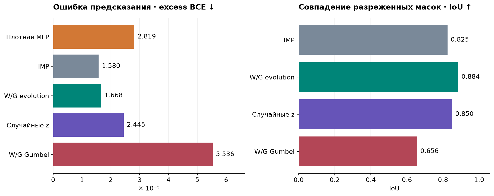
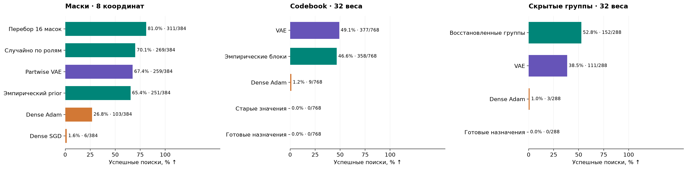
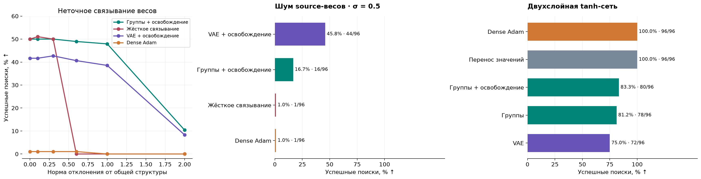

# Как перенос структуры помогает обучать новые задачи

Итоговый отчёт · 26 октября 2026

**Мы показали, что между родственными задачами можно переносить структуру
решения и заново обучать численные веса.** На синтетических задачах это заметно
повышает вероятность успешного обучения при фиксированном онлайн-бюджете.
Выигрыш зависит от устройства задачи: простой генератор структур часто
сопоставим с VAE, а в двухслойном tanh-контроле лучший результат даёт Adam.

## Что мы решали и как

Мы исследовали, можно ли извлечь полезное индуктивное смещение из решений
предыдущих задач. Сначала переносили **маски связей**: какие веса сети разрешено
обучать. Затем перешли к **связыванию весов**: какие координаты должны иметь
общее значение. Это позволяет ограничить число свободных параметров даже
у плотной сети. Последние опыты проверяли восстановление неизвестных групп,
шум источников и приблизительное совпадение структуры.

Общая схема: собрать банк исходных решений, построить генератор структур,
предложить кандидатов, обучить для каждого свежие веса и выбрать по ошибке
на отдельной выборке. Выбранную структуру обучали повторно; при неточном
связывании затем разрешали независимо менять все веса. Сравнивали VAE,
эмпирические генераторы, случайный поиск, перебор, готовые исходные решения
и настроенные плотные SGD/Adam.

## От восстановления масок к переносу новых сочетаний

В ранних опытах учителем была ReLU-сеть 48→8→1: 32 полезных входа,
16 шумовых и 32 разрешённые связи из 384. Генератор обучался на картах весов
и градиентов (W/G). Проверяли новые функции с известными масками и новые
сочетания знакомых частей. IMP — контроль, который обучает плотную сеть
и последовательно удаляет малые веса.

На новых функциях известных структур W/G evolution восстановил маску
в 65/72 поисков, но случайный поиск латентного кода дал меньшую среднюю
ошибку. На 24 отложенных сочетаниях evolution достиг **IoU 0,884 против
0,825 у IMP**. При этом excess BCE оказался немного хуже: **0,001668
против 0,001580**; у плотной MLP — 0,002819. Более точная структура
не гарантировала лучшего предсказания. Gumbel-поиск уступил обоим подходам.

*Средние по 24 test-сочетаниям. Excess BCE — ошибка сверх ошибки учителя;
IoU — доля совпавших связей в объединении масок. Метрики показывают разные
стороны результата. Полная стоимость предварительного обучения не уравнена.*

## Где структурный поиск дал выигрыш

Чтобы отделить механизм от качества восстановления сложной сети, мы провели
контролируемые опыты с синусоидальными учителями. В mask-опыте выбираются
полезные связи, в codebook-опыте — назначения двух общих значений весам.
Исходные и целевые задачи различаются численными параметрами; для codebook
цели также используют новые сочетания частей и более высокие частоты.

*Успех — аналитический population MSE < 0,1. В каждой панели одинаковый
онлайн-бюджет: 64 обучения по 1024 шага, batch 64; у генераторов обычно
32 пробных обучения и 32 свежих обучения выбранной структуры.
Панели относятся к разным задачам и не образуют общей выборки.*

На масках VAE дал **67,4% успеха против 26,8% у Adam**, но перебор всего
16 допустимых масок оказался сильнее — 81,0%. Три новых source-банка
подтвердили направление эффекта: VAE 64,3%, эмпирический генератор 66,7%,
Adam 36,2%.

При 32 codebook-весах VAE достиг **49,1%**, эмпирические блоки — 46,6%,
Adam — 1,2%. Даже с правильными назначениями перенос старых значений дал
0/768 успехов, а обучение свежих значений — 768/768. Этот контроль
отделяет пользу схемы связывания от переноса численного решения.
Когда границы групп скрыли, восстановленные по source-решениям группы
дали **52,8%**, VAE — 38,5%, Adam — 1,0%.

## Когда метод перестаёт помогать

*В каждом условии — 96 поисков на метод по трём source-банкам.
«Освобождение» — 768 шагов со связанными весами и 256 плотных шагов.
Слева и в центре успех означает population MSE < 0,1; справа — normalized
MSE < 0,01 на независимой выборке из 16 384 примеров.*

При норме отклонения от точного связывания, равной 1, жёсткое ограничение
дало 0/96 успехов; освобождение весов после структурного старта —
**46/96 (47,9%)**. При сильном шуме source-весов VAE с освобождением оказался
устойчивее использованного извлекателя групп: **45,8% против 16,7%**.
Однако в реализуемой двухслойной tanh-сети Adam и перенос численных весов
достигли **96/96**, VAE — 72/96. При увеличении codebook до 48 весов
успех VAE упал до 12,8%: фиксированное число предложений хуже покрывает
растущее пространство комбинаций.

## Чего мы добились

Мы получили рабочую схему поиска обучаемых подпространств и теоретически
разделили три условия её успеха: покрытие полезных структур, обучаемость
внутри них и надёжность выбора кандидата. Для Gaussian sine-модели доказали
достаточные условия конечнобюджетного выигрыша; отдельно разобрали
идентифицируемость скрытых групп и ошибку приблизительного связывания.
Теоремы зависят от своих предположений и не доказывают провал любого
SGD или Adam.

**Основной вклад — обоснованный и проверенный механизм переноса структуры.**
Универсальное превосходство VAE и преимущество по полной стоимости
вычислений не установлены: банк решений и генератор требуют отдельного
обучения. Результаты синтетические; повторы на общих задачах и трёх банках
не равны большой независимой выборке задач. Новая перестановка целевых
координат также разрушает наблюдаемый перенос.

Работа оформлена в [английский драфт на 37 страниц](paper_vae_solver/main.pdf)
с доказательствами, контролями и результатами. Исследования приостановлены;
текущий этап — авторское чтение и правки.

Источники: [ReLU и композиция](archive/history/reports/FINAL_REPORT_2026-10-20.md),
[маски](paper_vae_solver/results/RESULTS.md),
[codebook](paper_vae_solver/results/CODEBOOK_RESULTS.md),
[скрытые группы](paper_vae_solver/results/HIDDEN_STRUCTURE_RESULTS.md),
[робастность и tanh](paper_vae_solver/results/ROBUSTNESS_TWOLAYER_RESULTS.md).
Графики построены из сохранённых JSON; [данные](report_assets/chart_data.csv),
[источники с SHA-256](report_assets/sources.json) и
[скрипт построения](report_assets/build_figures.py) включены в репозиторий.
Команда: `python report_assets/build_figures.py` (NumPy и Matplotlib).
