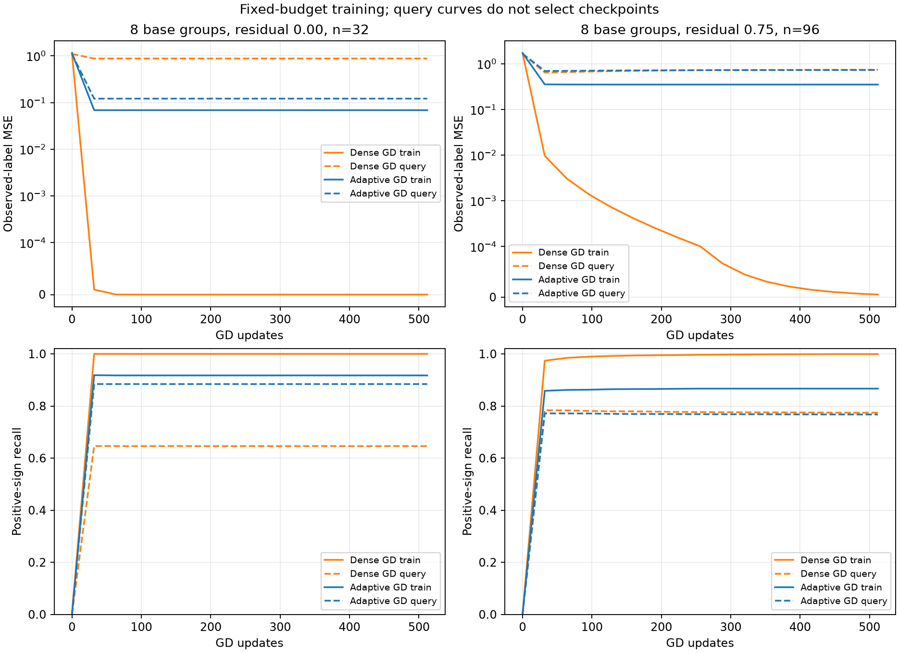
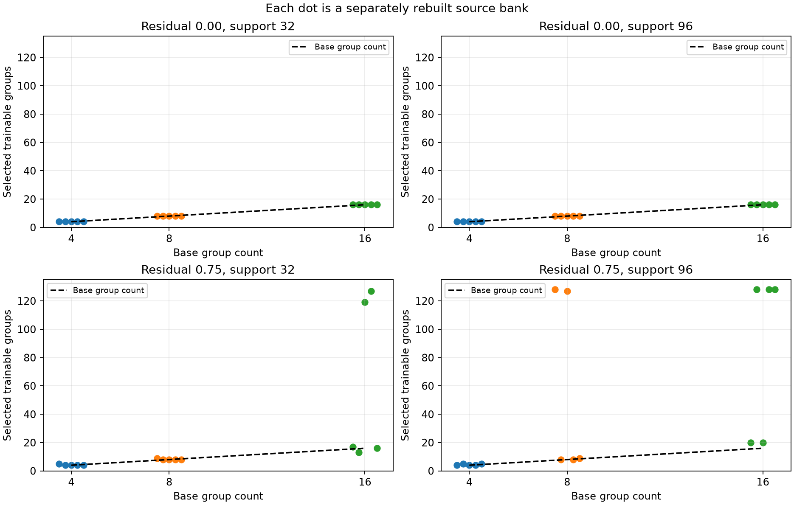
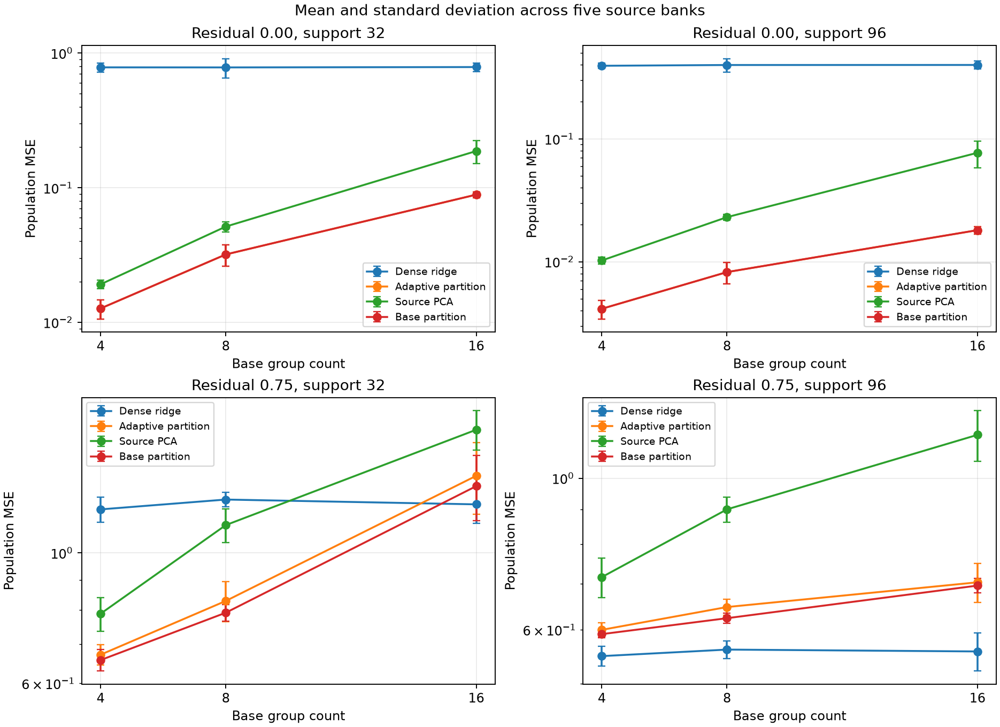
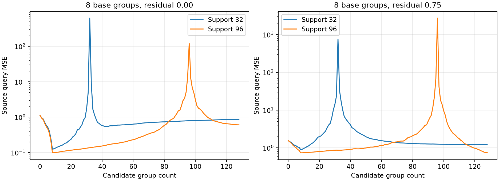

# Проверка автоматического выбора кодбука на GPU

> Архивировано 3 ноября 2026. Ветка выбора и изменения групп; в текущей постановке paper индексатор фиксирован в каждой численной попытке.
> [Рабочие материалы статьи](../../../mds/README.md) · [Навигация по архиву](../README.md).

2 ноября 2026. **Из плотных исходных решений удалось восстановить разбиение весов и автоматически выбрать 4, 8 или 16 общих коэффициентов.** При точных равенствах восстановлены и число групп, и само разбиение во всех 30 сочетаниях банка и объёма данных. При сильном нарушении равенств полезность hard tying зависит от объёма выборки; на более крупной выборке обычный ridge оказался лучше.

Это контролируемый опыт с линейной регрессией. Он проверяет статистический механизм из [теоретического отчёта](../../../mds/theory/STRUCTURAL_ADVANTAGE_THEORY_2026-11-02.md) и первый вариант [адаптивных индексаторов](ADAPTIVE_INDEXATOR_DESIGN_2026-11-02.md).

## Задача и аналитическое решение

Вход содержит 128 независимых стандартных Gaussian признаков. Базовый индексатор выключает 32 связи, а остальные 96 делит на четыре, восемь или 16 групп одинакового размера. Перед генерацией задач позиции случайно переставляются. Алгоритм извлечения не получает ни число групп, ни число нулевых связей, ни перестановку.

Нормированный базис разбиения и целевая функция задаются так:

$$
\begin{aligned}
V&=U(U^\top U)^{-1/2},\\
a_\tau&\sim\mathcal N(0,I_{K_*}/K_*),\\
w_\tau&=Va_\tau+r_\tau,\qquad V^\top r_\tau=0,\\
y&=x^\top w_\tau+\epsilon,\qquad
x\sim\mathcal N(0,I_{128}),\quad \epsilon\sim\mathcal N(0,0.09).
\end{aligned}
$$

В первом режиме остаток равен нулю: равенства между весами точны. Во втором его норма равна 0,75, а направление независимо меняется между задачами. При ненулевом остатке часть базовых нулевых связей также может стать ненулевой; базовый индексатор в этом режиме обозначает общую часть функции.

Аналитическая функция предсказания — линейная форма с полным истинным вектором весов. Основная метрика измеряет ошибку относительно этой чистой функции:

$$
R(\widehat w)=\mathbb E_x[(x^\top\widehat w-x^\top w_\tau)^2]
=\|\widehat w-w_\tau\|^2.
$$

Она вычисляется точно, без Monte Carlo ошибки тестовой выборки. MSE относительно наблюдаемых шумных ответов в среднем больше на 0,09. Train/query-кривые показывают именно observed-label MSE.

Для примера, при восьми группах каждая из них содержит 12 связей. Их коэффициенты на одной задаче могут быть положительными или отрицательными; на другой задаче все восемь чисел новые. Расположение общих групп сохраняется.

## Получение исходных решений и выбор сложности

Для каждого сочетания числа групп и нормы остатка построены пять независимых банков. В каждом банке 24 исходные задачи по 512 примеров. Их полные плотные решения least squares получены на GPU и образуют профили 128 позиций по 24 задачам.

Из этих профилей строится иерархия Ward. В начале каждая связь имеет собственный коэффициент. На каждом шаге выполняется самое дешёвое объединение двух групп или присоединение группы к фиксированному нулю. Получаются 129 кандидатов: от 128 обучаемых групп до нулевой модели.

Восемь отдельных исходных задач выбирают число групп по средней query MSE после нового обучения коэффициентов. Выбор производится отдельно для 32 и 96 support-примеров. На каждую калибровочную задачу приходится 512 query-примеров. Эти же задачи выбирают силу ridge и ранг PCA.

Все решения сохраняются в файле `*_frozen.json` **до генерации целевых задач**. Затем создаются 16 новых целевых задач банка: до 96 support-примеров, 512 query-примеров для кривых и 1024 test-примера. Target query не выбирает структуру, настройки или checkpoint в этом опыте. Число шагов GD фиксировано заранее.

Всего выполнено 30 банков: три размера базового кодбука, два режима остатка и пять повторов. Внутри каждого банка два размера support и восемь методов оцениваются на одних и тех же 16 задачах. Получено 7680 строк метрик. При оценке разброса независимыми единицами считаются банки, а не все повторные fits.

## Сравниваемые методы

| Метод | Какие данные и ограничения использует |
| --- | --- |
| Dense min-norm | Плотное решение минимальной нормы на целевом support; предел сходящегося GD из нуля |
| Dense ridge | Плотная регрессия с L2-штрафом; коэффициент выбран на исходной калибровке |
| Adaptive partition | Иерархия из source-решений; K выбран на исходной калибровке; новые целевые числа |
| Base partition | Заданный базовый индексатор; при нулевом остатке это правильная структура |
| Source PCA | Подпространство по тем же 24 плотным source-решениям; ранг выбран на исходной калибровке |
| Random partition | Случайная перестановка выбранного индексатора с сохранением размеров групп и числа нулей |
| Dense GD | 512 полных градиентных шагов из нуля; устойчивый шаг по спектру support-матрицы |
| Adaptive GD | Те же 512 шагов в нормированном базисе выбранной структуры; также из нуля |

Аналитические решатели дают ориентир достижимого результата соответствующего класса. Для GD сохранены все запланированные точки кривых. Успех дополнительно определён как population MSE не выше 0,20; основное сравнение использует саму MSE.

## Результаты на семействе с восемью базовыми группами

В таблице средние по пяти банкам и стандартные отклонения между средними банков. В каждом столбце 80 целевых задач. Числа округлены до двух знаков; CSV сохраняют полную точность.

| Метод | Точные равенства, 32 примера | Точные равенства, 96 примеров | Остаток 0,75, 32 примера | Остаток 0,75, 96 примеров |
| --- | ---: | ---: | ---: | ---: |
| Dense min-norm | 0.78 ± 0.13 | 0.53 ± 0.04 | 1.24 ± 0.03 | 0.66 ± 0.02 |
| Dense ridge | 0.78 ± 0.13 | 0.40 ± 0.05 | 1.23 ± 0.03 | **0.56 ± 0.02** |
| Adaptive partition | **0.03 ± 0.01** | **0.01 ± 0.00** | 0.83 ± 0.07 | 0.65 ± 0.02 |
| Base partition | 0.03 ± 0.01 | 0.01 ± 0.00 | 0.79 ± 0.03 | 0.62 ± 0.01 |
| Source PCA | 0.05 ± 0.00 | 0.02 ± 0.00 | 1.12 ± 0.07 | 0.90 ± 0.04 |
| Random partition | 1.22 ± 0.20 | 0.97 ± 0.17 | 2.01 ± 0.15 | 1.22 ± 0.46 |
| Dense GD | 0.78 ± 0.13 | 0.52 ± 0.04 | 1.24 ± 0.03 | 0.66 ± 0.02 |
| Adaptive GD | 0.03 ± 0.01 | 0.01 ± 0.00 | 0.83 ± 0.07 | 0.65 ± 0.02 |

На левой части рисунка плотный GD почти обнуляет train MSE, но query MSE остаётся большой. Это соответствует механизму неидентифицируемости по малой выборке, а не отсутствию прогресса по обучающей цели. Извлечённая структура оставляет train-ошибку, связанную с шумом, и лучше восстанавливает функцию на новых входах.

Дополнительный test recall положительного знака чистой цели при точных равенствах и 32 примерах составляет 94,52% у адаптивной структуры, 93,06% у PCA и 65,08% у плотного GD. На графиках recall рассчитан по наблюдаемым train/query-ответам, поэтому он включает влияние шума меток и отличается от test recall чистого знака. Главная метрика остаётся регрессионной.

При остатке 0,75 и 96 примерах плотный ridge достигает MSE 0,56 против 0,65 у адаптивной структуры. Базовое подпространство уже не содержит всю целевую функцию. Более длительное обучение тех же связанных коэффициентов этого ограничения не устранит.

При 96 примерах конечный плотный GD иногда немного лучше своего предельного min-norm решения: недообучение выполняет роль слабой регуляризации. Поэтому предельное решение нельзя объявлять нижней границей ошибки всех промежуточных итераций в шумном случае.

## Восстановление числа групп и самого разбиения

При точных равенствах все пять банков выбрали правильные 4, 8 или 16 групп при обоих объёмах support. Диагностика после обучения сравнила маски и отношения равенства между всеми парами весов, независимо от названий кодов. Во всех 30 случаях восстановлено точное разбиение, включая нулевые связи.

При ненулевом остатке базовое число групп уже не обязано быть оптимальным числом свободных параметров. Например, для восьми базовых групп и 96 примеров выбраны размеры 128, 8, 127, 8 и 9. Это показывает чувствительность к источникам и к переходу между сильным и слабым ограничением. На таком семействе результат не следует описывать как восстановление «истинного K».

В верхнем ряду кривые adaptive и base partition совпадают: найдено то же разбиение. PCA также получает сильный выигрыш относительно плотного обучения. Разница с адаптивной группировкой здесь может объясняться тем, что дискретные равенства позволяют точнее восстановить подпространство из конечного шумного банка. Это результат данного семейства; преимущество над произвольным оптимальным способом обучения подпространства не доказано.

## Почему одного жадного пути недостаточно в общем случае

Иерархия содержит только одну структуру каждого размера. Она не перебирает все разбиения и может рано выполнить неверное объединение, которое уже не исправляется последующими шагами. Качество вдоль пути также не монотонно:

Окрестность числа параметров, равного числу support-примеров, особенно чувствительна к шуму. Выбор между маленьким K и почти полной матрицей может перескакивать через эту область. Это аргумент в пользу нескольких иерархий, обратимых split/merge-операций и регуляризованного остатка. Эти расширения не включены в данный запуск.

## Стоимость и воспроизводимость

Все решения least squares, ridge, GD, PCA и сама кластеризация вычислены на Tesla V100 №7 в float64; CPU использовался для сохранения файлов, агрегации и построения графиков. PyTorch — 2.6.0+cu118. Суммарное измеренное время этапов составило 8,72 с для source-fit, 4,54 с для построения иерархий и PCA, 146,61 с для калибровки кандидатов и 31,30 с для всех целевых методов. Это время данного запуска, включая служебные операции, а не оценка только CUDA kernels.

На один банк приходится 12 288 исходных размеченных примеров и 4864 примера для калибровки с учётом максимального support и query. Эти данные — дополнительный источник информации по сравнению с target-only dense GD. Пилот не показывает, что полный сбор банка дешевле прямого решения одной задачи. Амортизация имеет смысл при повторном использовании структур на многих задачах.

Основные артефакты:

- [Зафиксированный протокол](../../../experiments/adaptive_indexators_v1/protocol.json) и [реализация](../../../experiments/adaptive_indexators_v1/run.py).
- [Все метрики](../../../experiments/adaptive_indexators_v1/results/metrics.csv), [средние по банкам](../../../experiments/adaptive_indexators_v1/results/bank_summary.csv) и [сводка](../../../experiments/adaptive_indexators_v1/results/summary.csv).
- [Выбор сложности](../../../experiments/adaptive_indexators_v1/results/selection.json) и [диагностика разбиений](../../../experiments/adaptive_indexators_v1/results/recovery.csv).
- [Кривые](../../../experiments/adaptive_indexators_v1/results/curves.json), [время этапов](../../../experiments/adaptive_indexators_v1/results/timings.json), [среда и хеши](../../../experiments/adaptive_indexators_v1/results/environment.json).

Исходные веса, выбранные индексаторы, целевые коэффициенты и модели сохранены в NPZ рядом с метриками. Тесты не создавались и не запускались; выполнен сам исследовательский эксперимент.

## Что можно перенести в следующий нейросетевой опыт

Выбор количества общих коэффициентов можно отделить от знания истинных групп и выполнять по переносу на исходные задачи. Точная группировка на этом семействе обеспечивает преимущество при малой выборке, которое не исчезает от увеличения числа шагов обычного плотного GD до его предела. Случайная группировка того же размера этого преимущества не даёт.

Следующий нелинейный вариант должен допускать исправление неверных объединений и ослабление приблизительных равенств. Сравнение с PCA, сильной регуляризацией и proximal WSR остаётся существенным. Сама линейная проверка не подтверждает качество генерации новых сложных индексаторов, необходимость авторегрессии или преимущество на реальных изображениях.
