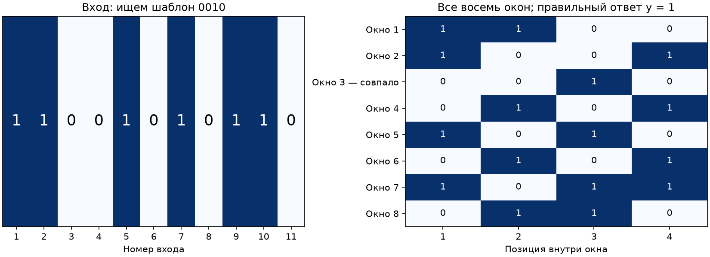
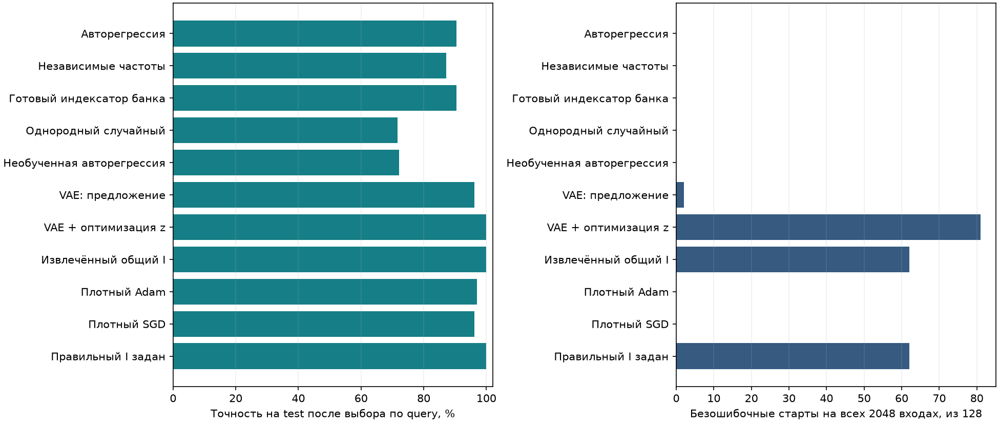
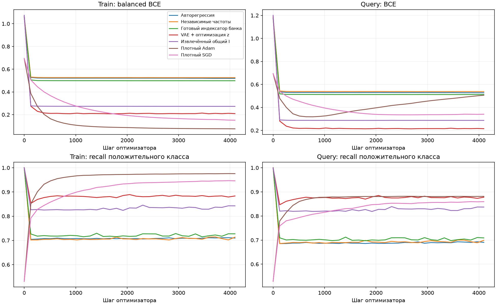
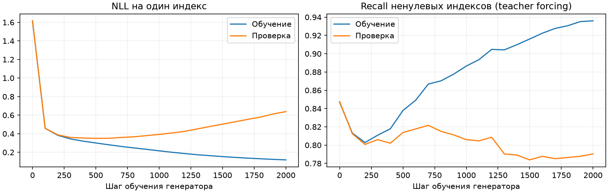
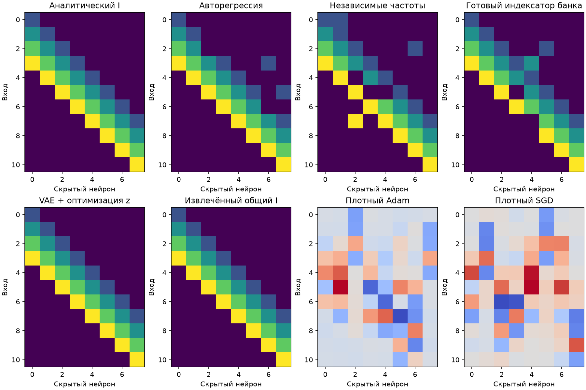

# Pattern: проверка авторегрессионного генератора индексаторов

> Архивировано 3 ноября 2026. Предыдущий экспериментальный этап; его результаты и ограничения сохранены для справки.
> [Рабочие материалы статьи](../../../mds/README.md) · [Навигация по архиву](../README.md).

1 ноября 2026 года. Продолжение [опыта с кодбуком](PATTERN_CODEBOOK_2026-10-28.md).

**Отладочное продолжение:** [выбор температуры по исходным задачам](PATTERN_AUTOREGRESSIVE_DEBUG_2026-11-01.md) устранил сбой генерации: AR и частотный метод получили безошибочные выбранные модели на всех четырёх шаблонах. Ниже сохранён первоначальный опыт при T = 1.

**Авторегрессионный генератор обучен и проверен. Он предлагает более полезные структуры, чем независимые частоты, но в этом опыте уступает плотному Adam и не получает безошибочных решений.** Перенос общего индексатора и прежний VAE с оптимизацией скрытого кода решают все четыре отложенные задачи. Ниже отдельно показаны первоначальный запуск и повтор после проверки качества исходных индексаторов.

## Задача и точное решение

На входе 11 бит. Нужно определить, встречается ли заданный четырёхбитовый шаблон хотя бы в одном из восьми окон. Все 2048 входов равновероятны. Обозначим шаблон через p, а входные биты представим числами −1 и +1:

$$
\begin{aligned}
x&\in\{-1,+1\}^{11},\qquad p\in\{0,1\}^{4},\\
y_p(x)&=\mathbf 1\!\left\{\exists h\in\{1,\ldots,8\}:\ x_{h+s-1}=2p_s-1\ \text{для всех }s=1,\ldots,4\right\}.
\end{aligned}
$$

Ученик — сеть 11 → 8 ReLU → 1. Её первый слой содержит 88 возможных весов. Индексатор выбирает для каждой связи одно из четырёх чисел кодбука или фиксированный ноль:

$$
\begin{aligned}
W_{ih}&=C_{I_{ih}},\qquad I_{ih}\in\{0,1,2,3,4\},\qquad C_0=0,\\
g(x)&=a\sum_{h=1}^{8}\operatorname{ReLU}\!\left(\sum_{i=1}^{11}W_{ih}x_i+b\right)+o.
\end{aligned}
$$

Для фиксированного индексатора обучаются семь чисел: четыре значения C, общий скрытый сдвиг b, выходной множитель a и выходной сдвиг o. Ответ положителен, если g ≥ 0.

Точный индексатор связывает нейрон h с четырьмя входами его окна, повторяя один кодбук во всех окнах:

$$
\begin{aligned}
I^*_{ih}&=\begin{cases}i-h+1,&h\leq i\leq h+3,\\0,&\text{иначе},\end{cases}\\
C_s&=2p_s-1,\qquad b=-3,\qquad a=2A,\qquad o=-A,\qquad A>0.
\end{aligned}
$$

При полном совпадении окна сумма четырёх произведений равна 4, а выход ReLU равен 1. При хотя бы одном несовпадении сумма не больше 2 и ReLU равен нулю. Поэтому g положителен ровно при наличии шаблона: ошибка классификации равна нулю. Это представление точного решения, а не гарантия его нахождения оптимизатором. При увеличении A бинарная кросс-энтропия стремится к нулю.

Например, шаблон `0010` встречается во входе `11001010110` в третьем окне.

## Как строили генератор

Использовали прежний банк: 1536 достаточно хороших исходных сетей для 12 шаблонов. Он получен обучением плотных сетей и постепенным удалением слабых связей, а не сэмплированием фиксированных случайных индексаторов. Столбцы выровнены по исходным тренировочным маскам. Общие коды извлечены из изменения весов между исходными задачами; истинный индексатор не служит обучающей меткой.

Унаследованное извлечение использовало четыре связи на столбец и четыре группы по восемь. Следовательно, подготовка этого банка содержит известные ограничения задачи. После неё у каждой позиции уже есть предполагаемый ненулевой код; генератор главным образом учится совместному наличию связей. Этот опыт не проверяет самостоятельное открытие произвольных групп повторений.

Основной генератор — MADE: два скрытых слоя по 256 нейронов. Он последовательно выбирает 88 индексов, учитывая предыдущие:

$$
\begin{aligned}
p_\theta(I)&=\prod_{t=1}^{88}p_\theta(I_t\mid I_1,\ldots,I_{t-1}),\\
\mathcal L(\theta)&=-\frac1N\sum_{n=1}^{N}\log p_\theta(I^{(n)}).
\end{aligned}
$$

Обучение — 2000 шагов Adam. Состояние выбирается по вероятности отложенных исходных индексаторов. Генератору не задаются окна, top-32 или ёмкости групп. После обучения его параметры заморожены: каждый предложенный индексатор получает новый кодбук. В основной авторегрессии скрытый код на целевой задаче не оптимизируется.

**Качество нужно проверять после перехода к кодбуку.** В первом запуске использовали банк, отобранный по исходным сетям со свободными весами. Дополнительная проверка всех 1536 индексаторов — четыре старта кодбука по 2048 шагов — дала среднюю исходную query-точность 81,10% против 94,83% до сжатия. Безошибочным на полном домене оказался только один из 1536 индексаторов. Это результат конечного обучения кодбука, не доказательство невозможности лучших численных решений.

Поэтому во втором запуске оставили индексаторы с balanced BCE < 0,3 на проверочных данных их исходных задач. Получилось 187 тренировочных, 24 проверочных и 26 отложенных структур; в тренировочной части остались все 12 шаблонов. Средняя исходная query-точность отобранных кодбуков — 89,75%. Порог не подбирался по целевым результатам. Второй запуск является этапом разработки: первый результат к этому моменту уже был просмотрен.

## Сравнения и условия

Независимый частотный генератор выбирает код каждой позиции по её частотам в том же банке. Перенос готовой структуры берёт целый исходный индексатор. Однородный случайный контроль использует общий состав кодов банка, без привязки к позиции. Необученная авторегрессия показывает результат без обучения генератора.

Прежний VAE либо предлагает фиксированный индексатор, либо дополнительно оптимизирует 16 переменных z при замороженном декодере. Он использует top-32 и не переобучается после отбора банка во втором запуске. Поэтому это сравнение готовых методов с разными ограничениями, а VAE+z дополнительно выполняет адаптивный поиск структуры. Извлечённый общий индексатор и заданный правильный индексатор — отдельные контроли. Плотные Adam и SGD обучают 105 свободных численных параметров.

Проверяются четыре прежних отложенных шаблона: `0010`, `0100`, `1011`, `1101`. Для этого опыта заново разделили входы: 768 для обучения, 256 для выбора и 512 для test; остальные не используются при решении. Это повтор на известном benchmark, а не новые невиденные задачи.

У всех методов 32 старта и 4096 шагов на шаблон. Численные настройки взяты из подбора на исходных задачах: Adam для кодбука 0,1, плотный Adam 0,01, SGD 0,3. Состояния и старты выбираются только по query BCE. Совпадает число обновлений и предъявлений; вычислительные затраты, число переменных и стоимость подготовки генераторов различны. 128 стартов относятся к четырём задачам, а не к 128 независимым задачам.

## Результаты

Точность в таблице усредняется по четырём моделям, выбранным по query. Безошибочный старт проверяется на всех 2048 входах, включая обучающие; независимый test указан отдельно.

| Метод | Test, исходный банк | Test, отобранный банк | Безошибочные старты после отбора |
| :-- | --: | --: | --: |
| Авторегрессия | 87,60% | 90,38% | 0/128 |
| Независимые частоты | 84,33% | 87,16% | 0/128 |
| Готовая структура банка | 87,45% | 90,48% | 0/128 |
| Однородный случайный контроль | 70,65% | 71,63% | 0/128 |
| Необученная авторегрессия | 71,24% | 72,17% | 0/128 |
| VAE: фиксированное предложение | 96,14% | 96,14% | 2/128 |
| VAE + оптимизация z | 100,00% | 100,00% | 81/128 |
| Извлечённый общий индексатор | 100,00% | 100,00% | 62/128 |
| Плотный Adam | 96,97% | 96,97% | 0/128 |
| Плотный SGD | 96,09% | 96,09% | 0/128 |
| Правильный индексатор задан | 100,00% | 100,00% | 62/128 |

У VAE+z и двух контролей с общим индексатором выбранные модели безошибочны на всех 2048 входах каждой из четырёх задач. Для этих методов и плотных оптимизаторов исходные предложения, инициализации и данные между запусками совпадают; повторное выполнение воспроизвело их результаты.

Кривые показывают среднее всех 128 стартов, а таблица — выбранные по query модели. Поэтому средний loss даже у правильного индексатора не стремится к нулю: часть численных стартов не сходится к точному решению. Train BCE сбалансирована по классам, query BCE обычная.

## Что выучило распределение

На исходных отложенных сетях первого запуска NLL на один индекс у авторегрессии равна 0,35 против 0,40 у независимых частот. После отбора меньшего банка — 0,37 против 0,36. Преимущество по моделированию банка оказалось неустойчивым; меньший банк не улучшил оценку его распределения.

Отдельно замороженные генераторы предложили по 8192 структуры. Кодбуки для этой большой выборки не обучались: это диагностика структур, а не 8192 решённых задач.

| Генератор после отбора | Точный эталонный индексатор | Средний F1 связей | Средний F1 повторений |
| :-- | --: | --: | --: |
| Авторегрессия | 2/8192 | 0,82 | 0,53 |
| Независимые частоты | 0/8192 | 0,82 | 0,55 |
| Готовая структура банка | 0/8192 | 0,82 | 0,57 |
| Однородный случайный | 0/8192 | 0,58 | 0,08 |
| VAE: предложение | 124/8192 | 0,90 | 0,80 |

Номера кодов и скрытые нейроны согласуются с эталоном только при диагностике. F1 повторений оценивает пары связей с одним кодом, включая ошибочные объединения и пропущенные повторения. В тренировочном банке после отбора 187 уникальных структур, точного эталонного индексатора среди них нет. Авторегрессия дала 8187 уникальных предложений и ни одной точной копии тренировочного индексатора. Получение двух эталонных структур показывает возможность выхода за банк, но их частота слишком мала для надёжного поиска с 32 предложениями.

При массе полезных структур q вероятность хотя бы одного попадания за B независимых предложений равна:

$$
P(\text{хотя бы одно попадание})=1-(1-q)^B.
$$

Два точных совпадения из 8192 — около 0,02%. Если использовать эту грубую оценку для массы именно эталонных индексаторов, шанс предложить один за 32 попытки меньше 1%. Это не оценка массы всех полезных структур и не гарантия обучения кодбука. Нулевые наблюдаемые частоты у других контролей не означают нулевой математической вероятности.

У плотных методов показаны численные веса, у остальных — индексы. Для одного шаблона возможны другие точные представления, в том числе из-за совпадающих значений C; буквальное восстановление данного эталона — более сильное требование, чем правильная функция.

**Итог:** совместное распределение научились моделировать и иногда получать из него правильную структуру, которой не было в банке. Однако выбранный рецепт с обычным maximum likelihood пока не даёт достаточно высокой частоты полезных предложений. Отбор по качеству именно кодбука улучшил решение, но превосходства авторегрессии над готовой структурой банка или плотным Adam не показал. Положительный результат переноса общего индексатора и VAE+z воспроизведён. У Pattern индексатор общий для всех шаблонов, поэтому этот опыт не доказывает генерацию новых сложных комбинаций.

## Материалы

[Код и команды](../../../pattern/autoregressive/README.md), [итоговая сводка](../../../mds/assets/2026-11-01/autoregressive_20261101_v2/summary.json), [таблица CSV](../../../mds/assets/2026-11-01/autoregressive_20261101_v2/comparison.csv), [первоначальный запуск](../../../mds/assets/2026-11-01/autoregressive_20261101_v1/summary.json).

Полные запуски — `pattern/runs/autoregressive_20261101_v1/` и `v2/`: замороженные протоколы, снимки кода, SHA-256 исходных артефактов, предложения, генераторы, численные веса и кодбуки, z, состояния, кривые, проверка исходных кодбуков и структурное покрытие. Выполнены эксперименты, проверка стиля и просмотр рисунков; тесты не создавались и не запускались.
