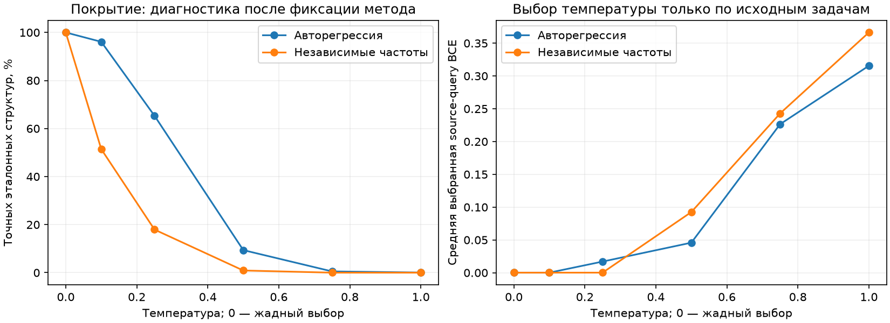
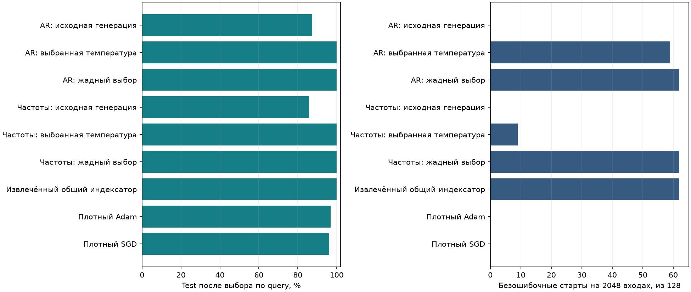
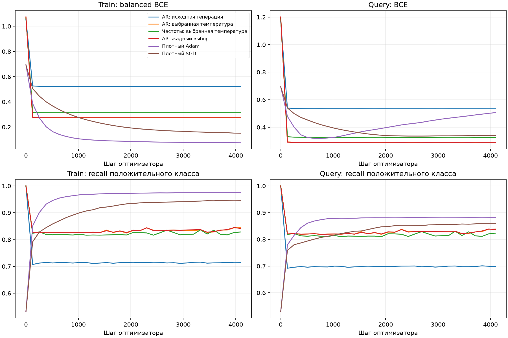
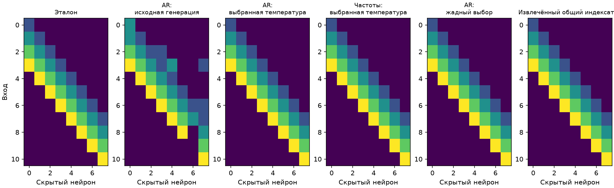

# Pattern: отладка генерации индексаторов

> Архивировано 3 ноября 2026. Предыдущий экспериментальный этап; его результаты и ограничения сохранены для справки.
> [Рабочие материалы статьи](../../../mds/README.md) · [Навигация по архиву](../README.md).

1 ноября 2026 года. Продолжение [первой проверки авторегрессии](PATTERN_AUTOREGRESSIVE_2026-11-01.md).

**Подтверждённая причина неудачи — слишком случайная генерация целого индексатора.** Замороженная модель уже восстанавливает общий индексатор при жадном выборе каждого следующего индекса. После выбора температуры только на исходных задачах авторегрессия решила все четыре целевых шаблона без ошибок. Простой частотный метод после той же калибровки тоже решил их; отдельное преимущество авторегрессии над этим контролем не установлено.

## Что проверяли

Задача прежняя: по 11 битам определить наличие четырёхбитового шаблона. У сети 11 → 8 ReLU → 1 индексатор содержит 88 значений от 0 до 4. Код 0 выключает связь, остальные выбирают четыре общих числа. Для каждой предложенной структуры заново обучаются четыре значения кодбука и три общих численных параметра. [Постановка и точное решение](PATTERN_AUTOREGRESSIVE_2026-11-01.md#задача-и-точное-решение) сохранены в основном отчёте.

Использовали замороженную MADE и частоты из второго предыдущего запуска. Банк и веса генератора не переобучались. У банка остаются ранее раскрытые ограничения подготовки: четыре связи на скрытый нейрон и четыре группы по восемь. Новый этап не добавляет в генерацию геометрию окон, top-32 или правильные индексы.

Сначала сравнили жадно сгенерированный индексатор с общим индексатором, ранее извлечённым из исходных решений. Они совпали и у MADE, и у покоординатного максимума частот. Однако вероятность одной канонической записи этого индексатора при прежнем AR-сэмплировании составляла лишь около **0,01%**. Высокой вероятности отдельного индекса недостаточно: для правильного целого нужны согласованные решения на всех 88 позициях.

## Что изменили

Добавили температуру T. Модель выдаёт оценки следующего кода; перед случайным выбором делим их на T:

$$
q_{\theta,T}(I)=\prod_{t=1}^{88}\operatorname{softmax}\!\left(\frac{\ell_\theta(I_{<t})}{T}\right)_{I_t},\qquad T>0.
$$

При T = 1 сохраняется прежнее распределение. Меньшая T усиливает предпочтение наиболее вероятного кода. Отдельный режим T = 0 означает последовательный жадный выбор. Он не является общим алгоритмом поиска глобально наиболее вероятного индексатора.

T выбирается по качеству решения исходных задач, а не по совпадению с эталонной структурой. На четырёх исходных шаблонах `0001`, `0110`, `1001`, `1110` проверили T из {1; 0,75; 0,5; 0,25; 0,1; 0}. Для каждой — восемь стартов кодбука по 2048 шагов. Сравнивали среднюю query BCE лучшего старта каждого шаблона. Среди температур в пределах 0,0001 от минимальной BCE выбирали наибольшую, сохраняя случайность, когда она не ухудшает исходное решение.

Так выбраны **T = 0,1 для AR** и **T = 0,25 для частот**. Настройки записаны до запуска целевых задач. Калибровка одинакова для двух методов; её вычислительные затраты учитываются отдельно от целевого поиска.

Правая панель — данные выбора температуры. Левая — последующая диагностика по известному эталону; она не выбирала метод или его настройки.

## Результат решения задач

На каждом из четырёх прежних отложенных шаблонов: 32 старта по 4096 шагов, 768 обучающих примеров, 256 для выбора и 512 независимых test-примеров. Состояния и старты выбираются только по query BCE. Численные настройки, разбиение и начальные численные значения совпадают между методами. Предложения T = 1 сгенерированы заново, поэтому этот столбец не обязан буквально совпадать с прежними 128 предложениями.

| Метод | Средняя выбранная test-точность | Безошибочные старты на всех 2048 входах | Полностью решённые шаблоны |
| :-- | --: | --: | --: |
| AR: прежняя генерация, T = 1 | 87,35% | 0/128 | 0/4 |
| AR: выбранная T = 0,1 | **100,00%** | **59/128** | **4/4** |
| AR: жадный выбор | 100,00% | 62/128 | 4/4 |
| Частоты: прежняя генерация, T = 1 | 85,74% | 0/128 | 0/4 |
| Частоты: выбранная T = 0,25 | 100,00% | 9/128 | 4/4 |
| Частоты: жадный выбор | 100,00% | 62/128 | 4/4 |
| Извлечённый общий индексатор | 100,00% | 62/128 | 4/4 |
| Плотный Adam | 96,97% | 0/128 | 0/4 |
| Плотный SGD | 96,09% | 0/128 | 0/4 |

Полностью решённый шаблон означает, что выбранная по query модель верно отвечает на **всех 2048 входах**, включая обучающие. Независимый test показан отдельно. Для обоих откалиброванных генераторов выбранные индексаторы также совпали с эталоном с учётом перестановок кодов и скрытых нейронов.

Кривые усреднены по всем 128 стартам. Таблица показывает модели, выбранные по query, поэтому их качество выше среднего на кривых. Даже при правильном индексаторе не все старты кодбука сходятся к точному решению: у жадных методов и извлечённого индексатора успешны 62 из 128. Train BCE сбалансирована по классам, query BCE обычная.

## Почему исправление помогло

После фиксации всех настроек сделали по 8192 предложения каждого генератора. Кодбуки для этой большой диагностической выборки не обучались.

| Генерация | Точных эталонных индексаторов | Уникальных предложений |
| :-- | --: | --: |
| AR, T = 1 | 4/8192 | 8181 |
| AR, выбранная T = 0,1 | **7873/8192 (96,11%)** | 11 |
| Частоты, T = 1 | 0/8192 | 8192 |
| Частоты, выбранная T = 0,25 | 1469/8192 (17,93%) | 619 |
| Жадный выбор каждого из двух методов | 8192/8192 | 1 |

Нулевое число наблюдаемых совпадений не означает нулевой вероятности. Наблюдаемая частота учитывает эквивалентные перестановки; приведённая выше вероятность одной канонической записи относится к более узкому событию.

Авторегрессия с выбранной температурой почти всегда предлагает общий правильный индексатор. Поэтому поиск тратит бюджет преимущественно на обучение кодбука с новыми численными стартами. При T = 1 бюджет уходил на многочисленные структуры с отдельными ошибочными индексами.

**Что показано:** извлечённая из исходных решений структура уже содержалась в замороженной модели; source-only выбор способа декодирования сделал её доступной при малом бюджете поиска. Переобучение генератора для этого не потребовалось.

**Граница результата:** у Pattern один общий правильный индексатор. Жадные частоты восстанавливают его столь же успешно. Низкая температура уменьшает разнообразие предложений — у AR осталось 11 уникальных структур из 8192. Этот опыт отлаживает перенос общего индексатора, но не доказывает обучение сложных зависимостей, разнообразной структуры или новых комбинаций. Все четыре целевые задачи ранее использовались в исследовании; это отладка, не независимое подтверждение на новом benchmark. 128 стартов относятся к четырём задачам, а не к 128 независимым задачам. Совпадение целевых шагов и предъявлений не уравнивает FLOPs и стоимость исходного сбора и калибровки.

## Материалы

[Команды запуска](../../../pattern/autoregressive/README.md#отладка-генерации-выбор-температуры-на-исходных-задачах), [численная сводка](../../../mds/assets/2026-11-01/autoregressive_debug/summary.json), [CSV](../../../mds/assets/2026-11-01/autoregressive_debug/comparison.csv). Полный запуск — `pattern/runs/autoregressive_debug_20261101_v1/`: исходная калибровка, зафиксированный выбор температуры, предложения и веса всех стартов, кодбуки, кривые, снимки кода и хеши. Истории сжаты без потери содержимого. Выполнены эксперименты, проверка стиля, ссылок и рисунков; тесты не создавались и не запускались.
