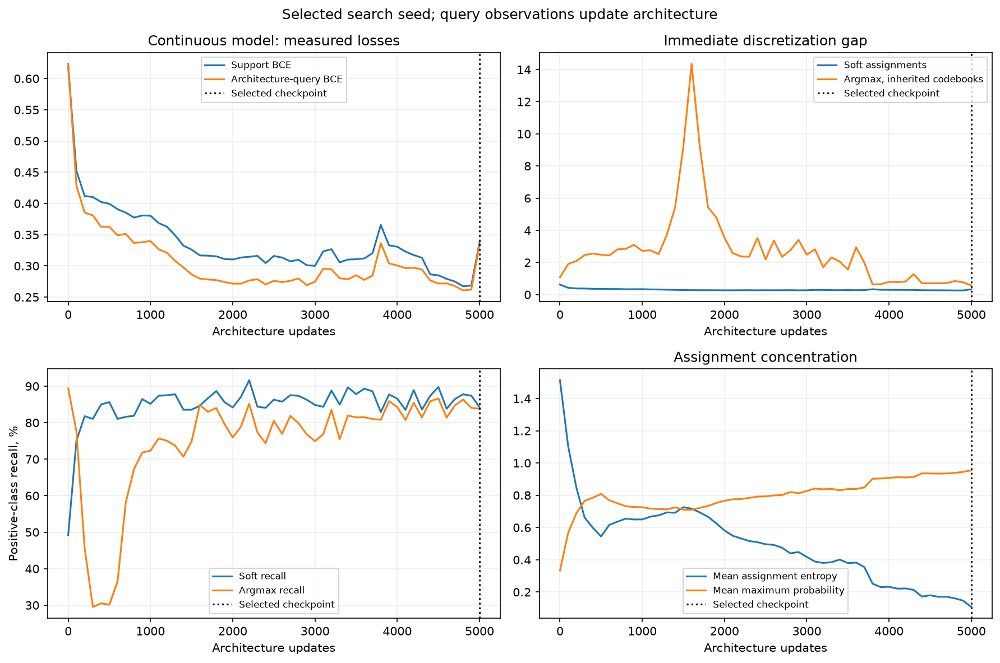
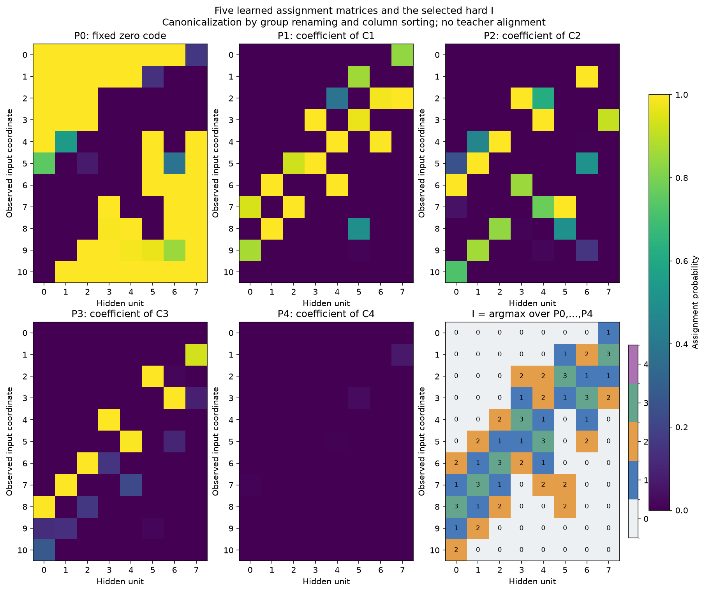
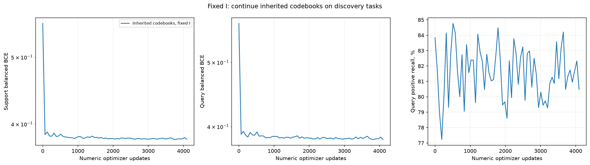
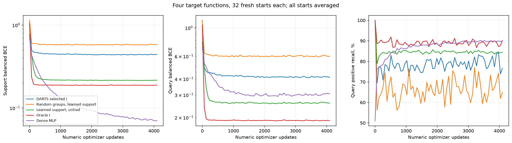
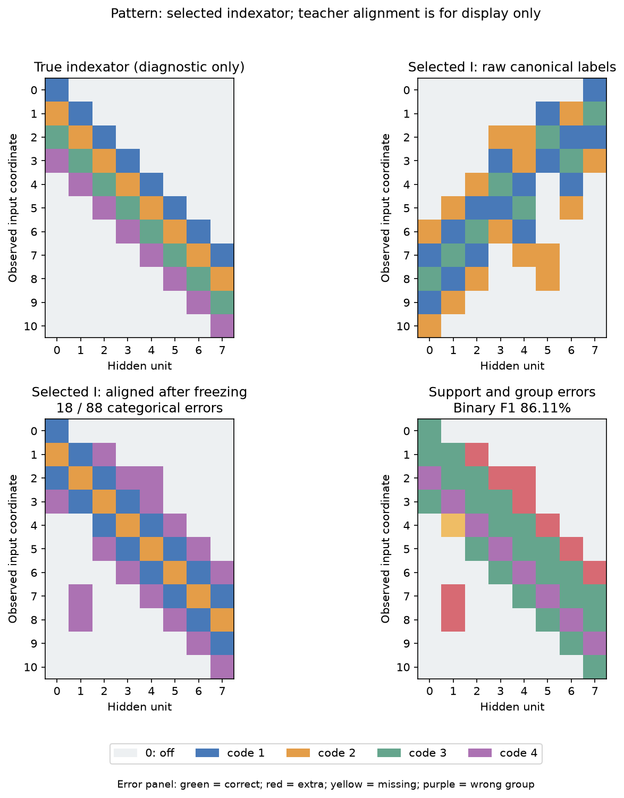
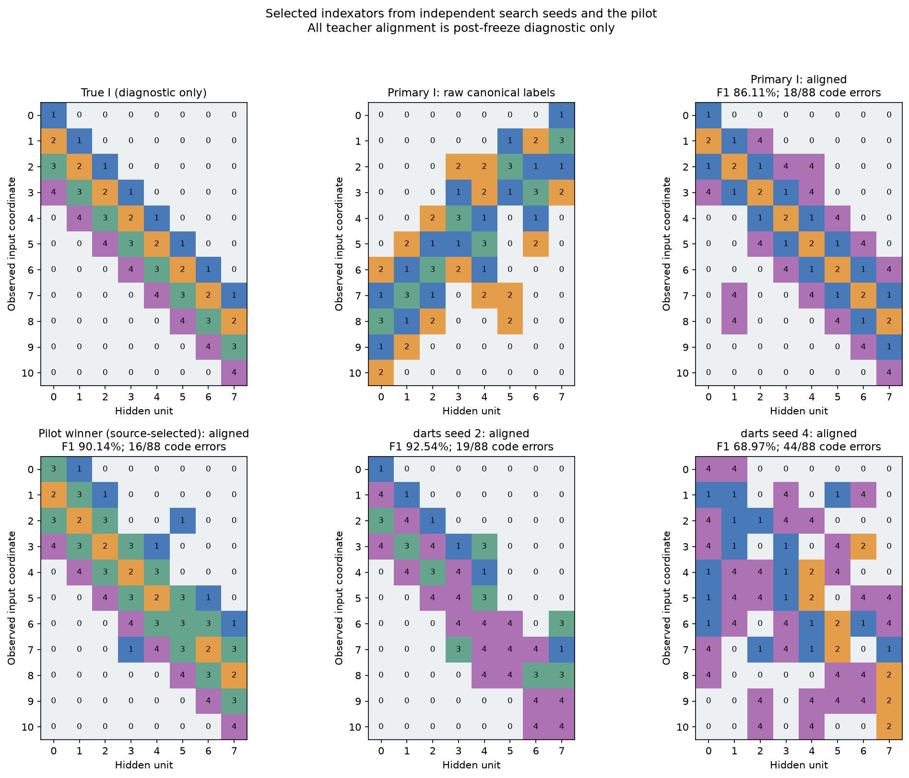

# Pattern: чередующийся DARTS-поиск индексатора и кодбуков

Схема обучения P/C и дообучения после argmax выполнена. Точный I не восстановлен: основной confirmation-selected индексатор даёт 82.84% test BA, отдельный source-selected победитель пилота — 89.42%. Для той же основной бинарной маски снятие шэринга повышает BA до 94.37%. С истинным I и заново обученным кодбуком — 100.00%. Таким образом, в этом опыте найдена часть связности, но назначения групп пока не дают качественного переноса.

Реализована согласованная схема W=sum(P_i*C_i), C_0=0: общий индексатор 11×8×5, отдельные кодбуки десяти исходных задач и четыре численных старта на задачу. Исходный Pattern 11→8 ReLU→1 сохранён. Четыре числа C, общее скрытое смещение, общий readout и offset дают 7 параметров. Геометрия окон, число активных связей и размеры групп в поиск не передавались. После argmax индексатор фиксируется; отдельно выполнены дообучение унаследованных чисел и проверка переноса с совершенно новыми кодбуками.

Основа — [DARTS, §2–3](https://arxiv.org/pdf/1806.09055). Чередуются три support-обновления чисел и одно query-обновление архитектуры. Unrolled-контроль дифференцирует через один виртуальный Adam-шаг с текущими моментами. Это приближение адаптации, не точный градиент полностью решённой внутренней задачи. Архитектура оптимизируется по данным, GT-меток индексатора нет.

## Настройка на исходных функциях

Пилот: 12 конфигураций × два search seed, 3000 outer-шагов после 512 numeric warmup. Настраивались numeric_lr .03/.1, alpha_lr .003/.01/.03, soft или annealed режим. Annealed снижает T до .1 и поздно вводит штраф энтропии .02. 72 различных жёстких I проверены на отдельных функциях 1110/1111 с шестью численными режимами и четырьмя свежими стартами на режим/функцию. Каждый старт выбирает checkpoint по query; средний BCE на третьем selection-пуле выбирает индексатор/режим. Качество мягкой модели и близость к oracle не участвуют в выборе. Лучшие конфигурации подтверждены на трёх новых search seed с first-order и unrolled обновлениями, по восемь свежих численных стартов.

| Config | Architecture update | Mean selection BCE ×1000 | Selection BA по seed, % |
| --- | --- | --- | --- |
| 5 | first | 263.16 | 87.58, 95.41, 84.72 |
| 5 | unrolled | 283.00 | 83.76, 92.68, 88.08 |
| 3 | first | 369.79 | 86.85, 77.09, 83.99 |
| 3 | unrolled | 377.32 | 85.74, 77.24, 85.48 |

Выбран config 5, order first; primary seed 3, checkpoint 5000. Числа: lr 0.1, initial C norm 0.5.

Каждая P_i имеет размер 11×8; сумма пяти каналов в каждой позиции равна единице. Канал 0 умножает фиксированный нулевой код. Рисунок показывает канонические имена групп и порядок столбцов без учителя; I на последней панели равен argmax этих же вероятностей. Матрицы, logits, temperature и соответствующие source-кодбуки сохранены в selected_probabilities.npz/json.

## Фиксируем I и дообучаем те же кодбуки

Здесь используются десять исходных задач и те же четыре численных состояния на задачу, что были у выбранного search checkpoint. Сохраняются значения C/b/readout/offset, жёсткий I не меняется. Adam moments сброшены; ещё 4096 support-шагов с исходным search numeric_lr. Query выбирает checkpoint каждого старта. Таблица усредняет все задачи и старты; это обучение тех же задач, отдельно от следующего переноса.

| Этап | Query BCE | Query BA, % | Query recall, % |
| --- | --- | --- | --- |
| Soft, selected checkpoint | 0.33 | 84.29 | 84.25 |
| Argmax, same codebooks | 0.57 | 80.22 | 83.83 |
| Fixed I, codebooks fine-tuned | 0.38 | 80.97 | 80.86 |

## Новые численные параметры на целевых функциях

Архитектура и все численные настройки заморожены до создания целевых меток. 0010/0100/1011/1101 отсутствуют в текущем discovery/selection, но исторически уже изучались: это повторная проверка на новом split/seed, не новый benchmark. На функцию 768 support, 256 query и 1024 disjoint test; каждый метод получает 32 свежих старта и 4096 Adam-шагов, query выбирает checkpoint и старт. Dense/untied численные настройки также выбраны только на source selection. Средний старт и query-selected качество разделены.

| Структура | Связи | Численных параметров | Средний test BA, % | Query-selected test BA, % | Query-selected recall, % |
| --- | --- | --- | --- | --- | --- |
| DARTS selected I | 40 | 6 | 78.04 | 82.84 | 85.14 |
| Learned support, untied | 40 | 43 | 89.05 | 94.37 | 91.78 |
| Random groups, learned support | 40 | 6 | 70.71 | 71.83 | 75.27 |
| Random positions, same group sizes | 40 | 6 | 67.72 | 68.49 | 66.26 |
| Initial random I | 67 | 7 | 69.97 | 69.55 | 72.09 |
| Dense, shared head | 88 | 91 | 99.44 | 100.00 | 100.00 |
| Dense MLP | 88 | 105 | 90.70 | 99.24 | 98.86 |
| Oracle I | 32 | 7 | 90.25 | 100.00 | 100.00 |
| Oracle support, untied | 32 | 35 | 84.18 | 96.25 | 94.62 |
| darts seed 2 | 35 | 6 | 69.43 | 70.19 | 71.26 |
| darts seed 4 | 55 | 6 | 71.81 | 72.31 | 74.77 |
| Pilot winner (source-selected) | 39 | 7 | 81.17 | 89.42 | 80.72 |

## Какой индексатор получен

После заморозки проверено соответствие аналитическому I: binary F1 86.11%, TP/FP/FN 31/9/1; категориальных ошибок 18/88. Переименование групп и Hungarian-сопоставление скрытых столбцов используются только для диагностики и рисунка. До численного обучения применяется лишь канонизация без учителя.

Основной выбор следует заранее заданному confirmation-критерию. Победитель пилота добавлен как отдельный описательный контроль после вариативных подтверждающих запусков, до открытия target: pilot_reference_frozen.json фиксирует происхождение и время. Он не подменяет основной результат. Его 100% на двух selection-функциях не перенеслись на четыре целевые функции. Матрицы всех четырёх выбранных I до/после диагностического выравнивания и ошибки групп доступны в selected_indexators.json/npz.

Random groups сохраняет выбранную бинарную маску и размеры групп, перемешивая только положительные назначения. Random positions сохраняет общие размеры групп, перемешивая все 88 позиций. Это по одному фиксированному случайному контролю, не распределение структур. Oracle использует истинный индексатор как привилегированный ориентир; его кодбук обучается заново тем же режимом. Аналитический oracle с истинными битами, bias=-3, readout=20 и offset=-10 проверяет представимость на всех 2048 входах.

Ограничения: одно семейство с одним общим истинным I, лишь две функции для выбора настроек, три подтверждающих search seed. Успех не доказывает вывод произвольной архитектуры, превосходство над Adam или необходимость генератора структур. Alpha здесь оптимизируется непосредственно; MLP/AR/diffusion-генераторы не обучались. Все исходные и промежуточные состояния сохранены; программные тесты не создавались и не запускались.
