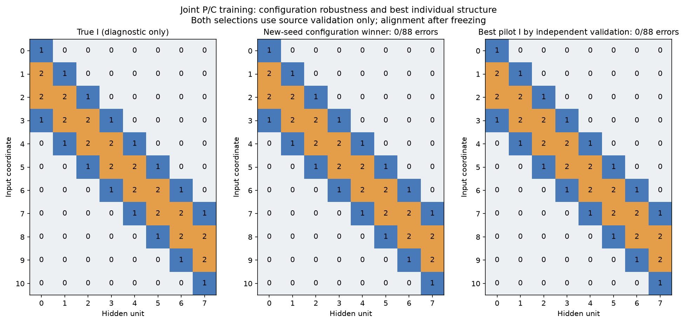
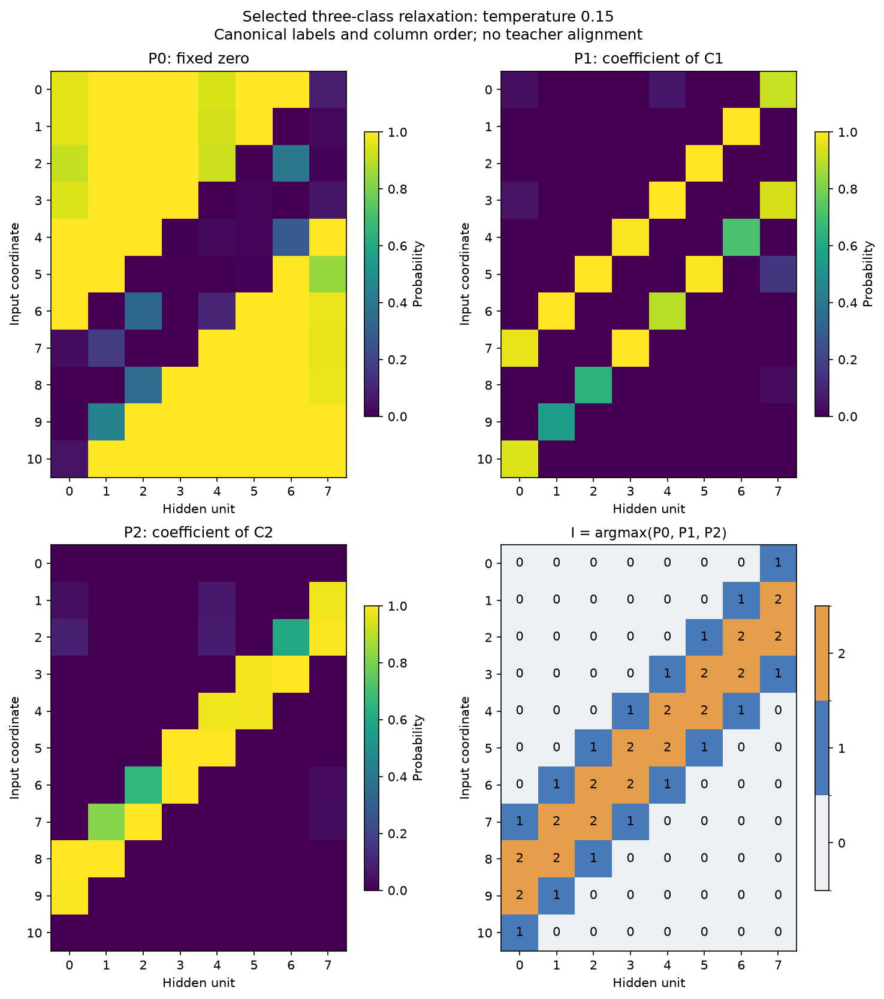
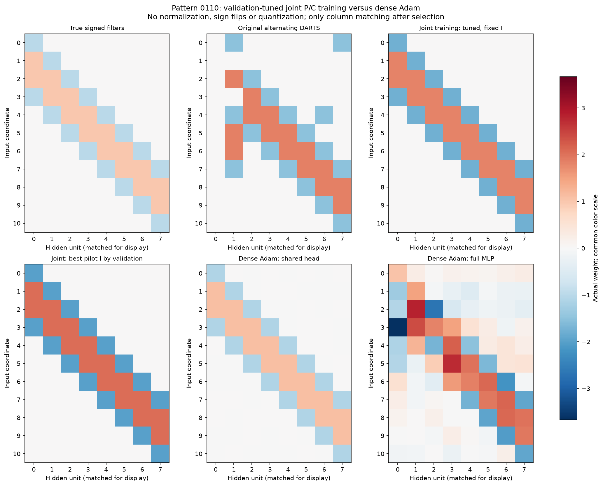
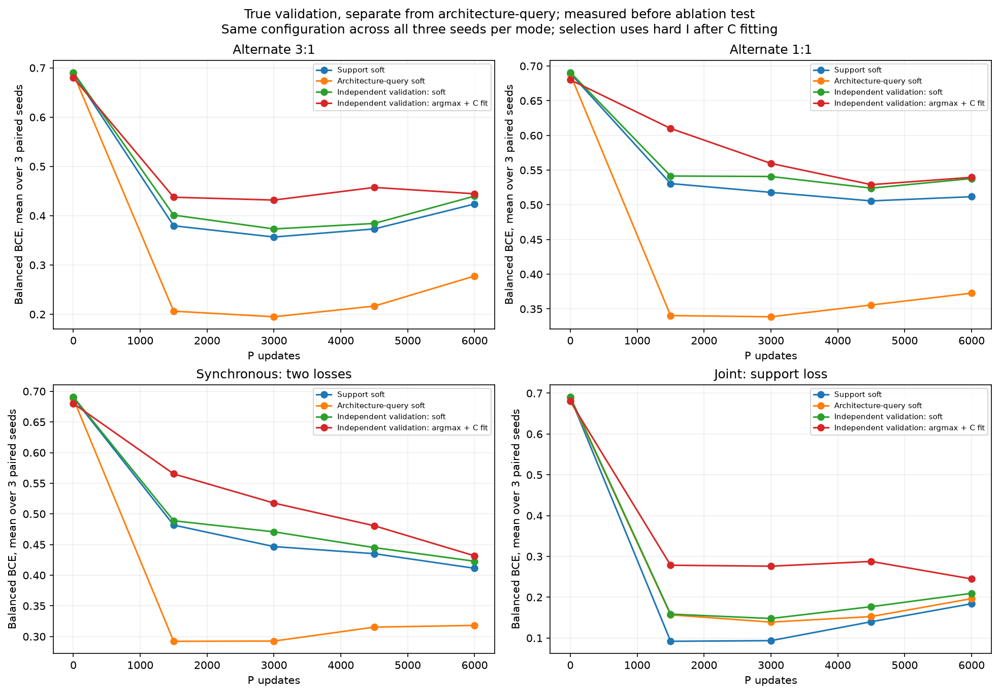

# Pattern 0110: итог сравнения чередования и совместного обучения

Совместный поиск: выбранный на новых search seed индексатор восстановлен точно. Ошибок 0/88, F1 маски 100.00%, test BA после дообучения исходного C 100.00%. Точных I на трёх новых search seed: 1/3. Лучший индивидуальный pilot I, выбранный отдельно по validation, имеет 0/88 ошибок.

Только фиксированное 0110, 11→8 ReLU→1, C0=0 и два свободных кода; вместе с общей головой 5 численных параметров. Во время поиска P являются softmax по 3 классам, после argmax I фиксируется и C дообучается 4096 шагов. Истинные окна/метки I не подаются поиску. Совпадение с GT проверяется только после выбора, с учётом переименования двух кодов и перестановок скрытых колонок.

| Вариант | Численных параметров | Ошибок I/88 | Test BA, % |
| --- | --- | --- | --- |
| Alternate 3:1 | 5 | 6 | 91.89 |
| Alternate 1:1 | 5 | 11 | 86.31 |
| Synchronous: two losses | 5 | 1 | 96.28 |
| Joint: support loss | 5 | 1 | 96.53 |
| Joint support: tuned LR | 5 | 0 | 100.00 |
| Dense Adam: shared head (91) | 91 | — | 100.00 |
| Dense Adam: full MLP (105) | 105 | — | 95.51 |

Основные строки: source-selected индексаторы с продолжением исходного кодбука; Adam — плотные численные сети. Порядок обновлений сравнивался на парных seed 5/6/7 при одинаковых заранее выбранных LR. Дополнительный подбор joint LR отдельно подтверждён на новых seed 8/9/10, поэтому эта строка не является парной с первыми четырьмя. Чередование 3:1 получает втрое больше численных шагов, чем 1:1.

Подбор joint: numeric LR 0.03, alpha LR 0.003/0.01/0.03, sparsity 0/0.01; подтверждение выбрало alpha LR0.01, sparsity0.01, seed9, шаг4500. Основной I со свежими C: query-выбранный test BA 100.00%, среднее 32 стартов 79.50%. Способность обучить C и вероятность найти I оцениваются раздельно.

Последующая [диагностика численной оптимизации](numeric_optimization_20261104/REPORT.md) при фиксированном истинном I воспроизвела неудачи стандартным `torch.optim.Adam`: существенны начальные знаки C и погасшие ReLU. Обучаемые скрытый b и выходной d уже есть. Подбор их инициализации дал на 64 новых Gaussian-стартах 36 точных решений вместо 29; выбор между C и -C после 64 support-шагов с продолжением лучшей по query ветки — 61/64. Средний test BA соответственно 83.77%, 77.67% и 97.66%; query-выбранный старт во всех вариантах 100%. На прежнем семействе противоположных знаков выбор C/-C дал 64/64 вместо 32/64. Бюджет 4096 включает обе начальные ветки. Это отдельный контроль обучения свежих чисел, исходный поиск P не повторялся.

Support 768 обучает C; в split-режимах query 256 обучает P. Joint использует один support-loss для P и C, query не получает архитектурных градиентов. Отдельная selection 512 без градиентов выбирает checkpoint и настройки по жёсткой модели после дообучения C, с усреднением по четырём текущим кодбукам и затем трём search seed. Test 512 не ранжирует кандидатов. Охлаждение и плохие локальные минимумы остаются источниками нестабильности; рост позднего soft-loss не всегда означает чистое переобучение.

Все стадии и исходники сохранены: [полная история](REPORT.md), [парная абляция](update_ablation/REPORT.md), [подбор joint](joint_tuning/REPORT.md), [Adam](adam_baseline/REPORT.md). Это исследовательская серия на известном паттерне; расширения после первоначального test явно зарегистрированы. Новые seed — проверка инициализаций, а не новый независимый benchmark. Программные тесты не запускались; сохранены реальные обучающие кривые, состояния и хеши.

## Знаковые пары и устранение компенсации перед argmax

По уточнению пользователя сравнили ровно `[0,c1,c2]` и `[0,c1,c2,-c1,-c2]`: два свободных числа C в обоих случаях. [Серия удвоения](signed_codebook_20261104/REPORT.md) на новых search seed11–16 нашла индивидуальные source-selected решения100% всего домена в обоих вариантах. Основной confirmation-based выбор: исходный100%, paired98.15%; у paired мягкая модель100%, immediateargmax90.71%. В одной позиции P(C1)≈.4979 и P(-C1)≈.5012 создавали вес≈.006, который argmax заменял на≈1.70.

Для каждой пары можно вычесть общий минимум вероятностей и перенести его удвоенную массу в P0. Это сохраняет мягкие W при любых C, строго исключает одновременную массу в своих двойниках и не требует нового обучения P или коэффициента штрафа. На том же paired seed15 immediateargmax стал100%, после того же C-fit98.15%→100%, бинарная маска восстановлена точно. Другие два выбранных search seed остались неточными; группировки почти одинаковых численных значений не сливались. [Контролируемая проверка и выбранный I](signed_codebook_20261104/regularization/projection_original/REPORT.md).

Дополнительная [абляция штрафов](signed_codebook_20261104/regularization/REPORT.md): pilot17–19, confirmation20–22, одинаковые P/C/batch, alpha.01/numeric.03. Произведение P(+C)P(-C) и нормированная дисперсия значений с постоянными коэффициентами .01/.1/1 в этой сетке не улучшили результат. Выбранный новый контроль после C-fit97.22%, оба штрафа93.98%. Канонизация подняла новый контроль до100% на всех2048, но его объявленная маска содержит44 связи: один C стал почти нулевым и используется как дополнительный нулевой слот. Поэтому качество функции, точность маски и группировки оцениваются отдельно. Все новые P/I, веса Adam, кривые и полные метрики сохранены; свежие C для projected I не оценивались.
