# DARTS-like: один фиксированный Pattern 0110

Выбранный индексатор **не восстановлен точно**: 12/88 категориальных ошибок после глобальной перестановки кодов и сопоставления скрытых нейронов. F1 бинарной маски — 81.25%. Из 300 сохранённых снимков 0 точно совпали с истинным индексатором; это диагностика после выбора, а не критерий выбора.

Точно совпадают 4/8 выровненных скрытых столбцов. Полностью отключённые входы (нумерация с 0): [1]. Верхняя граница BA для любой функции оставшихся входов на всех 2048 наблюдениях — 92.61%. Противоречащая пара: {"positive": "01100000000", "negative": "00100000000", "differing_coordinates": [1]}. У такой пары одинаковы все подключённые координаты и любой выход сети при любых числах кодбука, но метки разные. Это структурная потеря информации, которую дообучение C исправить не может.

## Постановка и выбор

Только распознавание подстроки 0110 в 11 бинарных координатах. 8 ReLU-нейронов. На каждую из 88 позиций — softmax по 3 индексам: C0=0 фиксирован, C1/C2 обучаются. Три дополнительных числа — общий скрытый bias, общий readout и выходной offset. Итого 5 численных параметров. Модель не заменялась маской с независимыми весами.

768 support → численные обновления; 256 query → архитектурные обновления и выбор численных checkpoint; 512 selection → сравнение настроек и индексаторов; 512 test → только после заморозки. Все 2048 входов показаны дополнительно и включают обучающие наблюдения. Задача исторически изучалась в проекте; это новый разрез одной известной задачи.

Пилот: 24 настройки × 2 seed; подтверждение: две выбранные настройки × 3 новых seed × first-order/один виртуальный Adam-шаг. По 6000 внешних шагов, по 3 численных обновления. C1/C2 случайно инициализированы разными знаками для согласования имён между 4 репликами; во время обучения их значения и знаки не ограничены. Разметка окон, позиции связей и число активных связей не сообщались поиску.

В каждой точке 0/1500/3000/4500/6000 argmax фиксировал I, после чего исходные C дообучались 4096 шагов. Checkpoint по query BCE, архитектуры — по средней selection BCE четырёх реплик; настройки подтверждения — по среднему трёх seed. Основной seed выбран по selection. Истинный I и диагностические совпадения не использовались в выборе.

Выбранная настройка: `{"id": 10, "numeric_lr": 0.03, "architecture_lr": 0.03, "schedule": "annealed", "sparsity_penalty": 0.0, "order": "first", "search_seed": 2}`, снимок 4500.

## Результаты

С сохранённым и дообученным C основной индексатор: test BA 84.67%, recall 74.07%. Пять чисел [C1,C2,b,a,offset]: -1.51, 1.85, -4.18, 1.59, -1.77.

Ниже все структуры переобучаются с 32 свежими C. Половина стартов меняет местами начальные C1/C2; аналитические значения не используются. Общие LR/масштаб выбраны по selection только основного I. Среднее всех стартов и результат старта, выбранного по query BCE, разделены. BA — balanced accuracy; test содержит 512 входов.

| Метод | Связей | Ошибок I /88 | F1 маски, % | BA: среднее 32 стартов, % | BA: query-выбор, % | Recall: query-выбор, % | BA: все 2048, % |
| --- | --- | --- | --- | --- | --- | --- | --- |
| DARTS: selected I | 32 | 12 | 81.25 | 70.71 | 84.67 | 74.07 | 84.84 |
| Pilot: selected I | 41 | 13 | 82.19 | 72.35 | 84.21 | 85.65 | 86.12 |
| search seed 3 | 56 | 34 | 63.64 | 63.68 | 71.35 | 71.76 | 71.96 |
| search seed 4 | 78 | 60 | 56.36 | 49.96 | 49.62 | 0.93 | 49.62 |
| True I (diagnostic) | 32 | 0 | 100.00 | 80.14 | 100.00 | 100.00 | 100.00 |
| Random I, same label counts | 32 | 34 | 53.12 | 53.97 | 58.12 | 55.09 | 54.56 |
| Initial random I | 20 | 29 | 50.00 | 50.12 | 51.50 | 14.81 | 50.92 |

Аналитический контроль истинного I: C=(-1,+1), b=-3, a=20, offset=-10, BA на всех 2048 входах 100.00%. Эти числа использованы только в контроле после заморозки.

## Что меняется при дискретизации

У замороженного поискового checkpoint средняя soft BA четырёх реплик: query 97.91%, test 86.73%. Сразу после argmax с теми же C средняя test BA 85.01%. Это различает переобучение архитектурной query и потери дискретизации; отдельные soft/hard значения сохранены в frozen_relaxation_metrics.json.

Средние query-метрики четырёх исходных численных реплик выбранного поиска. Query участвовала в поиске; это не test.

| Состояние | BCE | BA, % | Recall, % |
| --- | --- | --- | --- |
| Soft, перед argmax | 0.18 | 97.91 | 96.52 |
| Argmax, исходные C | 0.26 | 91.90 | 85.22 |
| Argmax, дообученные C | 0.25 | 91.54 | 85.22 |

## Точные артефакты

`selected_indexators.json/.npz`: raw/выровненные I всех выбранных seed, истинный I и преобразования. `selected_probabilities.json/.npz`: P0/P1/P2 выбранного checkpoint. `snapshot_structure_audit.json`: диагностика каждого сохранённого снимка. `frozen.json/.npz`: выбор без test. `evaluation_fits.npz`: все численные старты и реально измеренные кривые.

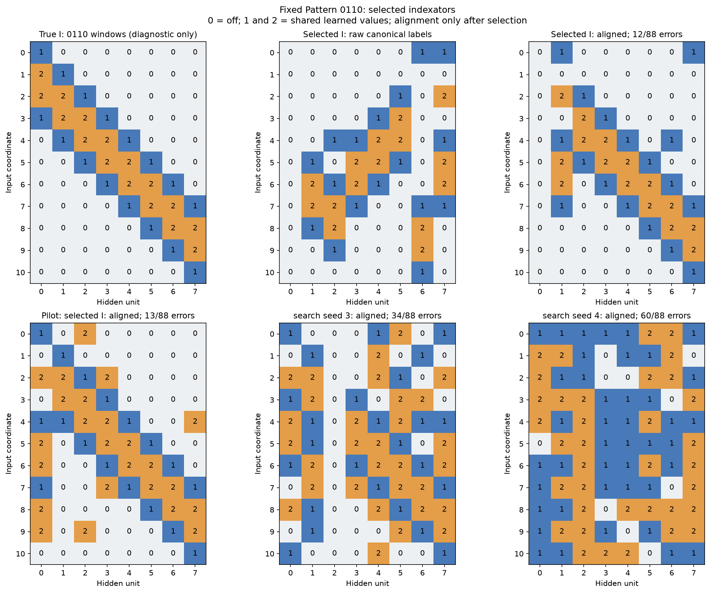

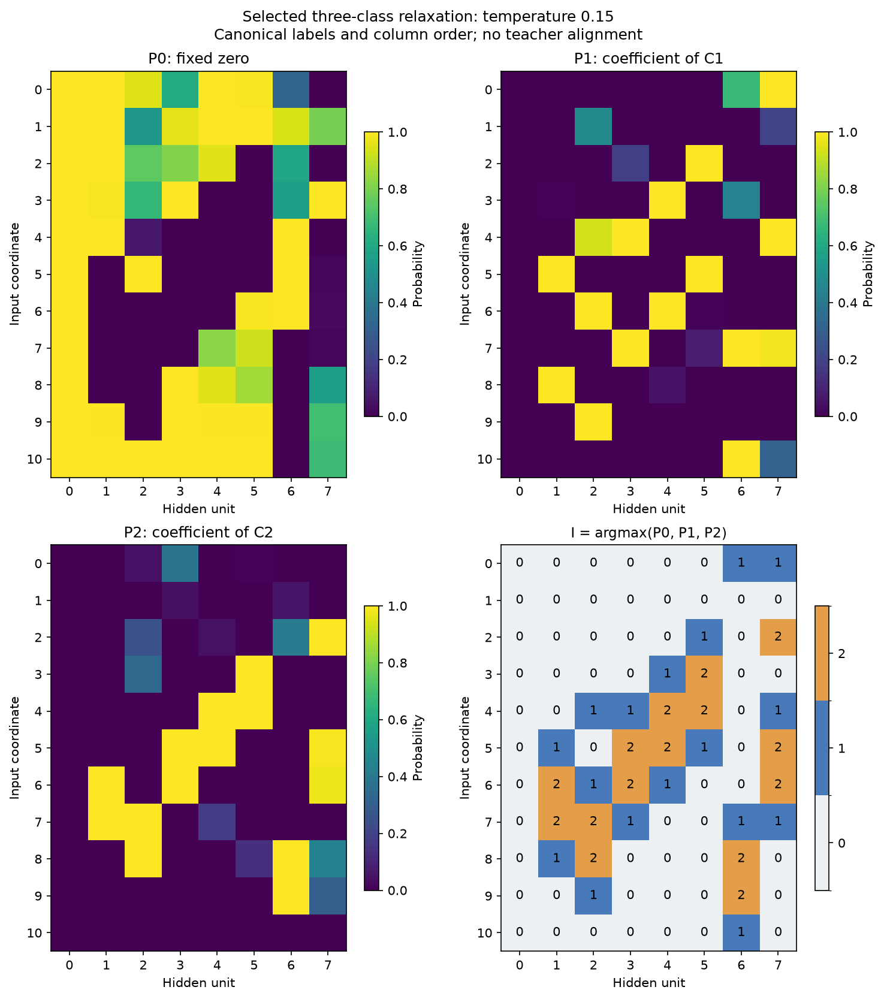

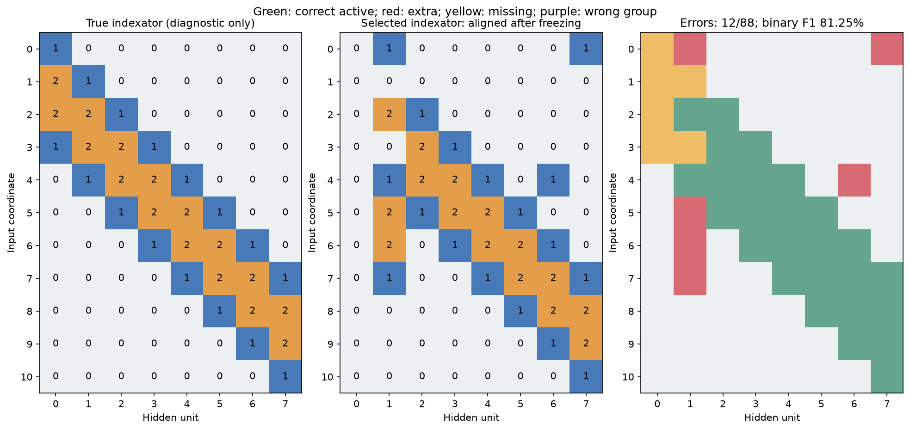

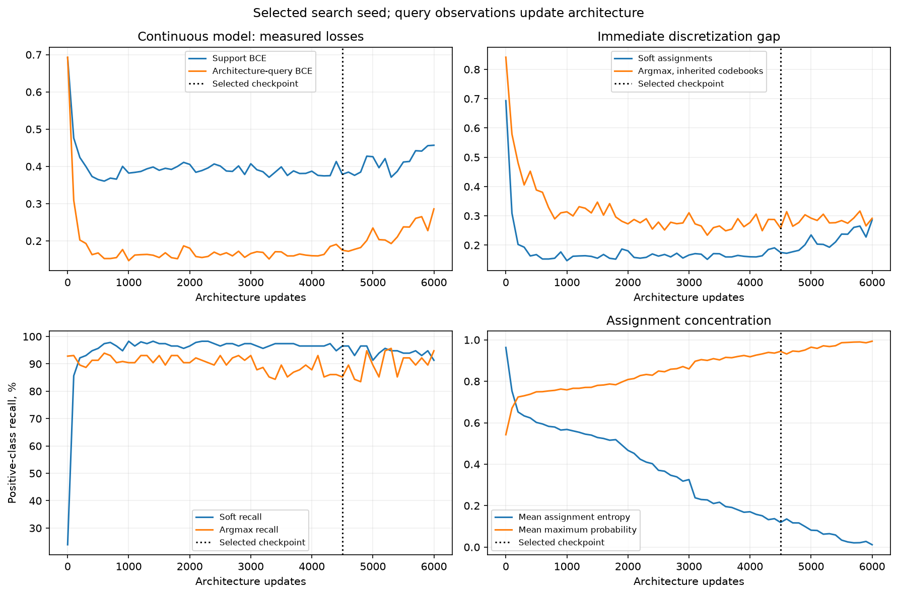

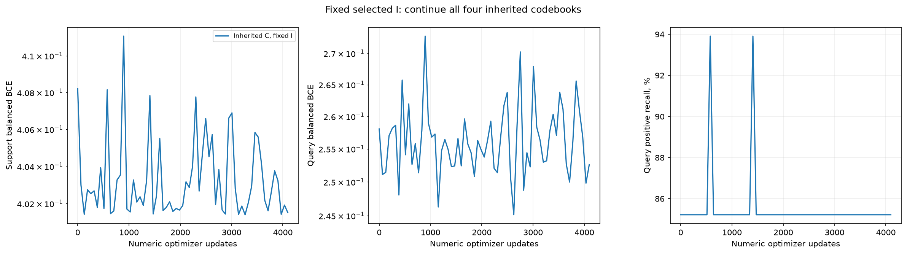

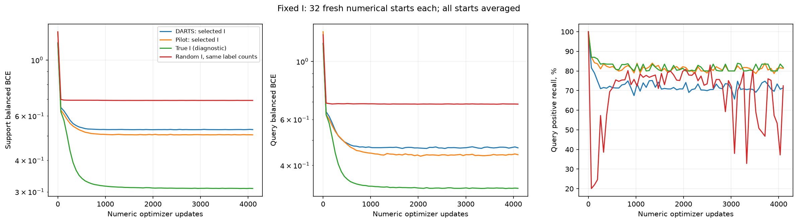

Классификация и восстановление I — разные критерии. Неполное совпадение не доказывает невозможность другой реализации той же функции. Эксперимент проверяет данную релаксацию, бюджет и процедуру выбора на одном паттерне.

Программные тесты не запускались; выполнены сами экспериментальные обучения и аналитический контроль. Никаких изменений алгоритма после открытия test.

## Дополнение по запросу пользователя: плотный Adam

В DARTS-поиске обновления поочерёдные: три шага C на support при фиксированном P, один шаг логитов P на query при фиксированном C. Unrolled-контроль дифференцирует через один виртуальный Adam-шаг C. После argmax меняются только численные параметры.

Adam-контроли одновременно обучают все численные веса на support. Первый сохраняет общий hidden bias и readout, как DARTS; второй — обычный MLP с отдельными bias/readout. Оба имеют 11 входов и 8 ReLU. 8 режимов LR/масштаба × 8 стартов, средний selection BCE выбирает режим. Затем 32 свежих старта по 4096 шагов; query выбирает checkpoint и старт. Сравнение добавлено после просмотра основного test по новому запросу пользователя; основной I не изменялся, test не выбирал Adam-настройки.

| Метод | Численных параметров | Test BA: среднее стартов, % | Test BA: query-выбор, % |
| --- | --- | --- | --- |
| DARTS: fixed I, fresh C | 5 | 70.71 | 84.67 |
| Dense Adam: shared head (91) | 91 | 98.79 | 100.00 |
| Dense Adam: full MLP (105) | 105 | 91.80 | 95.51 |

Хитмапы показывают реальные численные входные веса на общей цветовой шкале. Столбцы переставлены после выбора для визуального сопоставления с истинными окнами. Для Adam использовано сопоставление по косинусу без изменения знаков, масштаба весов или квантования. Bias и readout не показаны на матрице; они сохранены в NPZ.

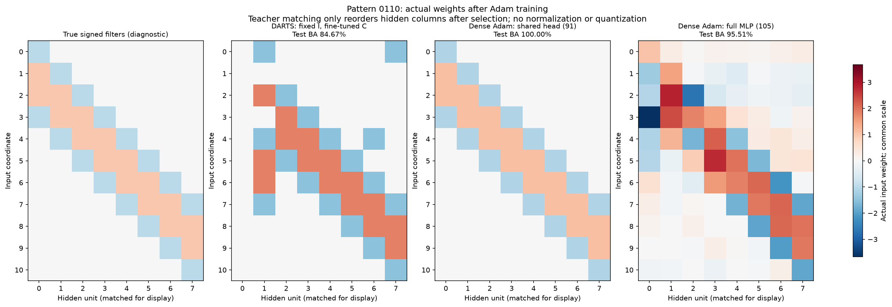

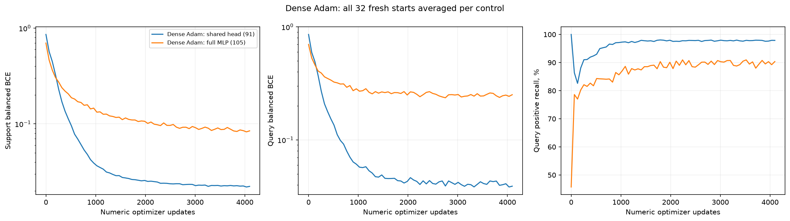

## Абляция по запросу пользователя: порядок обновлений P и C

Это дополнение после первоначального test. Исходный выбор не меняется. Две заранее выбранные настройки поиска проверены на трёх новых парных seed 5/6/7. Начальные P/C и warmup совпадают; на каждом внешнем шаге совпадают три support minibatch и независимый query minibatch. 1:1 варианты используют первый support batch. Всего 6000 обновлений P; 3:1 получает 18000 обновлений C, остальные 6000, плюс общий warmup512. Таким образом отдельно меняются соотношение обновлений, их порядок и обучающий loss.

Alternate3/1: сначала C на support, затем P на query. Synchronous split: оба градиента вычисляются до обновления чисел, C по support и P по query. Joint support: оба градиента вычисляются по одному support loss; query не обучает P. Везде независимые состояния Adam, одинаковые регуляризаторы, четыре кодбука и argmax с последующим дообучением C4096.

Checkpoint и конфигурация выбираются по прежнему source-only правилу после дообучения исходных C. Для всех трёх I выбранной конфигурации — по32 свежих C с общей ранее зафиксированной численной настройкой. Старт C выбирается поquery; первичный search seed — поselection. Ни test, ни совпадение с истинным I не ранжируют модели.

Основная таблица: продолжаем исходные C после фиксации I, как в предложенном пользователем алгоритме. Три seed перечислены в порядке5/6/7. Свежие кодбуки — отдельный контроль ниже.

| Режим | Config | Mean selection BCE | Test BA: три seed, % | Среднее seed, % | Primary BA, % | Primary ошибок I/88 | Точных I/3 |
| --- | --- | --- | --- | --- | --- | --- | --- |
| Alternate 3:1 | 11 | 0.41 | 87.76, 68.12, 91.89 | 82.59 | 91.89 | 6 | 0 |
| Alternate 1:1 | 11 | 0.52 | 67.96, 70.46, 86.31 | 74.91 | 86.31 | 11 | 0 |
| Synchronous: two losses | 11 | 0.42 | 67.04, 65.40, 96.28 | 76.24 | 96.28 | 1 | 0 |
| Joint: support loss | 10 | 0.24 | 96.53, 73.19, 93.98 | 87.90 | 96.53 | 1 | 0 |

| Режим: свежие C | Среднее BA трёх seed, % | Primary: query-выбранный C, % | Primary: среднее32C, % |
| --- | --- | --- | --- |
| Alternate 3:1 | 76.55 | 91.89 | 74.33 |
| Alternate 1:1 | 67.97 | 86.31 | 72.76 |
| Synchronous: two losses | 71.58 | 96.53 | 77.95 |
| Joint: support loss | 80.17 | 96.53 | 80.37 |

У некоторых неосновных seed свежие C с общим режимом сходятся хуже унаследованных чисел; это ограничение общей численной настройки. Качество самого алгоритма продолжения C оценивается первой таблицей.

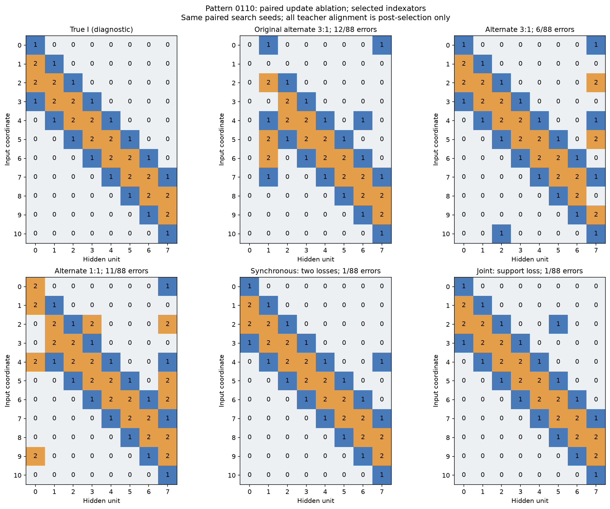

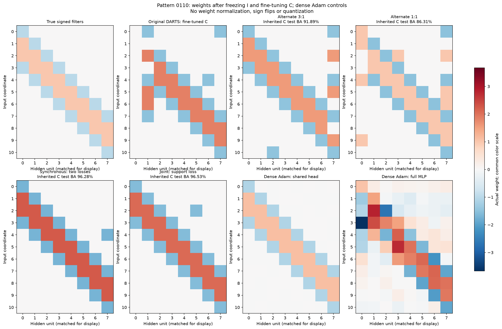

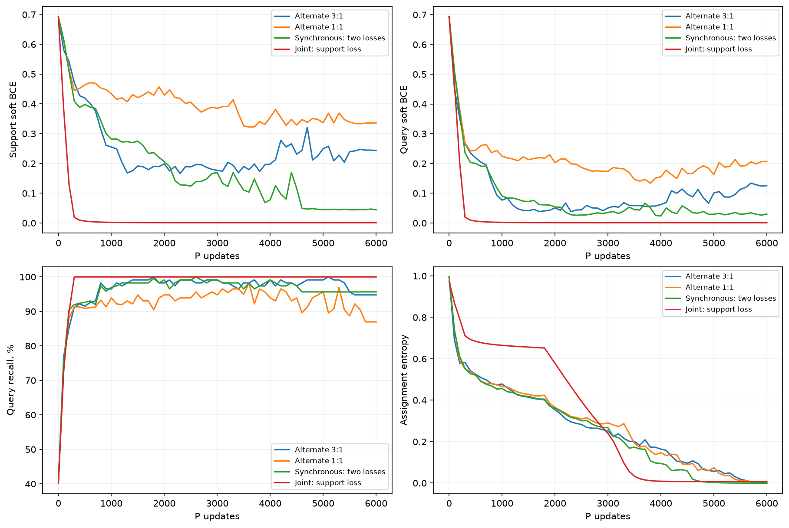

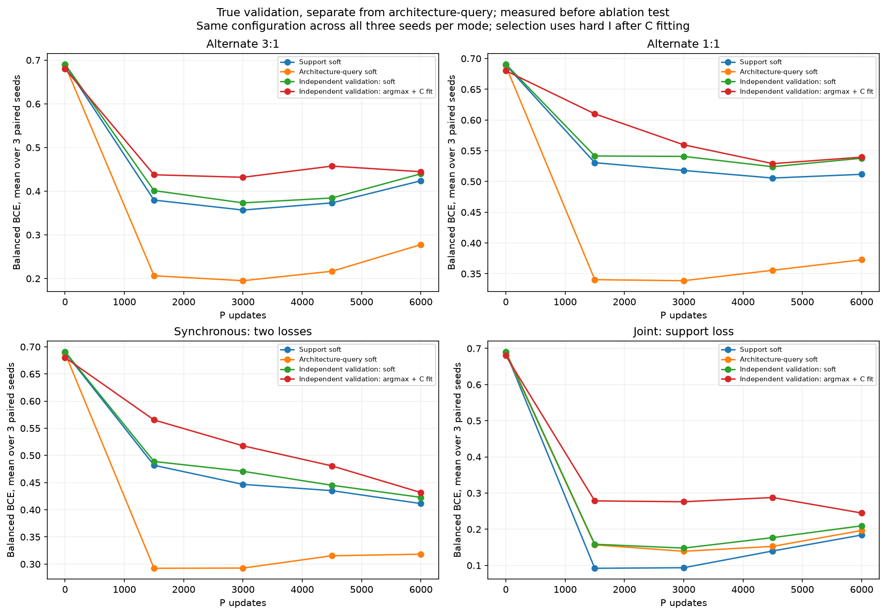

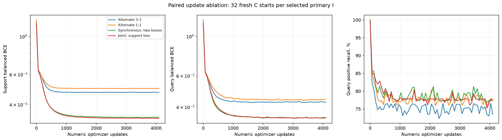

## Осторожный подбор гиперпараметров совместного обучения

Дополнительный source-only подбор после первой абляции: numeric LR 0.03, alpha LR 0.003/0.01/0.03, annealing, sparsity0/0.01. Три парных pilot seed 5/6/7; уже обученные поиски с alpha0.03 переиспользованы. Две конфигурации выбраны по средней selection BCE после argmax и дообучения C, затем подтверждены на новых seed 8/9/10. Совместно P/C учатся только на support; query не получает архитектурных градиентов. 6000 шагов — максимум, итог выбирается из пяти сохранённых точек. Test и истинный I не выбирают настройки.

Индексатор **восстановлен точно**: 0/88 ошибок; F1 маски 100.00%. Выбраны numeric LR 0.03, alpha LR0.01, sparsity0.01, search seed9, шаг4500. Mean selection BCE трёх новых seed: 0.36.

С исходным дообученным C: test BA 100.00%, recall 100.00%. Soft-модель выбранного checkpoint: query BA 100.00%, test BA 100.00%. Свежие C ниже выбираются по query из32стартов; их LR/масштаб отдельно откалиброваны по source selection.

| I | Ошибок /88 | F1, % | Fresh C: test BA, % | BA все2048, % |
| --- | --- | --- | --- | --- |
| primary | 0 | 100.00 | 100.00 | 100.00 |
| pilot_reference | 1 | 98.46 | 96.53 | 97.24 |
| search_seed_10 | 25 | 67.86 | 50.00 | 50.00 |
| search_seed_8 | 26 | 70.00 | 50.00 | 50.00 |
| best_individual_source | 0 | 100.00 | 100.00 | 100.00 |

Отдельный вопрос — нашёл ли поиск хотя бы один полезный I: до итогового test сохранён кандидат с минимальной средней selection BCE четырёх C среди всего пилота, без усреднения по search seed. У него 0/88 ошибок, test BA со свежим C 100.00%. Он не подменяет основной confirmation-based выбор. Протокол и исходное состояние — individual_reference.json/.npz.

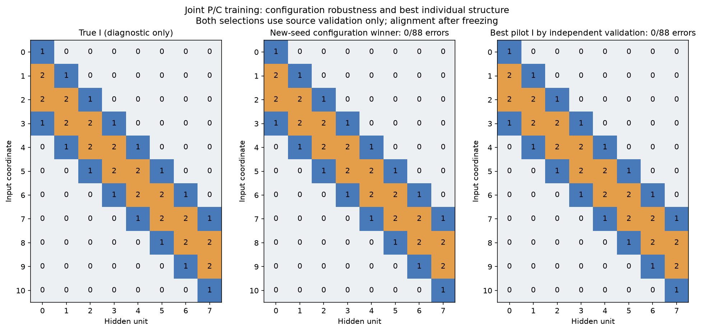

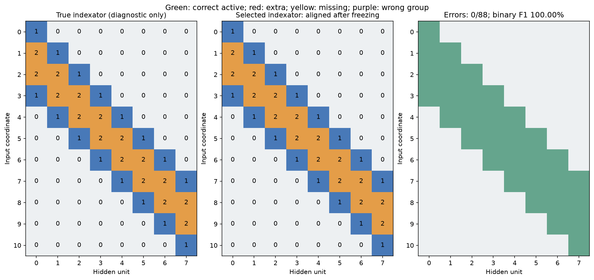

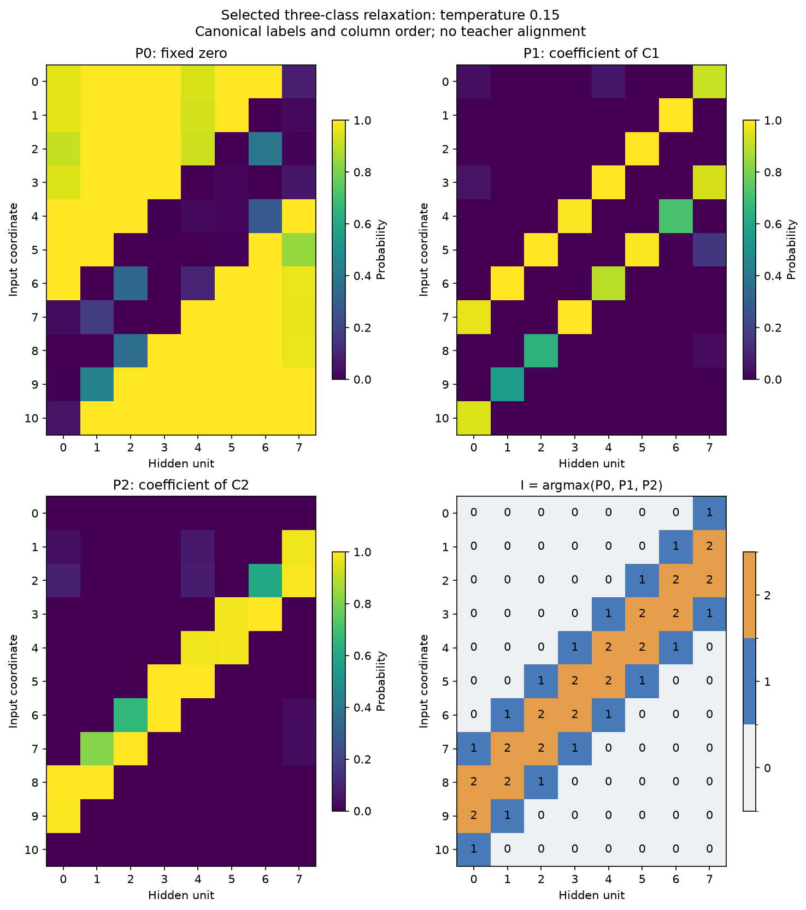

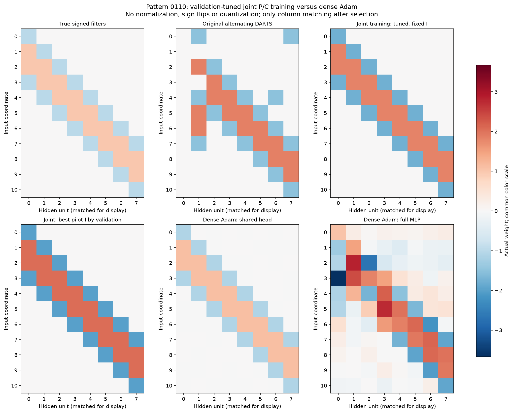

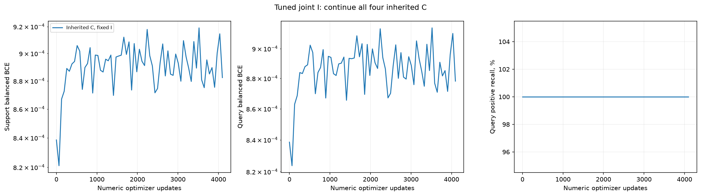

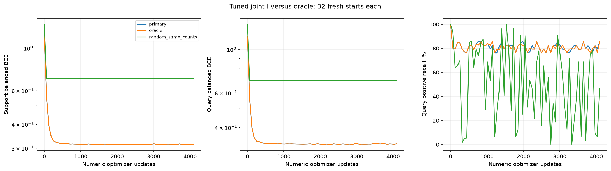

Это исследовательское продолжение на известном паттерне, не независимый новый benchmark. Новые search seed проверяют воспроизводимость поиска; дискретное совпадение с истинным I остаётся отдельной диагностикой после заморозки.
