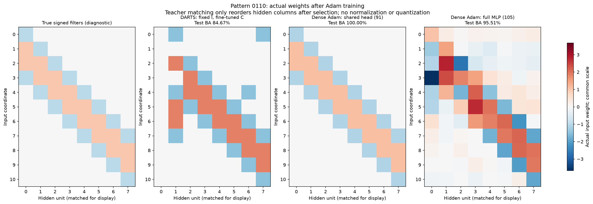
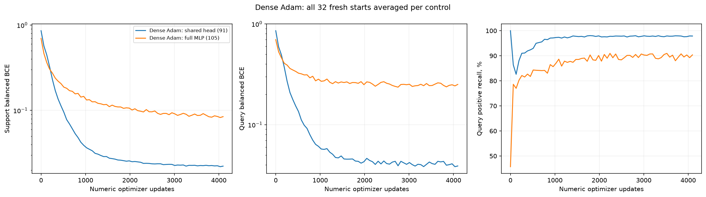

## Дополнение по запросу пользователя: плотный Adam

В DARTS-поиске обновления поочерёдные: три шага C на support при фиксированном P, один шаг логитов P на query при фиксированном C. Unrolled-контроль дифференцирует через один виртуальный Adam-шаг C. После argmax меняются только численные параметры.

Adam-контроли одновременно обучают все численные веса на support. Первый сохраняет общий hidden bias и readout, как DARTS; второй — обычный MLP с отдельными bias/readout. Оба имеют 11 входов и 8 ReLU. 8 режимов LR/масштаба × 8 стартов, средний selection BCE выбирает режим. Затем 32 свежих старта по 4096 шагов; query выбирает checkpoint и старт. Сравнение добавлено после просмотра основного test по новому запросу пользователя; основной I не изменялся, test не выбирал Adam-настройки.

| Метод | Численных параметров | Test BA: среднее стартов, % | Test BA: query-выбор, % |
| --- | --- | --- | --- |
| DARTS: fixed I, fresh C | 5 | 70.71 | 84.67 |
| Dense Adam: shared head (91) | 91 | 98.79 | 100.00 |
| Dense Adam: full MLP (105) | 105 | 91.80 | 95.51 |

Хитмапы показывают реальные численные входные веса на общей цветовой шкале. Столбцы переставлены после выбора для визуального сопоставления с истинными окнами. Для Adam использовано сопоставление по косинусу без изменения знаков, масштаба весов или квантования. Bias и readout не показаны на матрице; они сохранены в NPZ.

