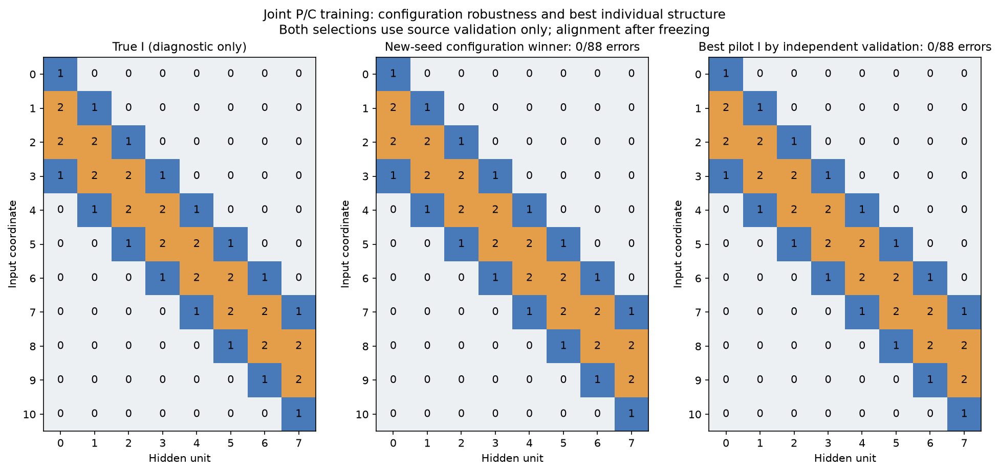
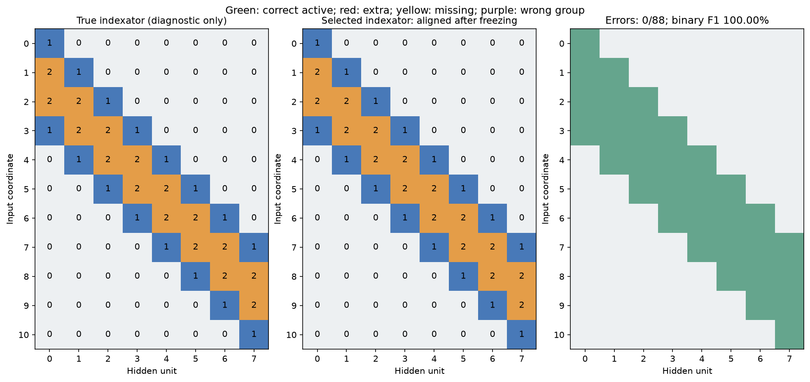
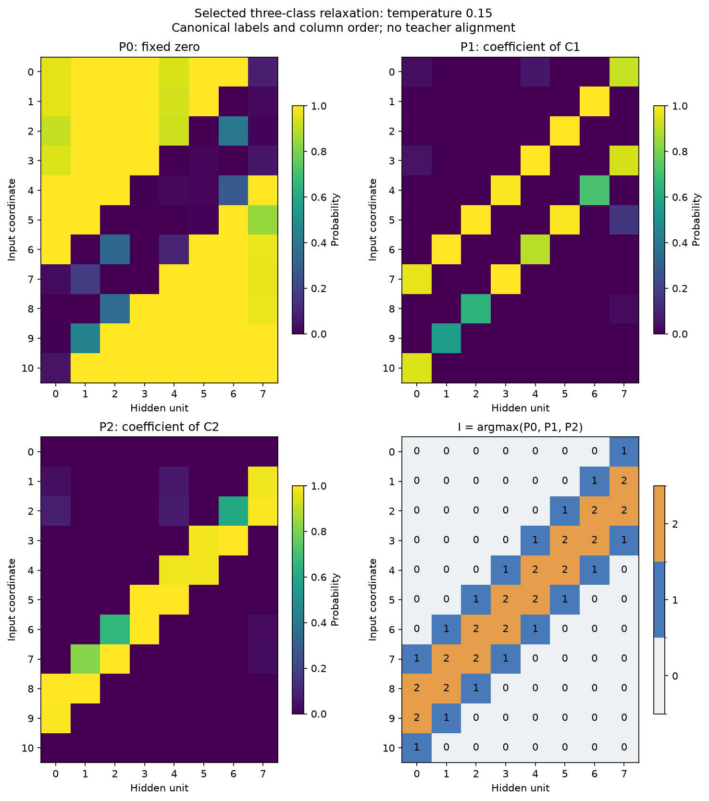
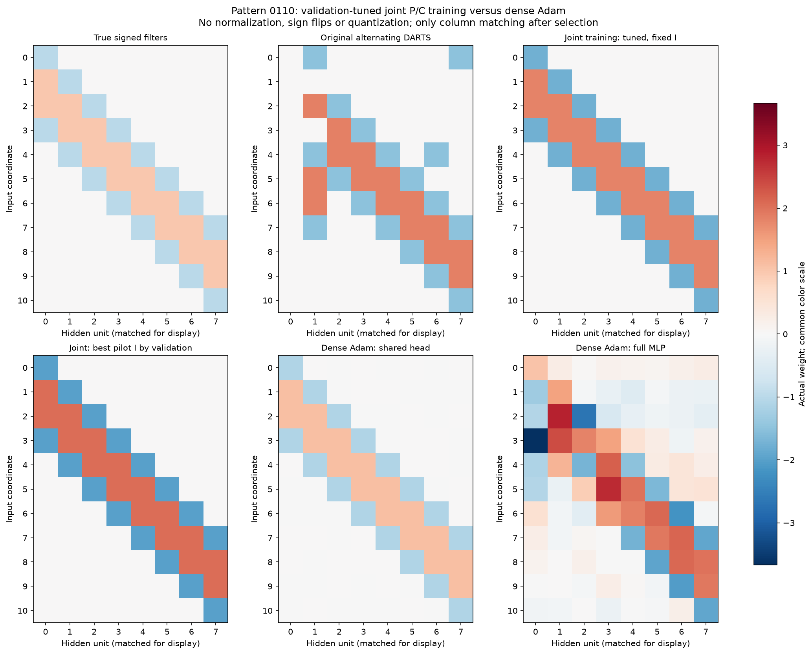
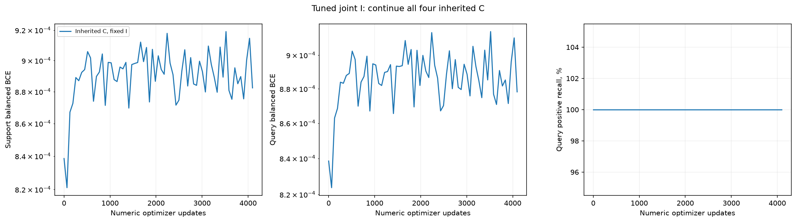
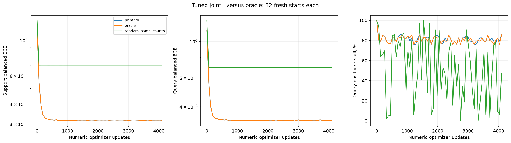

## Осторожный подбор гиперпараметров совместного обучения

Дополнительный source-only подбор после первой абляции: numeric LR 0.03, alpha LR 0.003/0.01/0.03, annealing, sparsity0/0.01. Три парных pilot seed 5/6/7; уже обученные поиски с alpha0.03 переиспользованы. Две конфигурации выбраны по средней selection BCE после argmax и дообучения C, затем подтверждены на новых seed 8/9/10. Совместно P/C учатся только на support; query не получает архитектурных градиентов. 6000 шагов — максимум, итог выбирается из пяти сохранённых точек. Test и истинный I не выбирают настройки.

Индексатор **восстановлен точно**: 0/88 ошибок; F1 маски 100.00%. Выбраны numeric LR 0.03, alpha LR0.01, sparsity0.01, search seed9, шаг4500. Mean selection BCE трёх новых seed: 0.36.

С исходным дообученным C: test BA 100.00%, recall 100.00%. Soft-модель выбранного checkpoint: query BA 100.00%, test BA 100.00%. Свежие C ниже выбираются по query из32стартов; их LR/масштаб отдельно откалиброваны по source selection.

| I | Ошибок /88 | F1, % | Fresh C: test BA, % | BA все2048, % |
| --- | --- | --- | --- | --- |
| primary | 0 | 100.00 | 100.00 | 100.00 |
| pilot_reference | 1 | 98.46 | 96.53 | 97.24 |
| search_seed_10 | 25 | 67.86 | 50.00 | 50.00 |
| search_seed_8 | 26 | 70.00 | 50.00 | 50.00 |
| best_individual_source | 0 | 100.00 | 100.00 | 100.00 |

Отдельный вопрос — нашёл ли поиск хотя бы один полезный I: до итогового test сохранён кандидат с минимальной средней selection BCE четырёх C среди всего пилота, без усреднения по search seed. У него 0/88 ошибок, test BA со свежим C 100.00%. Он не подменяет основной confirmation-based выбор. Протокол и исходное состояние — individual_reference.json/.npz.

Это исследовательское продолжение на известном паттерне, не независимый новый benchmark. Новые search seed проверяют воспроизводимость поиска; дискретное совпадение с истинным I остаётся отдельной диагностикой после заморозки.
