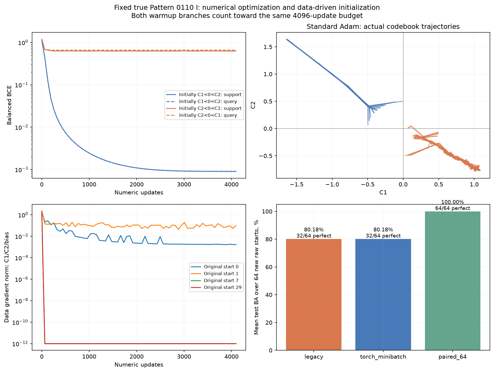
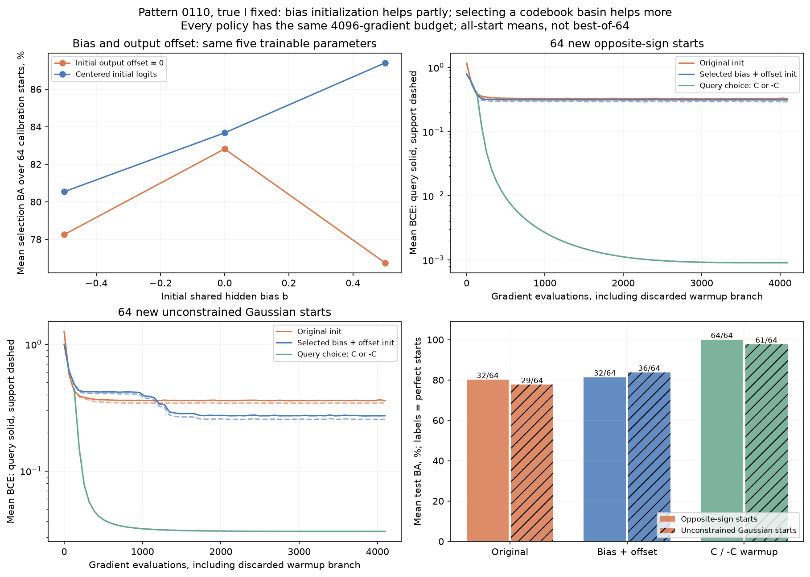

# Pattern 0110: диагностика обучения чисел при истинном I

Причина неудачных численных запусков при правильном I связана с инициализацией и областями сходимости ReLU-модели. Замена реализации Adam не исправила результат. Инициализация уже имеющихся сдвигов помогает частично; короткий выбор между кодбуками C и -C по query помогает сильнее.

Модель всё время одна: h_j = ReLU(sum_i C[I_ij] x_i + b), logit = a sum_j h_j + d. C0=0 фиксирован; C1, C2, общий скрытый сдвиг b, коэффициент a и выходной сдвиг d обучаются. Всего пять численных параметров. Исходная инициализация b=0, a=1, d=0. Новые сдвиги не добавлялись.

В исходных 32 стартах все 16/16 инициализаций C1<0<C2 дали 100%, из обратных знаков 0/16. Два начальных значения C переставлялись при неизменном I, поэтому менялась стартовая функция. Два старта полностью погасили скрытые ReLU; их градиент от данных по C1/C2/b равен нулю. L2 продолжает действовать, но не несёт информации о правильном направлении от данных. Знаки используются здесь для анализа сохранённых результатов, не для выбора новой инициализации.

Стандартный torch.optim.Adam с теми же начальными значениями, minibatch, L2 и ограничением нормы градиента каждой модели воспроизвёл 16/32 точных запуска. Максимальное различие query BCE 3.4e-06. Исходный BatchedAdam добавляет 1e-12 под корень знаменателя; эта численная разница не объясняет провал. Полный batch также не устранил проблему; это контроль шума с большим числом примеров на update. Строгая локальная минимальность плохих точек не доказывалась.

Исправление процедуры инициализации: для каждого сырого старта коротко обучить C и -C на support, сравнить query BCE, продолжить лучшую ветку вместе с её Adam moments. Аналитические значения и нужные знаки не подаются. 4096 численных gradient-evaluations на сырой старт включают обе ветки warmup: по 64 шага обеим, затем ещё 3968 выбранной. Архитектура всё время фиксирована, P не обучается.

| Калибровка на32 новых стартах | Mean selection BCE | Mean selection BA, % | Точных на selection |
| --- | --- | --- | --- |
| paired_64 | 0.0009 | 100.00 | 32/32 |
| paired_256 | 0.0009 | 100.00 | 32/32 |
| legacy | 0.3122 | 82.64 | 16/32 |
| torch_minibatch | 0.3122 | 82.64 | 16/32 |
| torch_fullbatch | 0.3151 | 82.54 | 16/32 |

До итогового контроля выбрана политика paired_64 по mean selection BCE. Затем64 новых старта прежнего семейства с противоположными знаками и64 независимых нормированных Gaussian-старта без ограничения знаков (в том числе одинаковые знаки). Checkpoint по query. Ни test, ни истинные численные значения не выбирают политику.

| Политика | Mean test BA, % | 100% на test | 100% на всех2048 | Query-выбор BA, % |
| --- | --- | --- | --- | --- |
| legacy | 80.18 | 32/64 | 32/64 | 100.00 |
| torch_minibatch | 80.18 | 32/64 | 32/64 | 100.00 |
| paired_64 | 100.00 | 64/64 | 64/64 | 100.00 |
| gaussian_legacy | 79.82 | 33/64 | 33/64 | 100.00 |
| gaussian_torch_minibatch | 79.82 | 33/64 | 33/64 | 100.00 |
| gaussian_paired_64 | 95.31 | 58/64 | 58/64 | 100.00 |

## Отдельная проверка предложения о сдвиге b

На двух новых семействах по 32 сырых старта сравнили b0=-0.5/0/+0.5 и d0=0 либо d0=-mean_support(initial logit). Во втором случае начальные логиты центрируются около нуля; используются только входы support. Кодбуки и minibatch попарно одинаковые. Все пять параметров после инициализации свободно обучаются, фиксированного ограничения на b нет. Политику выбрали по среднему selection BCE двух семейств, затем проверили на ещё двух семействах по 64 новых старта.

| b0 | d0 | Selection BCE | Mean BA, % | Точных opposite | Точных Gaussian |
| --- | --- | --- | --- | --- | --- |
| -0.5 | 0 | 0.3542 | 78.25 | 16/32 | 13/32 |
| -0.5 | centered | 0.3439 | 80.54 | 16/32 | 13/32 |
| 0.0 | 0 | 0.3120 | 82.82 | 16/32 | 16/32 |
| 0.0 | centered | 0.3039 | 83.67 | 16/32 | 16/32 |
| 0.5 | 0 | 0.4290 | 76.75 | 9/32 | 11/32 |
| 0.5 | centered | 0.2446 | 87.40 | 16/32 | 21/32 |

Выбран b0=0.5, center_output=True. Итоговый контроль ниже; gaussian_ означает произвольные начальные знаки, остальные строки — прежнее семейство с противоположными знаками. selected_bias меняет только начальные b/d; paired_64 меняет процедуру выбора начального кодбука при исходных b/d.

| Политика | Mean test BA, % | 100% на test | 100% на всех 2048 | Query-выбор BA, % |
| --- | --- | --- | --- | --- |
| legacy | 80.18 | 32/64 | 32/64 | 100.00 |
| selected_bias | 81.39 | 32/64 | 32/64 | 100.00 |
| paired_64 | 100.00 | 64/64 | 64/64 | 100.00 |
| gaussian_legacy | 77.67 | 29/64 | 29/64 | 100.00 |
| gaussian_selected_bias | 83.77 | 36/64 | 36/64 | 100.00 |
| gaussian_paired_64 | 97.66 | 61/64 | 61/64 | 100.00 |

Выбор лучшего старта по query корректен: в этой серии он даёт 100% и в исходной процедуре. Доля успешных стартов описывает необходимый бюджет перезапусков. Даже C/-C не гарантирует сходимость с произвольного Gaussian-старта; безусловная устойчивость не установлена. Изменение начальных b/d само по себе не заменяет выбор области сходимости.

Новая опция single.fit_fixed: specification['paired_initialization_steps']=64/256, значение 0 сохраняет старый алгоритм. Исторические результаты поиска структуры не перезаписывались; опция включена только в новых численных контролях. Проверка выполнена для фиксированного истинного 0110-I, который совпадает с найденным joint-поиском после выравнивания. Влияние на дальнейший soft-поиск P не измерялось. Программные тесты не создавались и не запускались; выполнены сами контролируемые обучения.
