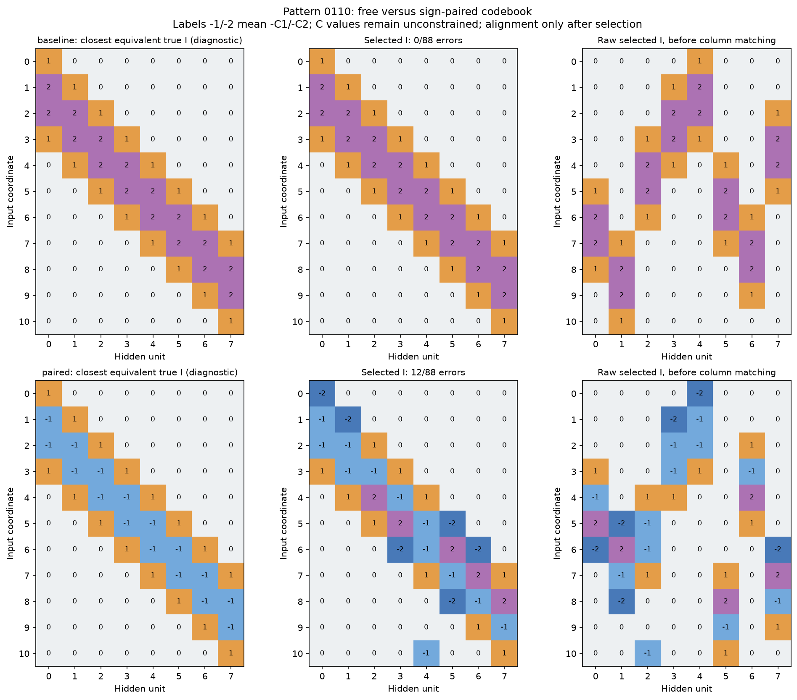
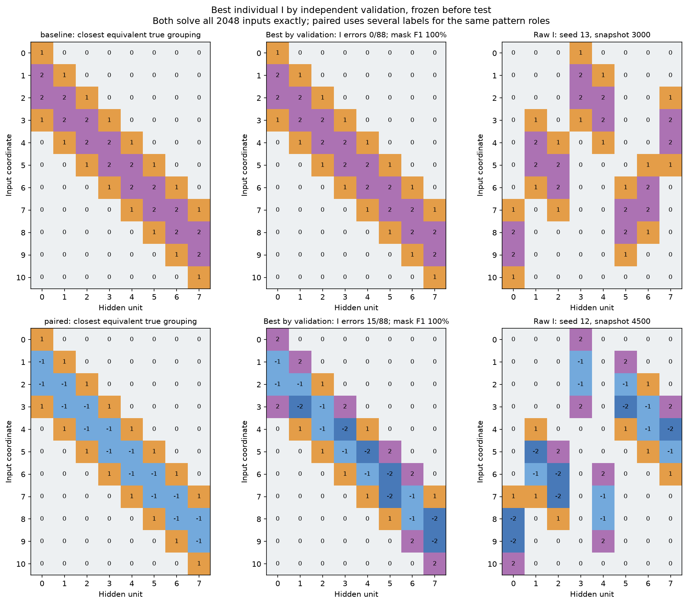
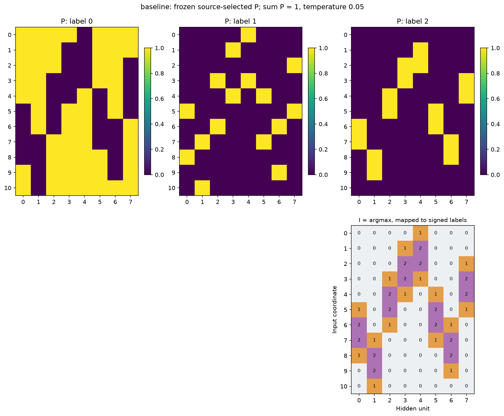
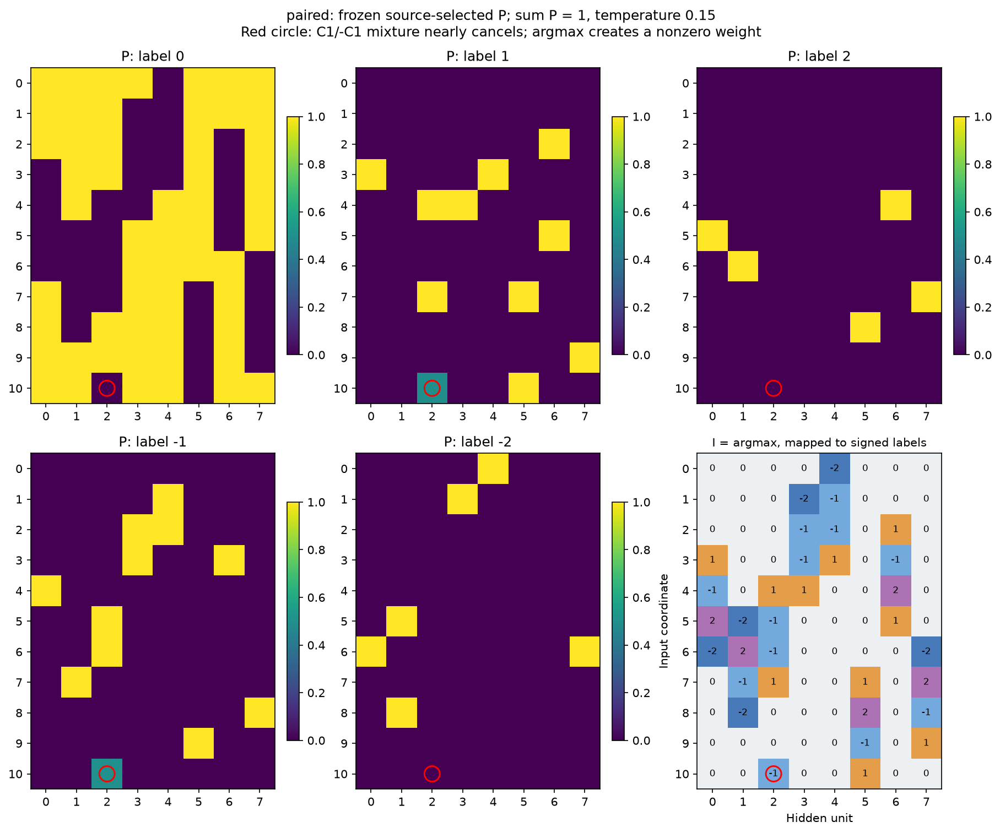
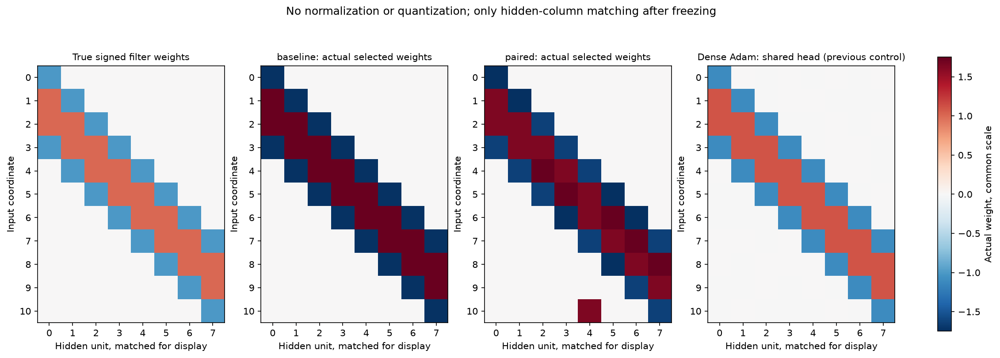
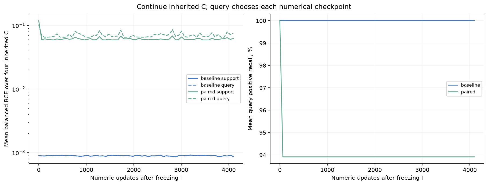
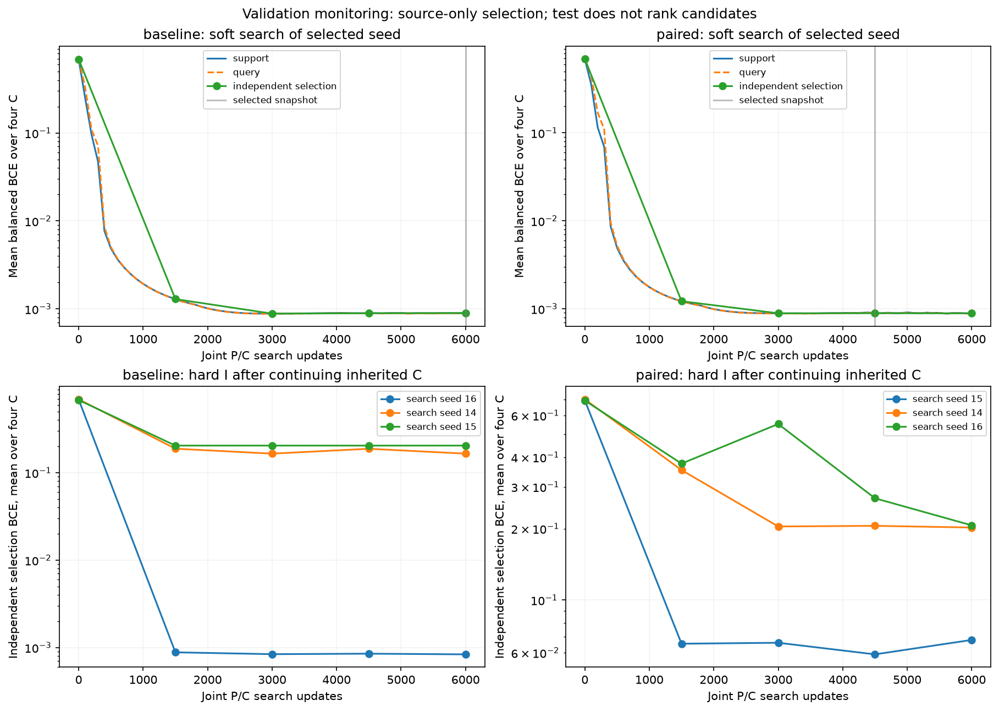

# Pattern 0110: удвоение индексов через C и -C

Продолжение по запросу пользователя: [штрафы компенсации](regularization/REPORT.md) и [точный перенос взаимно гасящейся массы в нулевой индекс](regularization/projection_original/REPORT.md). Второй приём исправил конкретную ошибку основного paired seed15: immediateargmax90.71%→100%, после одинакового дообучения C98.15%→100%, бинарная маска стала точной. Ниже сохранены исходные результаты без этого преобразования.

Сравниваются исходные [0,c1,c2] и ровно предложенные пользователем [0,c1,c2,-c1,-c2]. В обоих случаях два свободных числа кодбука и b/a/d, всего пять численных параметров. Четыре ненулевых значения второго варианта не независимы. Базовые c1/c2 свободно меняют знак; отдельный положительный модуль или clamp не вводится. В hard-артефактах отрицательные значения I означают ссылку на -C, а не физический знак веса.

При поиске W=(P+1-P-1)c1+(P+2-P-2)c2. Это позволяет менять знак эффективного веса через P, без обязательной смены знака c. Во время выбора не передаются истинные окна, связи, численность групп или I. При фиксированном I неиспользуемые дополнительные классы сами по себе не меняют задачу обучения чисел.

Контроль фиксированного истинного I: та же физическая функция переписана через -c1,+c2, с соответствующим отражением начального c1. Из 32 стартов точных на selection 16 против исходных 16; max различие query BCE 1.9e-06. Это контроль параметризации, а не поиск структуры.

Совместное обучение P/C на support; query выбирает численные checkpoint. Сетка numeric LR.03, alpha .003/.01/.03 × sparsity0/.01, annealed softmax1→.05, entropy.02. Pilot seeds11/12/13, по18 запусков каждого варианта. Две настройки каждого варианта подтверждены на14/15/16. Четыре C,512 warmup,6000 joint steps. После argmax все четыре исходных C дообучаются4096 шагов. Mean независимой selection BCE выбирает checkpoint, затем конфигурацию по среднему трёх seed, затем основной seed. Численные и minibatch seed общие, начальные P различаются из-за разного количества классов.

| Вариант | Классов I | Численных параметров | Ошибок I/88 | F1 маски, % | Warm test BA, % | Точных I на новых seed |
| --- | --- | --- | --- | --- | --- | --- |
| baseline | 3 | 5 | 0 | 100.00 | 100.00 | 1/3 |
| paired | 5 | 5 | 12 | 98.46 | 98.15 | 0/3 |

Способность найти хотя бы одно решение и устойчивость выбранной конфигурации — разные оценки. Ниже отдельный лучший индивидуальный кандидат по независимой selection среди всего одинакового бюджета pilot/confirmation. Он выбран и заморожен до test и не подменяет основной configuration-based выбор выше.

| Вариант | Этап | Seed | Ошибок I/88 | F1 маски, % | Test BA, % | BA всех 2048, % |
| --- | --- | --- | --- | --- | --- | --- |
| baseline | pilot | 13 | 0 | 100.00 | 100.00 | 100.00 |
| paired | pilot | 12 | 15 | 100.00 | 100.00 | 100.00 |

Для paired нет единственного именования истинного I: одинаковую функцию могут задать один противоположный ±код либо две независимые группы. Диагностика после freeze берёт ближайшее представление двух ролей паттерна, учитывает глобальные имена/знаки групп и перестановку нейронов. Отдельно считается бинарная маска. Эти преобразования не участвуют в выборе.

| Вариант | Search seed | Alpha LR | Sparsity | Snapshot | Ошибок I | Warm test BA, % |
| --- | --- | --- | --- | --- | --- | --- |
| baseline | 16 | 0.03 | 0.0 | 6000 | 0 | 100.00 |
| baseline | 14 | 0.03 | 0.0 | 6000 | 4 | 93.98 |
| baseline | 15 | 0.03 | 0.0 | 4500 | 4 | 95.14 |
| paired | 15 | 0.01 | 0.0 | 4500 | 12 | 98.15 |
| paired | 14 | 0.01 | 0.0 | 6000 | 13 | 95.14 |
| paired | 16 | 0.01 | 0.0 | 6000 | 11 | 92.36 |

Разрыв soft→argmax оценивается с исходными C до дообучения, затем сравнивается с hard I после дообучения. Метрики soft/argmax усреднены по четырём текущим C, warm — выбранный по query кодбук. Относительная ошибка весов — норма разности soft- и hard-матриц, делённая на норму soft-матрицы, средняя по тем же четырём C.

| Вариант | Soft test BA, % | Argmax test BA, % | Warm hard test BA, % | Относительный разрыв W |
| --- | --- | --- | --- | --- |
| baseline | 100.00 | 100.00 | 100.00 | 0.000 |
| paired | 100.00 | 90.71 | 98.15 | 0.176 |

У paired после дообучения значения C1/C2 могут быть почти противоположны, так что C1 и -C2, а также C2 и -C1 образуют близкие значения. Вероятностная смесь тогда имеет несколько почти эквивалентных категорий. Это возможная причина усложнения дискретизации и разделения одинаковых ролей между именами групп; причинная абляция этой гипотезы не проводилась. Фактические значения и ошибка проекции сохранены в selected_indexators.json.

В выбранном paired-I обнаружен конкретный механизм лишней связи: input11/hidden3 в исходном порядке имеет P(C1)=49.79%, P(-C1)=50.12%, P(0)=0.0103%. При C1 около -1.70 мягкий вес около +0.006, а argmax даёт +1.70. Эта позиция отмечена красным на P-хитмапах. Средняя максимальная вероятность по всей матрице 99.42% скрывает одну такую неоднозначную позицию; относительный скачок всей W составляет 17.6%. Наблюдение объясняет эту лишнюю связь, но само по себе не доказывает причину результатов всех поисковых запусков. При четырёх signed-метках разные имена также могут задавать почти одинаковые физические веса, поэтому строгие ошибки группировки нужно читать вместе с F1 связей и качеством функции.

Свежие C проверяются отдельно:32 общих нормированных Gaussian-старта без ограничения знаков, ранее подобранные lr.03/norm.5. warmup0 — прежний fit; warmup64 — выбор C/-C по query, суммарный бюджет4096 учитывает обе ветки. Oracle использует те же начальные функции в обоих вариантах. Выбор лучшего старта по query корректен; среднее и доля успешных описывают бюджет перезапусков.

| Вариант | Fresh I / процедура | Mean test BA, % | Точных test | Query-selected test BA, % |
| --- | --- | --- | --- | --- |
| baseline | primary_warmup0 | 76.67 | 14/32 | 100.00 |
| baseline | oracle_warmup0 | 76.67 | 14/32 | 100.00 |
| baseline | primary_warmup64 | 95.31 | 29/32 | 100.00 |
| baseline | oracle_warmup64 | 95.31 | 29/32 | 100.00 |
| paired | primary_warmup0 | 80.37 | 0/32 | 98.15 |
| paired | oracle_warmup0 | 76.67 | 14/32 | 100.00 |
| paired | primary_warmup64 | 97.11 | 0/32 | 98.15 |
| paired | oracle_warmup64 | 95.31 | 29/32 | 100.00 |

Отдельный лучший индивидуальный source-кандидат заморожен до test; он не заменяет основной выбор по конфигурации. Его I и метрики сохранены в individual.npz/.json и summary.json. Это исследовательский опыт на уже известном паттерне, новые seed проверяют инициализацию, не новый независимый benchmark. Программные тесты не создавались и не запускались.
