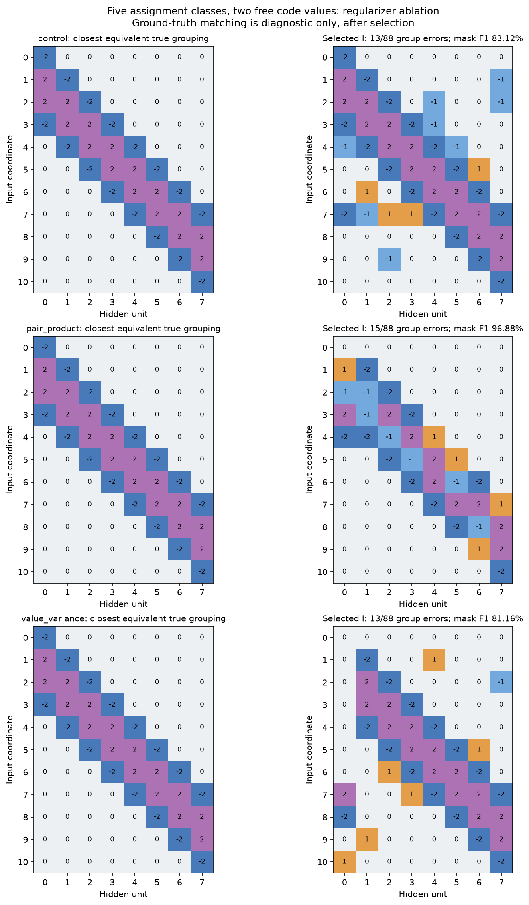
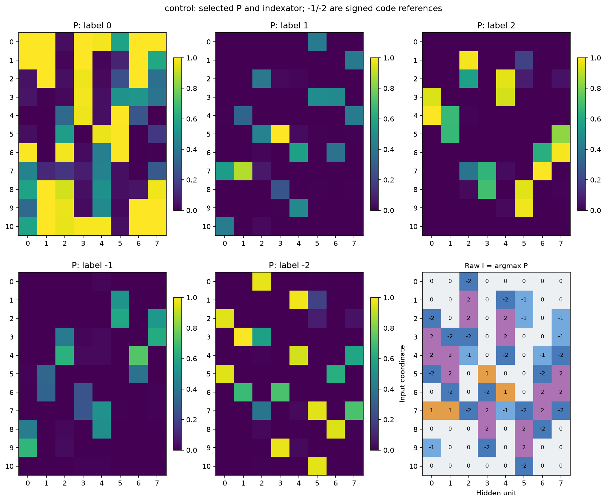
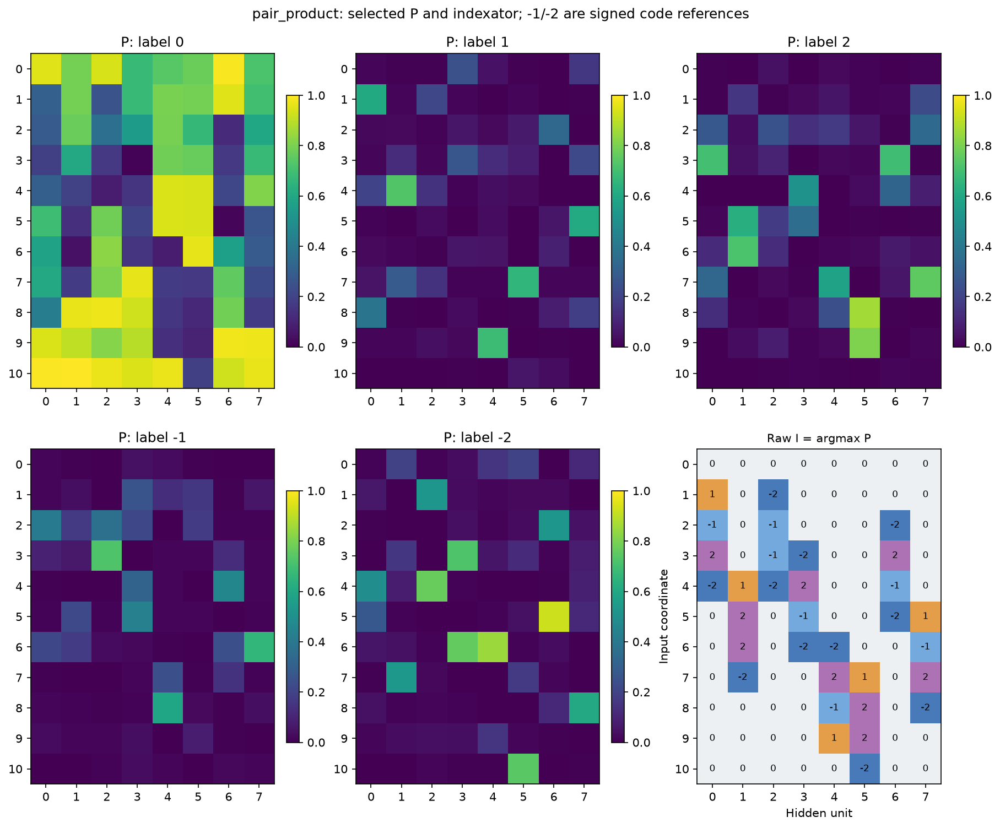
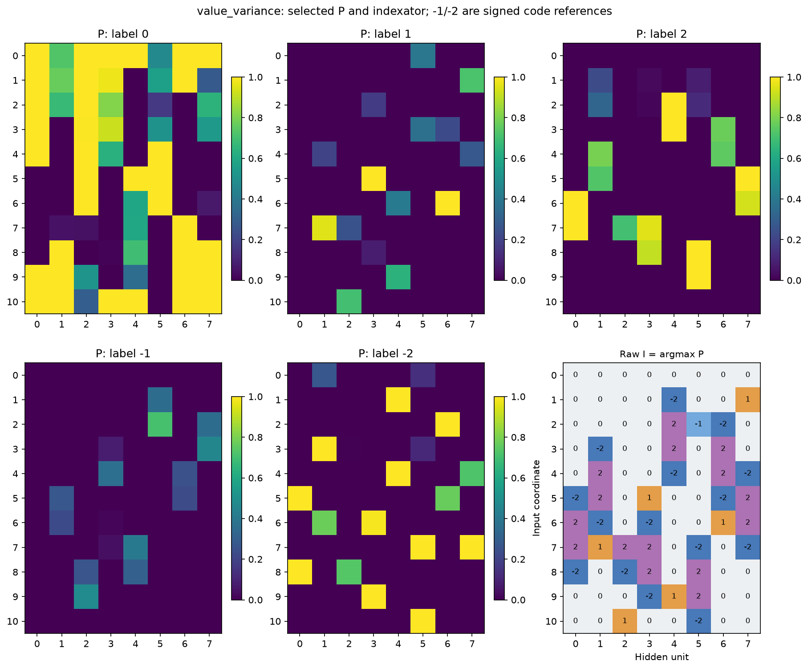
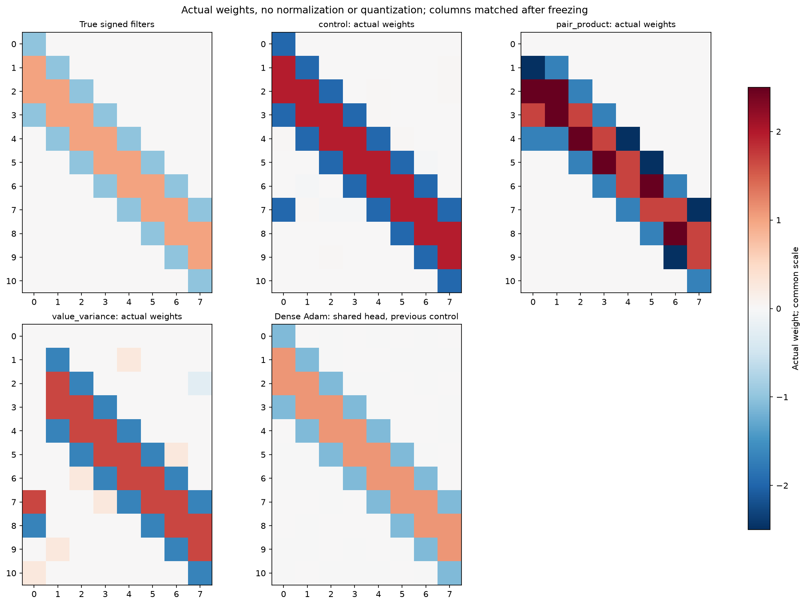
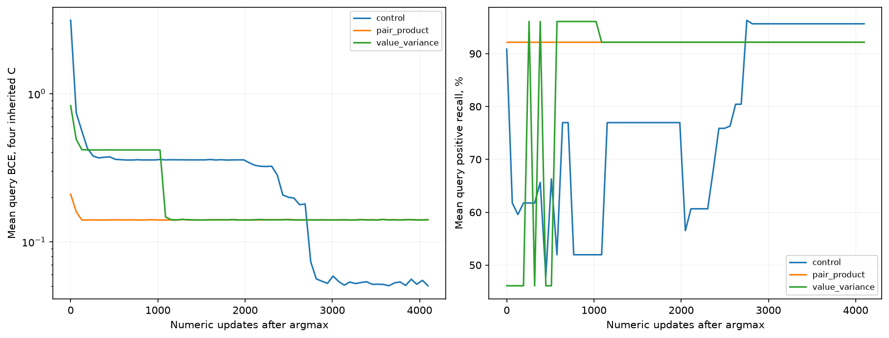
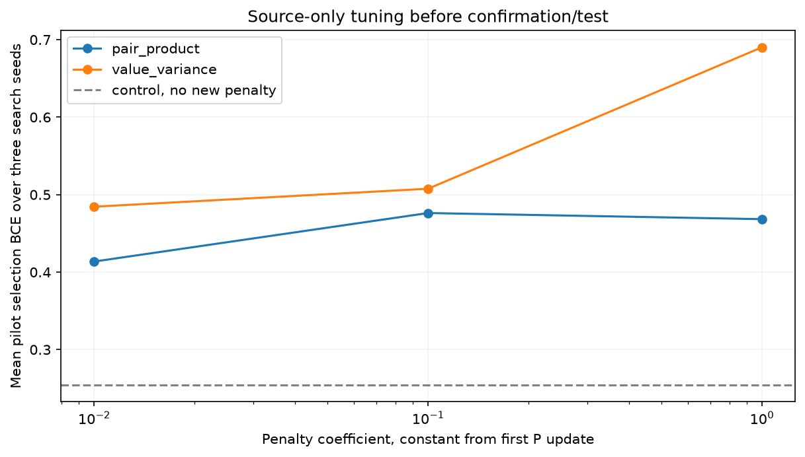
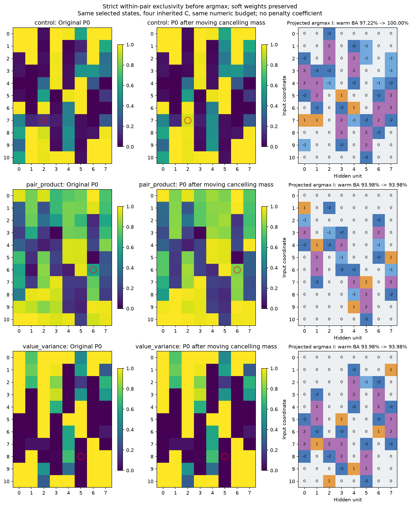

# Pattern 0110: пресечение компенсации между знаковыми кодами

Во всех трёх вариантах ровно [0,c1,c2,-c1,-c2], два свободных числа кодбука и b/a/d. Сравниваются контроль, произведение вероятностей противоположных слотов одной пары и дисперсия численных значений смеси. Это мягкие штрафы, не строгие дискретные запреты.

$$
L_{\mathrm{pair}}=\lambda\frac1{88}\sum_{ij}\sum_{k=1}^2 P_{ij,+k}P_{ij,-k}.
$$

Первый штраф подавляет смесь внутри своей пары. Компенсация между разными базовыми кодами остаётся возможной.

$$
L_{\mathrm{var}}=\lambda\frac1{88}\sum_{ij}\frac{\sum_k P_{ij,k}(v_k-\bar w_{ij})^2}{\max(\tfrac12(c_1^2+c_2^2),\varepsilon)},\qquad v=(0,c_1,c_2,-c_1,-c_2).
$$

Второй штраф включает нулевое значение и любые разные численные значения. Он допускает распределение массы между фактически одинаковыми значениями: их выбор через argmax не меняет вес. Масштаб нормирован, C отсоединён от графа этого штрафа, чтобы он обновлял только P. Числа C по-прежнему учатся по support BCE и прежнему L2.

Все начальные P/C и minibatch одинаковы для одного search seed. Numeric LR.03, alpha LR.01, sparsity0, прежние annealing/entropy. Коэффициенты .01/.1/1 действуют с первого архитектурного шага. Pilot17/18/19 выбирает один коэффициент по mean hard selection BCE, confirmation20/21/22 его проверяет. Максимум6000 joint шагов, четыре C,512 warmup; пять снимков и4096 дообучения C после argmax. Query выбирает численные checkpoint, независимая selection выбирает I и настройки; teacher/test не ранжируют кандидатов.

| Метод | Lambda | Soft test BA,% | Argmax BA,% | Warm hard BA,% | F1 маски,% | Точных масок/seed | Относительный скачок W |
| --- | --- | --- | --- | --- | --- | --- | --- |
| control | 0.0 | 100.00 | 77.41 | 97.22 | 83.12 | 0/3 | 0.544 |
| pair_product | 0.01 | 99.77 | 93.98 | 93.98 | 96.88 | 0/3 | 0.362 |
| value_variance | 0.01 | 95.55 | 71.99 | 93.98 | 81.16 | 0/3 | 0.392 |

Soft/argmax — среднее четырёх текущих C до дообучения; warm — кодбук, выбранный по query после дообучения. Точные маски и строгие группировки оцениваются отдельно: одинаковые роли могут использовать разные почти равные signed-значения.

| Метод | Search seed | Снимок | Ошибок групп/88 | F1 маски,% | Warm test BA,% | BA всех2048,% |
| --- | --- | --- | --- | --- | --- | --- |
| control | 20 | 4500 | 13 | 83.12 | 97.22 | 97.59 |
| control | 22 | 6000 | 16 | 93.55 | 93.98 | 95.17 |
| control | 21 | 6000 | 11 | 87.72 | 89.35 | 89.66 |
| pair_product | 22 | 3000 | 15 | 96.88 | 93.98 | 95.17 |
| pair_product | 20 | 3000 | 27 | 72.73 | 93.07 | 92.94 |
| pair_product | 21 | 6000 | 23 | 54.55 | 70.14 | 70.69 |
| value_variance | 20 | 6000 | 13 | 81.16 | 93.98 | 95.17 |
| value_variance | 22 | 6000 | 8 | 96.88 | 93.98 | 95.17 |
| value_variance | 21 | 3000 | 17 | 66.67 | 75.69 | 77.59 |

Лучший индивидуальный кандидат по source selection среди всего pilot/confirmation также заморожен до test; он оценивает возможность найти решение и не заменяет основной выбор конфигурации.

| Метод | Ошибок групп/88 | F1 маски,% | Test BA,% | BA всех2048,% |
| --- | --- | --- | --- | --- |
| control | 14 | 100.00 | 100.00 | 100.00 |
| pair_product | 15 | 96.88 | 93.98 | 95.17 |
| value_variance | 13 | 81.16 | 93.98 | 95.17 |

Свежие C — отдельный контроль с теми же32 Gaussian-стартами, lr.03/norm.5, checkpoint/старт по query. warmup64 выбирает C/-C; бюджет4096 учитывает отброшенную ветку. Тест уже изучался в предыдущих сериях: это исследовательская абляция на известной задаче, новые search seed не образуют новый benchmark.

| Метод | Fresh процедура | Mean test BA,% | Точных/32 | Query-selected BA,% |
| --- | --- | --- | --- | --- |
| control | primary_warmup0 | 77.99 | 0/32 | 97.22 |
| control | primary_warmup64 | 94.27 | 0/32 | 97.22 |
| pair_product | primary_warmup0 | 76.46 | 0/32 | 93.98 |
| pair_product | primary_warmup64 | 92.61 | 0/32 | 93.98 |
| value_variance | primary_warmup0 | 78.55 | 0/32 | 93.98 |
| value_variance | primary_warmup64 | 92.54 | 0/32 | 93.98 |

Полные оценки каждой пары I/C, происхождение выбора, P, исходники, фактические кривые и диагностика компенсации сохранены в NPZ/JSON. Программные тесты не создавались и не запускались.

## Точная несовместимость двух знаков перед argmax

Вместо нового loss можно убрать взаимно гасящуюся массу из каждой пары и перенести её в нулевой слот. Для любого C мягкая W сохраняется, а произведение вероятностей внутри пары становится ровно нулевым. Это отдельная абляция hardening на тех же выбранных конфигурации/seed/snapshot и четырёх исходных C. Поиск P не повторяется, численный бюджет после argmax тот же4096. Подробности и все три seed — [projection/REPORT.md](projection/REPORT.md).

$$
\begin{aligned}
m_k&=\min(P_{+k},P_{-k}),\\
P'_0&=P_0+2\sum_km_k,\\
P'_{+k}&=P_{+k}-m_k,\quad P'_{-k}=P_{-k}-m_k.
\end{aligned}
$$

| Метод | Прежний warm BA,% | Новый argmax BA,% | Новый warm BA,% | BA всех2048,% | F1 маски,% |
| --- | --- | --- | --- | --- | --- |
| control | 97.22 | 80.71 | 100.00 | 100.00 | 84.21 |
| pair_product | 93.98 | 89.25 | 93.98 | 95.17 | 95.24 |
| value_variance | 93.98 | 71.99 | 93.98 | 95.17 | 81.16 |

На исходном пятизначном кодбуке seed15 тот же приём исправил единственную лишнюю связь: обычный immediate argmax90.71%, после канонизации100%; после одинакового C-fit98.15%→100%, маска стала точной. Два других выбранных seed от этого не стали точными. [Отдельная проверка](projection_original/REPORT.md).

На новом control seed20 функция после канонизации тоже решается на100% всех2048, однако объявленная маска содержит44 связи вместо32. Причина отличается: один свободный код используется как почти нулевой (в исходном raw-fit C1≈-0.0203 при C2≈1.969), поэтому ненулевые имена индексов не обязательно обозначают существенные веса. Перенос внутри пары не устраняет такой дубль нулевого кода. Это демонстрирует различие качества функции, точности бинарной маски и точности группировки.

В проверенной сетке постоянных коэффициентов .01/.1/1 штрафы не дали преимущества; меньшие коэффициенты и позднее включение здесь не исследовались. Канонизация строго устраняет только компенсацию между собственными двойниками и не гарантирует восстановление GT или сходимость каждого search seed.
