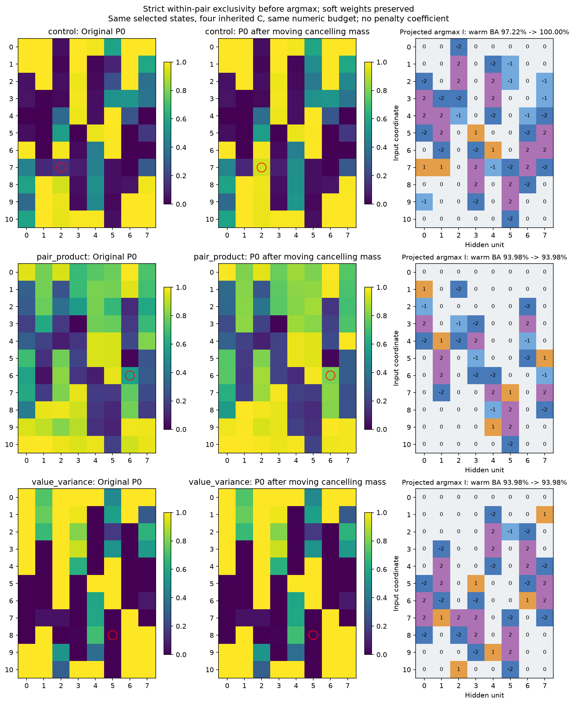

# Удаление взаимно гасящейся массы перед argmax

Для каждой пары +Ck/-Ck общая масса переносится в нулевую категорию. Правило не использует C, данные или учителя, сохраняет мягкую W для любого кодбука и сумму вероятностей. После преобразования не более одного слота каждой пары имеет положительную массу.

$$
\begin{aligned}
m_k&=\min(P_{+k},P_{-k}),\\
P'_0&=P_0+2\sum_k m_k,\\
P'_{+k}&=P_{+k}-m_k,\qquad P'_{-k}=P_{-k}-m_k.
\end{aligned}
$$

Это отдельная абляция дискретизации: прежние выбранные конфигурация, search seed и snapshot сохранены. Все четыре исходных C обучаются с теми же4096 шагами и batch stream; query выбирает численный checkpoint. Ни новый search, ни подбор штрафа не требуются. Новый I и source fits заморожены до heldout. Задача и её test уже известны, поэтому анализ исследовательский и posthoc.

| Метод | Seed | Прежний warm BA,% | Новый argmax BA,% | Новый warm BA,% | BA всех2048,% | F1 маски,% |
| --- | --- | --- | --- | --- | --- | --- |
| control | 20 | 97.22 | 80.71 | 100.00 | 100.00 | 84.21 |
| control | 22 | 93.98 | 93.98 | 93.98 | 95.17 | 93.55 |
| control | 21 | 89.35 | 89.35 | 89.35 | 89.66 | 87.72 |
| pair_product | 22 | 93.98 | 89.25 | 93.98 | 95.17 | 95.24 |
| pair_product | 20 | 93.07 | 51.35 | 89.28 | 90.16 | 73.56 |
| pair_product | 21 | 70.14 | 70.14 | 70.14 | 70.69 | 54.55 |
| value_variance | 20 | 93.98 | 71.99 | 93.98 | 95.17 | 81.16 |
| value_variance | 22 | 93.98 | 93.98 | 93.98 | 95.17 | 96.88 |
| value_variance | 21 | 75.69 | 75.69 | 75.69 | 77.59 | 66.67 |

Компенсация между разными базовыми кодами может сохраниться. Точное восстановление всей структуры со всех seed не гарантируется; группировки и маска оцениваются отдельно. Свежие C для новых projected I здесь не оценивались.

Сохранены исходные/преобразованные P, I, исходные C, все fits и метрики, max разность мягких W, сумм вероятностей и произведений противоположных слотов. Программные тесты не создавались и не запускались.
