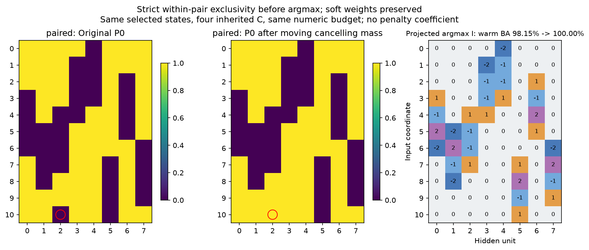

# Удаление компенсации перед argmax: исходный пятизначный кодбук

В каждой паре Ck/-Ck переносим общую вероятность в фиксированный нулевой слот:

$$
\begin{aligned}
m_k &= \min(P_{+k},P_{-k}),\\
P'_0 &= P_0+2\sum_k m_k,\\
P'_{+k} &= P_{+k}-m_k,\qquad P'_{-k}=P_{-k}-m_k.
\end{aligned}
$$

Преобразование сохраняет сумму вероятностей и мягкие веса для любых C, но в каждой паре оставляет положительную вероятность не более чем у одного знака. Оно не использует учителя и не имеет коэффициента штрафа. Компенсация между разными базовыми кодами может остаться.

Состояния исходного совместного поиска, конфигурация, три выбранных search seed и snapshot не меняются. Применяется только новая дискретизация; затем те же четыре исходных C обучаются4096 шагов с теми же batch. Checkpoint и C выбираются по query. Новые I и source fits заморожены до heldout. Это posthoc-анализ уже изученной задачи.

| Search seed | Прежний warm test BA, % | Новый argmax BA, % | Новый warm test BA, % | BA всех2048, % | F1 маски, % |
| --- | --- | --- | --- | --- | --- |
| 15, основной | 98.15 | 100.00 | 100.00 | 100.00 | 100.00 |
| 14 | 95.14 | 95.14 | 95.14 | 94.77 | 93.75 |
| 16 | 92.36 | 92.66 | 92.36 | 92.18 | 90.32 |

У основного состояния обычный immediate argmax давал90.71% BA. После преобразования он даёт100% ещё до дополнительного обучения C. Удалена одна лишняя связь; оставшиеся разные имена почти равных кодов не сливались, строгая группировка по двум ролям имеет11/88 отличий. Это точная бинарная маска и точное решение функции, а не доказательство единственного истинного шэринга.

Максимальное изменение мягких W по трём состояниям и четырём C:2.38e-7; изменение суммы вероятностей1.19e-7; произведение вероятностей внутри каждой пары после преобразования ровно0. Свежие C для новых projected I не оценивались.

Исходные/преобразованные P, I, начальные C, fits и оценки сохранены в NPZ; происхождение выбора — registration.json и source_frozen.json. Численные результаты — summary.json. Программные тесты не создавались и не запускались.
