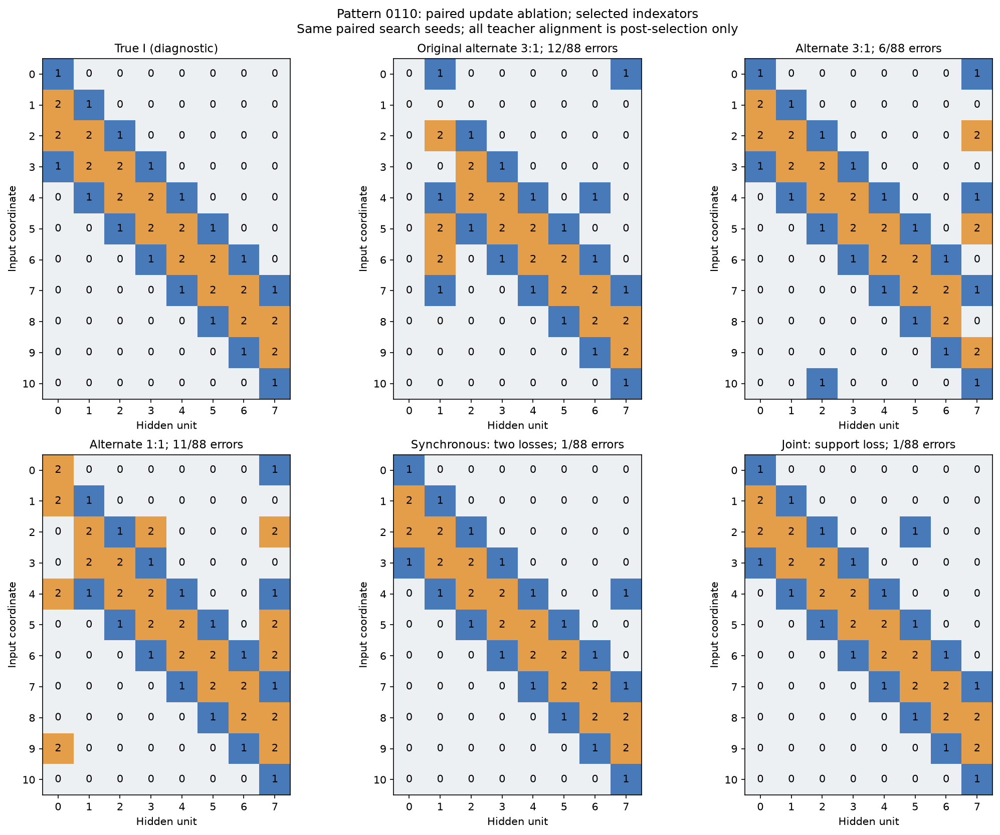
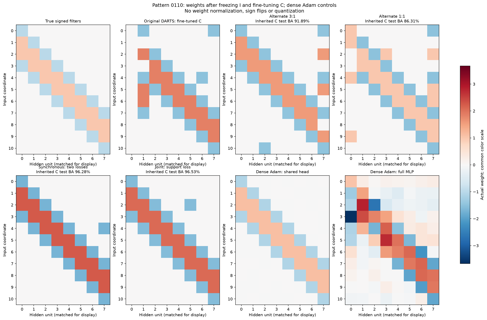
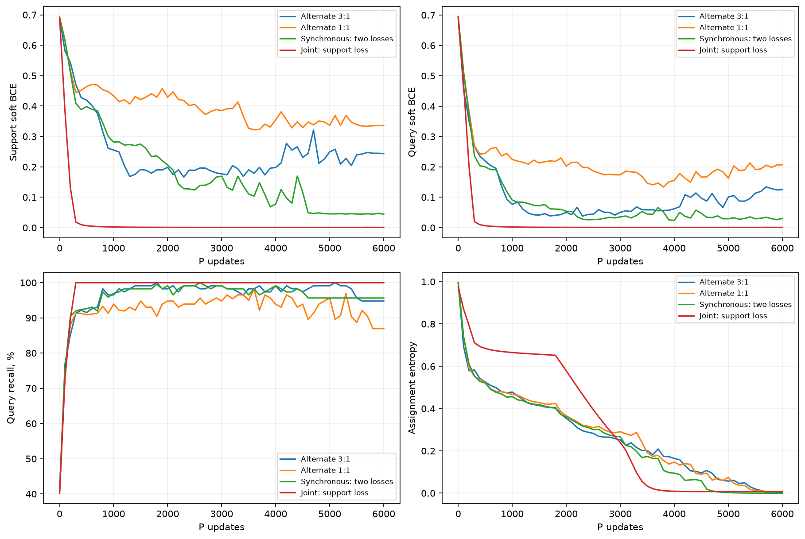
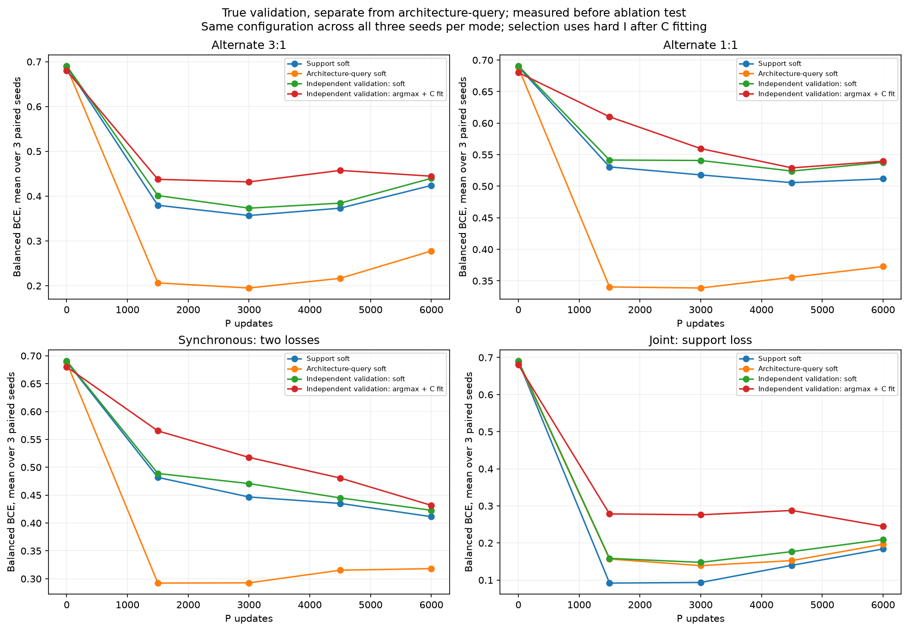
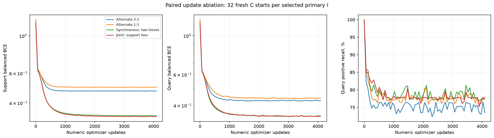

## Абляция по запросу пользователя: порядок обновлений P и C

Это дополнение после первоначального test. Исходный выбор не меняется. Две заранее выбранные настройки поиска проверены на трёх новых парных seed 5/6/7. Начальные P/C и warmup совпадают; на каждом внешнем шаге совпадают три support minibatch и независимый query minibatch. 1:1 варианты используют первый support batch. Всего 6000 обновлений P; 3:1 получает 18000 обновлений C, остальные 6000, плюс общий warmup512. Таким образом отдельно меняются соотношение обновлений, их порядок и обучающий loss.

Alternate3/1: сначала C на support, затем P на query. Synchronous split: оба градиента вычисляются до обновления чисел, C по support и P по query. Joint support: оба градиента вычисляются по одному support loss; query не обучает P. Везде независимые состояния Adam, одинаковые регуляризаторы, четыре кодбука и argmax с последующим дообучением C4096.

Checkpoint и конфигурация выбираются по прежнему source-only правилу после дообучения исходных C. Для всех трёх I выбранной конфигурации — по32 свежих C с общей ранее зафиксированной численной настройкой. Старт C выбирается поquery; первичный search seed — поselection. Ни test, ни совпадение с истинным I не ранжируют модели.

Основная таблица: продолжаем исходные C после фиксации I, как в предложенном пользователем алгоритме. Три seed перечислены в порядке5/6/7. Свежие кодбуки — отдельный контроль ниже.

| Режим | Config | Mean selection BCE | Test BA: три seed, % | Среднее seed, % | Primary BA, % | Primary ошибок I/88 | Точных I/3 |
| --- | --- | --- | --- | --- | --- | --- | --- |
| Alternate 3:1 | 11 | 0.41 | 87.76, 68.12, 91.89 | 82.59 | 91.89 | 6 | 0 |
| Alternate 1:1 | 11 | 0.52 | 67.96, 70.46, 86.31 | 74.91 | 86.31 | 11 | 0 |
| Synchronous: two losses | 11 | 0.42 | 67.04, 65.40, 96.28 | 76.24 | 96.28 | 1 | 0 |
| Joint: support loss | 10 | 0.24 | 96.53, 73.19, 93.98 | 87.90 | 96.53 | 1 | 0 |

| Режим: свежие C | Среднее BA трёх seed, % | Primary: query-выбранный C, % | Primary: среднее32C, % |
| --- | --- | --- | --- |
| Alternate 3:1 | 76.55 | 91.89 | 74.33 |
| Alternate 1:1 | 67.97 | 86.31 | 72.76 |
| Synchronous: two losses | 71.58 | 96.53 | 77.95 |
| Joint: support loss | 80.17 | 96.53 | 80.37 |

У некоторых неосновных seed свежие C с общим режимом сходятся хуже унаследованных чисел; это ограничение общей численной настройки. Качество самого алгоритма продолжения C оценивается первой таблицей.

