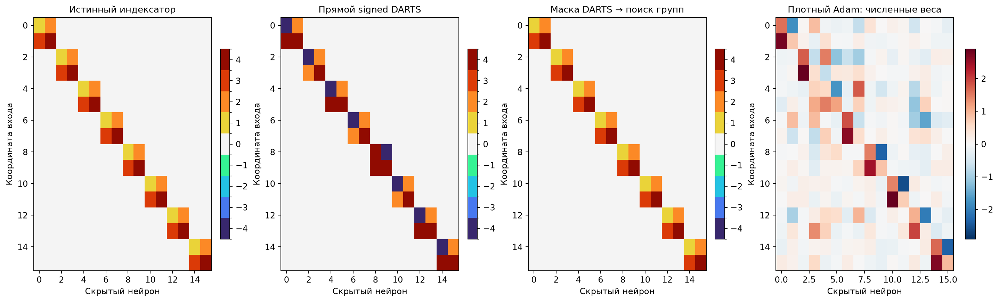
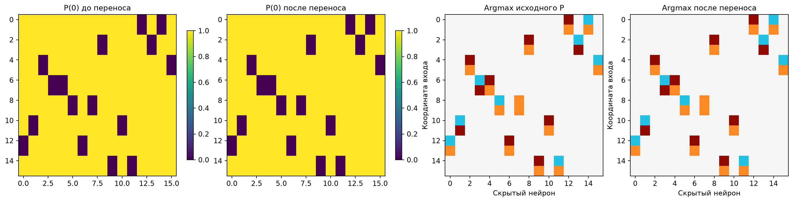
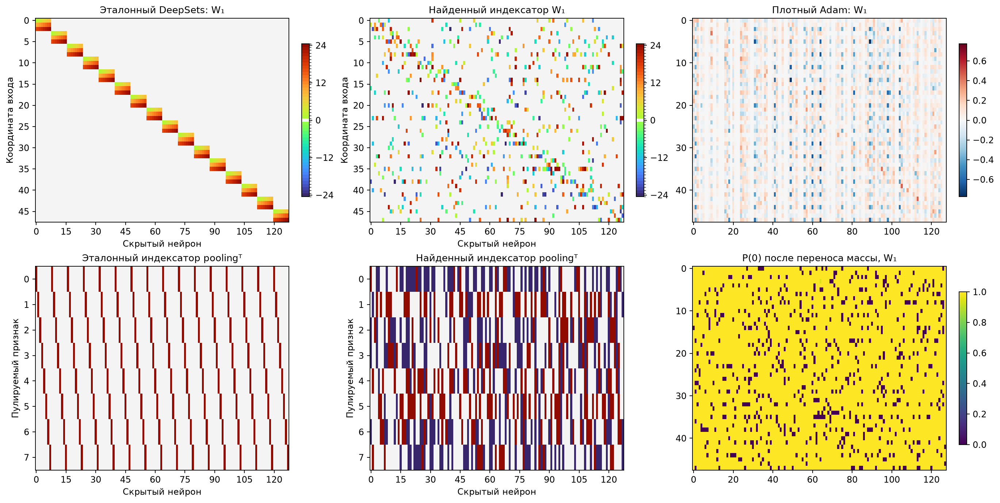
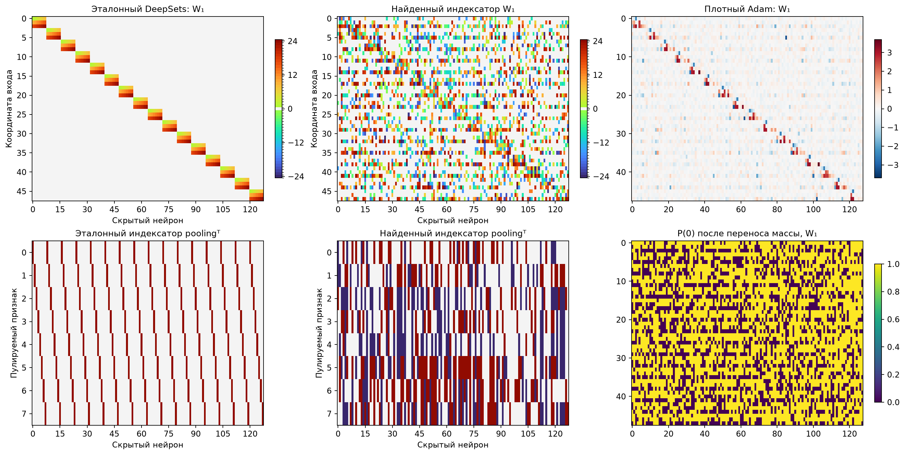
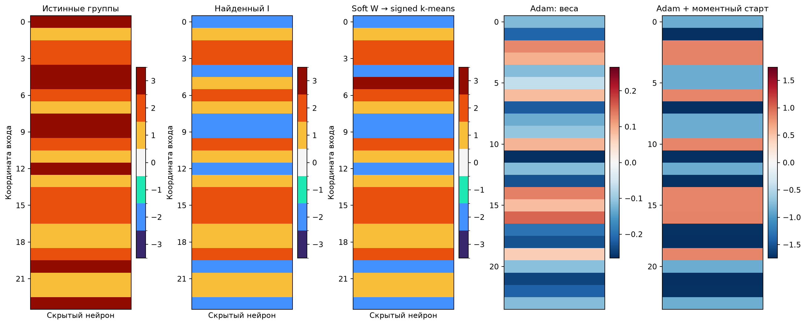

# Signed DARTS: DeepSets и сумма двух синусоид

Все основные структуры, численные состояния и гиперпараметры выбраны по support/query/selection до оценки. Query, по которой обновляется P, не считается независимой валидацией. После переноса взаимно гасящейся массы C/−C в ноль берётся argmax и переобучаются только численные параметры. Справочники содержат m свободных C и ровно связанные −C; размер словаря 2m+1.

## Синтетический DeepSets

Восемь двухмерных точек, два общих ReLU-фильтра на точку, четыре независимых численных кода. Входные координаты скрыто переставлены; поиску доступны 16 входов и 16 скрытых нейронов без блоков, ролей и числа активных связей. Support/query/selection/test: 1024/512/2048/8192. Функция — сумма всех ReLU с общими b/a/d. Метрика ниже — MSE, делённая на дисперсию обучающих ответов; меньше лучше.

| Поиск | Выбранный C | Свежий C | Плотный Adam | Истинный I + Adam |
| --- | --- | --- | --- | --- |
| deepsets | 0.0730619 | 0.0729466 | 0.0323113 | 3.29e-09 |
| deepsets_refinement | 0.0377519 | 0.0372649 | 0.0323113 | 3.29e-09 |

Двухэтапный follow-up: NMSE 3.49403e-09; свежий C 0.000391665; ошибок I 0/256. Это отдельный exploratory опыт: маска DARTS, независимые веса внутри неё, signed k-means и дообучение C.

Прямой поиск, восстановление бинарной маски и восстановление групп оцениваются отдельно. Приближённое решение функции не доказывает точное восстановление равенств. Научная оценка одной синтетической структуры не устанавливает перенос на произвольные DeepSets.

В рисунках синтетики исходная перестановка входных координат восстановлена только для отображения. Скрытые нейроны и глобальные имена/знаки групп согласованы после выбора модели. Плотные Adam/SGD показываются реальными численными весами; дискретные индексаторы им не приписываются.

## Перемешанные точки изображений

Это компактный опыт: изображения усредняются до 4×4 точек с признаками row/column/intensity. Эталонный DeepSets: phi 3→8 ReLU, mean pooling, rho 8→32 ReLU→10. Поиск использует общий dense 48→128→8→32→10 и узнаёт индексаторы первого слоя, bias и pooling с 24/8/1 независимыми кодами. Финальный rho обучается численно. Это меньшая модель и разрешение, чем исторический пилот на 196 точках и width64; результаты не являются его воспроизведением.

Все десять классов; 6000/1000/1000 отдельных training-изображений для support/query/selection. В каждом обучающем minibatch точки переставляются; official test 10000 открыт после freeze. У реальных меток нет известного истинного I: сравнение индексаторов с ручным DeepSets — диагностика архитектурного сходства. В колонке свежего C все численные параметры, включая rho, переинициализированы.

| Датасет | Наш I + C | Наш I + свежий C | Плотный Adam | Плотный SGDM | Ручной DeepSets + Adam |
| --- | --- | --- | --- | --- | --- |
| MNIST | 32.50% | 32.31% | 22.50% | 24.47% | 63.51% |
| FashionMNIST | 64.98% | 64.85% | 61.13% | 58.28% | 69.54% |

## Две синусоиды и локальные минимумы

24 Gaussian-входа, один неизвестный трёхгрупповой unit-вектор v. Цель 0.4 sin(0.7 vᵀx) + sin(f vᵀx). Ученик — одна sin с обучаемой амплитудой, без phase/bias. Она приближает сильную высокую компоненту; слабая низкая компонента даёт ненулевой floor. Число sin-нейронов задано заранее одинаково для всех методов.

Для каждого замороженного I заново проверяются четыре старта при каждой норме 0.5/2/6/8. Query выбирает C среди этих 16 стартов, selection — структуру. Плотные Adam/SGD/SGDM независимо подбирают норму и шаг. Long Adam получает два старта по 12000 вместо восьми по 3000 шагов. Моментный контроль берёт направление mean(x*y) только по support и дообучает все 24 веса; он использует информированный старт и показан отдельно от случайных стартов. Точный Gaussian-риск и истинный v не участвуют в выборе.

| f | Наш I + C | Наш I + свежий C | Adam случайный | SGDM случайный | Adam long | Adam моментный | Истинный I + Adam |
| --- | --- | --- | --- | --- | --- | --- | --- |
| 4 | 0.184637 | 0.182989 | 0.500727 | 0.0554292 | 0.501195 | 0.0504657 | 0.0499721 |
| 6 | 0.297114 | 0.296073 | 0.501477 | 0.501993 | 0.501556 | 0.0503931 | 0.0500559 |
| 8 | 0.500431 | 0.0505058 | 0.501371 | 0.502019 | 0.500874 | 0.0502529 | 0.0500057 |

Отдельный заранее зарегистрированный контроль: после канонизации P кластеризовать абсолютные мягкие численные веса в m групп, знаки сохранить в I, затем обучить новые C. Все варианты порога нуля и численные настройки заданы до просмотра sine-test результатов; выбор только по query/selection, новый тест после freeze. Этот постпроцесс отличается от прямого argmax P.

| f | Прямой DARTS | Soft W → k-means | Свежий C | Ошибок I | Свежих успехов |
| --- | --- | --- | --- | --- | --- |
| 4 | 0.184637 | 0.183066 | 0.182706 | 7/24 | 0/32 |
| 6 | 0.297114 | 0.0502433 | 0.0502671 | 7/24 | 8/32 |
| 8 | 0.500431 | 0.0503241 | 0.55058 | 11/24 | 0/32 |

Таблица показывает точную population MSE, меньше лучше. В каждом summary сохранены нормы population-градиента и минимальные собственные значения полных Hessian в низком и высоком стационарных решениях. Наличие строгого плохого минимума не означает, что любой градиентный метод с любой инициализацией обязан в нём остаться.

Дополнительная диагностика оптимизатора при неизменных I: начальные C получены усреднением mean(x*y) внутри их подписанных групп, затем нормированы и зашумлены на 2%. Показаны точная MSE и число успехов среди 32 таких стартов. Все численные значения обучались; инициализатор использовал только support. Это отдельный post-freeze контроль с источниковым подбором параметров, а не первоначальная Gaussian-инициализация.

| f | Прямой I + moment-C | Квантованный I + moment-C | Истинный I + moment-C |
| --- | --- | --- | --- |
| 4 | 0.182464 (0/32) | 0.182463 (0/32) | 0.0499692 (32/32) |
| 6 | 0.296048 (0/32) | 0.0501966 (32/32) | 0.0499956 (32/32) |
| 8 | 0.0504158 (32/32) | 0.0504355 (32/32) | 0.0500421 (32/32) |

Диагноз: при f=4 и f=6 ошибки прямого I остаются даже с хорошей численной инициализацией. При f=8 тот же фиксированный I достигает почти минимальной MSE после исправления инициализации C: здесь отдельной причиной неудачи был численный поиск. Случайные старты и старты с оценкой направления по support следует сравнивать отдельно и у нашего метода, и у dense Adam.

### Проверка структуры при смене численных значений

Это один вектор v и одно истинное разбиение на группы при трёх частотах, а не три независимых семейства. Его различные координатные значения примерно −0.289599, −0.144232 и +0.142582: две группы почти образуют пару C/−C. Хорошее приближение этой функции допускает ложный шэринг. Поэтому небольшой риск не доказывает, что извлечённый I переносится на произвольные новые значения истинных кодов.

После заморозки выполнена аналитическая диагностика: проектирование v в линейное подпространство фиксированного подписанного I и одномерная минимизация точного Gaussian-риска по норме веса с аналитическим выбором амплитуды. Затем в истинных группах с фиксированным seed сгенерированы 32 новых направления. Ниже приведён численный минимум риска, достижимый при идеальном подборе C, и число новых функций, для которых этот минимум меньше 0.1. Это проверка представимости, а не результаты обучения на новых задачах.

| f / индексатор | Минимум на исходной функции | Средний минимум при новых C | Представимо с MSE<0.1 |
| --- | --- | --- | --- |
| 4/oracle | 0.0499573 | 0.0499573 | 32/32 |
| 4/direct | 0.182424 | 0.481248 | 0/32 |
| 4/quantized | 0.182424 | 0.481248 | 0/32 |
| 6/oracle | 0.0499751 | 0.0499751 | 32/32 |
| 6/direct | 0.295798 | 0.495966 | 0/32 |
| 6/quantized | 0.050158 | 0.43892 | 4/32 |
| 8/oracle | 0.0499751 | 0.0499751 | 32/32 |
| 8/direct | 0.0503234 | 0.459655 | 2/32 |
| 8/quantized | 0.0503234 | 0.459655 | 2/32 |

Полные предположения, principal angles подпространств и все 32 значения — `sine_capacity_diagnosis.json`. Данная проверка показывает недостаток переноса группировок, который может быть скрыт хорошим решением одной функции.

## Что сохранено и ограничения сравнения

В каталогах задач: specification/protocol, исполнявшиеся source snapshots, все поисковые кривые и выбранные checkpoints, полные численные метрики, P до/после переноса, точные выбранные целочисленные I, frozen/heldout manifests, PNG/SVG. Никаких программных тестов не создавалось и не запускалось.

Структурный поиск требует отдельного многократного обучения P и C, подбора и проверки кандидатов. Его стоимость не равна одному dense fit; метрики после фиксации I не учитывать как полную стоимость метода. Сравнивать также все старты и все подтверждающие seed в JSON, не только основной выбранный запуск. Гарантия успеха и универсальное преимущество над Adam не установлены.

Измеренная стоимость ниже включает все сохранённые численные обучения и поисковые обновления в каждом каталоге. Один model update — один minibatch одного численного старта; P update относится к одной архитектуре. Время — сумма измеренных интервалов обучения с промежуточной оценкой, без запуска Python и части CPU-постобработки. Общие controls двух синтетических продолжений учитываются только в исходном каталоге.

| Каталог | Численных model updates | P updates | Измерено, мин |
| --- | --- | --- | --- |
| deepsets | 7100032 | 276000 | 2.95 |
| deepsets_mask_then_sharing | 276000 | 0 | 0.64 |
| deepsets_refinement | 7103360 | 840000 | 3.92 |
| images_FashionMNIST | 1027680 | 132000 | 4.75 |
| images_MNIST | 1027680 | 132000 | 4.83 |
| sine_4 | 22988032 | 276000 | 3.84 |
| sine_4_quantized | 672000 | 0 | 0.35 |
| sine_6 | 22988032 | 276000 | 3.73 |
| sine_6_quantized | 672000 | 0 | 0.37 |
| sine_8 | 22988032 | 276000 | 3.76 |
| sine_8_quantized | 528000 | 0 | 0.35 |
