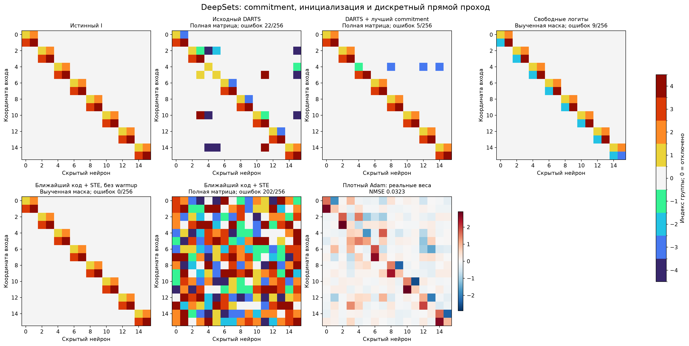

# DeepSets: что исправляет поиск шэринга

Проверены три отдельно зарегистрированные серии. Словарь во всех случаях [0,C1,…,C4,−C1,…,−C4], четыре независимых числа. Структура и настройки выбираются только по support/query/selection; teacher открывается после фиксации выбора. Это продолжение исследования одной ранее изученной численной функции, а не новый benchmark.

| Область поиска | Вариант | Средняя selection NMSE по 3 seed | Точных I/3 | Ошибок выбранного I/256 | Test NMSE выбранного I |
| --- | --- | --- | --- | --- | --- |
| Полная матрица | Исходный DARTS | 0.0461416 | 0/3 | 22 | 0.0306287 |
| Полная матрица | DARTS + лучший commitment | 0.0320234 | 0/3 | 5 | 0.0153347 |
| Выученная маска | Свободные логиты | 0.0261072 | 0/3 | 9 | 0.00341942 |
| Выученная маска | Логиты + commitment | 0.00312787 | 2/3 | 0 | 3.44072e-09 |
| Выученная маска | Логиты после warmup1000 | 3.38498e-09 | 3/3 | 0 | 3.43964e-09 |
| Выученная маска | Ближайший код + STE, без warmup | 3.37581e-09 | 3/3 | 0 | 3.42821e-09 |
| Полная матрица | Ближайший код + STE | 0.0807491 | 0/3 | 202 | 0.0791835 |

## Как читать результат

Commitment при полном поиске улучшает функцию, но не восстанавливает истинные группы. На общей маске, ранее найденной DARTS, логиты с commitment дают2/3 точных I. Численный warmup1000 с инициализацией P и C по весам даёт3/3. Ближайший код в прямом проходе и identity straight-through дают3/3 без численного warmup. Это альтернативный способ поиска, не точный градиент через argmax и не обычный мягкий DARTS.

Для nearest-STE каждая позиция имеет латентное число Z. В прямом проходе берётся ближайшее значение из подписанного кодбука. Градиент веса копируется на Z, а C получает сгруппированный градиент; добавлено слабое притяжение Z к ближайшему коду и кодов к назначенным Z. Центры изначально задаются квантилями случайных Z. Ни k-means, ни истинные связи, блоки или значения весов не используются.

Это проверка условного поиска шэринга: одна и та же маска получена ранее из данных, но не переоткрывается на каждом новом seed. Статистика3/3 не означает3/3 успеха полного алгоритма с нуля. Полная матрица проверена отдельно и отражена в таблице. Свежие32 C — новые инициализации на той же функции, не смена истинной задачи.

Инициализация по расстояниям и совместное обучение центров связаны с [Soft-to-Hard Vector Quantization](https://proceedings.neurips.cc/paper_files/paper/2017/file/86b122d4358357d834a87ce618a55de0-Paper.pdf). Прямой перенос градиента — приближённый [straight-through estimator](https://arxiv.org/abs/1308.3432). Здесь это собственная адаптация к знаковому кодбуку, не воспроизведение результатов этих работ.

На дискретных панелях цвет обозначает имя группы, а не величину веса. Координаты, скрытые нейроны и имена групп согласованы с teacher только для отображения после выбора. Панель Adam показывает реальные численные веса.

## Полные серии

- [deepsets_sharing_ablation](deepsets_sharing_ablation/REPORT.md)
- [deepsets_sharing_geometry](deepsets_sharing_geometry/REPORT.md)
- [deepsets_sharing_full](deepsets_sharing_full/REPORT.md)

## Стоимость и сохранённые данные

- deepsets_sharing_ablation: измеренное обучение 4.53 мин, артефакты 5.6 MiB.
- deepsets_sharing_geometry: измеренное обучение 5.98 мин, артефакты 3.1 MiB.
- deepsets_sharing_full: измеренное обучение 6.06 мин, артефакты 2.1 MiB.

Время — сумма записанных интервалов поиска и численных fit, без части CPU-постобработки и запуска Python. Три серии имеют разные области поиска и бюджеты; это не сравнение равных FLOPs. В каждой серии сравнения парные по seed и minibatch. Сохранены все P/I, латентные веса геометрических методов, исходные численные состояния, кривые, свежие C, протоколы и executed source snapshots. Программные тесты не создавались и не запускались.
