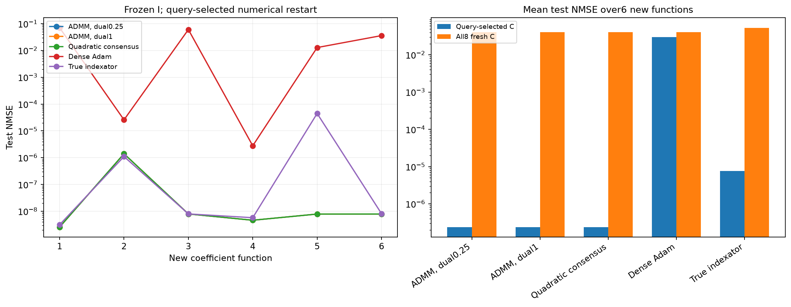
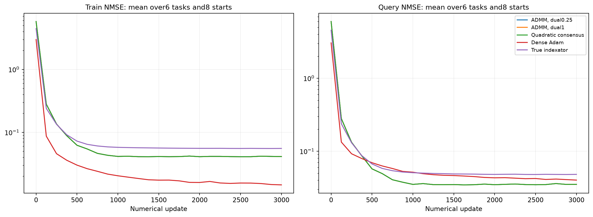

# Перенос фиксированных индексаторов на новые коэффициенты

Шесть новых целевых функций с новыми истинными C. Все извлечённые I выбраны на старой функции и фиксированы. На каждой новой функции с нуля обучаются только численные параметры; независимая validation выбирает настройки. Oracle и dense — отдельные диагностические контроли.

| Метод | Средняя test NMSE, query-selected C | Средняя test NMSE по всем8 C |
| --- | ---: | ---: |
| damped_admm/learned | 2.38487e-07 | 0.0404312 |
| damped_admm/random_sharing | 0.428695 | 0.427293 |
| damped_admm/random_all | 0.500301 | 0.503796 |
| admm/learned | 2.38481e-07 | 0.0404312 |
| admm/random_sharing | 0.386587 | 0.38737 |
| admm/random_all | 0.538126 | 0.539506 |
| quadratic/learned | 2.38489e-07 | 0.0404312 |
| quadratic/random_sharing | 0.45853 | 0.461623 |
| quadratic/random_all | 0.653445 | 0.654067 |
| oracle | 7.62383e-06 | 0.0533949 |
| dense_adam | 0.0298967 | 0.0407865 |

random_sharing переставляет кодовые метки внутри той же маски, random_all перемешивает все позиции с сохранением числа кодов и их частот. Численные скорости/радиусы подбираются отдельно для каждого метода на query/selection, heldout не участвует. Это перенос между коэффициентами одной скрытой структуры, не перенос между архитектурами или датасетами.

Полный протокол: ../transfer_registration.json. Численные состояния и source-freeze сохранены по каждой задаче. Программные тесты не создавались и не запускались.

## Кривые и границы вывода

Кривые усредняют все8 численных стартов на всех6 новых функциях при выбранной по selection численной настройке каждого метода. Train измерен на первых512 support-примерах, query — на512; ось X — реальные обновления. Они не показывают test во время обучения. В таблице выше также сохранены перестановочные контроли шэринга и подключений.

Малая source-ошибка и успешные свежие C на прежней функции недостаточны для вывода о переносимой структуре. Здесь переносится только source-selected I; значения C, bias/readout/offset не переносятся. Истинный I — отдельная диагностика численной обучаемости. Шесть функций одной скрытой структуры не являются переносом между датасетами или новыми архитектурами.

Новое численное обучение переноса: 1.20 мин. Повторно использованы идентичные dense-контроли стоимостью 1.44 мин, если указаны dense_control_reuse.json. Совпадение наблюдений, протокола, настроек и бюджета проверено перед загрузкой. Source-поиск сюда не включён.
