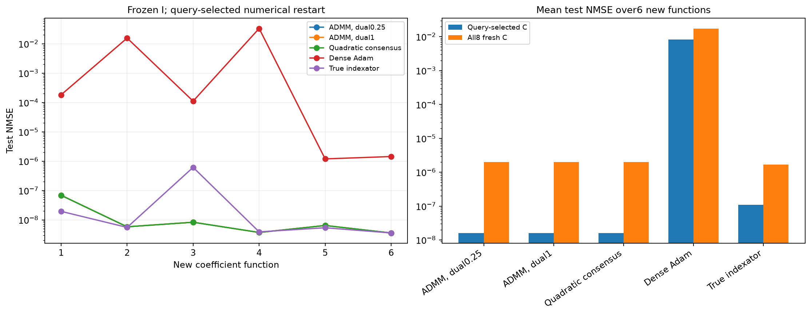
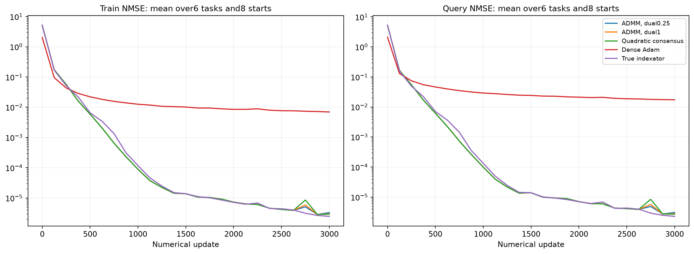

# Перенос фиксированных индексаторов на новые коэффициенты

Шесть новых целевых функций с новыми истинными C. Все извлечённые I выбраны на старой функции и фиксированы. На каждой новой функции с нуля обучаются только численные параметры; независимая validation выбирает настройки. Oracle и dense — отдельные диагностические контроли.

| Метод | Средняя test NMSE, query-selected C | Средняя test NMSE по всем8 C |
| --- | ---: | ---: |
| damped_admm/learned | 1.6074e-08 | 1.9879e-06 |
| damped_admm/random_sharing | 0.449101 | 0.446623 |
| damped_admm/random_all | 0.521037 | 0.521922 |
| admm/learned | 1.60728e-08 | 1.98772e-06 |
| admm/random_sharing | 0.391225 | 0.40417 |
| admm/random_all | 0.563555 | 0.560707 |
| quadratic/learned | 1.60681e-08 | 1.98793e-06 |
| quadratic/random_sharing | 0.413537 | 0.414687 |
| quadratic/random_all | 0.602057 | 0.600445 |
| oracle | 1.0883e-07 | 1.68073e-06 |
| dense_adam | 0.00821085 | 0.01752 |

random_sharing переставляет кодовые метки внутри той же маски, random_all перемешивает все позиции с сохранением числа кодов и их частот. Численные скорости/радиусы подбираются отдельно для каждого метода на query/selection, heldout не участвует. Это перенос между коэффициентами одной скрытой структуры, не перенос между архитектурами или датасетами.

Полный протокол: ../transfer_confirmation_registration.json. Численные состояния и source-freeze сохранены по каждой задаче. Программные тесты не создавались и не запускались.

## Кривые и границы вывода

Кривые усредняют все8 численных стартов на всех6 новых функциях при выбранной по selection численной настройке каждого метода. Train измерен на первых512 support-примерах, query — на512; ось X — реальные обновления. Они не показывают test во время обучения. В таблице выше также сохранены перестановочные контроли шэринга и подключений.

Малая source-ошибка и успешные свежие C на прежней функции недостаточны для вывода о переносимой структуре. Здесь переносится только source-selected I; значения C, bias/readout/offset не переносятся. Истинный I — отдельная диагностика численной обучаемости. Шесть функций одной скрытой структуры не являются переносом между датасетами или новыми архитектурами.

Новое численное обучение переноса: 2.57 мин. Повторно использованы идентичные dense-контроли стоимостью 0.00 мин, если указаны dense_control_reuse.json. Совпадение наблюдений, протокола, настроек и бюджета проверено перед загрузкой. Source-поиск сюда не включён.
