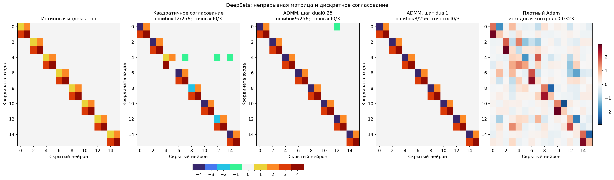
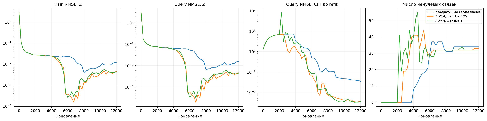

# DeepSets: согласование непрерывной и дискретной матриц

Полный поиск256 позиций без готовой маски, истинного числа связей, групп или чисел учителя. Сравниваются квадратичный штраф без dual и два шага dual-переменной. Никакая позиция не фиксируется до окончательного source-выбора.

| Метод | Средняя selection NMSE | Средняя test NMSE,3seed | Точных масок/3 | Точных I/3 | Связей выбранного I | Средняя test NMSE32 свежих C |
| --- | ---: | ---: | ---: | ---: | ---: | ---: |
| Квадратичное согласование | 0.0800086 | 0.0235058 | 1/3 | 0/3 | 34 | 0.0701144 |
| ADMM, шаг dual0.25 | 0.0437056 | 0.0166677 | 0/3 | 0/3 | 33 | 0.0420631 |
| ADMM, шаг dual1 | 0.0404989 | 0.0413134 | 1/3 | 0/3 | 32 | 0.0425438 |

## Алгоритм и границы

Сначала 2000 непрерывных обновлений Z, затем 10000 обновлений со связью с проекцией Q=C[I]. На support оптимизируется L(Z)+rho/2*mean((Z-Q+U)^2). Каждые 50 шагов обновляются индексатор и четыре центра по Z+U: локальными Lloyd-итерациями, с фиксированным нулём и ценой ненулевого выбора. Затем U+=eta*(Z-Q). Сравниваются eta0, eta0.25 и eta1. Rho растёт геометрически от 0.01 до 1/100; U масштабируется обратно при изменении rho.

Цена lambda выбирается из 0/0.003/0.03/0.3. Число активных связей неизвестно поиску. Внутренняя непрерывная задача не решается точно; гарантий глобальной сходимости нейросетевого поиска нет. Forward при поиске использует Z, итоговая сеть — дискретный C[I]. Ошибка Z отдельно показана на графиках; итоговая таблица оценивает только жёсткий индексатор после C-fit.

24 настройки, pilot281/282; одна настройка на семью фиксируется до confirmation283/284/285. Снимки0/4000/8000/12000 отбираются только после3000 hard-C-fit шагов с1исходным+3свежими Gaussian стартами. Query выбирает численные checkpoints, средняя selection выбирает I/настройку. Новый heldout8192 и teacher-аудит после source/freshfreeze. Fresh32C на прежней функции — численный контроль, не перенос.

Литературная основа — [ADMM для pruning и clustering](https://arxiv.org/abs/1811.01907). Общий механизм не заявляется новым; здесь исследуется teacher-blind восстановление полного I со signed-кодбуком. Adam на рисунке — прежний контроль, не повторное обучение.

Полные выбранные I/C/W: selected_indexators.json; исходники, регистрация, freeze и states сохранены. Программные тесты не создавались и не запускались.
