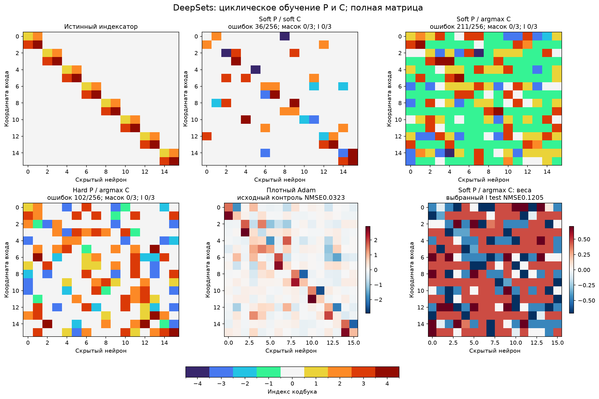
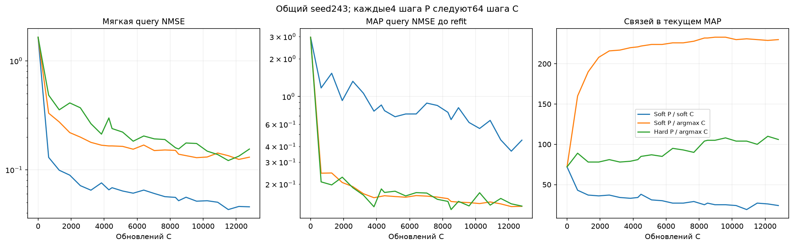

# DeepSets: повторяющиеся блоки P и C на полной матрице

В каждом цикле сначала4 support-шага P при остановленном C, затем64 support-шага C при остановленном P. Индексатор заново вычисляется после каждой P-фазы. Логиты сохраняются; ни P, ни C не фиксируются навсегда.200 циклов,800 обновлений P,12800 обновлений C, четыре численные реплики.

| Режим | Средняя selection NMSE | Средняя test NMSE, 3 seed | Точных масок/3 | Точных I/3 | Связей выбранного I | Средняя test NMSE32 свежих C |
| --- | ---: | ---: | ---: | ---: | ---: | ---: |
| Soft P / soft C | 0.267556 | 0.256253 | 0/3 | 0/3 | 38 | 0.206711 |
| Soft P / argmax C | 0.125668 | 0.122822 | 0/3 | 0/3 | 231 | 0.120721 |
| Hard P / argmax C | 0.109514 | 0.111424 | 0/3 | 0/3 | 113 | 0.108446 |

## Мягкая и дискретная модели до refit

Среднее по source-selected снимкам трёх confirmation seed при их текущих C. Эти ошибки относятся к модели до независимого C-refit из основной таблицы.

| Режим | Soft query NMSE | Argmax query NMSE | Максимум изменений MAP за зарегистрированный цикл, 3 seed |
| --- | ---: | ---: | --- |
| Soft P / soft C | 0.0457011 | 0.526478 | 8, 6, 6 |
| Soft P / argmax C | 0.123926 | 0.128948 | 8, 13, 12 |
| Hard P / argmax C | 0.143 | 0.122244 | 22, 19, 24 |

Изменения argmax между циклами подтверждают, что I не фиксируется навсегда. Циклический soft-P/hard-C проверяет предложение пользователя; один размер блока не исчерпывает возможные расписания.

## Протокол

Soft P/soft C — парный блочный контроль. Soft P/hard C — предложенная пользователем схема: архитектурная фаза оптимизирует смесь кодов, численная фаза обучается на текущем argmax I. Hard P/hard C использует argmax также в архитектурном forward, градиент P — через softmax STE. Это смещённая оценка; градиент через адаптацию C не вычисляется.

P=softmax(alpha), без sampling и без охлаждения; словарь [0,C1,…,C4,−C1,…,−C4]. Raw MAP без переноса массы; sparsity0.03 и поздний entropy0.02 общие. Все256 позиций разрешены. Предварительная маска, истинные связи, перестановка входов и число истинных связей поиску не передаются.

Шесть настроек на семью: C lr0.01/0.03, P lr0.01/0.03/0.1. Pilot241/242 выбирает одну настройку, confirmation243/244/245 проверяет её на новых seed. Начальные alpha/C и phase-minibatch совпадают. Numerical Adam moments сохраняются между циклами.

Снимки после0/67/133/200 циклов фиксируют MAP; затем четыре исходных C проходят3000 шагов refit с новыми моментами оптимизатора. Query выбирает численные checkpoints, средняя selection ошибка выбирает снимки и настройки. Teacher открывается после source/fresh freeze. Fresh-C калибровка и32 новые Gaussian-инициализации, heldout8192 новых входов той же ранее изученной функции. Три seed не являются тремя независимыми задачами.

Чередование замороженных весов и архитектурных параметров при hard-путях также применяется в [ProxylessNAS, §3.2](https://arxiv.org/abs/1812.00332). Здесь проверяется его конкретная адаптация к индексатору и общему численному кодбуку; новизна самого принципа не заявляется.

Полные выбранные I/C/W сохранены в selected_indexators.json; raw P/alpha/C — в snapshots.npz. Перестановки нейронов и названия групп согласованы с teacher только для рисунков/аудита. Adam — исходный численный контроль, не новое обучение.

Измеренное обучение 3.41 мин., включая 44.04с незавершённой попытки. Первая попытка получила SIGTERM; повторный пилот использовал тот же протокол и seed. Программные тесты не создавались и не запускались.
