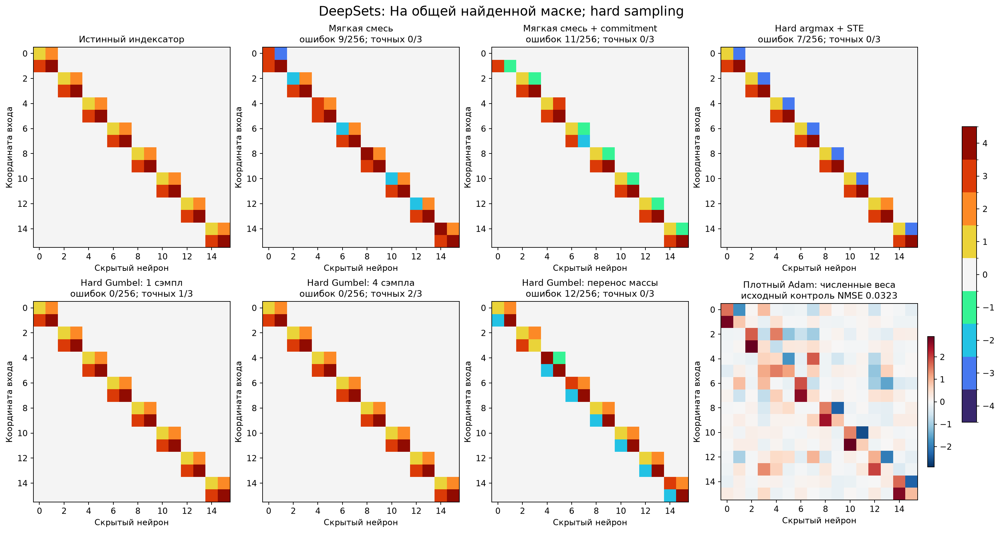
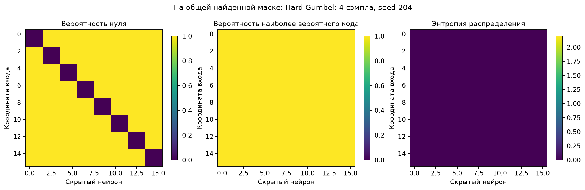
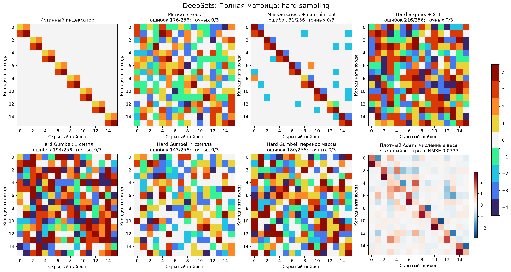
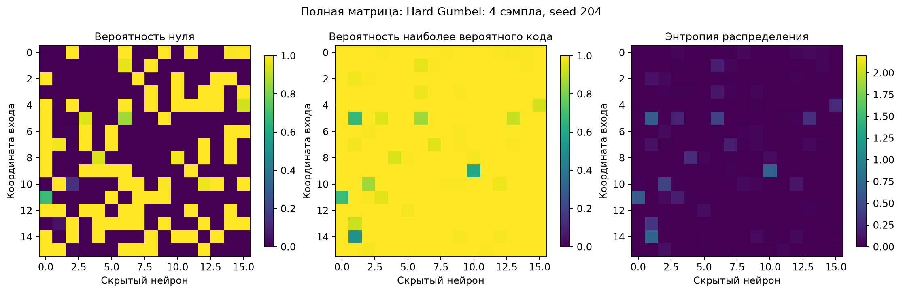
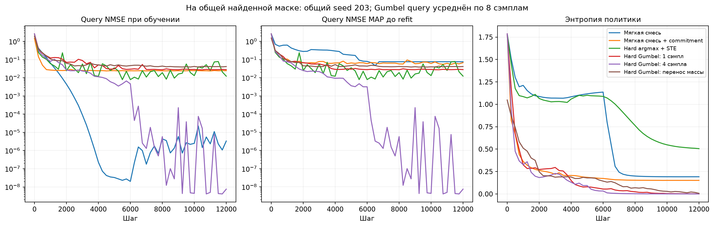
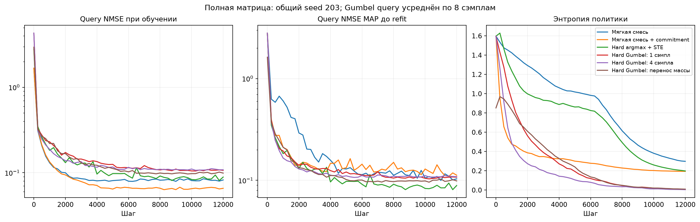

# DeepSets: жёсткое сэмплирование индексаторов

Сравнение на одном ранее изученном синтетическом учителе. Маски и численные параметры выбираются только по source-данным. Три новых seed не являются тремя новыми задачами.

В hard-вариантах каждая позиция в каждом прямом проходе имеет ровно один код из [0,C1,…,C4,−C1,…,−C4]. Индексатор общий для minibatch; четыре сэмпла используют один общий кодбук. Backward использует смещённую straight-through оценку.

| Область | Метод | Средняя selection NMSE | Точных I/3 | Точных масок/3 | Ошибок выбранного I | Test NMSE выбранного I | Средняя test NMSE 32 свежих C |
| --- | --- | ---: | ---: | ---: | ---: | ---: | ---: |
| Выученная маска | Мягкая смесь | 0.0374551 | 0/3 | 2/3 | 9/256 | 0.0300311 | 0.0300232 |
| Выученная маска | Мягкая смесь + commitment | 0.0593386 | 0/3 | 0/3 | 11/256 | 0.0465713 | 0.149833 |
| Выученная маска | Hard argmax + STE | 0.0239618 | 0/3 | 3/3 | 7/256 | 0.00332228 | 0.0321961 |
| Выученная маска | Hard Gumbel: 1 сэмпл | 0.0268005 | 1/3 | 2/3 | 0/256 | 3.45977e-09 | 0.03223 |
| Выученная маска | Hard Gumbel: 4 сэмпла | 0.0211007 | 2/3 | 2/3 | 0/256 | 3.43512e-09 | 0.0178043 |
| Выученная маска | Hard Gumbel: перенос массы | 0.0392455 | 0/3 | 2/3 | 12/256 | 0.0100263 | 0.0100109 |
| Полная матрица | Мягкая смесь | 0.0845602 | 0/3 | 0/3 | 176/256 | 0.0817641 | 0.0816309 |
| Полная матрица | Мягкая смесь + commitment | 0.0718465 | 0/3 | 0/3 | 31/256 | 0.0168962 | 0.0170555 |
| Полная матрица | Hard argmax + STE | 0.0826016 | 0/3 | 0/3 | 216/256 | 0.0793102 | 0.0788581 |
| Полная матрица | Hard Gumbel: 1 сэмпл | 0.09459 | 0/3 | 0/3 | 194/256 | 0.0829861 | 0.0824624 |
| Полная матрица | Hard Gumbel: 4 сэмпла | 0.0894141 | 0/3 | 0/3 | 143/256 | 0.0852147 | 0.0851923 |
| Полная матрица | Hard Gumbel: перенос массы | 0.094352 | 0/3 | 0/3 | 180/256 | 0.0858409 | 0.0856679 |

## Что получилось

На найденной маске лучший сэмплирующий вариант — Hard Gumbel: 4 сэмпла: средняя selection NMSE 0.0211007, точных индексаторов 2/3. Мягкий контроль: 0.0374551; детерминированный hard STE: 0.0239618. Три запуска дают предварительное сравнение; надёжное преимущество шума над детерминированным hard forward не установлено.

Полный поиск: лучший сэмплирующий вариант Hard Gumbel: 4 сэмпла, NMSE 0.0894141, точных I 0/3. Эти результаты следует отделять от поиска шэринга внутри готовой найденной маски.

Численные значения выбранных кодбуков, полные матрицы I/W и train/query/selection ошибки экспортированы в masked/selected_indexators.json и full/selected_indexators.json. Изображения групп согласованы с teacher только после выбора.

## Протокол

По24 настройки в каждой области. Pilot201/202 выбирает скорость обучения и, для полного поиска, sparsity по hard-refit selection NMSE. Confirmation203/204/205 использует выбранные настройки. Каждый поиск12000 шагов, один численный старт. Контроль soft_commit добавляет нормированный commitment0.1. Точные настройки сохранены в registration.json и family_selection.json.

После снимков0/4000/8000/12000 фиксируется MAP индексатор именно обучаемой политики, без дополнительного переноса массы. Кодбук дообучается3000 шагов с одного исходного и трёх свежих Gaussian-стартов; query выбирает численные checkpoints, средняя selection ошибка выбирает структуру. Диагностическая ошибка случайных структур не используется для выбора.

Маска в masked взята из одного ранее выбранного DARTS запуска; вне неё связи запрещены, внутри разрешён нулевой код. Full начинает со всех256 допустимых позиций. Масса +/- переносится до sampling только в отдельной ветке gumbel_1_mass; это изменение распределения, а не эквивалентная канонизация стохастического loss.

Температура backward плавно меняется1→0.3, вероятность sampling остаётся softmax(alpha). Во всех ветках одинаковый поздний entropy penalty0.02. Начальные alpha/C и support minibatch парные, Gumbel noise парный по seed, один сэмпл — префикс четырёх. Gumbel4 использует в4 раза больше стохастических оценок loss за шаг. Реализация пакетирует все ветки по максимуму4, поэтому отдельные wall-clock затраты методов из общего времени не выводятся.

Fresh-C calibration использует8 стартов на сочетание rate/radius; затем32 новые Gaussian-инициализации при зафиксированных структуре и настройках. Это проверка оптимизатора на той же функции, не перенос на другой истинный кодбук.

## Индексаторы и вероятности

Имена групп и нейроны согласованы с teacher только для финального аудита и рисунков. Панель Adam показывает исходный численный контроль; он здесь повторно не обучался.

## Затраты

- masked: измеренное обучение 5.22 мин.
- full: измеренное обучение 5.21 мин.

Сохранены регистрации, исходники выполненных запусков, P, alpha, I, C, кривые и refit. Программные тесты не создавались и не запускались.
