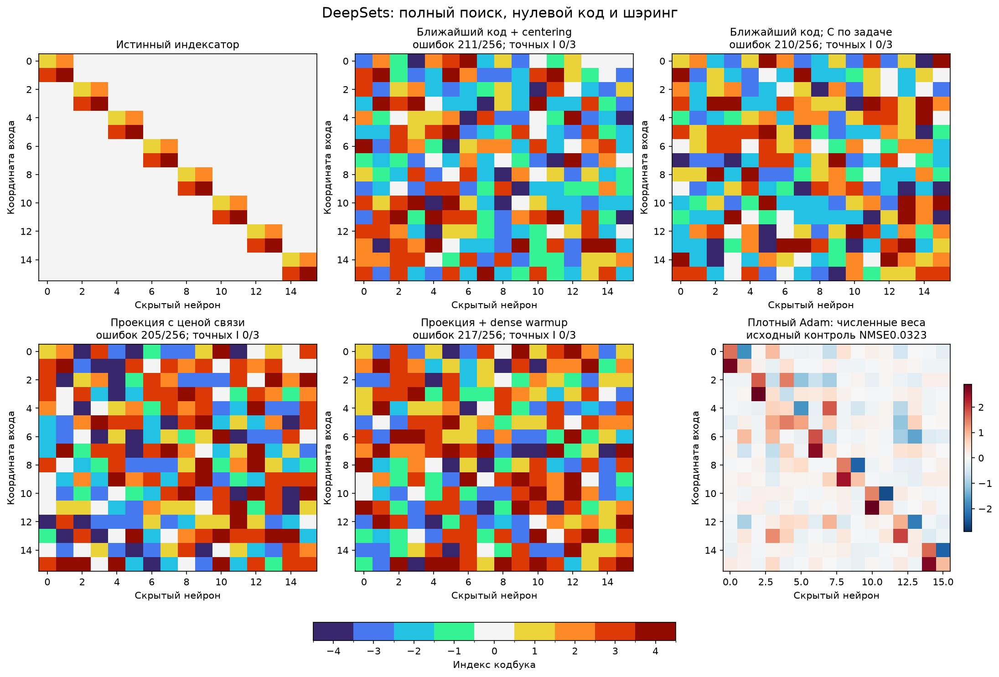
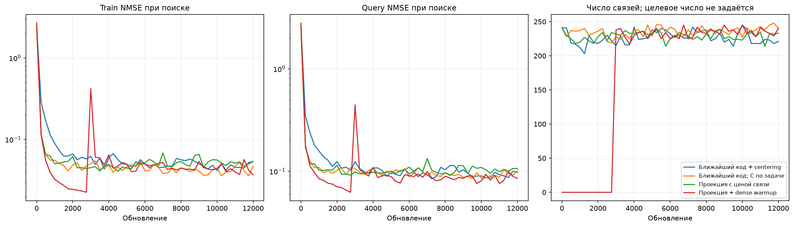

# DeepSets: извлечение полного индексатора проекцией

Один ранее изученный синтетический учитель, все256 позиции доступны. Никакой готовой маски, ролей координат или истинного числа32 связей в поиске нет. Новый hard-forward nearest-code контроль и модификации: C только по task-loss, цена ненулевого кода в проекции, полный dense warmup3000 шагов.

| Метод | Средняя selection NMSE | Средняя test NMSE, 3 seed | Точных масок/3 | Точных I/3 | Связей выбранного I | Средняя test NMSE32 свежих C |
| --- | ---: | ---: | ---: | ---: | ---: | ---: |
| Ближайший код + centering | 0.0832218 | 0.084276 | 0/3 | 0/3 | 234 | 0.0814928 |
| Ближайший код; C по задаче | 0.078943 | 0.0767279 | 0/3 | 0/3 | 233 | 0.0769125 |
| Проекция с ценой связи | 0.0763982 | 0.0777742 | 0/3 | 0/3 | 227 | 0.0764711 |
| Проекция + dense warmup | 0.0791852 | 0.0809204 | 0/3 | 0/3 | 240 | 0.0773541 |

## Проекция

Мягкие смеси после warmup не используются. Для каждой позиции берётся ровно один код; при сохранении фиксируется ровно этот индекс. Ниже s — stop-gradient среднего квадрата четырёх численных кодов; lambda постепенно нарастает.

$$
I_e=\arg\min_k\left[\frac{(Z_e-D_k(C))^2}{s}+\lambda\,\mathbf{1}_{k\ne0}\right],\qquad W_e=D_{I_e}(C).
$$

Ненулевой штраф меняет границы решения в пользу нуля. Это стоимость выбора дискретного кода, не несмещённый градиент task-loss с L0. Z получает identity STE и commitment0.01; C получает градиент задачи по выбранным кодам. У nearest-контроля дополнительно centering0.01, в остальных C-centering отключён. Численные L2/Adam/clip общие. При инференсе храним I и C, заново округлять по обычному nearest нельзя.

Pilot261/262 выбирает одну настройку каждой семьи, confirmation263/264/265 использует выбранные настройки. Численные скорости0.003/0.01; цена ненулевого кода0.001/0.01/0.1/1.0. Поиск12000 шагов, включая optional warmup3000. Начальные Z и support minibatch парные. Dense warmup не отключает связи: вся матрица остаётся обучаемой.

Каждый снимок0/4000/8000/12000 оценивается после3000 C-fit шагов с одного исходного и трёх свежих C. Query выбирает численные checkpoints, средняя selection ошибка — структуру и настройки. Teacher и новый heldout8192 открываются после source/fresh-freeze. Четыре семьи не являются независимыми задачами; три seed — также не новые функции.

32 свежих C на той же функции показывают численную сходимость, а не перенос структуры. Перенос требует новых целевых функций с новыми истинными коэффициентами при фиксированном I и оценивается отдельной стадией.

Основа: [LUT-Q](https://arxiv.org/abs/1911.04951), [оптимизация VQ/STE](https://arxiv.org/abs/2305.08842), [ProxQuant](https://arxiv.org/abs/1810.00861). Здесь проверяются конкретные модификации извлечения sharing; новизна механизма проекции сама по себе не заявляется.

Полные выбранные I/C/W: selected_indexators.json. Согласование с teacher используется только для аудита и рисунков. Adam — исходный численный контроль, здесь не переобучался.

Измеренное обучение 3.69 мин. Программные тесты не создавались и не запускались.
