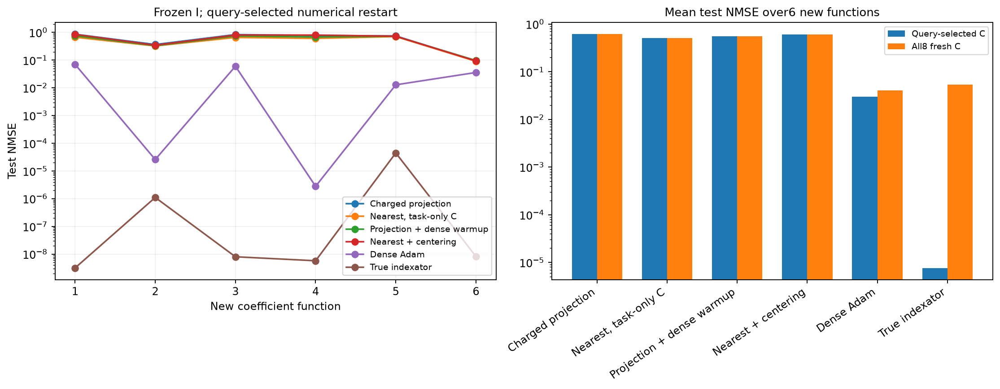
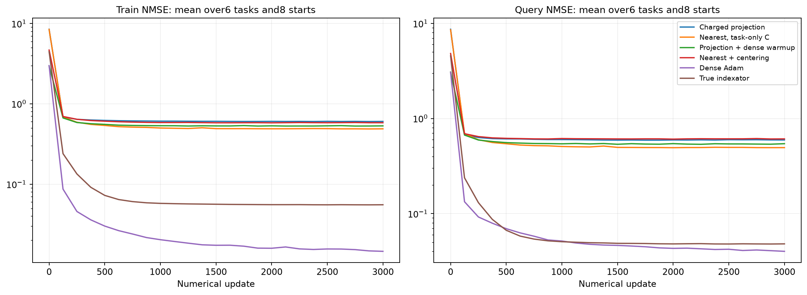

# Перенос фиксированных индексаторов на новые коэффициенты

Шесть новых целевых функций с новыми истинными C. Все извлечённые I выбраны на старой функции и фиксированы. На каждой новой функции с нуля обучаются только численные параметры; независимая validation выбирает настройки. Oracle и dense — отдельные диагностические контроли.

| Метод | Средняя test NMSE, query-selected C | Средняя test NMSE по всем8 C |
| --- | ---: | ---: |
| proximal/learned | 0.614231 | 0.614223 |
| proximal/random_sharing | 0.652592 | 0.652851 |
| proximal/random_all | 0.729628 | 0.731226 |
| task_centers/learned | 0.511096 | 0.510555 |
| task_centers/random_sharing | 0.704554 | 0.7041 |
| task_centers/random_all | 0.74144 | 0.742108 |
| proximal_warm/learned | 0.557054 | 0.557185 |
| proximal_warm/random_sharing | 0.632331 | 0.631894 |
| proximal_warm/random_all | 0.712807 | 0.713088 |
| nearest/learned | 0.603236 | 0.601976 |
| nearest/random_sharing | 0.71287 | 0.713861 |
| nearest/random_all | 0.621432 | 0.621484 |
| oracle | 7.62398e-06 | 0.0533949 |
| dense_adam | 0.0298967 | 0.0407865 |

random_sharing переставляет кодовые метки внутри той же маски, random_all перемешивает все позиции с сохранением числа кодов и их частот. Численные скорости/радиусы подбираются отдельно для каждого метода на query/selection, heldout не участвует. Это перенос между коэффициентами одной скрытой структуры, не перенос между архитектурами или датасетами.

Полный протокол: ../transfer_registration.json. Численные состояния и source-freeze сохранены по каждой задаче. Программные тесты не создавались и не запускались.

## Кривые и границы вывода

Кривые усредняют все8 численных стартов на всех6 новых функциях при выбранной по selection численной настройке каждого метода. Train измерен на первых512 support-примерах, query — на512; ось X — реальные обновления. Они не показывают test во время обучения. В таблице выше также сохранены перестановочные контроли шэринга и подключений.

Малая source-ошибка и успешные свежие C на прежней функции недостаточны для вывода о переносимой структуре. Здесь переносится только source-selected I; значения C, bias/readout/offset не переносятся. Истинный I — отдельная диагностика численной обучаемости. Шесть функций одной скрытой структуры не являются переносом между датасетами или новыми архитектурами.

Измеренное численное обучение всех методов и настроек переноса: 2.67 мин. Source-поиск сюда не включён.
