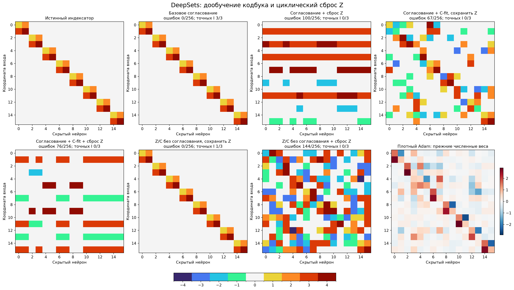
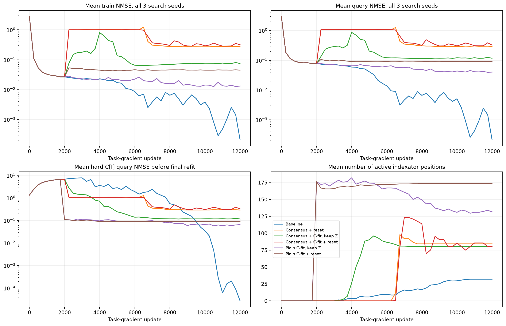
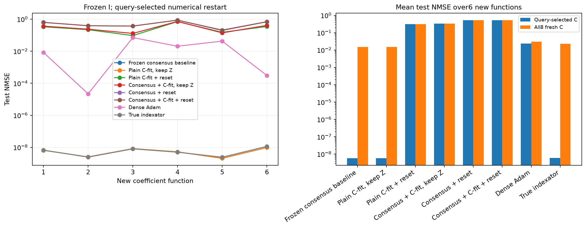
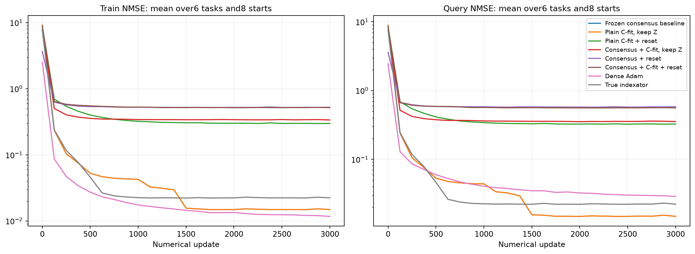

# Циклическое дообучение C и присваивание Z=C[I]

Успешный предыдущий вариант отдельно зафиксирован с исходниками, протоколом, состояниями и хешами: [deepsets_consensus_exact_v1](../../../frozen_methods/deepsets_consensus_exact_v1/README.md). Его результат3/3 не перезаписывается. Здесь новый парный контроль на других seed и предложенный пользователем цикл с task-обучением C и обратным копированием весов в Z.

## Исходная функция

| Метод | Z/C шагов за цикл | Adam Z после копирования | Selection NMSE | Mean test NMSE,3seed | Точных масок | Точных I | Связей выбранного I | Mean test32 fresh C |
| --- | ---: | --- | ---: | ---: | ---: | ---: | ---: | ---: |
| Базовое согласование | 50/0 | без копирования | 2.75258e-09 | 7.92075e-10 | 3/3 | 3/3 | 32 | 3.45602e-09 |
| Согласование + сброс Z | 50/0 | очистить | 0.280243 | 0.286362 | 0/3 | 0/3 | 91 | 0.308453 |
| Согласование + C-fit, сохранить Z | 40/10 | без копирования | 0.104283 | 0.101491 | 0/3 | 0/3 | 83 | 0.0869852 |
| Согласование + C-fit + сброс Z | 25/25 | очистить | 0.285601 | 0.287777 | 0/3 | 0/3 | 65 | 0.271817 |
| Z/C без согласования, сохранить Z | 40/10 | без копирования | 0.0517396 | 0.0523495 | 1/3 | 1/3 | 32 | 3.45302e-09 |
| Z/C без согласования + сброс Z | 40/10 | очистить | 0.0752079 | 0.0749652 | 0/3 | 0/3 | 163 | 0.0738727 |

## Что именно сравнивается

Во всех режимах2000 общих плотных warmup-обновлений, затем200 циклов по50 task-gradient шагов:12000 суммарно. В базовом варианте все50 шагов получает Z. При C-fit цикл делится на40/10,25/25 или10/40 шагов Z/C. Голова обновляется каждый раз. Это равенство количества градиентных проходов, не числа обучаемых координат или FLOPs; реальные счётчики сохранены в cycle_diagnostics.json.

Цикл: обучить Z → точно спроецировать в I/C → обучить C и голову при фиксированном I → при необходимости присвоить Z=C[I]. Все256 позиций могут меняться в следующем цикле. Проекция не получает маску, истинные группы, численные коды или число32 связей.

Согласование сохраняет прежние rho0.01→100,lambda0.3,dual0.25. В plain-варианте Z обучается только по task-loss и L2; нет ни dual, ни штрафа согласования, а проекция использует постоянную цену tau0.0006/0.006/0.06. Во всех вариантах точная одномерная проекция совместно определяет центры и нулевые позиции.

При перезаписи Z отдельно проверяются сохранение и очистка его моментов Adam. Моменты C очищаются при каждой новой проекции, моменты головы сохраняются. В гибридном режиме dual обновляется по расхождению с адаптированным C[I] до перезаписи Z. Это модифицированный цикл, без утверждения стандартной ADMM-гарантии.

Базовые настройки не ретюнятся.39 настроек зарегистрированы до пилота341/342; одна настройка на семью фиксируется для confirmation343/344/345. Все старты Z и support-minibatch парные. Четыре снимка получают одинаковый hard-C-refit3000 шагов:1исходный+3свежих GaussianC. Query выбирает численныйcheckpoint, meanselection выбирает структуру и гиперпараметры. Query не участвует в task-градиентах или выборе состояния C внутри цикла.

Кривые в точках завершения цикла показывают состояние после копирования, если оно включено. Ошибка Z до копирования и величина разрыва сохранены отдельно в history.json. Равенство Z=C[I] в эти моменты не означает правильной структуры. Максимальная фактическая ошибка присваивания сохранена в cycle_diagnostics.json.

Новый source-heldout8192 и teacher-аудит открываются после source/freshfreeze. Fresh32 относится к той же функции, а не к переносу. Adam на хитмапе — прежний численный контроль. Всё исследование пока на синтетическом DeepSets одной скрытой структуры.

## Перенос на новые коэффициенты

Шесть ранее не оценённых функций зарегистрированы до поиска (seed-offset15100000). Исходные I фиксированы; на каждой новой функции обучаются только заново инициализированные численные параметры. Query выбирает старт из8, selection — численную настройку из6. После этого создаётся отдельный test8192.

| Метод | Mean test NMSE, query-selected C | Mean test NMSE, all8 starts |
| --- | ---: | ---: |
| Базовое согласование | 5.72941e-09 | 0.0152369 |
| Согласование + сброс Z | 0.532018 | 0.532045 |
| Согласование + C-fit, сохранить Z | 0.335886 | 0.335953 |
| Согласование + C-fit + сброс Z | 0.528331 | 0.528126 |
| Z/C без согласования, сохранить Z | 5.73022e-09 | 0.0152369 |
| Z/C без согласования + сброс Z | 0.31114 | 0.31106 |
| oracle | 6.02763e-09 | 0.022869 |
| dense_adam | 0.0239307 | 0.0297391 |

Shuffle-sharing и shuffle-all контроли каждой семьи, все старты и отдельные функции сохранены в transfer_confirmation/REPORT.md и summary.json. Среднее всех8 стартов отдельно от выбранного по query результата позволяет видеть численные срывы.

Измеренное source-обучение всех кандидатов и численных стартов: 4.20 мин. Стоимость переноса указана отдельно в его отчёте. Программные тесты не создавались и не запускались; Ruff изменённых Python-файлов прошёл.
