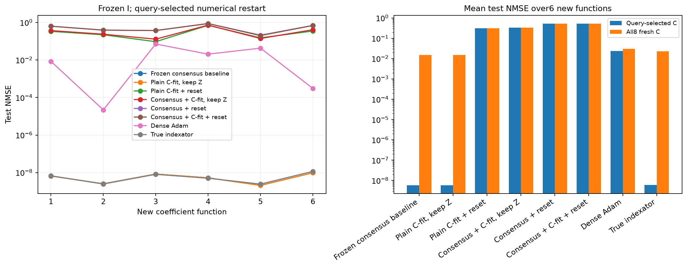
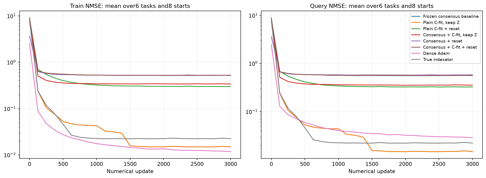

# Перенос фиксированных индексаторов на новые коэффициенты

Шесть новых целевых функций с новыми истинными C. Все извлечённые I выбраны на старой функции и фиксированы. На каждой новой функции с нуля обучаются только численные параметры; независимая validation выбирает настройки. Oracle и dense — отдельные диагностические контроли.

| Метод | Средняя test NMSE, query-selected C | Средняя test NMSE по всем8 C |
| --- | ---: | ---: |
| consensus_baseline/learned | 5.72941e-09 | 0.0152369 |
| consensus_baseline/random_sharing | 0.635047 | 0.643897 |
| consensus_baseline/random_all | 0.50735 | 0.506672 |
| plain_adapt_keep/learned | 5.73022e-09 | 0.0152369 |
| plain_adapt_keep/random_sharing | 0.523447 | 0.526228 |
| plain_adapt_keep/random_all | 0.685035 | 0.68495 |
| plain_adapt_reset/learned | 0.31114 | 0.31106 |
| plain_adapt_reset/random_sharing | 0.739275 | 0.741293 |
| plain_adapt_reset/random_all | 0.660865 | 0.660811 |
| consensus_adapt_keep/learned | 0.335886 | 0.335953 |
| consensus_adapt_keep/random_sharing | 0.785104 | 0.785742 |
| consensus_adapt_keep/random_all | 0.738095 | 0.738228 |
| consensus_reset/learned | 0.532018 | 0.532045 |
| consensus_reset/random_sharing | 0.559111 | 0.559712 |
| consensus_reset/random_all | 0.461286 | 0.460309 |
| consensus_adapt_reset/learned | 0.528331 | 0.528126 |
| consensus_adapt_reset/random_sharing | 0.525638 | 0.528814 |
| consensus_adapt_reset/random_all | 0.724926 | 0.725857 |
| oracle | 6.02763e-09 | 0.022869 |
| dense_adam | 0.0239307 | 0.0297391 |

random_sharing переставляет кодовые метки внутри той же маски, random_all перемешивает все позиции с сохранением числа кодов и их частот. Численные скорости/радиусы подбираются отдельно для каждого метода на query/selection, heldout не участвует. Это перенос между коэффициентами одной скрытой структуры, не перенос между архитектурами или датасетами.

Полный протокол: ../transfer_confirmation_registration.json. Численные состояния и source-freeze сохранены по каждой задаче. Программные тесты не создавались и не запускались.

## Кривые и границы вывода

Кривые усредняют все8 численных стартов на всех6 новых функциях при выбранной по selection численной настройке каждого метода. Train измерен на первых512 support-примерах, query — на512; ось X — реальные обновления. Они не показывают test во время обучения. В таблице выше также сохранены перестановочные контроли шэринга и подключений.

Малая source-ошибка и успешные свежие C на прежней функции недостаточны для вывода о переносимой структуре. Здесь переносится только source-selected I; значения C, bias/readout/offset не переносятся. Истинный I — отдельная диагностика численной обучаемости. Шесть функций одной скрытой структуры не являются переносом между датасетами или новыми архитектурами.

Новое численное обучение переноса: 2.51 мин. Повторно использованы идентичные dense-контроли стоимостью 0.00 мин, если указаны dense_control_reuse.json. Совпадение наблюдений, протокола, настроек и бюджета проверено перед загрузкой. Source-поиск сюда не включён.
