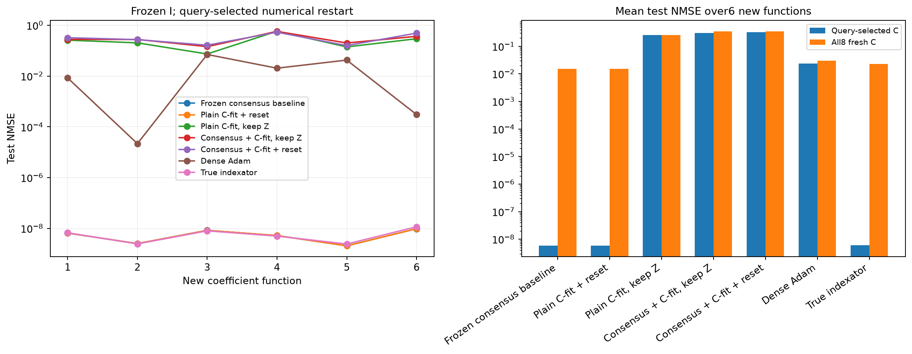
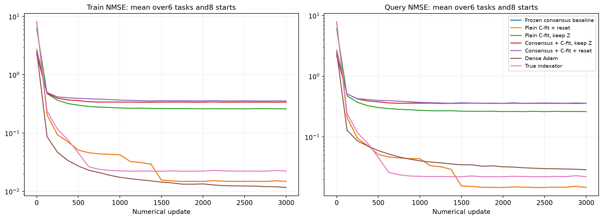

# Перенос фиксированных индексаторов на новые коэффициенты

Шесть новых целевых функций с новыми истинными C. Все извлечённые I выбраны на старой функции и фиксированы. На каждой новой функции с нуля обучаются только численные параметры; независимая validation выбирает настройки. Oracle и dense — отдельные диагностические контроли.

| Метод | Средняя test NMSE, query-selected C | Средняя test NMSE по всем8 C |
| --- | ---: | ---: |
| consensus_baseline/learned | 5.74181e-09 | 0.0152369 |
| consensus_baseline/random_sharing | 0.597021 | 0.603647 |
| consensus_baseline/random_all | 0.680148 | 0.67961 |
| plain_adapt_reset/learned | 5.74191e-09 | 0.0152365 |
| plain_adapt_reset/random_sharing | 0.633594 | 0.636105 |
| plain_adapt_reset/random_all | 0.722454 | 0.728466 |
| plain_adapt_keep/learned | 0.261266 | 0.260853 |
| plain_adapt_keep/random_sharing | 0.740124 | 0.741211 |
| plain_adapt_keep/random_all | 0.774385 | 0.775334 |
| consensus_adapt_keep/learned | 0.309323 | 0.34464 |
| consensus_adapt_keep/random_sharing | 0.736706 | 0.761965 |
| consensus_adapt_keep/random_all | 0.737172 | 0.745419 |
| consensus_adapt_reset/learned | 0.326685 | 0.352892 |
| consensus_adapt_reset/random_sharing | 0.755787 | 0.807616 |
| consensus_adapt_reset/random_all | 0.765115 | 0.765069 |
| oracle | 6.03265e-09 | 0.022869 |
| dense_adam | 0.0239307 | 0.0297391 |

random_sharing переставляет кодовые метки внутри той же маски, random_all перемешивает все позиции с сохранением числа кодов и их частот. Численные скорости/радиусы подбираются отдельно для каждого метода на query/selection, heldout не участвует. Это перенос между коэффициентами одной скрытой структуры, не перенос между архитектурами или датасетами.

Полный протокол: ../transfer_confirmation_registration.json. Численные состояния и source-freeze сохранены по каждой задаче. Программные тесты не создавались и не запускались.

## Кривые и границы вывода

Кривые усредняют все8 численных стартов на всех6 новых функциях при выбранной по selection численной настройке каждого метода. Train измерен на первых512 support-примерах, query — на512; ось X — реальные обновления. Они не показывают test во время обучения. В таблице выше также сохранены перестановочные контроли шэринга и подключений.

Малая source-ошибка и успешные свежие C на прежней функции недостаточны для вывода о переносимой структуре. Здесь переносится только source-selected I; значения C, bias/readout/offset не переносятся. Истинный I — отдельная диагностика численной обучаемости. Шесть функций одной скрытой структуры не являются переносом между датасетами или новыми архитектурами.

Новое численное обучение переноса: 1.17 мин. Повторно использованы идентичные dense-контроли стоимостью 1.34 мин, если указаны dense_control_reuse.json. Совпадение наблюдений, протокола, настроек и бюджета проверено перед загрузкой. Source-поиск сюда не включён.
