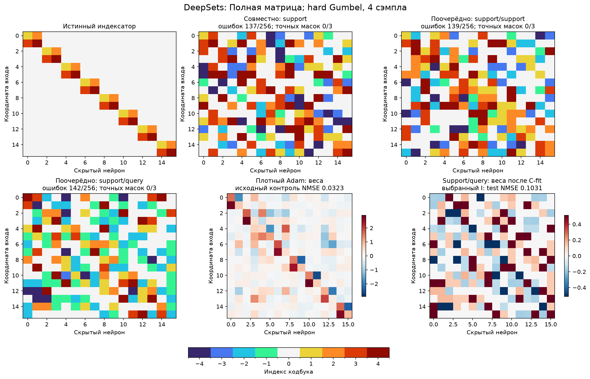
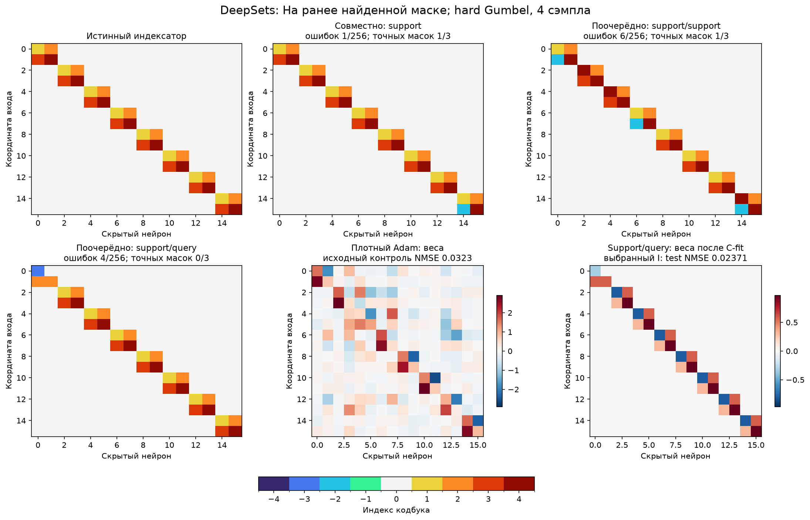
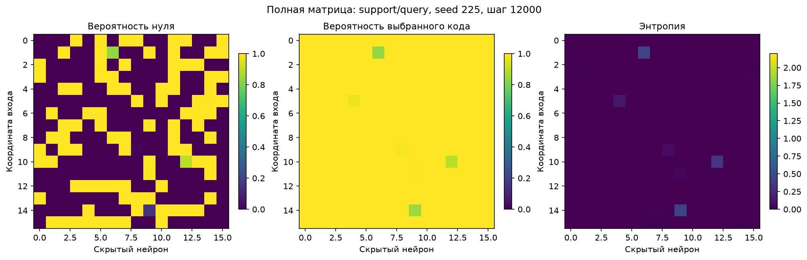
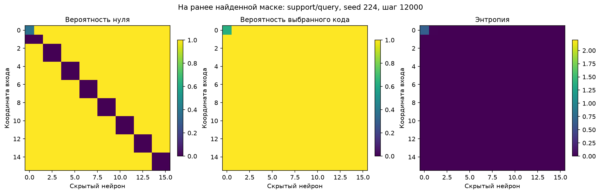
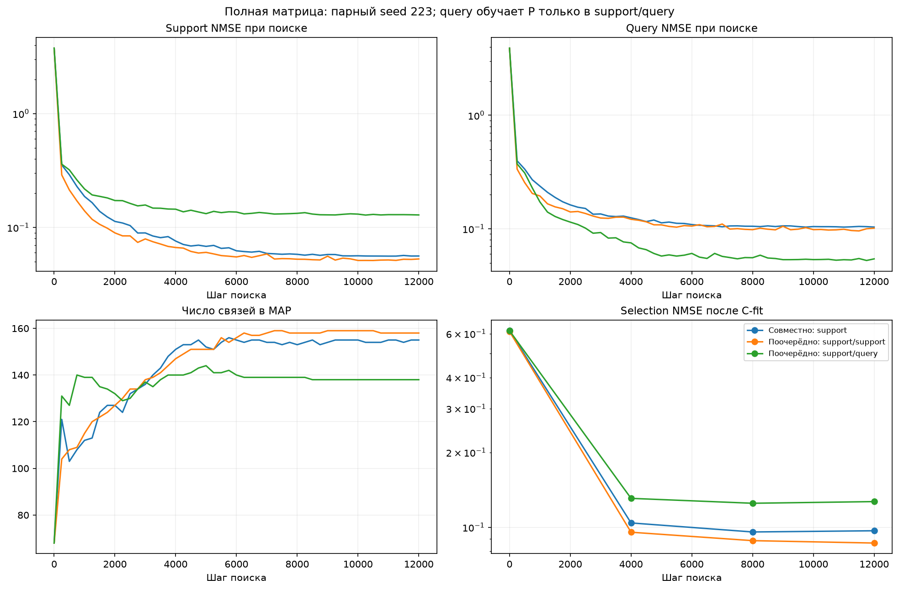
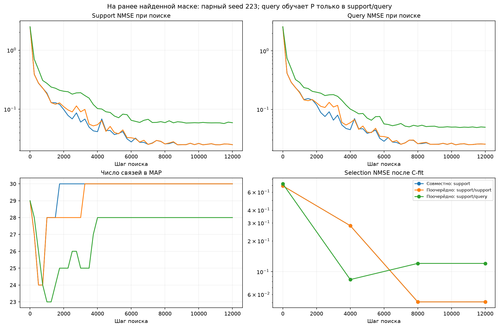

# DeepSets: support-C / query-P при hard sampling

Первая проверка разделения обновлений на одном ранее изученном синтетическом учителе. Это first-order alternating: градиент через численную адаптацию C не вычисляется. Прямой проход выбирает один из девяти кодов [0,C1,…,C4,−C1,…,−C4] на каждую позицию; backward использует смещённый Gumbel-Softmax STE.

| Область | Метод | Средняя selection NMSE | Средняя test NMSE, 3 seed | Точных масок/3 | Точных I/3 | Связей выбранного I | Средняя test NMSE, 32 свежих C |
| --- | --- | ---: | ---: | ---: | ---: | ---: | ---: |
| Полная матрица | Совместно: support | 0.0946757 | 0.0923979 | 0/3 | 0/3 | 155 | 0.0919931 |
| Полная матрица | Поочерёдно: support/support | 0.0917923 | 0.091702 | 0/3 | 0/3 | 158 | 0.0886661 |
| Полная матрица | Поочерёдно: support/query | 0.117305 | 0.110361 | 0/3 | 0/3 | 161 | 0.10423 |
| Выученная маска | Совместно: support | 0.027159 | 0.0197381 | 1/3 | 0/3 | 32 | 0.0209907 |
| Выученная маска | Поочерёдно: support/support | 0.0386256 | 0.0228327 | 1/3 | 0/3 | 32 | 0.0105568 |
| Выученная маска | Поочерёдно: support/query | 0.0598433 | 0.0595551 | 0/3 | 0/3 | 31 | 0.0585953 |

## Результат сравнения

- full: отношение средней selection NMSE support/query к совместному контролю — 1.239; точных масок 0/3 против 0/3, точных I 0/3 против 0/3.
- masked: отношение средней selection NMSE support/query к совместному контролю — 2.203; точных масок 0/3 против 1/3, точных I 0/3 против 0/3.

После freeze отдельно проверен пилот совместного обучения на маске: точный I в 2/2 seed. На confirmation точных I 0/3. Успех отдельных seed не является устойчивым восстановлением. Лучшая выбранная совместным обучением структура имеет одну ошибку шэринга при правильной маске.

Для этой выбранной структуры медиана test NMSE32 свежих C равна 0.00120643, максимум 0.0500539; 19/32 стартов ниже0.01. Усреднённая ошибка включает численные неудачи, но даже хорошие старты не исправляют ошибочное дискретное назначение.

Записанные нормы градиентов P ненулевые во всех стадиях; максимальная ошибка равенства hard forward выбранному one-hot равна0. Это исключает отсутствие градиента P и подмену hard forward мягкой смесью в этих запусках. Градиент через адаптацию C и отдельная длительная адаптация C для каждой сэмплированной структуры требуют другого эксперимента.

## Ошибки при поиске до фиксации I

Средние по выбранным source-снимкам трёх seed; support/query усредняются по восьми случайным структурам при текущем C. Selection после C-fit выше относится уже к фиксированному MAP I и не является той же моделью. Снижение query, по которой обучается P, само по себе не доказывает улучшения структуры.

| Область | Метод | Support NMSE при поиске | Query NMSE при поиске | Связей в MAP, среднее |
| --- | --- | ---: | ---: | ---: |
| full | Совместно: support | 0.0527135 | 0.10323 | 156 |
| full | Поочерёдно: support/support | 0.0532109 | 0.102982 | 158.7 |
| full | Поочерёдно: support/query | 0.116624 | 0.052121 | 148 |
| masked | Совместно: support | 0.0256769 | 0.0274358 | 30.67 |
| masked | Поочерёдно: support/support | 0.0210163 | 0.0227259 | 30.67 |
| masked | Поочерёдно: support/query | 0.0657594 | 0.0675615 | 29 |

## Обновления и выбор

В каждой итерации C обновляется на support с отсоединённым P. Совместный контроль вычисляет градиент P на том же support minibatch при C до обновления. Поочерёдный support/support использует обновлённый C. Поочерёдный support/query использует обновлённый C и query minibatch. В двух поочерёдных вариантах C и численная голова отсоединены от графа архитектурного loss.

Все три режима имеют одинаковые12000 обновлений C и12000 обновлений P, четыре hard-структуры на каждой стадии, два forward/backward на итерацию. Один кодбук во время поиска. На одном seed совпадают начальные alpha/C, support/query minibatch и Gumbel noise; в двух стадиях итерации используется один и тот же шум. Радиус C нормирован по начальной hard MAP матрице, без soft-to-hard сдвига масштаба при запуске.

На семью шесть настроек: C lr0.003/0.01 и P lr0.003/0.01/0.03. Радиус0.5; sparsity0.03 для full и0 для masked; поздний entropy0.02; P=softmax(alpha), температура только surrogate1→0.3. Влияние переноса массы и число численных реплик здесь не варьируются.

Pilot221/222 выбирает одну настройку каждой семьи; confirmation223/224/225 проверяет её без нового подбора. Внутри seed снимок0/4000/8000/12000 выбирается по средней selection ошибке четырёх C-fit: исходный C плюс три свежих Gaussian,3000 support шагов, численные checkpoints выбирает query. Query в support/query участвует в поиске P и не считается независимой валидацией; независимый source-fold selection используется для выбора структуры и гиперпараметров.

После заморозки структуры и source-настроек выполняется калибровка C-fit и32 новых старта C. Heldout8192 новых входов создаётся после freeze. Все данные относятся к той же функции; это не перенос на другого учителя. Три seed дают предварительную оценку, не достаточную для вывода об устойчивом преимуществе метода.

Full разрешает все256 позиций, истинное число32 поиску не передаётся. Masked использует ранее найденную DARTS маску; внутри неё нулевой код остаётся доступен. Успех masked означает условное восстановление шэринга, а не полный поиск с нуля.

## Выбранные индексаторы

Полные I, C, W и исходные метрики: full/selected_indexators.json и masked/selected_indexators.json. Группы, знаки и перестановки нейронов согласуются с teacher только для аудита и рисунков. Adam — ранее выполненный плотный контроль на этой задаче, здесь не переобучается.

## Затраты

- full: измеренное обучение 5.00 мин.; оценок hard-структур 4320000.
- masked: измеренное обучение 4.91 мин.; оценок hard-структур 4320000.

Исходники выполненных стадий, регистрации, P/alpha/C, hard-refit и свежие старты сохранены. Программные тесты не создавались и не запускались.
