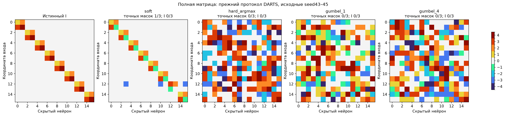

# Контроль: прежний DARTS и жёсткое сэмплирование

Исходные seed43/44/45 и прежние настройки. Это воспроизведение, не новая независимая проверка. Четыре численные реплики и512 soft numerical warmup шагов; alpha lr0.1, C lr0.01, температура политики1→0.03, sparsity0.03. В hard-ветках forward дискретный после warmup; вероятности сохраняются. Gumbel surrogate имеет температуру1 без дополнительного охлаждения.

Максимальные отличия soft-контроля от исходных snapshot: {'probabilities': 1.0, 'numeric': 0.44602149724960327}.

| Метод | Средняя selection NMSE | Точных масок/3 | Точных I/3 | Test NMSE выбранного I |
| --- | ---: | ---: | ---: | ---: |
| soft | 0.0474491 | 1/3 | 0/3 | 0.0298676 |
| hard_argmax | 0.0844071 | 0/3 | 0/3 | 0.0807254 |
| gumbel_1 | 0.104103 | 0/3 | 0/3 | 0.0944088 |
| gumbel_4 | 0.0924888 | 0/3 | 0/3 | 0.0871556 |

Мягкий контроль использует исходную функцию train.search без изменений, включая исходный перенос массы при извлечении I. Hard-ветки сэмплируют исходную политику без переноса массы и фиксируют её MAP. Настройки не подбирались повторно; каждый I получает3000 C-fit шагов с четырёх исходных численных состояний. Учитель и новые heldout-входы открыты после source/fresh выбора. Полные данные и32 свежих C сохранены по каждому методу.

Совпадение начальных состояний после warmup между новыми методами: {'hard_argmax': {'numeric_max_difference': 0.0, 'policy_max_difference': 0.0}, 'gumbel_1': {'numeric_max_difference': 0.0, 'policy_max_difference': 0.0}, 'gumbel_4': {'numeric_max_difference': 0.0, 'policy_max_difference': 0.0}}. Старый архив и новый soft имеют небольшое различие C уже после warmup; их дальнейшие траектории не побитово идентичны. Здесь сравнивается повтор протокола, а не утверждается точное воспроизведение прежнего состояния.

## Диагностика плохой маски предыдущего hard-sampling запуска

Отдельный source-only анализ прежнего Gumbel4 full, seed204, шаг8000: MAP имеет 161 активных связей, train NMSE 0.049232, query NMSE 0.0867636. Каждая активная связь по очереди отключалась при фиксированных C и выходной голове; обучение не проводилось.

Из 23 удалений, улучшающих query, 22 ухудшают support. Лишь 4 удаления улучшают support. Следовательно, support-only архитектурный градиент на этом состоянии удерживает связи, вредные для query. Это локальное свидетельство архитектурного переобучения, не исчерпывающее объяснение всей траектории.

У 75 из 161 удалений знак локальной линейной оценки −W·grad(L) отличается от знака фактического изменения support loss. Это диагностика конечного перехода в ноль, а не измерение фактического stochastic STE-gradient. Медианная вероятность нуля на активных связях 2.53241e-05; исправляющие назначения могут редко сэмплироваться.

Диагностика относится к одному сохранённому MAP checkpoint до C-refit. Она не оценивает точный expected-loss градиент, совместные удаления или повторное обучение C после изменения I. Численные дельты, градиенты и P сохранены в edge_drop_diagnostic.npz.

