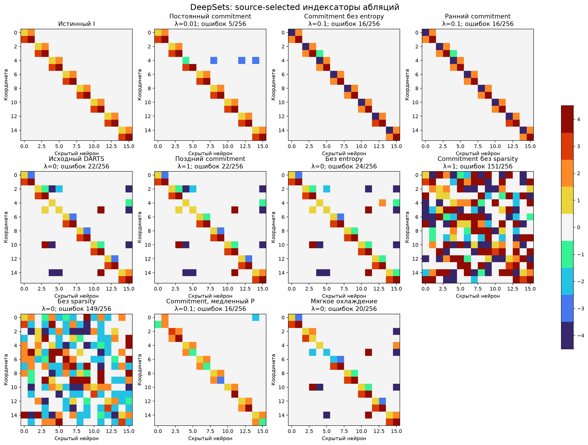
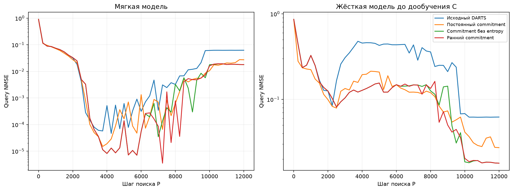

# DeepSets: абляции DARTS и commitment

Одна ранее изученная синтетическая задача. Маска, истинные группы и роли координат не передаются поиску. Словарь [0,C1,…,C4,−C1,…,−C4]. Pilot43/44; confirmation111/112/113. Настройки выбираются по среднему hard-refit selection NMSE, teacher открывается после freeze. Поиск 12000 шагов, четыре численные реплики, C-fit3000 шагов для каждого снимка.

| Вариант | λ | Selection NMSE, среднее 3 seed | Точных I/3 | Точных масок/3 | Test NMSE выбранного seed | Ошибок I/256 | Свежих C с NMSE<0.01/32 |
| --- | --- | --- | --- | --- | --- | --- | --- |
| Постоянный commitment | 0.01 | 0.0320234 | 0/3 | 1/3 | 0.0153347 | 5 | 0/32 |
| Commitment без entropy | 0.1 | 0.0354983 | 0/3 | 0/3 | 0.0144197 | 16 | 0/32 |
| Ранний commitment | 0.1 | 0.0367592 | 0/3 | 0/3 | 0.0144195 | 16 | 0/32 |
| Исходный DARTS | 0 | 0.0461416 | 0/3 | 1/3 | 0.0306287 | 22 | 0/32 |
| Поздний commitment | 1 | 0.0482096 | 0/3 | 1/3 | 0.0322511 | 22 | 0/32 |
| Без entropy | 0 | 0.0498909 | 0/3 | 1/3 | 0.0340088 | 24 | 0/32 |
| Commitment без sparsity | 1 | 0.0651182 | 0/3 | 0/3 | 0.0599917 | 151 | 0/32 |
| Без sparsity | 0 | 0.0655784 | 0/3 | 0/3 | 0.0585803 | 149 | 0/32 |
| Commitment, медленный P | 0.1 | 0.0678408 | 0/3 | 0/3 | 0.0417836 | 16 | 0/32 |
| Мягкое охлаждение | 0 | 0.0729264 | 0/3 | 0/3 | 0.0462222 | 20 | 0/32 |

Свежие C — новые численные инициализации на той же функции, не перенос на новые задачи. Все per-seed результаты и все32 численных старта сохранены в summary.json. Изменения относительно уже просмотренных результатов — исследовательские абляции, не новый независимый benchmark. Программные тесты не запускались.
