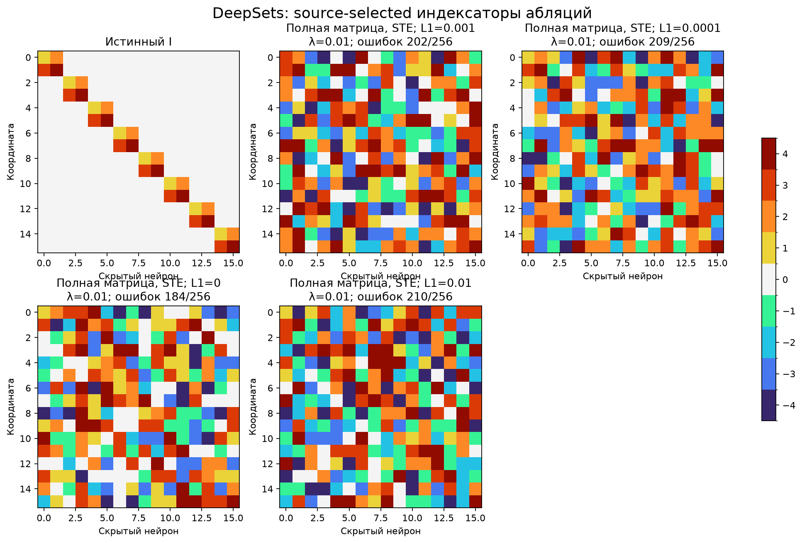
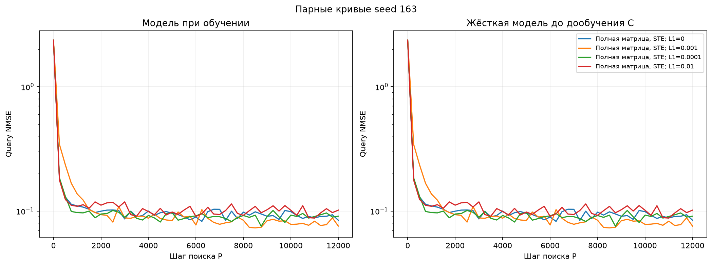

# DeepSets: абляции DARTS и commitment

Полный поиск подключений и шэринга с нуля без готовой маски. Ближайший дискретный код и identity STE, одна численная реплика во время поиска. При C-fit один исходный и три свежих кодбука. Истинные группы и роли координат не передаются поиску. Словарь [0,C1,…,C4,−C1,…,−C4]. Pilot [161, 162]; confirmation [163, 164, 165]. Настройки выбираются по среднему hard-refit selection NMSE, teacher открывается после freeze. C-fit3000 шагов для каждого снимка.

| Вариант | λ | Selection NMSE, среднее 3 seed | Точных I/3 | Точных масок/3 | Test NMSE выбранного seed | Ошибок I/256 | Свежих C с NMSE<0.01/32 |
| --- | --- | --- | --- | --- | --- | --- | --- |
| Полная матрица, STE; L1=0.001 | 0.01 | 0.0807491 | 0/3 | 0/3 | 0.0791835 | 202 | 0/32 |
| Полная матрица, STE; L1=0.0001 | 0.01 | 0.0811885 | 0/3 | 0/3 | 0.0807832 | 209 | 0/32 |
| Полная матрица, STE; L1=0 | 0.01 | 0.0827845 | 0/3 | 0/3 | 0.0814509 | 184 | 0/32 |
| Полная матрица, STE; L1=0.01 | 0.01 | 0.0843634 | 0/3 | 0/3 | 0.0805325 | 210 | 0/32 |

Свежие C — новые численные инициализации на той же функции, не перенос на новые задачи. Все per-seed результаты и все32 численных старта сохранены в summary.json. Изменения относительно уже просмотренных результатов — исследовательские абляции, не новый независимый benchmark. Программные тесты не запускались.
