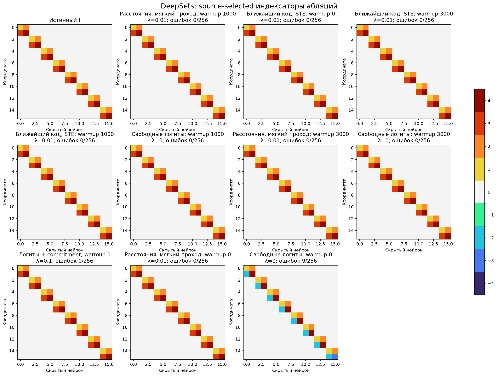
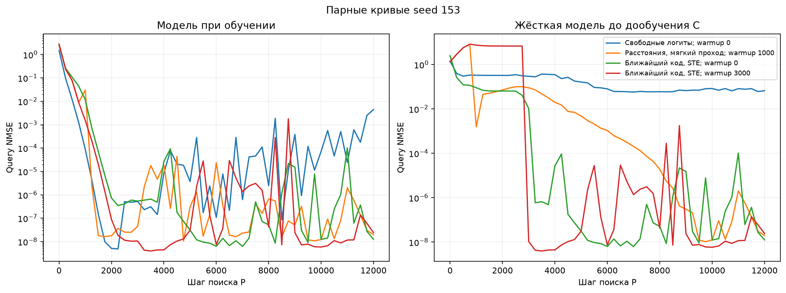

# DeepSets: абляции DARTS и commitment

Условный поиск шэринга на ранее найденной самим DARTS маске. Общий бюджет12000 включает masked warmup. Одна численная реплика во время поиска, затем один исходный и три свежих кодбука для C-fit. Истинные группы и роли координат не передаются поиску. Словарь [0,C1,…,C4,−C1,…,−C4]. Pilot [151, 152]; confirmation [153, 154, 155]. Настройки выбираются по среднему hard-refit selection NMSE, teacher открывается после freeze. C-fit3000 шагов для каждого снимка.

| Вариант | λ | Selection NMSE, среднее 3 seed | Точных I/3 | Точных масок/3 | Test NMSE выбранного seed | Ошибок I/256 | Свежих C с NMSE<0.01/32 |
| --- | --- | --- | --- | --- | --- | --- | --- |
| Расстояния, мягкий проход; warmup 1000 | 0.01 | 3.37001e-09 | 3/3 | 3/3 | 3.39189e-09 | 0 | 32/32 |
| Ближайший код, STE; warmup 0 | 0.01 | 3.37581e-09 | 3/3 | 3/3 | 3.42821e-09 | 0 | 32/32 |
| Ближайший код, STE; warmup 3000 | 0.01 | 3.37727e-09 | 3/3 | 3/3 | 3.43508e-09 | 0 | 32/32 |
| Ближайший код, STE; warmup 1000 | 0.01 | 3.38006e-09 | 3/3 | 3/3 | 3.42515e-09 | 0 | 32/32 |
| Свободные логиты; warmup 1000 | 0 | 3.38498e-09 | 3/3 | 3/3 | 3.43964e-09 | 0 | 32/32 |
| Расстояния, мягкий проход; warmup 3000 | 0.01 | 3.38559e-09 | 3/3 | 3/3 | 3.38604e-09 | 0 | 32/32 |
| Свободные логиты; warmup 3000 | 0 | 3.39595e-09 | 3/3 | 3/3 | 3.42755e-09 | 0 | 32/32 |
| Логиты + commitment; warmup 0 | 0.1 | 0.00312787 | 2/3 | 3/3 | 3.44072e-09 | 0 | 32/32 |
| Расстояния, мягкий проход; warmup 0 | 0.01 | 0.0210725 | 1/3 | 3/3 | 3.38215e-09 | 0 | 31/32 |
| Свободные логиты; warmup 0 | 0 | 0.0261072 | 0/3 | 1/3 | 0.00341942 | 9 | 22/32 |

Свежие C — новые численные инициализации на той же функции, не перенос на новые задачи. Все per-seed результаты и все32 численных старта сохранены в summary.json. Изменения относительно уже просмотренных результатов — исследовательские абляции, не новый независимый benchmark. Программные тесты не запускались.
