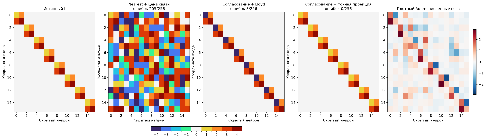
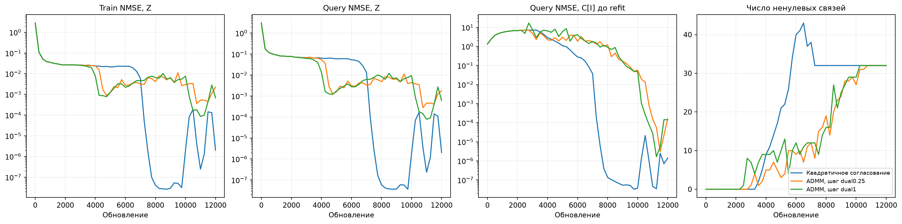
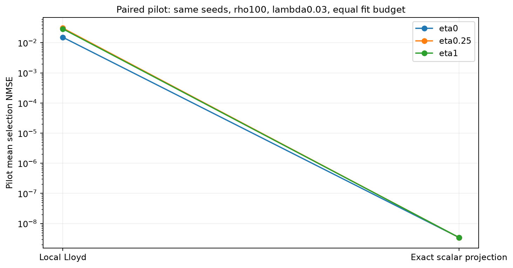
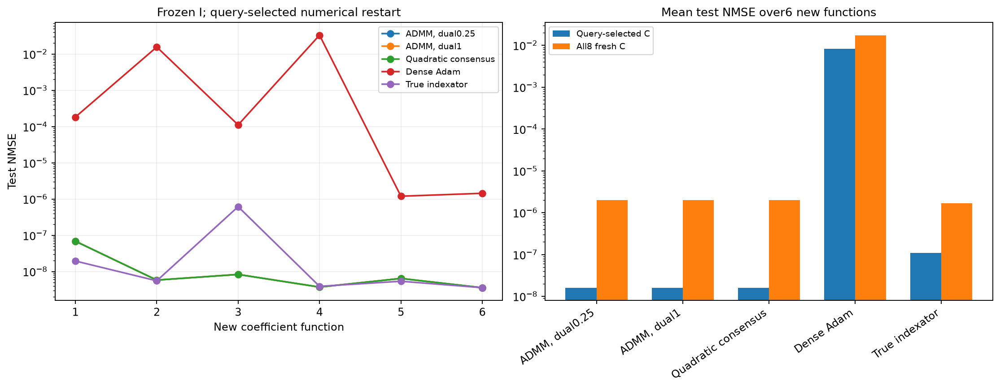
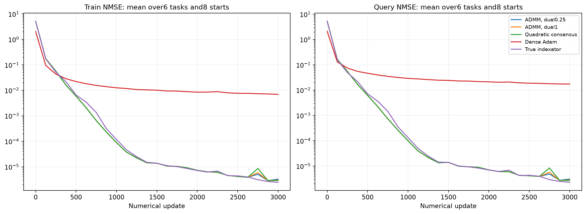

# Полный индексатор DeepSets: nearest, согласование и точная проекция

На синтетическом DeepSets точная скалярная проекция внутри ADMM-подобного согласования восстановила полный истинный индексатор в 3/3 запусках. Поиск получил размер матрицы 16×16 и четыре свободных кода со знаковыми парами. Маска, группы и число 32 активных связей использовались только для аудита после выбора.

## Исходная функция

| Метод | Mean selection NMSE | Mean test NMSE,3seed | Точных масок | Точных I | Связей выбранного I | Mean test32 fresh C |
| --- | ---: | ---: | ---: | ---: | ---: | ---: |
| Nearest + STE + centering | 0.0832218 | 0.084276 | 0/3 | 0/3 | 234 | 0.0814928 |
| Nearest + STE; C по задаче | 0.078943 | 0.0767279 | 0/3 | 0/3 | 233 | 0.0769125 |
| Nearest с ценой ненулевого кода | 0.0763982 | 0.0777742 | 0/3 | 0/3 | 227 | 0.0764711 |
| То же + dense warmup | 0.0791852 | 0.0809204 | 0/3 | 0/3 | 240 | 0.0773541 |
| Lloyd + квадратичное согласование | 0.0800086 | 0.0235058 | 1/3 | 0/3 | 34 | 0.0701144 |
| Lloyd + ADMM eta0.25 | 0.0437056 | 0.0166677 | 0/3 | 0/3 | 33 | 0.0420631 |
| Lloyd + ADMM eta1 | 0.0404989 | 0.0413134 | 1/3 | 0/3 | 32 | 0.0425438 |
| Точная проекция + квадратичный штраф | 0.00855663 | 0.00868301 | 2/3 | 2/3 | 32 | 3.42848e-09 |
| Точная проекция + ADMM eta0.25 | 3.19682e-09 | 2.54313e-09 | 3/3 | 3/3 | 32 | 3.42495e-09 |
| Точная проекция + ADMM eta1 | 3.37946e-09 | 3.30763e-09 | 3/3 | 3/3 | 32 | 3.42669e-09 |

У обычного nearest+STE ошибка уменьшилась, но структура осталась почти плотной. Согласование с локальным Lloyd выделило маску, однако могло оставлять пустой код и сливать группы. Точная одномерная проекция совместно выбирает нулевой префикс, центры и назначения без зависимости от инициализации центров. Это исправляет конкретное ограничение локальной проекции, а не доказывает глобальную сходимость нейросетевого поиска.

Парный пилот сравнивает одинаковые настройки инициализаций/данных/rho/lambda/бюджета. Числа находятся в paired_ablation.json; там же однократные проекции одних и тех же сохранённых V показывают стоимость до и после замены Lloyd. Эти локальные пробы не являются обучением или task-loss после адаптации C.

## Перенос фиксированного I

Сначала выполнено парное сравнение на шести коэффициентных функциях, ранее использованных для отрицательного nearest-контроля. Затем, после фиксации метода и исходных индексаторов, зарегистрированы ещё шесть ранее не оценённых функций (seed-offset 11100000). На каждой функции заново инициализируются все семь численных параметров. Query выбирает численный checkpoint и старт из восьми; selection выбирает скорость и радиус инициализации из шести настроек. Итоговый test создаётся после фиксации численных решений.

| Набор | Метод | Mean test NMSE, query-selected C | Mean test NMSE, all8 starts |
| --- | --- | ---: | ---: |
| Парные 6 функций | damped_admm/learned | 2.38487e-07 | 0.0404312 |
| Парные 6 функций | damped_admm/random_sharing | 0.428695 | 0.427293 |
| Парные 6 функций | damped_admm/random_all | 0.500301 | 0.503796 |
| Парные 6 функций | oracle | 7.62383e-06 | 0.0533949 |
| Парные 6 функций | dense_adam | 0.0298967 | 0.0407865 |
| Независимые 6 функций | damped_admm/learned | 1.6074e-08 | 1.9879e-06 |
| Независимые 6 функций | damped_admm/random_sharing | 0.449101 | 0.446623 |
| Независимые 6 функций | damped_admm/random_all | 0.521037 | 0.521922 |
| Независимые 6 функций | oracle | 1.0883e-07 | 1.68073e-06 |
| Независимые 6 функций | dense_adam | 0.00821085 | 0.01752 |

Среднее по всем восьми стартам отдельно показывает численные срывы: наличие правильного I не гарантирует успех каждого запуска Adam. Истинный I является численным контролем. Различия между эквивалентными индексаторами возникают из-за конечного числа случайных инициализаций и выбора численных настроек; они не означают превосходства над истинной структурой.

## Протокол, кривые и границы

Сохранены train/query кривые по реальным шагам: [nearest](../deepsets_projection_full/figures/curves.png), [Lloyd](../deepsets_consensus_full/figures/curves.png), [точная проекция](../deepsets_consensus_exact/figures/curves.png), [новый перенос](../deepsets_consensus_exact/transfer_confirmation/figures/numerical_curves.png). На этой задаче регрессии Recall неприменим. Полные I/C/W находятся в selected_indexators.json каждой серии; исходные и согласованные I сохранены отдельно. Выравнивание с учителем применяется только после фиксации решений для аудита и рисунков.

Результат относится к одному синтетическому учителю и смене его численных коэффициентов. На Pattern, синусах, изображениях и новых топологиях успешный вариант этой серии не проверялся. Скалярный DP имеет сложность O(K*N²), что ограничивает размер слоя. Поиск исследовательский на ранее изученной исходной функции; три seed измеряют вариативность поиска.

Успешный вариант использует проекционное согласование вместо исходного softmax-DARTS. [LUT-Q](https://arxiv.org/pdf/1911.04951) уже содержит непрерывные веса, nearest-code, дискретный forward и STE. [ADMM-кластеризация](https://arxiv.org/abs/1811.01907) и [точный одномерный k-means](https://journal.r-project.org/articles/RJ-2011-015/) тоже известны. Новизна общей механики не заявляется. Формулы, условная гарантия nearest при разделённых кодах и DP-рекурсия: [PROJECTION_METHOD.md](../../../PROJECTION_METHOD.md).

Измеренное новое обучение всех зарегистрированных кандидатов, стартов и контролей переноса: 15.93 мин. Идентичный dense-контроль стоимостью 1.44 мин повторно не обучался. Стоимость исходного Adam и прежних серий сюда не включена. Программные тесты не создавались и не запускались; Ruff изменённых Python-файлов прошёл.
