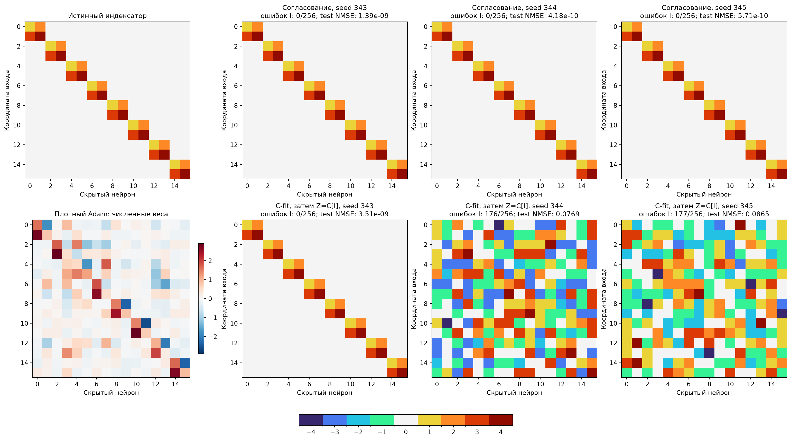
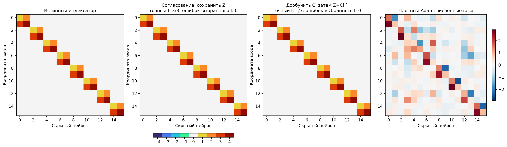

# Дообучение C и циклический сброс Z: итог проверки

Исходный успешный вариант [зафиксирован отдельно](../../../frozen_methods/deepsets_consensus_exact_v1/README.md). Проверено предложение: обучение Z → точная проекция I/C → обучение C по задаче при фиксированном I → Z=C[I] → следующий цикл. Поиск ведётся по всем 256 позициям с четырьмя свободными кодами и связанными отрицательными двойниками, без знания истинной маски и групп.

Выбор лучшего нового режима и длины блока выполнен по source-selection до генерации новых функций переноса; см. choices_frozen.json. В короткой серии 39 конфигураций, в длинной 37. Обе используют одинаковые исходные наблюдения, pilot 341/342 и confirmation 343–345. Бюджет каждого запуска: 2000 шагов разогрева и 10000 дальнейших обновлений по задаче. В короткой серии 200 циклов по 50 шагов, в длинной 10 циклов по 1000 шагов; исходный контроль всегда 200×50. Число градиентных проходов одинаково, FLOPs могут различаться. При удлинении блока меняется также частота проекций и сбросов: эффект числа шагов C отдельно от частоты не изолирован.

| Режим, выбранный по source | Z/C за цикл | Mean source test NMSE, 3 seed | Точный I | Mean fresh 32, та же функция | Перенос, query-selected | Перенос, все 8 стартов |
| --- | ---: | ---: | ---: | ---: | ---: | ---: |
| Исходное согласование | 50/0 | 7.92075e-10 | 3/3 | 3.45602e-09 | 5.72941e-09 | 0.0152369 |
| Дообучить C и присвоить Z=C[I] | 800/200 | 0.0544597 | 1/3 | 3.45427e-09 | 5.74191e-09 | 0.0152365 |
| Чередовать Z/C, сохранить Z | 800/200 | 0.0779702 | 0/3 | 0.0536364 | 0.261266 | 0.260853 |

Для каждого seed показан его собственный снимок, выбранный по source-selection; провальные запуски не удалены. Численный test относится к той же исходной функции. Следующая компактная хитмапа показывает только лучшие по selection структуры, используемые в переносе.

## Все source-абляции

| Блок | Семейство | Z/C | Selection NMSE | Mean source test NMSE | Точный I |
| --- | --- | ---: | ---: | ---: | ---: |
| 50 | Базовое согласование | 50/0 | 2.75258e-09 | 7.92075e-10 | 3/3 |
| 50 | Z/C без согласования, сохранить Z | 40/10 | 0.0517396 | 0.0523495 | 1/3 |
| 50 | Z/C без согласования + сброс Z | 40/10 | 0.0752079 | 0.0749652 | 0/3 |
| 50 | Согласование + C-fit, сохранить Z | 40/10 | 0.104283 | 0.101491 | 0/3 |
| 50 | Согласование + сброс Z | 50/0 | 0.280243 | 0.286362 | 0/3 |
| 50 | Согласование + C-fit + сброс Z | 25/25 | 0.285601 | 0.287777 | 0/3 |

[Полная таблица, кривые и индексаторы deepsets_reset_cycles](../deepsets_reset_cycles/REPORT.md).

| Блок | Семейство | Z/C | Selection NMSE | Mean source test NMSE | Точный I |
| --- | --- | ---: | ---: | ---: | ---: |
| 50 | Базовое согласование | 50/0 | 3.06091e-09 | 2.06004e-09 | 3/3 |
| 1000 | Z/C без согласования + сброс Z | 800/200 | 0.0559163 | 0.0544597 | 1/3 |
| 1000 | Z/C без согласования, сохранить Z | 800/200 | 0.0808385 | 0.0779702 | 0/3 |
| 1000 | Согласование + C-fit, сохранить Z | 500/500 | 0.179974 | 0.180246 | 0/3 |
| 1000 | Согласование + C-fit + сброс Z | 800/200 | 0.244358 | 0.239567 | 0/3 |

[Полная таблица, кривые и индексаторы deepsets_reset_long_cycles](../deepsets_reset_long_cycles/REPORT.md).

## Контроли и ограничения

Перенос: шесть новых функций с новыми коэффициентами, seed-offset 15100000. Исходный I фиксирован, все численные параметры заново инициализируются; 8 стартов × 3000 обновлений, 6 численных настроек. Query выбирает старт, mean selection — настройку; затем открывается test из 8192 примеров. Обе серии оцениваются на одинаковых задачах. Dense-контроль длинной серии повторно используется только после проверки идентичности данных и протокола.

oracle: mean query-selected test NMSE 6.02763e-09; mean всех 8 стартов 0.022869.
dense_adam: mean query-selected test NMSE 0.0239307; mean всех 8 стартов 0.0297391.

На новых функциях отдельные численные старты срываются даже при истинном I; почти нулевой результат после выбора по query не означает успех всех восьми стартов. Средние по всем стартам приведены отдельно. У эквивалентных точных I одна представимость; небольшие различия ошибок связаны с численным обучением, а не преимуществом над истинной структурой.

Длинный предложенный цикл восстановил точный I в 1/3 подтверждающих запусков, короткий — в 0/3; исходное согласование — в 3/3. Поэтому нельзя считать предложенный цикл неработающим, но он не улучшил воспроизводимость исходного варианта. Выбранный по валидации успешный I нового метода точен; его качество переноса следует отличать от вероятности получить такой I одним запуском поиска.

Циклический сброс по построению обнуляет численный разрыв Z−C[I] в момент присваивания. Он при этом удаляет непрерывные различия между позициями, получившими один код. В этой серии устранение разрыва само по себе не обеспечило устойчивого восстановления структуры. Сохранение Z оставляет эти различия доступными последующим шагам поиска. Это объяснение согласуется с измерениями, но не является доказательством для всех расписаний.

Полные счётчики Z/C/head, ошибок присваивания, числа проекций и разных колонок находятся в cycle_diagnostics.json каждой серии; train/query кривые — в их figures. Исходный архив и старые результаты проверены по SHA256 и не изменены. Программные тесты не создавались и не запускались; Ruff прошёл. Результат относится к синтетическому DeepSets одной скрытой структуры, новым численным коэффициентам и проверенным расписаниям. Новые запуски на Pattern/синусах/изображениях здесь не выполнялись.
