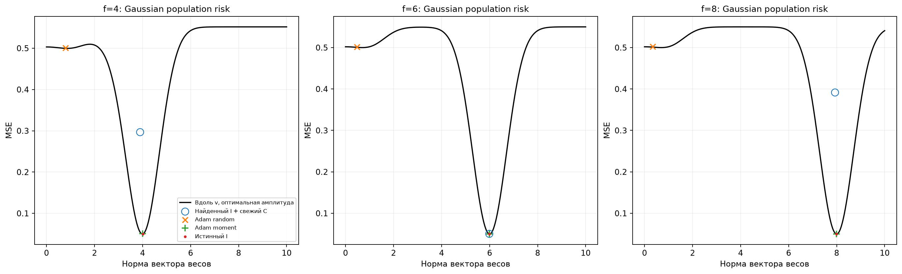
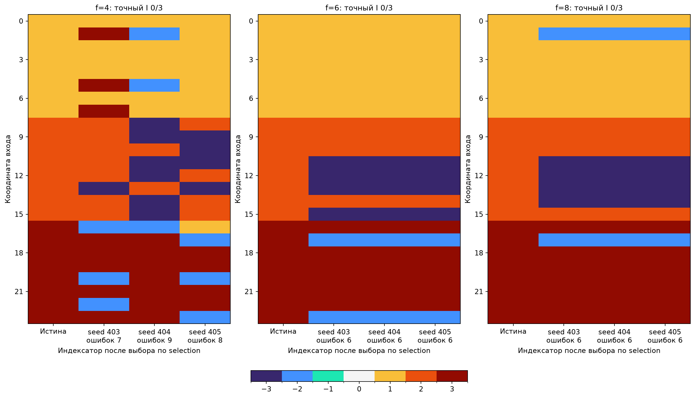
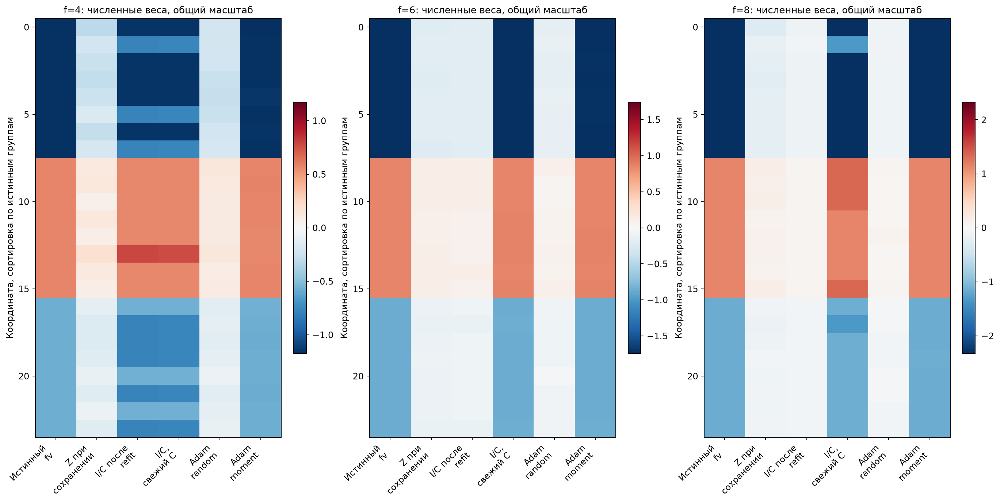
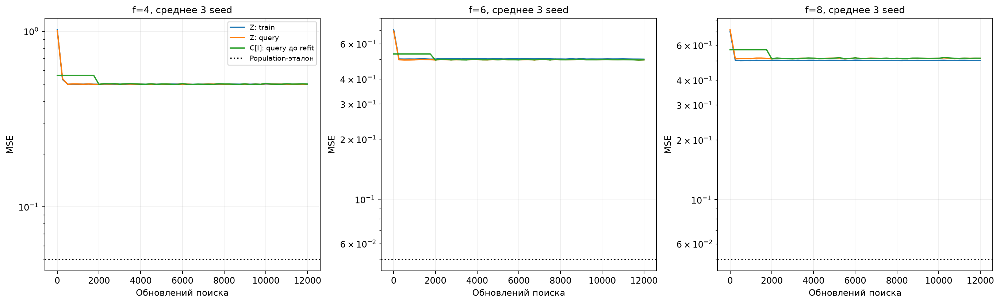
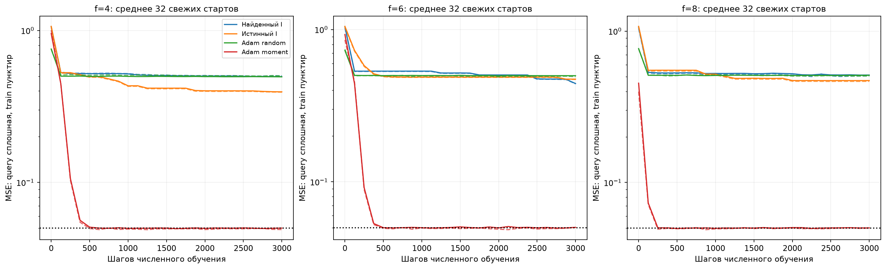
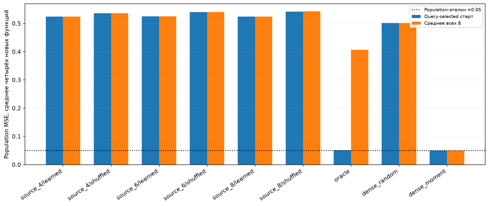

# Проекционное согласование на сумме двух синусоид

Проверен лучший вариант предыдущей серии DeepSets: непрерывный Z сохраняется, каждые 50 шагов точная проекция совместно выбирает I/C для Z+U, затем обновляется U. Z не перезаписывается через C[I], кодбук внутри поисковой траектории не обучается отдельным task-SGD.

Устойчивого выхода к глобальному минимуму не получено. При f=6 выбранный свежий кодбук дал population MSE 0.050383 против эталона 0.049975, 6/32 новых численных стартов оказались в пределах 0.001 от эталона. При f=4/8 ошибки существенно выше. Точный I не восстановлен ни в одном из трёх подтверждающих запусков на каждой частоте. На новых численных функциях перенос найденного шэринга не подтвердился.

Сохраняется исходная задача: 24 стандартных Gaussian-входа, y=0.4sin(0.7vᵀx)+sin(fvᵀx), f=4/6/8, один неизвестный трёхгрупповой вектор v единичной нормы. Ученик — одна a·sin(wᵀx), без фазы и offset. Поэтому нулевая ошибка недостижима: лучший population-риск около 0.05, плохой локальный — около 0.5. Это одна исходная структура и один v при трёх частотах, не три независимых семейства.

## Результат на исходной функции

Ниже точная Gaussian population MSE, без Monte Carlo-шума. Параметры выбраны исключительно по query/selection. Fresh означает 32 новых численных старта фиксированного source-I; таблица отдельно показывает результат query-selected старта и среднее всех 32.

| f | Population-эталон | Наш I, лучший C по validation | Наш I, fresh selected | Наш I, fresh mean32 | Adam random, fresh selected | Adam moment, fresh selected | Истинный I, fresh selected |
| --- | ---: | ---: | ---: | ---: | ---: | ---: | ---: |
| 4 | 0.04995725 | 0.2970391 | 0.296693 | 0.4994691 | 0.5008158 | 0.05046704 | 0.05028219 |
| 6 | 0.04997511 | 0.05034126 | 0.05038284 | 0.4551821 | 0.5018186 | 0.05038741 | 0.05006077 |
| 8 | 0.04997511 | 0.3915801 | 0.3915946 | 0.5010728 | 0.5026319 | 0.05025645 | 0.05012373 |

Кривая показывает риск для весов вдоль истинного v с аналитически оптимальной амплитудой. Точки — реально обученные параметры; они могут отклоняться от v. Истинное направление используется только при построении рисунка после freeze.

Столбец «лучший C по validation» — дополнительная проверка правила deployment: query выбирает старт из восьми при каждой настройке, selection выбирает настройку. Это выбор уже обученных calibration-параметров, а не новый32-start прогон. Решение заморожено до открытия population/test; основной fresh-протокол по-прежнему выбирает численную настройку по mean selection восьми стартов, затем проверяет32новых.

## Структура и численная сходимость

| f | Точный I | Ошибок выбранного I | Лучший достижимый риск в его подпространстве | Fresh MSE<0.1 | Fresh MSE≤эталон+0.001 |
| --- | ---: | ---: | ---: | ---: | ---: |
| 4 | 0/3 | 7/24 | 0.296555 | 0/32 | 0/32 |
| 6 | 0/3 | 6/24 | 0.05015801 | 6/32 | 6/32 |
| 8 | 0/3 | 6/24 | 0.3913652 | 0/32 | 0/32 |

Строки упорядочены по истинным группам только для отображения. Имена/знаки групп выровнены после freeze; при отображении численных весов допускается общий переворот w и амплитуды одной sin. Значения весов не нормируются для рисунка. У источника две группы близки к C/−C, поэтому хорошая ошибка функции ещё не доказывает правильный шэринг.

## Исходные параметры DeepSets и подбор для синусов

Сравнивается mean population MSE трёх source-selected hard-C-refit решений. Это этап поиска с четырьмя численными стартами на снимок, до последующей калибровки и 32 свежих C. Обе настройки проверены на тех же seed 403–405.

| f | Исходные radius0.5/rho100/lambda0.3 | Настройка после пилота | Mean population MSE после подбора |
| --- | ---: | --- | ---: |
| 4 | 0.5476275 | radius2/rho1/lambda0 | 0.4336423 |
| 6 | 0.5459551 | radius0.5/rho100/lambda0 | 0.5010155 |
| 8 | 0.5499751 | radius0.5/rho1/lambda0 | 0.5018205 |

## Протокол

32 конфигурации до пилота: radius 0.5/2/6/8, rho_final 1/100, lambda 0/0.003/0.03/0.3. Dual=0.25, Adam lr=0.01; 2000 dense warmup+10000 Z-обновлений, проекция каждые 50. Pilot 401/402 выбирает одну настройку; confirmation 403–405 проверяет её и исходные параметры DeepSets (radius0.5,rho100,lambda0.3). Все 24 позиции доступны, число ненулевых связей и истинные группы не задаются. Три независимых численных кода и связанные отрицательные двойники, фиксированный ноль.

Каждый из четырёх снимков I получает 3000 шагов hard-C-refit: один исходный и три новых Gaussian старта. Query выбирает численные checkpoints, средняя selection четырёх стартов выбирает I/config. Для выбранного I калибруются 12 численных настроек (4 нормы×3 скорости) по mean selection восьми стартов; затем обучаются 32 новых старта. Истинный I, случайно перемешанные группы и плотные Adam random/moment проверяются отдельно. Moment-start использует только mean(support_x*support_y) с 2% jitter. Подбор и ошибки всех стартов лежат в summary.json каждой частоты.

Support/query/selection 16384/4096/8192 взяты из прежнего эксперимента. Архивные calibration состояния dense/oracle повторно используются после проверки frozen SHA256, одинаковых наблюдений и fit-протокола; их код и происхождение сохранены в cached_controls/provenance.json. Все новые 32-start проверки действительно обучены. Архивный dense-long даёт 2×12000 обновлений вместо 8×3000; его результаты также в summary.json. Нынешнее исследование использует ранее изученную исходную функцию, а не независимую подтверждающую задачу.

На поисковых кривых train считается по всему support. В численных кривых train — первые 512 support-примеров, query — все 4096; полные support-ошибки выбранных checkpoints сохранены в summary.json. Популяционный риск и новый test16384 открываются после source/numerical freeze и не участвуют в выборе.

## Настоящий перенос

Четыре новые функции с новыми Gaussian-значениями трёх истинных групп, направления нормированы. Общая целевая частота f=6: все три source-I сравниваются на одинаковых функциях и X. Структуры заморожены до генерации направлений. Каждый I фиксирован; численные параметры полностью новые. 12 настроек×8 стартов×3000 шагов на метод, query checkpoints/start, mean selection настройки, новый test после freeze. Dense random/moment получают тот же численный протокол.

| Метод | Mean population MSE, query-selected | Mean population MSE, все8 | Mean test MSE, query-selected |
| --- | ---: | ---: | ---: |
| source_4/learned | 0.5243952 | 0.5244177 | 0.5242661 |
| source_4/shuffled | 0.5357727 | 0.5358267 | 0.5345668 |
| source_6/learned | 0.5250594 | 0.5251964 | 0.5240006 |
| source_6/shuffled | 0.5405802 | 0.5406067 | 0.5392214 |
| source_8/learned | 0.5245405 | 0.524608 | 0.5231905 |
| source_8/shuffled | 0.5422827 | 0.5423652 | 0.5415548 |
| oracle | 0.05060335 | 0.4067732 | 0.05087213 |
| dense_random | 0.5013503 | 0.5013507 | 0.5014731 |
| dense_moment | 0.05028023 | 0.0502871 | 0.050464 |

Дополнительно для 32 новых направлений аналитически оценивается лучший достижимый риск в подпространстве каждого I (одномерная минимизация, амплитуда устраняется аналитически). Это представимость при идеальном численном подборе, не результаты обученного переноса.

| Source-I | Mean best-achievable population MSE | Направлений с риском<0.1 |
| --- | ---: | ---: |
| source_4/learned | 0.5205877 | 0/32 |
| source_4/shuffled | 0.5373457 | 0/32 |
| source_6/learned | 0.4698506 | 1/32 |
| source_6/shuffled | 0.5388507 | 0/32 |
| source_8/learned | 0.5174496 | 0/32 |
| source_8/shuffled | 0.5406483 | 0/32 |

Измеренное новое обучение, включая поиск/кандидатные refit/калибровку/fresh и новый перенос: 12.91 мин. Переиспользованные старые calibration-фиты не включены повторно. Суммарная офлайн-стоимость структурного поиска выше одного dense-fit; одинаковые числа шагов не означают одинаковые FLOPs. Программные тесты не создавались и не запускались; Ruff новых файлов прошёл. Исходный frozen-метод DeepSets и старые результаты не менялись.
