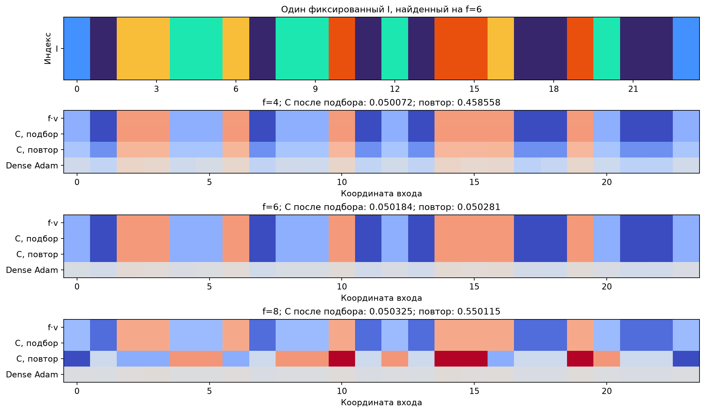

# Перенос фиксированного I с f=6 на другие частоты

Один индексатор из source-validation на f=6; целевое направление v не меняется. На каждой частоте C и амплитуда обучаются заново; исходные числа и состояния Adam не копируются. f=6 — контроль повторной численной подгонки, f=4/8 — перенос частоты. Учитель: .4sin(.7vᵀx)+sin(fvᵀx), ученик: a·sin(C[I]ᵀx).

12 настроек радиуса/Adam lr × 32 calibration-старта × 3000 шагов. Query выбирает checkpoint и старт на настройку; selection выбирает настройку. После этого 32 новых старта, query выбирает один из них. Все выборы заморожены до teacher-аудита, population-риска и нового test. Support/query/selection — прежние наблюдения, поэтому это перенос частоты на исходном направлении, а не проверка нового направления.

## Результат подбора свежего кодбука

Здесь показана модель, выбранная по query/selection среди 12 настроек. Все C обучены с нуля. Достигнуто близкое к глобальному качество на каждой частоте при одном неизменном I.

| f | Population | Test | Train | Query | Предел при фикс. I | Глобальный |
|---|---:|---:|---:|---:|---:|---:|
| 4 | 0.05007188 | 0.05045956 | 0.05014492 | 0.04955625 | 0.05003860 | 0.04995725 |
| 6 | 0.05018441 | 0.05050727 | 0.05026394 | 0.04963216 | 0.05015801 | 0.04997511 |
| 8 | 0.05032476 | 0.05067171 | 0.05043111 | 0.04975577 | 0.05030022 | 0.04997511 |

## Повтор при выбранной настройке с 32 новыми стартами

| f | Population, выбранный по query | Test | Среднее 32 | В пределах глобального +.001 | Лучший риск при фикс. I | Глобальный |
|---|---:|---:|---:|---:|---:|---:|
| 4 | 0.45855762 | 0.46002254 | 0.52130731 | 0/32 | 0.05003860 | 0.04995725 |
| 6 | 0.05028073 | 0.05063977 | 0.53439133 | 1/32 | 0.05015801 | 0.04997511 |
| 8 | 0.55011549 | 0.54317635 | 0.55004662 | 0/32 | 0.05030022 | 0.04997511 |

В повторе хорошая подгонка C не воспроизводится устойчиво из случайного старта. Близкая аналитическая представимость и реально достигнутые calibration-решения показывают, что этот провал численный. Смена частоты в основном масштабирует прежнее направление; она не проверяет истинность всех найденных групп равенств. Ранее отрицательный перенос в sine_consensus/transfer менял сами три коэффициента направления при f=6 — это другой эксперимент.

## Численная подгонка и контроли

`summary.json` содержит все 32 риска, calibration и fresh отдельно, полные train/query MSE, выбранные настройки, аналитическую представимость и старые dense/oracle контроли. Контроли используют те же функции/данные и 3000 шагов, но другой численный подбор (mean8, seed502); бюджеты поиска и старты не попарно одинаковы. Глобальный риск ненулевой, поскольку ученик содержит одну синусоиду. При визуализации общий знак веса согласован с v; исходные I/C/W сохранены без изменения.

Новое численное обучение: 1.02 мин. Ни один поиск структуры на целевых частотах не запускался.
