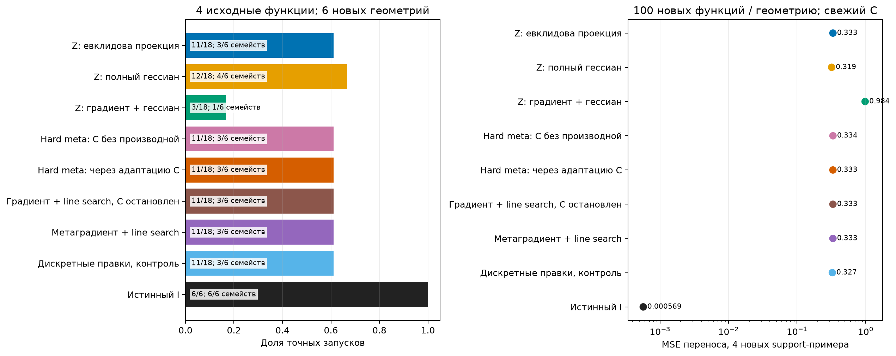
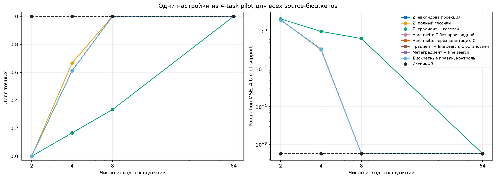
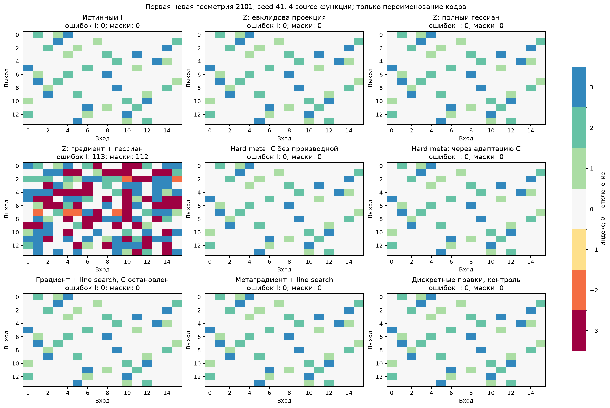
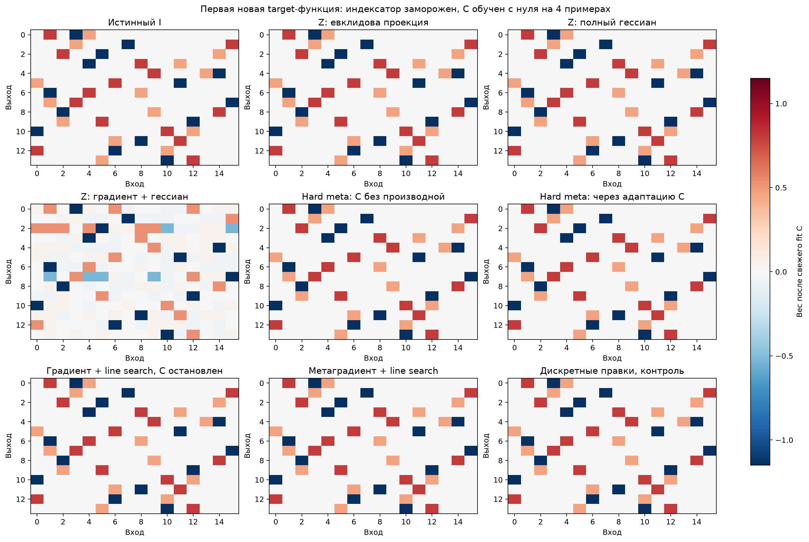
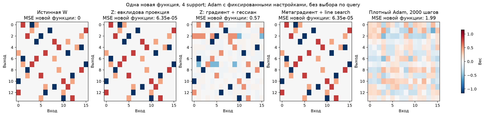
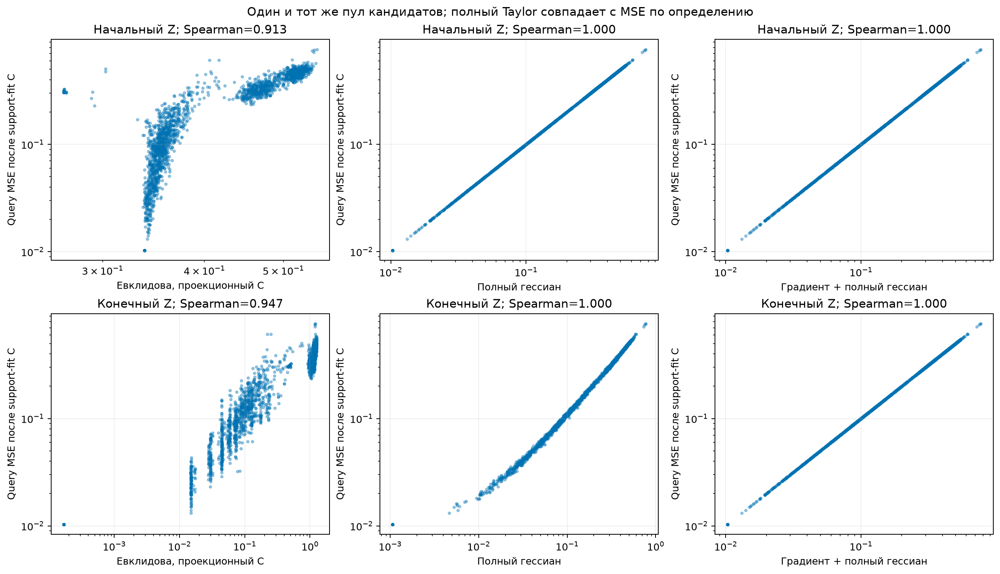
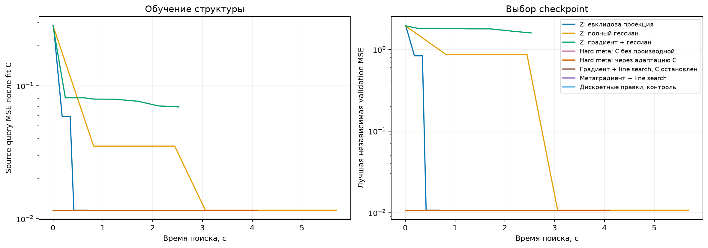
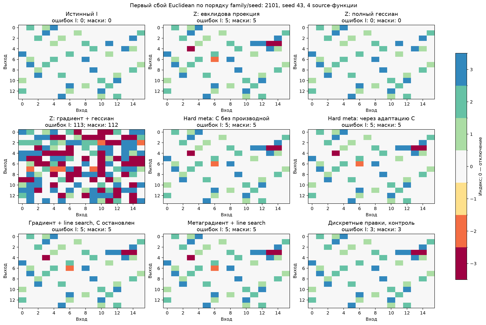

# Градиент, кривизна и адаптация кодбука

Исследование 5 ноября 2026. Четыре свободные V100 0–3, четыре параллельных shard. GPU 4–7 заняты чужими процессами. Скрытая перемешанная свёртка W14×16, K3, fixed0 и связанные отрицания. Все позиции и группы доступны поиску.

## Протокол

Первый pilot8 дал практически одинаковую минимальную validation loss у всех вариантов и learning rate. До новых подтверждающих геометрий зарегистрирован окончательный pilot4. Две pilot-геометрии2001/2002, два seed; по шесть настроек у каждого обучаемого варианта. После freeze настройки не менялись: шесть новых геометрий2101–2106, три seed, бюджеты2/4/8/64. Истинные I и новые100 коэффициентных функций на геометрию открыты только после заморозки всех моделей. Каждая новая функция адаптирует только свежий C. Независимая единица — шесть геометрий, не18 запусков.

Первоначальный8-task pilot сохранён отдельно и не используется как подтверждающий результат. Для2/8/64 нет отдельного HPO: это контроли с настройками, выбранными на4 функциях. Во всех случаях4 support +4 query на source-функцию; независимая validation24 функций по4+64; шум0.1.

Перед meta-pilot зарегистрированы четыре слепые случайные правки найденного Euclidean I: его исходная validation уже была на уровне шума. Оба STE, оба projected-варианта и query-edit контроль на pilot получают одинаковое испорченное начало; в confirmation индексатор не портится. Этот подбор исследует исправление найденной структуры и не использует teacher. После неудачного STE-pilot до подтверждения зарегистрированы projected-контроли без дополнительного HPO; см. meta_calibration.json и gradient_controls.json.

## Результаты

### 2 исходных функций

| Метод | Все seed точны, семейств | Точных запусков | F1 маски | MSE4, свежий C |
|---|---:|---:|---:|---:|
| Z: евклидова проекция | 0/6 | 0/18 | 0.397 | 1.98 |
| Z: полный гессиан | 0/6 | 0/18 | 0.391 | 2.01 |
| Z: градиент + гессиан | 0/6 | 0/18 | 0.383 | 2.11 |
| Hard meta: C без производной | 0/6 | 0/18 | 0.396 | 1.97 |
| Hard meta: через адаптацию C | 0/6 | 0/18 | 0.396 | 1.98 |
| Градиент + line search, C остановлен | 0/6 | 0/18 | 0.397 | 1.98 |
| Метаградиент + line search | 0/6 | 0/18 | 0.397 | 1.98 |
| Дискретные правки, контроль | 0/6 | 0/18 | 0.394 | 1.98 |
| Истинный I | 6/6 | 6/6 | 1.000 | 0.000569 |

### 4 исходных функций

| Метод | Все seed точны, семейств | Точных запусков | F1 маски | MSE4, свежий C |
|---|---:|---:|---:|---:|
| Z: евклидова проекция | 3/6 | 11/18 | 0.829 | 0.333 |
| Z: полный гессиан | 4/6 | 12/18 | 0.818 | 0.319 |
| Z: градиент + гессиан | 1/6 | 3/18 | 0.535 | 0.984 |
| Hard meta: C без производной | 3/6 | 11/18 | 0.829 | 0.334 |
| Hard meta: через адаптацию C | 3/6 | 11/18 | 0.829 | 0.333 |
| Градиент + line search, C остановлен | 3/6 | 11/18 | 0.829 | 0.333 |
| Метаградиент + line search | 3/6 | 11/18 | 0.829 | 0.333 |
| Дискретные правки, контроль | 3/6 | 11/18 | 0.829 | 0.327 |
| Истинный I | 6/6 | 6/6 | 1.000 | 0.000569 |

### 8 исходных функций

| Метод | Все seed точны, семейств | Точных запусков | F1 маски | MSE4, свежий C |
|---|---:|---:|---:|---:|
| Z: евклидова проекция | 6/6 | 18/18 | 1.000 | 0.000569 |
| Z: полный гессиан | 6/6 | 18/18 | 1.000 | 0.000569 |
| Z: градиент + гессиан | 1/6 | 6/18 | 0.675 | 0.636 |
| Hard meta: C без производной | 6/6 | 18/18 | 1.000 | 0.000569 |
| Hard meta: через адаптацию C | 6/6 | 18/18 | 1.000 | 0.000569 |
| Градиент + line search, C остановлен | 6/6 | 18/18 | 1.000 | 0.000569 |
| Метаградиент + line search | 6/6 | 18/18 | 1.000 | 0.000569 |
| Дискретные правки, контроль | 6/6 | 18/18 | 1.000 | 0.000569 |
| Истинный I | 6/6 | 6/6 | 1.000 | 0.000569 |

### 64 исходных функций

| Метод | Все seed точны, семейств | Точных запусков | F1 маски | MSE4, свежий C |
|---|---:|---:|---:|---:|
| Z: евклидова проекция | 6/6 | 18/18 | 1.000 | 0.000569 |
| Z: полный гессиан | 6/6 | 18/18 | 1.000 | 0.000569 |
| Z: градиент + гессиан | 6/6 | 18/18 | 1.000 | 0.000569 |
| Hard meta: C без производной | 6/6 | 18/18 | 1.000 | 0.000569 |
| Hard meta: через адаптацию C | 6/6 | 18/18 | 1.000 | 0.000569 |
| Градиент + line search, C остановлен | 6/6 | 18/18 | 1.000 | 0.000569 |
| Метаградиент + line search | 6/6 | 18/18 | 1.000 | 0.000569 |
| Дискретные правки, контроль | 6/6 | 18/18 | 1.000 | 0.000569 |
| Истинный I | 6/6 | 6/6 | 1.000 | 0.000569 |

## Что именно сравнивается

Z-варианты имеют общий старт, одинаковый L-step, rho/dual-сетки, четыре старта и80 раундов; штраф разреженности везде нулевой. Hessian-вариант меняет только критерий проекции. Taylor добавляет линейный член градиента в точке Z+U к той же полной кривизне. Проектор локальный, с условными assignment/C проходами; глобальное решение полного гессиана не заявляется. Это диагностическая модификация, а не доказанная новая ADMM-схема.

Hard meta стартует с выбранного Z-евклидова I. Оба варианта имеют один жёсткий forward, одинаковые шесть learning rate,800 шагов и4 малых возмущения. Разница — только производная support-fit C. Градиент через жёсткое назначение суррогатный STE. Непрерывный накопитель задаёт коэффициенты общего базиса A, что отличается от исходных скалярных Z. На каждом checkpoint кодбуки заново оцениваются одинаковым точным МНК без ridge. Дискретные правки — отдельный контроль, не часть градиентного поиска.

Projected stop/full используют сырой градиент по непрерывному расширению A, нормированный по максимальному модулю. Каждый шаг предлагает шесть целиком жёстких матриц для смещений0.25/0.5/1/2/4/8; после точного support-fit C source-query выбирает строгое улучшение. При отсутствии улучшения алгоритм останавливается; предел80 шагов. Это глобальный line search по градиентному направлению, а не перебор всех позиций. Полный вариант учитывает изменение C, остановленный — только прямое влияние A. Оба сохраняют шаг0 и выбирают checkpoint независимой validation.

## Диагностика критериев

Для каждой из четырёх pilot-реплик один пул из сохранённых checkpoints и1024 фиксированных случайных возмущений. Teacher не используется. Сравниваются евклидова проекция с её C, та же норма после support-fit C, диагональная/полная эмпирическая кривизна и полный Taylor. В Taylor C уже получен на support; его равенство query-loss является алгебраическим тождеством для линейной модели, не эмпирическим открытием. У изотропных Gaussian inputs population-метрика предсказаний равна Frobenius, поэтому нельзя автоматически считать гессиан лучшим.

| Состояние Z | Критерий | Средний Spearman с адаптационным query-loss |
|---|---|---:|
| initial | Евклидова, проекционный C | 0.8736 |
| initial | Евклидова, support-fit C | -0.1211 |
| initial | Диагональный гессиан | 0.5894 |
| initial | Полный гессиан | 1.0000 |
| initial | Градиент + полный гессиан | 1.0000 |
| final | Евклидова, проекционный C | 0.9065 |
| final | Евклидова, support-fit C | 0.8856 |
| final | Диагональный гессиан | 0.9067 |
| final | Полный гессиан | 0.9996 |
| final | Градиент + полный гессиан | 1.0000 |

Направленная производная inner-fit: относительная ошибка 1.11e-11; cosine полного и остановленного градиентов 0.956. Это проверка численной реализации на одном pilot-состоянии, не гарантия поиска дискретного I.

Плотный Adam для первого target:2000 шагов, lr0.03, нулевая инициализация,4 support. Training MSE 2.226e-07, population MSE 1.988. Это отдельная иллюстрация, не среднее по100 функциям и не настроенный конкурент. Линейная плотная задача выпуклая; разница обучения/переноса не свидетельствует о локальном минимуме Adam.

## Графики

## Ограничения

Это линейный benchmark с аналитическим численным inner-fit. Нелинейные Pattern/DeepSets/синусы этим запуском не проверяются. Метаградиентные варианты продолжают общий Z-поиск, без случайного старта A. Задачи query служат внешней обучающей целью; независимая validation выбирает checkpoint. Новые тестовые функции в поиске не участвуют. Не заявляются глобальная сходимость или алгоритмическая новизна. Исходные методы и артефакты предыдущих этапов не изменялись.

## Интерпретация результатов

Ранний свободный Z действительно задаёт плохую геометрию отбора. На четырёх pilot-репликах из одного и того же пула евклидова проекция начального Z выбирает структуры со средней независимой validation MSE2.129; support-adaptation/query-критерий выбирает0.01067. На конечном Z эти выбранные ошибки уже совпадают. Нельзя считать евклидову метрику всегда плохой или весь эффект приписать градиенту.

Полный гессиан дал небольшой прирост в основном4-task режиме:12/18 вместо11/18 точных I, MSE4 0.319 вместо0.333. Это один дополнительный запуск и одна дополнительная геометрия со всеми точными seed; шесть независимых геометрий не дают основания объявлять большой устойчивый выигрыш. Добавление линейного gradient-term в Z-projector ухудшило результат до3/18 иMSE0.984. Его локальный проектор уменьшает собственную квадратичную цель; равенство Taylor MSE проверено до4.44e-16. Это не доказательство глобального решения assignment-задачи.

Градиент через support-fit C вычислен корректно (направленная ошибка1.1e-11), но STE Adam не добавил точных восстановлений:11/18, почти та же transfer MSE. В pilot большие шаги открывали множество лишних связей; validation сохраняла старт. Projected full со строгим source-query line search в confirmation4 не принял ни одного из предложенных шагов и полностью сохранил исходные I. Следовательно, непрерывное направление и его жёсткая проекция не обеспечили полезный дискретный переход.

Важная послепоисковая проверка: во всех7 ошибочных Euclidean-запусках4-task истинный I имеет меньший source-query loss. Даже после исчерпания однопозиционных улучшений контрольного поиска он лучше последнего состояния в7 случаях. Истина добавлялась только в этот audit после freeze. В этих случаях критерий предпочёл бы нужную структуру, однако алгоритмы до неё не добрались. Это поддерживает объяснение через трудность дискретного поиска; недостаточно объяснять сбой одним лишь неправильным прокси или Adam-кодбуком.

При2 исходных функциях все варианты дали0/18. При8 Euclidean и Hessian уже18/18, fresh-C transfer MSE0.0005688 на уровне истинного I; Taylor6/18. При64 все варианты18/18. В данном benchmark использование нескольких функций с общим I оказалось сильнее, чем проверенные изменения градиента. Восемь функций не являются универсальным теоретическим порогом.

Новый figure выбран по правилу первого Euclidean-сбоя в порядке family/seed; основной figure indexators.png по-прежнему показывает заранее фиксированные family2101/seed41. Переименованы только номера/знаки кодов, координаты не переставляются.
