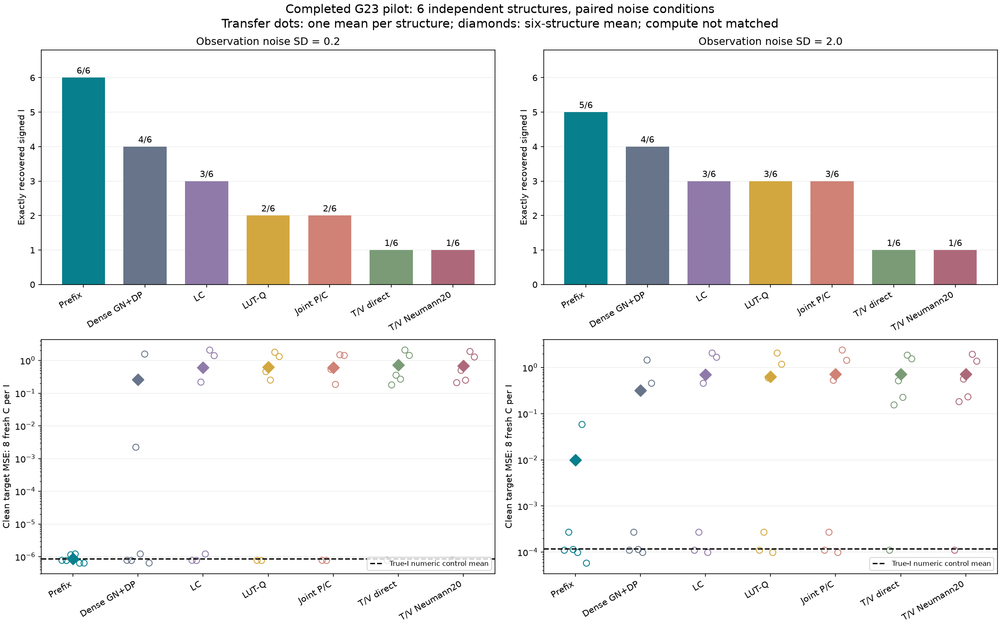
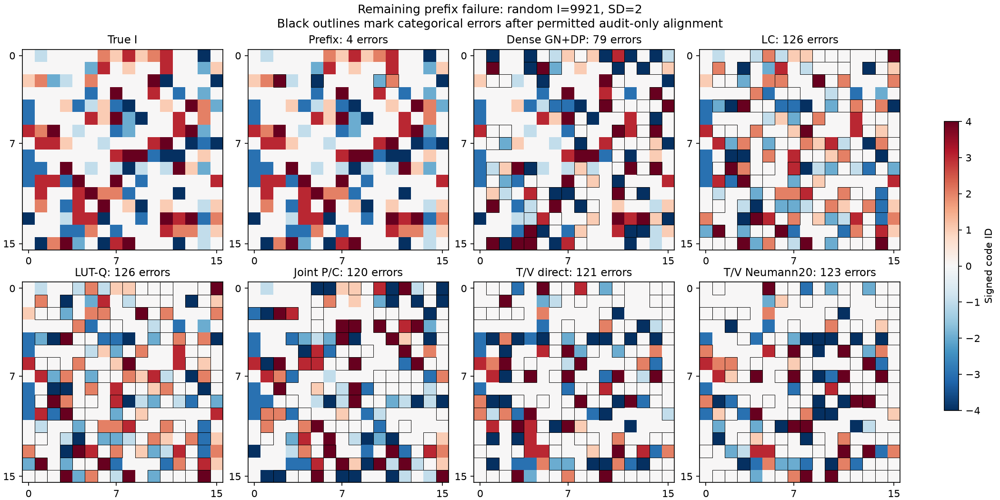
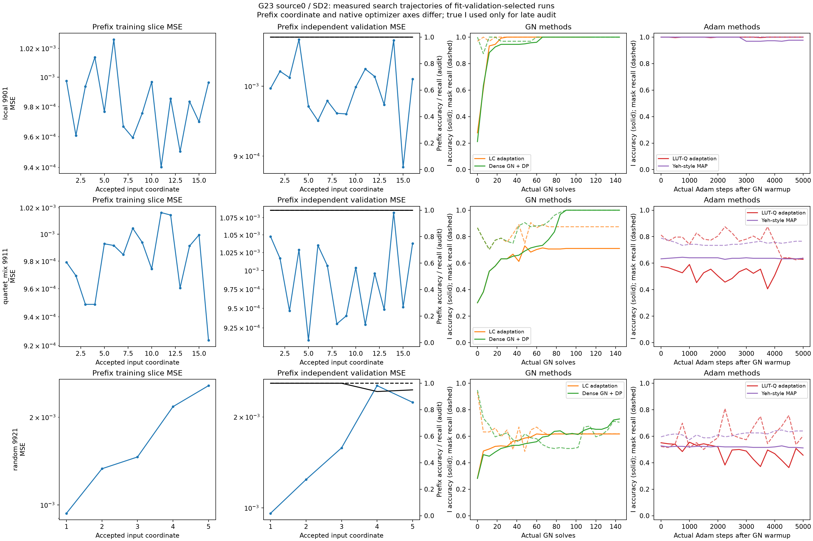
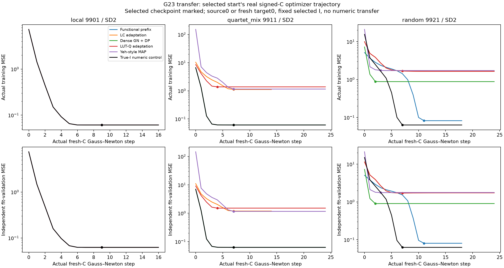
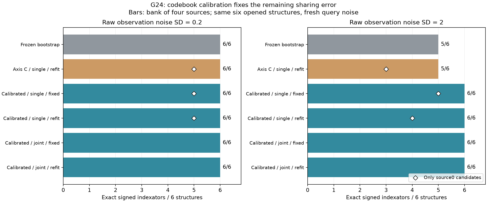
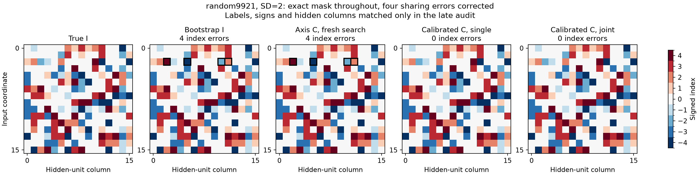

# Извлечение общей структуры весов: итоговый отчёт G23 и G24

Дата: 5 ноября 2026 года. Сравнение семи методов и перенос G23 завершены. Завершена также G24 — абляция повторной калибровки кодбуков и общего поиска по тем же шести структурам со свежим шумом. Ниже сначала полностью определён реализованный метод, затем приведены результаты, отрицательные исходы и их диагностика. Независимое подтверждение окончательной схемы, более общий класс сетей и доказательство новизны остаются открытыми.

## 1. Метод: что извлекаем и как устроена модель

Мы ищем схему подключений и равенств весов, которая сохраняется между несколькими функциями. Численные значения весов меняются от задачи к задаче. Структура представляется целочисленным индексатором: нулевой индекс отключает связь, одинаковые ненулевые индексы связывают её с одним числом кодбука, отрицательный индекс задаёт противоположный знак. На новой задаче сохраняем найденный индексатор и обучаем новый кодбук с нуля.

Текущий алгоритм использует значения функции на специально выбранных входах. Сначала он оценивает возможные численные значения весов по одномерным осевым срезам. Затем последовательно добавляет входные координаты и определяет, сколько скрытых нейронов имеют каждое допустимое продолжение уже найденного шаблона. После последней координаты эти целые количества непосредственно задают матрицу индексов. Ниже эта процедура называется **функциональным поиском по префиксам**, или **prefix-поиском**. В G24 добавлен один цикл: по предварительному общему I уточняются отдельные кодбуки задач, после чего все подключения и группы заново ищутся с пустого префикса. Проверены как независимые поиски, так и один совместный поиск.

### 1.1. Определения

| Обозначение | Определение | В G23 и G24 |
|---|---|---|
| D | Число входных координат | 16 |
| H | Число скрытых ReLU-нейронов | 16 |
| K | Число групп в teacher и число доступных ненулевых кодов поиска | 4 |
| T | Число source-функций с одной структурой | 4 |
| I | Общая матрица целых индексов размера D×H | Неизвестна learner |
| c_t | Вектор K численных коэффициентов задачи t | Независимо обучается для каждой задачи |
| S | Алфавит допустимых индексов | 0, ±1, …, ±K |
| b | Общий известный сдвиг скрытых нейронов | 0,15 |
| π | Случайный фиксированный порядок входных координат | Выбран без teacher-I |
| r | Текущая длина найденного префикса | От 1 до D |
| p | Уже найденный шаблон первых r−1 координат нейрона | Элемент S^(r−1) |
| m_p | Число скрытых нейронов с шаблоном p | Целое; сумма по p равна H |
| q_(p,a) | Число продолжений шаблона p индексом a | Целая переменная поиска |
| R_j | Число независимых шумных повторов запроса j | Зависит от панели |

Положим нулевой элемент кодбука равным нулю. Вес и матрица задачи определяются формулами

$$
\begin{aligned}
&c_{t,0}=0,\qquad I\in\{0,\pm1,\ldots,\pm K\}^{D\times H},\\
&W_{t,dh}=\operatorname{sgn}(I_{dh})c_{t,|I_{dh}|}.
\end{aligned}
$$

Например,

$$
I=(1,2,1,0,-2)
\quad\Longrightarrow\quad
W_t=(c_{t,1},c_{t,2},c_{t,1},0,-c_{t,2}).
$$

Это удвоенный кодбук с фиксированным нулём: хранятся K обучаемых чисел, а допустимых значений веса 2K+1. При K=4 получаем девять категорий. В общем численном fit коэффициенты могут иметь любой знак: знак нового коэффициента не обязан совпадать со знаком соответствующего source-коэффициента.

Истинная структура использует все K групп. Само пространство назначений допускает и неиспользованные коды; такое решение не считается восстановленным I, если оно объединило разные истинные группы.

Пусть E=DH, а e обозначает позицию матрицы при фиксированной векторизации. Определим дискретную матрицу назначений

$$
\begin{aligned}
A(I)_{ek}&=\operatorname{sgn}(I_e)\,\mathbf1\{|I_e|=k\},
\qquad A(I)\in\{-1,0,1\}^{E\times K},\\
\operatorname{vec}(W_t)&=A(I)c_t.
\end{aligned}
$$

В каждой строке A не более одного ненулевого элемента. Переносится именно эта общая схема; численные c_t, плотные W_t и состояния оптимизатора между задачами не переносятся.

### 1.2. Класс функций и доступ к данным

В этом benchmark рассматривается один скрытый ReLU-слой с известным общим сдвигом и одинаковыми известными выходными коэффициентами:

$$
\begin{aligned}
[u]_+&=\max(0,u),\\
f_t(x;I,c_t)&=\frac1{\sqrt H}\sum_{h=1}^{H}
\left[b+\sum_{d=1}^{D}x_d\operatorname{sgn}(I_{dh})c_{t,|I_{dh}|}\right]_+.
\end{aligned}
$$

Поиску известны D, H, K, b, нормировка выхода и класс активации. Он не получает позиции связей, число активных весов, истинные группы, скрытые перестановки или реальные коэффициенты. Можно запрашивать выход функции в выбранной точке. Входные градиенты и скрытые активации teacher недоступны.

Наблюдение является средним независимых шумных ответов:

$$
\begin{aligned}
Y_{t,j,\ell}&=f_t(x_j)+\epsilon_{t,j,\ell},
\qquad \epsilon_{t,j,\ell}\sim\mathcal N(0,\sigma^2),\\
\bar Y_{t,j}&=\frac1{R_j}\sum_{\ell=1}^{R_j}Y_{t,j,\ell}
\sim\mathcal N\!\left(f_t(x_j),\frac{\sigma^2}{R_j}\right).
\end{aligned}
$$

В коде непосредственно симулируется это точное Gaussian-распределение среднего. Цена R_j физических ответов всё равно учитывается. Высокая точность среднего здесь является существенным условием опыта.

Это конкретная синтетическая нелинейная задача поиска шэринга. Успех на ней не означает автоматически восстановления произвольного DeepSets, многослойного MLP, Pattern или сети на изображениях. Прежние опыты на этих задачах перечислены отдельно в разделе 11.

### 1.3. Когда два индексатора считаются одной структурой

Допустимы глобальная перестановка K названий групп, глобальный переворот знака каждой группы с соответствующим переворотом коэффициента и перестановка H скрытых нейронов. Входные координаты переставлять нельзя. Нумерация групп произвольна; равенство или противоположность двух весов — содержательная часть структуры.

Канонизация перебирает K!·2^K глобальных переименований/знаков, упорядочивает скрытые столбцы и выбирает минимальную сериализованную запись. Она использует только сам индексатор. Сопоставление с истинным I выполняется позднее, в отдельном аудите, после фиксации всех выборов.

## 2. Первый этап: численный словарь из осевых срезов

Обозначим через e_d единичный вектор входной координаты d. Для положительного известного b справедливо

$$
[b+u]_+ + [b-u]_+ - 2b = [|u|-b]_+.
$$

Применим это равенство к выходам на двух противоположных направлениях каждой оси и сложим по входам. Получится одномерная функция

$$
\begin{aligned}
G_t(s)
&=\sum_{d=1}^{D}\bigl[f_t(se_d)+f_t(-se_d)\bigr]-2D\sqrt H\,b\\
&=\frac1{\sqrt H}\sum_{k=1}^{K}n_k[s|c_{t,k}|-b]_+,\qquad s\ge0,\\
n_k&=\sum_{d,h}\mathbf1\{|I_{dh}|=k\}.
\end{aligned}
$$

Числа n_k являются неизвестными целыми количествами позиций группы. Расположение этих позиций из осевых сумм не определяется. Зато при различных ненулевых модулях кодов функция имеет изломы в точках b/|c_(t,k)|. Их положение несёт информацию о численном словаре до восстановления всех подключений.

В выполненном алгоритме DP по кусочно-линейным сегментам и целым интерсептам даёт инициализацию. Затем constrained nonlinear least squares уточняет положительные модули кодов, а неотрицательные амплитуды при каждом пробном словаре находятся NNLS. Из семи стартов выбирается результат по отдельным межузловым осевым наблюдениям.

Важное уточнение: этот DP является релаксированной сегментацией, а не сертифицированным глобальным решателем исходного непрерывного сплайна. В основной процедуре амплитуды после инициализации не принуждаются оставаться целыми. Ошибка оценённого словаря способна изменить последующий дискретный выбор. Совпадающие или очень близкие модули кодов также ухудшают различимость.

Для поиска одной source-функции можно выбрать gauge, где численные коды положительны, а их знаки включены в I. При общем fit нескольких задач и при переносе I фиксирован, поэтому коэффициенты снова обучаются как знаковые, без независимой сортировки по задачам.

Реализация: [codebook_counts.py](codebook_counts.py), [shared_structure_extract.py](shared_structure_extract.py).

## 3. Второй этап: структура через количества продолжений

### 3.1. От частичного шаблона к линейной модели

На шаге r рассматриваем входы, у которых ненулевыми могут быть только координаты π_1,…,π_r. Уже найденные шаблоны первых r−1 координат обозначим множеством P_(r−1). Их количества m_p известны из предыдущего принятого шага. В начале имеется один пустой шаблон с количеством H.

Для оценки численного словаря c определим значение индекса

$$
v_c(a)=\begin{cases}
0,&a=0,\\
\operatorname{sgn}(a)c_{|a|},&a\ne0.
\end{cases}
$$

Каждая пара «родитель p, продолжение a» задаёт наблюдаемую функцию, далее называемую атомом:

$$
\psi_{p,a}(x;c)=\frac1{\sqrt H}
\left[b+\sum_{j=1}^{r-1}x_{\pi_j}v_c(p_j)
+x_{\pi_r}v_c(a)\right]_+.
$$

Переменная q_(p,a) показывает, сколько нейронов получают такое продолжение. Допустимость требует

$$
q_{p,a}\in\mathbb Z_{\ge0},
\qquad \sum_{a\in S}q_{p,a}=m_p.
$$

Для фиксированного словаря и правильных родителей выход на текущем срезе линейно зависит от этих количеств:

$$
f_q(x;c)=\sum_{p\in P_{r-1}}\sum_{a\in S}q_{p,a}\psi_{p,a}(x;c).
$$

Например, если два нейрона пока имеют одинаковый префикс p, то m_p=2. Решение q_(p,+1)=1 и q_(p,−2)=1 продолжает один нейрон кодом +1, другой кодом −2. После этого они становятся двумя разными родителями. Порядок этих двух нейронов определять не требуется.

Таким образом, связь и её группа выбираются одновременно. Нулевое продолжение участвует наравне с остальными, а заранее найденная бинарная маска не является входом этого алгоритма.

### 3.2. Полная метрика функции

Удобно исключить нулевое продолжение. Для N наблюдений текущего среза определим базовый ответ, матрицу приращений и центрированную цель:

$$
\begin{aligned}
f_0(x;c)&=\sum_p m_p\psi_{p,0}(x;c),\\
M_{j,(p,a)}&=\psi_{p,a}(x_j;c)-\psi_{p,0}(x_j;c),\quad a\ne0,\\
y^0_j&=\bar Y_j-f_0(x_j;c),\\
z_{p,a}&=q_{p,a},\quad a\ne0.
\end{aligned}
$$

Тогда допустимое множество имеет ограничения неотрицательности и верхней границы суммы в каждом родителе. Оставшееся количество относится к нулевому продолжению:

$$
\begin{aligned}
&z_{p,a}\in\mathbb Z_{\ge0},\qquad
\sum_{a\ne0}z_{p,a}\le m_p,\\
&q_{p,0}=m_p-\sum_{a\ne0}z_{p,a}.
\end{aligned}
$$

Оптимизируем половину MSE именно функции, а не расстояние до непрерывных количеств:

$$
\begin{aligned}
Q(z)&=\frac1{2N}\|Mz-y^0\|_2^2\\
&=\frac12z^\top Gz-s^\top z+\text{const},\\
G&=\frac1N M^\top M,\qquad s=\frac1N M^\top y^0.
\end{aligned}
$$

Матрица G учитывает, как изменения разных количеств совместно влияют на выход. Два близких по евклидовой норме вектора количеств могут давать существенно разную ошибку функции. Для допустимого дискретного изменения δ значение цели меняется точно на

$$
Q(z+\delta)-Q(z)=(Gz-s)^\top\delta+\frac12\delta^\top G\delta.
$$

Это точная квадратичная формула для текущего фиксированного словаря атомов, а не Taylor-приближение всей нелинейной задачи с изменяемым c.

### 3.3. Фактически использованный решатель

Сначала вычисляется непрерывный LS и проверяется численный ранг словаря. Затем решается выпуклая QP-релаксация с теми же ограничениями на количества. Её primal feasibility и Frank–Wolfe gap проверяются отдельно от success-флага оптимизатора. После округления с сохранением родительских количеств целые назначения улучшаются по точному Q.

Использованы четыре заранее зарегистрированных варианта: одноединичные переносы количества; те же переносы с уточнением c; сочетание парных переносов и условной переоптимизации одного родителя; то же сочетание с уточнением c. Все допустимые изменения сохраняют общее число нейронов. Они могут переводить количество в ноль, из нуля в активную группу и между группами.

Одноединичная stationarity, парные ходы и решение условной задачи не доказывают глобальную оптимальность полной целочисленной задачи. При недостаточном ранге или непройденном численном допуске поиск прекращается с зарегистрированным отказом. Частичная структура не дополняется до полной с помощью teacher.

После принятого шага шаблон (p,a) повторяется q_(p,a) раз и становится родителем следующего шага. В вариантах с уточнением c его численные значения дополнительно обучаются при уже жёстком частичном I на всех срезах до текущего шага; checkpoint выбирается по соответствующим prefix-validation срезам. Прежние назначения при таком численном обновлении не меняются.

Когда r=D, получаем H полных столбцов индексатора. Порядок столбцов несущественен благодаря одинаковому readout. Полученная матрица уже целочисленна; итоговый softmax-argmax и кластеризация плотных весов для её построения не используются.

Реализация: [count_projection.py](count_projection.py), [count_qp_active.py](count_qp_active.py), [count_exchanges.py](count_exchanges.py). Эти численные инструменты известны; собственная проверяемая гипотеза относится к способу организации функционального извлечения, а не к изобретению QP или парного coordinate descent.

## 4. Общий индексатор, независимые кодбуки и перенос

### 4.1. Банк кандидатов

В G23 prefix-поиск проводится отдельно на каждой из четырёх source-функций. Полные кандидаты проходят короткое численное дообучение c при неизменном I. До четырёх лучших различных структур каждой source-функции сохраняются по fit-validation. Канонизация и дедупликация объединяют их в банк метода B, содержащий до шестнадцати структур.

Для любой наблюдаемой панели D_t задачи t под эмпирической loss понимается

$$
\widehat L_{\mathcal D,t}(I,c)=\frac1{|\mathcal D_t|}
\sum_{(x,\bar y)\in\mathcal D_t}\bigl[f_t(x;I,c)-\bar y\bigr]^2.
$$

Здесь D_t — множество входов и средних шумных ответов, а не число входных координат D. Обучающие, численные validation, meta и target-test панели различаются по назначению и независимости, как указано в разделах 4.2, 4.4 и 7.

Для каждого I из B затем заново обучаются все четыре независимых кодбука. На каждый кодбук выделяются 32 общих для конкурентов старта: все 2^K знаковых конфигураций и по две случайные инициализации модулей. Максимум 24 шага Gauss–Newton с backtracking по реальной ReLU-loss; ограничение модуля каждого коэффициента — 16. Старт и checkpoint выбираются по отдельному fit-validation H. Source-кодбук, послуживший получению I, в эти fit не передаётся.

Для фиксированного I сначала вычисляются признаки F_(j,h,k), предактивации a_(j,h) и матрица производных J по K коэффициентам:

$$
\begin{aligned}
F_{jhk}(I)&=\sum_d x_{jd}\operatorname{sgn}(I_{dh})
\mathbf1\{|I_{dh}|=k\},\\
a_{jh}&=b+\sum_kF_{jhk}(I)c_k,\\
J_{jk}&=\frac1{\sqrt H}\sum_h\mathbf1\{a_{jh}>0\}F_{jhk}(I).
\end{aligned}
$$

В точке излома используется производная ReLU, равная нулю. При N обучающих наблюдениях численный шаг имеет вид

$$
\begin{aligned}
\Delta c&=\left(\frac{J^\top J}{N}+\rho\lambda_{\max}I_K\right)^{-1}
\frac{J^\top(y-f)}{N},\\
c_{\mathrm{new}}&=c+2^{-\ell}\Delta c.
\end{aligned}
$$

Здесь I_K — единичная матрица, ρ — относительный ridge, λ_max=max(λ_max(JᵀJ/N),10⁻¹²) — численный масштаб Gram, ℓ — выбранная степень уменьшения шага. Шаг принимается при допустимых коэффициентах и снижении training loss. Gauss–Newton остаётся локальным решателем; многократные старты не являются доказательством нахождения глобального минимума.

### 4.2. Выбор общего I

После обучения всех кандидатов фиксируются их предсказатели. Только затем открывается отдельная meta-выборка M, которая не использовалась для построения I или численного обучения c. Выбираем

$$
\widehat I=\arg\min_{I\in B}\frac1T\sum_{t=1}^{T}
\frac1{|\mathcal M_t|}\sum_{(x,y)\in\mathcal M_t}
\left[f(x;I,\widehat c_t(I))-y\right]^2.
$$

Все методы получают такую же внешнюю процедуру свежего fit и выбора. Фиксируются все выборы по всем геометриям и условиям, после чего открывается teacher-I для структурного аудита.

В G23 это **выбор одной общей структуры из кандидатов**: во время формирования каждого кандидата использовалась одна функция. Совместное изменение counts нескольких функций реализовано и отдельно проверено в следующем G24; эти два этапа не смешиваются в таблице конкурентов.

### 4.3. Новая задача

На новой функции берём выбранный I без изменений и сбрасываем весь кодбук и оптимизатор. Обучаем K новых знаковых чисел на target-support, выбираем старт/checkpoint по target-validation. Чистая target-test ошибка измеряется после фиксации всех target-моделей всех методов. Численные значения source-весов не используются.

Совпадающий канонический I, одинаковые target-данные и одинаковые старты определяют одну численную задачу. Такой fit переиспользуется между методами с сохранением hashes и происхождения. Это экономия повторного вычисления одной задачи; коэффициенты между разными target-функциями по-прежнему независимы.

### 4.4. G24: калибровка кодбуков и полное повторение поиска

Измеренный сбой G23 состоял не только в локальных целочисленных ловушках: ошибка численных кодов меняла предпочтение между правильными и неправильными продолжениями. Поэтому в G24 проверен один дополнительный цикл «предварительный I → калиброванные c_t → новый I». Это конечный выполненный цикл; сходимость многократного чередования не исследована.

Обозначим через B₀ банк полных prefix-кандидатов G23, через T₀ — прежние обучающие наблюдения, через H₀ — прежнюю численную validation, а через Fit — фактически выполненную процедуру 32 свежих знаковых стартов и Gauss–Newton с выбором по H₀. Для каждого I из B₀ такие независимые численные fits уже были завершены до G24. Предварительный индексатор выбирается по наблюдаемым данным:

$$
\begin{aligned}
\widetilde c_t(I)&=\operatorname{Fit}_{\mathcal T_0,\mathcal H_0}(I,t),\\
I^{\mathrm{boot}}&\in\arg\min_{I\in\mathcal B_0}
\frac1T\sum_{t=1}^{T}\widehat L_{\mathcal H_0,t}
\bigl(I,\widetilde c_t(I)\bigr),\\
\widehat c_t^{\mathrm{boot}}&=\widetilde c_t(I^{\mathrm{boot}}).
\end{aligned}
$$

Здесь Fit обозначает численный алгоритм, а не гарантированный глобальный минимум по c. Старый meta-выбор, истинные I и c для этого шага не используются. Общий предварительный I задаёт согласованные имена и знаки K групп; численные коэффициенты каждой задачи обучены отдельно. Неправильный предварительный I способен сместить и эту калибровку — правильность bootstrap не предполагается как доказанное условие алгоритма.

В G24 предварительные I и c заморожены **до получения новых шумных prefix-ответов**. Затем новый поиск начинает с одного пустого шаблона количества H. Его входом служат численные c, известные D/H/K/b и новые ответы функции. Маска, позиции и назначения групп предварительного I в ограничения поиска не попадают: на каждом шаге снова разрешены все 0/±1/…/±K.

Для независимого варианта каждый source проходит тот же поиск со своим калиброванным c_t, а полученные кандидаты объединяются. Для совместного варианта parents и counts общие, но атомы и ответы различаются по задачам. При одинаковом N на задачу введём M_t, y_t⁰ по определениям раздела 3 и обозначим G_t=M_tᵀM_t/N, s_t=M_tᵀy_t⁰/N. Полная совместная цель равна

$$
\begin{aligned}
Q_{\mathrm{joint}}(z)
&=\frac1{2TN}\sum_{t=1}^{T}\|M_tz-y_t^0\|_2^2\\
&=\frac12z^\top G_{\mathrm{joint}}z-s_{\mathrm{joint}}^\top z+\mathrm{const},\\
G_{\mathrm{joint}}&=\frac1T\sum_tG_t,
\qquad s_{\mathrm{joint}}=\frac1T\sum_ts_t.
\end{aligned}
$$

Целочисленные ограничения на z и точная формула изменения Q остаются прежними. При refit-варианте после принятого жёсткого префикса каждый c_t отдельно уточняется до 12 GN-шагов на новых срезах 1,…,r; checkpoint выбирается по соответствующим новым prefix-validation. В fixed-варианте c остаются калиброванными до конца поиска. Это отделяет пользу начальной калибровки от пользы дальнейшего чередования.

Все полные новые I затем проходят одинаковый окончательный **сброшенный** fit четырёх кодбуков: 32 знаковых старта, до 24 GN-шагов, прежний train T₀ и новая Gaussian-validation H₁. После фиксации всех предсказателей открывается отдельная новая meta M₁ и выбирается один общий I. До структурного teacher-аудита фиксируются все выборы. G24 не использует target-test G23.

Реализация: [совместные атомы и counts](joint_prefix_search.py), [выбор bootstrap и протокол](joint_prefix_benchmark.py). Свежие labels отделяют новый поиск от прежнего шума; сами шесть структур остаются уже исследованными.

## 5. Псевдоалгоритмы выполненных вариантов

### 5.1. G23: исходное сравнение и перенос

```text
Вход:
    T source-функций с доступом только к шумным выходам;
    известные D, H, K, общий b > 0 и readout 1/sqrt(H);
    заранее заданные queries, splits, варианты поиска и численные бюджеты.
Выход:
    общий целочисленный I; на каждой задаче — свой численный c.

1. Подготовить и зафиксировать наблюдения:
       оси train/validation; prefix train/validation;
       full-Gaussian fit-validation H; отдельный meta M.
   Истинные I и c недоступны поиску и выбору.

2. Для source-задачи t = 1,...,T:
       Построить осевую сумму G_t(s).
       Инициализировать |c_t| DP-сегментацией.
       Уточнить словарь нелинейным fit с NNLS-амплитудами.
       Выбрать из семи стартов по осевой validation.

       Для каждого из четырёх зарегистрированных вариантов поиска:
           Родители = {пустой шаблон с количеством H}.
           Для r = 1,...,D в фиксированном случайном порядке π:
               Построить атомы всех продолжений 0/±1/.../±K.
               Вычесть нулевой baseline; получить M, G, s.
               Проверить численный ранг.
               Решить непрерывную QP с parent capacities.
               Проверить feasibility и QP gap.
               Округлить с сохранением количества каждого родителя.
               Улучшить целые counts по полной функциональной Q.
               При refit-варианте уточнить c на срезах 1,...,r,
                   checkpoint выбрать по prefix-validation.
               Заменить родителей найденными продолжениями/counts.
           При отказе сохранить partial trace и причину.
           При полном выходе построить жёсткий I и polish только c.
       Сохранить до четырёх различных полных I по H.

3. Канонизировать/объединить source-кандидаты в банк B метода.
   Для каждого I в B и каждой source-задачи t:
       Инициализировать c_t с нуля, 32 signed starts.
       Обучить только c_t на T, checkpoint/start выбрать по H.
   Зафиксировать ВСЕ кандидатные предсказатели до открытия meta-Y.

4. Открыть meta M. Выбрать один I по среднему meta-loss T задач.
   Зафиксировать ВСЕ выбранные I до teacher-аудита.
   Измерить mask / unsigned sharing / signed I / bank recall.

5. Для каждой новой target-функции:
       Сохранить I; сбросить c и состояние оптимизатора.
       Обучить c из 32 signed starts на новом support.
       Выбрать checkpoint/start на target-validation.
   Зафиксировать target-модели ОБОИХ сравниваемых наборов методов.
   Открыть target-test; измерить clean MSE и excess к true-I control.
```

### 5.2. G24: лучший по завершённой абляции вариант

На этих шести структурах калиброванный fixed-вариант уже достигает того же exact-I результата, что refit и joint. Поэтому дополнительное уточнение c на каждом префиксе не является необходимой частью наиболее простого успешного варианта. Псевдокод ниже показывает весь путь, включая получение bootstrap; готовая хорошая маска на входе не требуется.

```text
Вход: T source-функций; известные D,H,K,b,readout;
      заранее заданные splits, queries и бюджеты; teacher-I/C скрыты.

1. Получить предварительный банк B0 алгоритмом 5.1, шаги 1–3.
   Для каждого I из B0 независимо обучить c_t всех source-задач с нуля.
   Выбрать I_boot по среднему старому H0, сохранить его c_t.
   Зафиксировать этот выбор до новых наблюдений.

2. Получить новые независимые prefix train/validation, H1 и meta M1.
   Meta-labels пока не открывать. Старый target-test не использовать.

3. Для task t и каждого из двух решателей unit / parent_pair:
       c = калиброванный c_t; parents = {пустой шаблон: H}.
       Для r=1,...,D:
           Сформировать ВСЕ продолжения каждого parent: 0/±1/.../±K.
           Построить функциональные M,G,s на новом prefix-r train.
           Проверить rank, решить QP, проверить gap/feasibility.
           Округлить counts с сохранением количества каждого parent.
           Улучшить целые counts по точной функциональной Q.
           Проверить Q против настоящего hard-forward.
           Заменить parents найденными child-counts; c не менять.
       Если все D шагов приняты: получить полный I непосредственно
           из целых multiplicities и добавить его в банк метода.
       Иначе: сохранить отказ, не дополнять I по teacher.
   В отдельной абляции заменить single-метрику на среднюю T задач
       с одними counts; отдельно включить prefix C-refit.

4. Объединить/канонизировать полные I четырёх single-поисков.
   Для каждого I и каждого t СБРОСИТЬ c_t и оптимизатор:
       32 свежих signed starts; GN на T0; выбор по H1.
   Зафиксировать все предсказатели до открытия meta-M1.

5. Выбрать один общий I по средней ошибке на M1 всех T задач.
   Зафиксировать все I; только затем открыть teacher и оценить
       exact mask, unsigned sharing, signed I, bank recall и отказы.

6. При переносе сохранить только I и обучать новый c с нуля.
   Этот отдельный новый target-опыт для G24 ещё не выполнялся;
       законченный независимый target-опыт G23 описан в разделе 8.2.
```

## 6. Математическое обоснование и его границы

### 6.1. Почему выходы могут различить продолжения

При правильных родителях и различимых численных кодах разные child-шаблоны задают разные векторы весов. Для фиксированного общего ненулевого b разные ненулевые векторы имеют разные гиперплоскости излома. Линейная комбинация соответствующих ReLU-атомов не может исчезать всюду: распределительную вторую производную можно рассмотреть на участке одной гиперплоскости вне пересечений с другими. Коэффициент этого атома обязан быть нулевым. Постоянный атом нулевого вектора рассматривается отдельно.

Отсюда следует линейная независимость конечного словаря как функций и существование конечных различающих запросов. При распределении входов с положительной плотностью на всём пространстве population Gram положительно определён. Это стандартный аргумент, не новая теорема общего обучения нейросетей.

На конкретной конечной панели эмпирический Gram может быть вырожденным или плохо обусловленным. Часть изломов может не попадать в наблюдаемую область. Без нижней границы на минимальное собственное значение нельзя заявить единый достаточный бюджет запросов для всех допустимых c.

### 6.2. Условие устойчивого целочисленного выбора

Пусть Φ(c) — полная матрица атомов, q* — истинные counts правильного родителя, а Q_int — конечное множество допустимых counts. Матрица Φ содержит значения функций ψ; её не следует смешивать с дискретной матрицей назначений A(I) раздела 1. В этом подразделе нормы и скалярные произведения нормированы на число наблюдений. Введём

$$
\begin{aligned}
\Delta&=\min_{q\in\mathcal Q_{\mathrm{int}},\,q\ne q^*}
\|\Phi(c)(q-q^*)\|,\\
B_c&=\max_{q\in\mathcal Q_{\mathrm{int}}}
\|[\Phi(\widehat c)-\Phi(c)]q\|,\\
y&=\Phi(c)q^*+\epsilon.
\end{aligned}
$$

Достаточное условие единственности правильного глобального LS-решения:

$$
\Delta>2\bigl(B_c+\|\epsilon\|\bigr).
$$

Для правильных counts норма остатка не выше правой половины этой границы. Для любого неверного — не ниже Δ минус та же величина. Это обычный аргумент устойчивости конечного LS-множества.

Условие требует правильных родителей, допустимости истины и глобального дискретного поиска. Ни одно из этих требований нельзя заменить локальной stationarity решателя. Δ и B_c зависят от неизвестной истины, поэтому это объяснение условий успеха, а не реализованный статистический сертификат learner. Ранняя неверная ветка может исключить правильное полное I из дальнейшего поиска.

### 6.3. Почему малая ошибка c не гарантирует правильную структуру

Для конкретных неверных q определим

$$
g=\Phi(\widehat c)(q-q^*),
\qquad d=[\Phi(\widehat c)-\Phi(c)]q^*.
$$

Точное разложение разности наблюдаемых MSE имеет вид

$$
\begin{aligned}
&\|\Phi(\widehat c)q-y\|^2-\|\Phi(\widehat c)q^*-y\|^2\\
&\qquad=\underbrace{\|g\|^2}_{\text{структурное различие}}
+\underbrace{2\langle d,g\rangle}_{\text{сдвиг от ошибки кодбука}}
-\underbrace{2\langle\epsilon,g\rangle}_{\text{шум наблюдений}}.
\end{aligned}
$$

Ошибка кодбука действует направленно и может перевесить малое структурное различие. Поэтому более сильный integer solver иногда лучше минимизирует ошибочную цель и ухудшает найденный I. Эта формула была записана до соответствующей диагностики; её измеренные значения приведены в разделе 9.

### 6.4. Что даёт независимая meta-выборка

Для двух фиксированных кандидатных предсказателей a и b разность squared losses на одних labels не содержит случайного квадрата Y: он сокращается. Пусть N_meta — число одинаково точных meta-запросов на каждую задачу, R — число повторений каждого запроса. Условная дисперсия разности средних рисков равна

$$
\operatorname{Var}(\widehat R_a-\widehat R_b\mid X,\widehat f)
=\frac{4\sigma^2}{R(TN_{\mathrm{meta}})^2}
\sum_{t,j}\bigl[\widehat f_{a,t}(x_{tj})-\widehat f_{b,t}(x_{tj})\bigr]^2.
$$

Это относится к уже обученным предсказателям и риску на данном design. Сам факт независимого meta-выбора не гарантирует точный I: истинный I должен присутствовать в банке, его численный fit должен быть достаточно хорош, а альтернативы — различимы на данных. В G23 отдельно измерены наличие истины в банке и ошибка выбора при её наличии.

### 6.5. Что может дать совместный поиск и чего он не гарантирует

Поскольку каждый G_t положительно полуопределён, для любого вектора u

$$
u^\top G_{\mathrm{joint}}u=\frac1T\sum_t\frac{\|M_tu\|_2^2}{N}.
$$

Правая часть обращается в ноль тогда и только тогда, когда M_tu=0 для всех задач. Следовательно,

$$
\ker G_{\mathrm{joint}}=\bigcap_{t=1}^{T}\ker G_t.
$$

Одна функция может не различать два продолжения, которые различает другая. Их общий функциональный fit способен убрать такую неоднозначность. Условие раздела 6.2 переносится на вертикально объединённые, нормированные матрицы Φ_t и соответствующие ошибку кодбуков и шум. Это условное основание joint-схемы; оно не говорит, что любое добавление задач обязательно исправит I.

Даже разные векторы коэффициентов группы по задачам не гарантируют различимость всех integer counts. Например, у двух задач c₁=(1,1,2,2), c₂=(1,2,1,2). Количества групп (6,2,2,6) и (5,3,3,5) оба дают восемь значений 1 и восемь значений 2 в каждой задаче, хотя это разные количества четырёх групп. Само наличие четырёх разных межзадачных профилей не заменяет условие функционального разделения.

G24 проверяет конкретный алгоритм на шести геометриях. Его результат не доказывает положительный универсальный margin, глобальную сходимость целочисленных moves или правильность калиброванного c. Сложение task-loss, чередование блоков и данное равенство kernels являются известными математическими механизмами.

Полные предварительные выводы и их хронология: [THEORY.md, разделы 27–34](THEORY.md).

## 7. Завершённый протокол сравнения

G23 использует шесть новых по отношению к G19–G22 геометрий: две local, две quartet_mix и две unrestricted random. Идентификаторы 9901, 9902, 9911, 9912, 9921, 9922; общий seed 26110523017. На каждой геометрии имеются четыре независимых Gaussian-кодбука source и восемь новых кодбуков target. Для quartet_mix численные коэффициенты масштабированы вдвое вниз. Состояния с шумом 0,2 и 2 используют парные реализации базового шума, поэтому это не двенадцать независимых геометрий.

| Панель на source-функцию | Входы | Повторы на вход | Назначение |
|---|---:|---:|---|
| Осевой train | 32 800 | 4 194 304 | Инициализация словаря; часть общего train |
| Осевой validation | 32 768 | 4 194 304 | Выбор численного axis-fit |
| Prefix train | 16×2 048 | 4 096 | Поиск counts; в сумме train содержит 65 568 входов |
| Prefix validation | 16×512 | 4 096 | Численное уточнение c; architecture V у bi-level |
| Full-Gaussian H | 2 048 | 4 096 | Checkpoint/HPO и общий численный fit |
| Full-Gaussian meta M | 2 048 | 4 096 | Окончательный выбор после predictor freeze |

Сетка осей содержит ноль и геометрически распределённые положительные точки от 0,001 до 1024; validation лежит между соседними узлами. Prefix-запросы используют шесть зарегистрированных масштабов, один и тот же случайный порядок координат и одинаковые observed-панели для всех методов.

**Полная цена — 275 196 674 048 физических шумных ответов на одну source-функцию и одно шумовое условие**, включая все панели. На семейство из четырёх функций — 1 100 786 696 192. Средние симулируются аналитически, поэтому runtime не равен времени физического получения такого числа ответов. Это проверка возможности восстановления при высокой точности данных, а не результат по эффективности использования данных.

На новой target-функции: support 4096, validation 1024, по 64 повтора; clean test 8192 новых Gaussian-входа. Каждый метод проходит 48 target-задач на уровень шума, но независимых структур по-прежнему шесть.

### 7.1. Конкуренты и действительные отличия реализаций

| Строка | Фактический алгоритм | Существенная граница |
|---|---|---|
| Prefix | Осевой c-fit, функциональные counts, четыре solver/refit варианта | Жёсткий I получается непосредственно из counts |
| Dense GN + DP | Плотное обучение Gauss–Newton, затем явная оптимальная scalar signed-DP дискретизация | Дополнительный DP-readout раскрыт; плотный GN сам не выдаёт I |
| LC adaptation | Learning/compression, augmented Lagrangian и dual rescaling; GN L-step, scalar signed-DP C-step | Адаптация под фиксированный ноль, знаковые пары, нашу loss и модель |
| LUT-Q adaptation | Плотный латент, nearest assignments, обновление dictionary, task-gradient STE | Сохранён quantization cycle; signed dictionary и GN warmup добавлены явно |
| Joint categorical P/C | Совместный Adam по soft P и c; entropy/nuclear penalties; hard MAP readout | Это отдельная Yeh-inspired абляция, не полный T/V алгоритм статьи |
| Yeh T/V, direct | Один общий P, четыре c_t; inner T, architecture V; прямой локальный 4×4 inverse в implicit gradient | Полная T/V адаптация; конечный inner Adam не гарантирует стационарный c |
| Yeh T/V, Neumann20 | Та же T/V процедура с конвенцией Neumann helper авторского кода | Дополнительно сохранена невязка inverse-action; это не гарантия точного inverse |

LC/dense проверяют uniform-mean и physical-repeat-weighted loss, несколько ridge/penalty режимов и три независимых старта. LUT-Q и joint используют 5000 Adam-шагов и выбор по hard-MAP качеству после численного polish. У joint отдельно проверены nuclear penalty 0 и 0,001. Бюджеты HPO и число траекторий раскрыты в [протоколе](results/20261105/shared_structure_g23/protocol.json); они не уравнены по FLOPs.

Для bi-level зарегистрированы 24 задания, 18 LR/init/restart сценариев в каждом, всего 432 траектории. На 500 outer-шагов приходится по 250 inner Adam-шагов; outer LR 0,003/0,01/0,03, inner LR 0,001, entropy 0,025, nuclear 0,05. Рассмотрены random и source0-GN инициализации, по три старта. Native MAP сохраняется каждые 25 outer-шагов; до 16 уникальных I выбираются по H, затем проходят тот же fresh-C/meta протокол. Настройки не выбирались по teacher-I. Они также не доказывают оптимальную настройку метода статьи на нашей задаче.

Новые явные Hessian/mixed derivatives проверены на наблюдаемых данных против autodiff: максимальное относительное расхождение 4,22×10⁻¹⁶. В завершённых bi-level jobs численных аварий нет. При прямом inverse невязка обратного действия мала, но inner stationarity и soft/hard gap остаются содержательными ограничениями. Поэтому результат 1/6 относится к этой адаптации и данному протоколу.

Первоисточники: [LC, Carreira-Perpiñán и Idelbayev](https://arxiv.org/abs/1707.04319), [LUT-Q, Cardinaux et al.](https://arxiv.org/abs/1911.04951), [Equivariance Discovery by Learned Parameter-Sharing, Yeh et al.](https://proceedings.mlr.press/v151/yeh22b.html). Подробности source и supplement сохранены раздельно, исходные результаты не подменялись.

## 8. Результаты структуры и переноса

### 8.1. Точное восстановление

«Маска» проверяет нулевые позиции; «unsigned I» — маску и группы без относительных знаков; «signed I» — полный индексатор. Каждая метрика отдельно минимизирует свою ошибку по допустимым симметриям. Отсутствие полного кандидата считается отдельным отказом. Главный критерий — полный signed I, а не MSE или близость плотной W.

| Метод, общий I четырёх source-задач | Exact mask, σ=0,2 | Exact signed I, σ=0,2 | Exact mask, σ=2 | Exact signed I, σ=2 |
|---|---:|---:|---:|---:|
| **Prefix** | **6/6** | **6/6** | **6/6** | **5/6** |
| Dense GN + DP | 4/6 | 4/6 | 4/6 | 4/6 |
| LC adaptation | 3/6 | 3/6 | 3/6 | 3/6 |
| LUT-Q adaptation | 2/6 | 2/6 | 3/6 | 3/6 |
| Joint categorical P/C | 2/6 | 2/6 | 3/6 | 3/6 |
| Yeh T/V, direct inverse | 1/6 | 1/6 | 1/6 | 1/6 |
| Yeh T/V, Neumann20 | 1/6 | 1/6 | 1/6 | 1/6 |

У prefix единственная ошибка — unrestricted random 9921 при σ=2: бинарная маска точна, неверны четыре позиции шэринга. Его unsigned I также неверен. У остальных пяти геометрий найден полный I. Все строки имеют полные выбранные кандидаты; нулевых результатов из-за отсутствия выхода в итоговом common4 нет.

У каждого метода число точных I совпало с числом случаев, когда истина присутствует в его доступном банке. Ошибок выбора при наличии правильного кандидата — ноль. В этой серии основной bottleneck — получение правильного кандидата; meta-selection не может выбрать отсутствующую структуру.

### 8.2. Только перенос структуры: восемь новых c на I

Ниже clean MSE усреднена сначала по восьми новым функциям одной геометрии, затем по шести геометриям. Все 48 target-задач каждого метода завершены. Отдельный true-I control получает истинный индексатор после заморозки source-выбора и обучает новые c той же процедурой; он не получает истинные численные коэффициенты.

| Метод | Clean target MSE, σ=0,2 | Clean target MSE, σ=2 | Excess к true-I control, σ=2 |
|---|---:|---:|---:|
| **Prefix** | **8,618×10⁻⁷** | **0,00985693** | **0,00973741** |
| Dense GN + DP | 0,261856 | 0,317890 | 0,317770 |
| LC adaptation | 0,615423 | 0,696467 | 0,696347 |
| LUT-Q adaptation | 0,635201 | 0,638313 | 0,638194 |
| Joint categorical P/C | 0,605223 | 0,724825 | 0,724706 |
| Yeh T/V, direct inverse | 0,719403 | 0,714853 | 0,714734 |
| Yeh T/V, Neumann20 | 0,686384 | 0,712823 | 0,712704 |
| True-I numerical control | 8,618×10⁻⁷ | 0,000119519 | 0 |

При σ=0,2 все prefix-I совпадают с канонической истиной, поэтому численные задачи и их результаты совпадают с true-I control. Это ожидаемое следствие правильной структуры и одинаковых данных/стартов, а не отдельное доказательство глобальной оптимальности c-fit.

При σ=2 основное превышение ошибки сосредоточено в одном неверном I. У random 9921 target MSE 0,0584899 против 0,0000654442 при истинной структуре. В остальных пяти геометриях prefix использует правильный I и совпадает с соответствующим численным контролем. Таким образом, оставшаяся структурная ошибка имеет измеримые последствия на новых коэффициентах.



Пустые кружки на нижней панели — средняя ошибка восьми target-функций одной геометрии; ромб — среднее по шести геометриям. Эти точки не изображаются как 48 независимых подтверждений структуры.

### 8.3. Хитмапы и реальные траектории



Имена/знаки групп и hidden columns сопоставлены только для позднего аудита. Чёрные рамки отмечают неверные позиции. Цвет обозначает целочисленный индекс, а не численное значение веса.

Полный набор из шести геометрий: [исходные пять методов](results/20261105/shared_structure_g23/report/shared_indexators.png), [два T/V варианта](results/20261105/shared_bilevel_g23/report/bilevel_indexators.png). Для оценки численных весов до такого сопоставления сохранены [действительные source-W и латенты](results/20261105/shared_structure_g23/report/shared_source_weights.png); LUT-Q latent не выдаётся за фактическую дискретную forward-W.





Дополнительно: [source fresh-C Gauss–Newton](results/20261105/shared_structure_g23/report/shared_common_numeric_fits.png), [soft/raw-MAP/polished-MAP loss, inner stationarity и гиперградиенты T/V](results/20261105/shared_bilevel_g23/report/bilevel_optimization_diagnostics.png). Все кривые построены по сохранённым фактическим шагам; синтетические иллюстрации сходимости не используются.

### 8.4. Законченный G24: что исправило оставшиеся четыре ошибки

После разложения ошибки G23 зарегистрирован новый опыт на тех же шести I и четырёх source-C. Seed новых ответов 26110524017; Gaussian-noise и prefix train/validation независимы от bootstrap. Полные Gaussian H₁ и M₁ также новые. Все варианты получают одни и те же свежие ответы. Это открытая диагностическая абляция, а не подтверждение на новых структурах.

| Вариант G24, выбор одного общего I | Exact signed I, σ=0,2 | Exact signed I, σ=2 |
|---|---:|---:|
| Предварительный I, выбранный по старому H₀ | 6/6 | 5/6 |
| Новый поиск, прежний осевой c, single + refit | 6/6 | 5/6 |
| **Калиброванный c, single, fixed** | **6/6** | **6/6** |
| Калиброванный c, single, prefix-refit | 6/6 | 6/6 |
| Калиброванные c_t, joint4, fixed | 6/6 | 6/6 |
| Калиброванные c_t, joint4, prefix-refit | 6/6 | 6/6 |



Во всех строках обеих шумовых панелей exact mask составляет 6/6. После калибровки восстановлены и группы, и относительные знаки: ошибки random9921/σ=2 исправлены. Exact unsigned I совпадает с signed-I счётом. Ошибок окончательного выбора при наличии истины в банке снова нет.

В строках single объединены кандидаты **четырёх независимых source-поисков**. Это не результат одной произвольно взятой функции. Чтобы показать границу, отдельно сохранён выбор из кандидатов только source0:

| Только source0 | Exact I, σ=0,2 | Полный кандидат, σ=0,2 | Exact I, σ=2 | Полный кандидат, σ=2 |
|---|---:|---:|---:|---:|
| Прежний осевой c, refit | 5/6 | 5/6 | 3/6 | 4/6 |
| Калиброванный c, fixed | 5/6 | 5/6 | 5/6 | 5/6 |
| Калиброванный c, prefix-refit | 5/6 | 5/6 | 4/6 | 4/6 |

Source0 random9921 не даёт полного кандидата при обоих уровнях шума даже после калибровки. При σ=2 refit дополнительно теряет local9901 из-за численного отказа. В полном банке других source-кандидатов достаточно для точного общего I.

**Выделенный эффект — калибровка численных кодов перед полным повторением поиска.** Средняя joint-метрика на этом наборе не увеличила число точных I относительно банка четырёх независимых поисков с теми же калиброванными c. Дополнительный prefix-refit также не нужен для итоговых 6/6. Нельзя приписать joint или продолжительному чередованию тот выигрыш, который уже получен в более простом fixed-контроле.



Чёрные рамки отмечают неверные назначения; нулевые позиции во всех пяти панелях совпадают. Полные хитмапы всех шести геометрий и всех вариантов: [joint_indexators.png](results/20261105/joint_prefix_g24/report/joint_indexators.png).

Всего завершены 288 новых prefix-поисков и 12 frozen-I контролей. Из 300 выходов 276 полные, 24 — сохранённые частичные отказы; в общих банках 32 пары «условие, canonical-I» (26 различных I во всей серии). Для каждого из них независимо обучены четыре окончательных c из 32 свежих стартов. Все предсказатели зафиксированы в 17:24:16 UTC, все выборы I — в 17:24:35 UTC, затем выполнен teacher-аудит; отчёт готов в 17:24:53 UTC 5 ноября.

Новые панели стоят 184 549 376 физических ответов на source-функцию и шумовое условие **сверх** прежней стоимости bootstrap. Окончательная численная train-цель остаётся T₀, H₁/M₁ новые. Число single/joint траекторий и compute не уравнены. Конкуренты G23 на этих дополнительных данных заново не запускались; новый независимый target-transfer G24 не проводился. Поэтому G24 подтверждает исправление конкретного сбоя и не заменяет таблицу сравнения или переноса G23.

Исходные данные результата: [протокол](results/20261105/joint_prefix_g24/protocol.json), [отчёт и CSV](results/20261105/joint_prefix_g24/report/REPORT.md), [поздний структурный аудит](results/20261105/joint_prefix_g24/common/audit.json).

## 9. Абляции и диагностика оставшихся ошибок

### 9.1. Несколько задач расширили банк; эффект общего критерия не выявлен

До первого teacher-аудита зарегистрирована факторная абляция 2×2: кандидаты только source0 либо всех четырёх source; выбор по task0 либо по среднему четырёх задач. Она не меняла I/c и не собирала новые labels.

| Банк prefix | Критерий | Exact I при σ=0,2 | Exact I при σ=2 |
|---|---|---:|---:|
| source0 | task0 | 5/6 | 4/6 |
| source0 | mean4 | 5/6 | 4/6 |
| all4 | task0 | 6/6 | 5/6 |
| all4 | mean4 | 6/6 | 5/6 |

Такая же замена критерия при фиксированном банке не изменила число exact-I у остальных исходных методов. Следовательно, измеренное улучшение source1→common4 объясняется покрытием банка разными source-коэффициентами. Мы не обнаружили отдельного структурного выигрыша mean4-критерия и не называем это совместным уточнением I. [Полная факторная таблица](results/20261105/shared_structure_g23/factor_ablation/REPORT.md).

### 9.2. Ошибка словаря и локальная целочисленная ловушка — разные механизмы

После заморозки всех primary-решений проведена диагностика random 9921/σ=2. На каждом prefix отдельно минимизировалась структурная ошибка по допустимым именам/знакам групп и hidden permutations. В первой действительно неверной ветке перебирались group gauges, совместимые с правильным родителем. Это устраняет ошибочное отождествление смены названия группы со структурной ошибкой.

Для фактического словаря до refit наблюдаемая разность MSE точно разложена по формуле раздела 6.3. Нативная ошибка воспроизводится до машинной точности. Учитель используется здесь только для постфактум контрфактуального объяснения; эти сведения не передавались поиску и выбору.

В нескольких траекториях неверные продолжения имеют меньший training loss, чем истинное продолжение при том же оценённом словаре. Направленный член от ошибки c превышает структурный запас; уменьшение шума или усиление integer solver само по себе этого не исправляет. Например, для одной parent-pair ветки первый неверный шаг даёт gap −0,001093 при codebook-drift term −0,002591.

Но выбранный итоговый кандидат происходит из source1/unit_refit. Его первая структурная ошибка — prefix2: истинное допустимое продолжение уже имеет меньшую observed MSE на 0,001781 при том же pre-refit c. Поэтому здесь также присутствует локальный барьер конкретного дискретного поиска. Единственным объяснением через численный кодбук ограничиться нельзя.

Для итогового неверного I и уже зафиксированных четырёх fitted-c средние train-MSE gaps «неверный I минус истинный I при том же c» равны 0,57474; 0,000969; 0,33510; 0,29343. Средний gap 0,30106. Другие source-функции различают эти четыре ошибочные позиции гораздо сильнее, чем функция, породившая кандидата. Это мотивирует дальнейший совместный поиск counts; такой метод в этой серии ещё не запускался.

Источник: [диагностика V2](results/20261105/shared_structure_g23/failure_diagnosis_v2/decomposition.json). V1 сохранена отдельно, поскольку её terminal gauge мог ошибочно относить более раннее чистое переименование к первой ошибке. Сравнение с одним истинным кандидатом не является сертификатом глобальной оптимальности.

### 9.3. Численная адаптация тоже имеет ограничения

Отдельно сопоставлены 601 пары «тот же I/задача» с одинаковой uniform objective: warm source-fit и независимые fresh32starts. В пяти случаях выбранный fresh validation-loss более чем вдвое хуже warm с абсолютным gap больше 10⁻⁴. Оба результата выбирались на H; это не независимая target-test оценка. Никаких повторных fit или изменений primary-выборов по этой диагностике не делалось.

В текущем benchmark эти численные разрывы не породили ошибок выбора при наличии true-I в банке. В новых target-задачах excess относительно true-I numerical control не отрицателен по семейственным средним. Однако сам true-I fit остаётся локальной процедурой, а не доказанным глобальным численным оптимумом.

### 9.4. Что G24 добавляет к диагнозу

Свежий шум с прежним осевым кодбуком оставил результат 5/6 при σ=2. Значит, одного повторения наблюдений в этом опыте недостаточно. Тот же поиск после калибровки кодов через предварительный общий I дал 6/6 даже без prefix-refit. Это согласуется с измеренным членом сдвига 2⟨d,g⟩ из раздела 6.3: улучшать численный словарь надо до фиксации ранних дискретных веток.

Однако опыт не доказывает единственность такого объяснения для всех данных: калибровка не рандомизирована отдельно по каждой ошибке, число независимых структур мало, совместный численный fit остаётся локальным. Правильный банк не отменяет отказы отдельных функций. Также калибровка пока опирается на достаточно полезный предварительный банк; избавление от этой зависимости — отдельная гипотеза, не свойство выполненного G24.

## 10. Сходство с литературой и фактическая граница новизны

Запись через дискретную матрицу назначений и кодбук, перенос общей схемы между задачами, softmax-релаксация, bi-level оптимизация и nearest-code/STE уже имеют прямых предшественников. Поэтому ни одна из этих формулировок сама по себе не является нашим новым методом. DARTS использует непрерывную релаксацию архитектуры; LUT-Q сочетает task-gradient и шаги обновления lookup-назначений/словаря; LC формулирует обучение с ограничением сжатия. [DARTS](https://arxiv.org/abs/1806.09055), [LUT-Q](https://arxiv.org/abs/1911.04951), [LC](https://arxiv.org/abs/1707.04319).

Yeh et al. прямо ищут схемы parameter-sharing и проверяют восстановление симметрий. Поэтому общую цель «из данных найти интерпретируемый шэринг» нельзя объявить новой. Наш signed multi-task T/V baseline является раскрытой адаптацией этой работы. [Equivariance Discovery by Learned Parameter-Sharing](https://proceedings.mlr.press/v151/yeh22b.html).

Более близкие границы именно функционального метода: finite-alphabet blind source separation уже разделяет неизвестный дискретный объект и численные смеси; SLAM использует multiscale confidence sets и DP; finite-alphabet ReLU multiset recovery через пороги уже известен; query-based reconstruction ReLU-сетей использует их изломы. Соответствующие условия доступа и теоремы отличаются, но эти строительные блоки нельзя приписывать нам. [Behr–Munk](https://arxiv.org/abs/1505.05272), [Multiscale blind source separation](https://arxiv.org/abs/1608.07173), [Amir et al.](https://proceedings.neurips.cc/paper_files/paper/2023/file/84b686f7cc7b7751e9aaac0da74f755a-Paper-Conference.pdf), [Rolnick–Kording](https://proceedings.mlr.press/v119/rolnick20a.html).

Проверяемый собственный компонент — организация последовательного prefix-расширения с сохранением multiplicities, неизвестным численным словарём и полной task-метрикой так, чтобы на выходе получить переносимый signed-I. В G23 она дала более высокий наблюдаемый exact-I результат, чем выполненные адаптации конкурентов. Это кандидат на алгоритмический вклад. Его приоритет, необходимость каждого компонента и преимущество над подходящим matched-query reconstruction контролем ещё не установлены.

В G24 проверены калибровка через предварительный общий I и повторное построение всех назначений, в том числе joint-метрика при отдельных c_t. Само чередование «дискретная структура / непрерывные коэффициенты», согласование имён групп через общий объект и усреднение task-loss известны. Абляция не обнаружила отдельного преимущества joint против калиброванного single-банка. Эти компоненты поэтому не объявляются самостоятельной доказанной новизной.

Разделение принципиально: положительный результат маленького benchmark подтверждён; новизна и общее превосходство метода пока не доказаны. Полный [аудит литературы](LITERATURE.md) перечисляет прочитанные первоисточники, известные механизмы и ограничения переносимости теорем. Неисполненные CombiMin/SLAM/query-reconstruction алгоритмы не изображаются проигравшими конкурентами.

## 11. Все проверенные направления и связь с предыдущими задачами

### 11.1. До серии G1–G23

Это обзор разных протоколов. Числа между строками не являются одним сопоставимым leaderboard. Полный указатель всех сохранившихся отчётов, их хеши и исходные таблицы: [историческое приложение](history/APPENDIX.md), [manifest](history/manifest.json). В первом построении включено46 документов и82 таблицы. Удалённые по прежнему запросу raw-эксперименты не восстанавливались; отсутствие артефактов не заменяется вымышленными метриками.

| Направление | Что фактически проверялось | Подтверждённый вывод и границы | Основной источник |
|---|---|---|---|
| Извлечение из плотных решений | Обучение MLP, разреживание, кластеризация профилей без известных ролей координат | Остановлено после source-отбора; нового target-переноса для этой серии не было | [README](../mlp_structure_discovery_v1/README.md) |
| Случайный банк и MADE | Случайные подключения/группы, мутации, несколько численных стартов, query-отбор, AR | 7183 структуры; полезный перенос не получен. Выбранный MADE checkpoint на шаге0 соответствует частотам | [Отчёт](../../reports/final/RANDOM_STRUCTURE_SEARCH_2026-11-03.md) |
| Исторические MLP/diffusion/Transformer и data-encoder серии | Обсуждавшиеся и ранние генераторные/encoder-decoder варианты | Часть новых опытов удалена пользователем; их нельзя считать действующим подтверждающим benchmark или переиспользовать неподтверждённые интерпретации | Исторический указатель и архивы; состояния отмечаются отдельно |
| DARTS: multi-pattern | Общие категориальные назначения, отдельные кодбуки функций | Проблемы маски и шэринга; source-задачи не всегда различали нужные роли | [Отчёт](../darts_indexator_v1/results/pattern_20261104/REPORT.md) |
| DARTS: один Pattern0110 | Совместное/чередующееся обучение, LR, после argmax исходный и свежий C | Один точный confirmation I из3 новых seed; точная функция не означает устойчивого поиска I | [Итог](../darts_indexator_v1/results/single_0110_20261104/FINAL_COMPARISON.md) |
| Оптимизация C при истинном I | Знаки, ReLU, инициализация bias, выбор между C и−C | Существенная часть ошибок относится к численной адаптации, даже когда I правильный | [Численная диагностика](../darts_indexator_v1/results/single_0110_20261104/numeric_optimization_20261104/REPORT.md) |
| Удвоенный кодбук и перенос массы | Fixed0, C1/C2 и связанные отрицания; канонизация вероятностей без изменения мягкой W | Компенсация C/−C объясняла отдельные скачки argmax; устранение компенсации не является общей гарантией шэринга | [Знаковые пары](../darts_indexator_v1/results/single_0110_20261104/signed_codebook_20261104/REPORT.md) |
| Штрафы commitment/entropy/variance | Выраженность выбора кода, плотность/температура | Полный DARTS не восстановил устойчиво весь I; условный поиск внутри найденной маски существенно успешнее | [Абляции](../darts_structured_tasks_v1/results/20261104/SHARING_ABLATIONS.md) |
| Независимые веса внутри маски + кластеризация | Проверка маски отдельно от равенств весов | На одном nonlinear DeepSets найден точный I, но это дополнительный этап, не прямой argmax DARTS | [Исходный отчёт](../darts_structured_tasks_v1/results/20261104/REPORT.md) |
| Hard sampling/Gumbel/STE | Различные режимы жёсткого forward и surrogate backward | На найденной маске встречались точные I; полный поиск оставался неуспешным | [Hard sampling](../darts_structured_tasks_v1/results/20261104/deepsets_hard_sampling/REPORT.md) |
| Alternate/reset/cyclic | Циклическое обучение мягкой структуры и жёстких чисел, длинные циклы, warm-start | Сами циклы не обеспечили правильного полного I; бюджеты и успехи переноса различаются по сериям | [Cyclic](../darts_structured_tasks_v1/results/20261104/deepsets_cyclic_full/REPORT.md), [Reset](../darts_structured_tasks_v1/results/20261104/reset_research/REPORT.md) |
| Z и проекционное согласование | Плотный латент, signed nearest-code, quadratic/ADMM/damped варианты, точный scalar DP | Предыдущий nonlinear DeepSets дал точные I и перенос на6 новых коэффициентных функций одной структуры; это ещё не независимые новые геометрии | [Полный поиск](../darts_structured_tasks_v1/results/20261104/deepsets_consensus_exact/REPORT.md), [Перенос](../darts_structured_tasks_v1/results/20261104/deepsets_consensus_exact/transfer_confirmation/REPORT.md) |
| Синусоиды | Проекционный поиск и перенос фиксированного I на новые частоты | Нужно различать класс студента, достижимый floor и численную нестабильность новых C | [Sine consensus](../darts_structured_tasks_v1/results/20261105/sine_consensus/REPORT.md), [Frequency transfer](../darts_structured_tasks_v1/results/20261105/sine_frequency_transfer/REPORT.md) |
| Изображения DeepSets | MNIST/FashionMNIST с перемешиваемыми точками, DARTS и dense/ручной DeepSets | Ручная архитектура сильнее; полная структура DeepSets не восстановлена | [Отчёт трёх задач](../darts_structured_tasks_v1/results/20261104/REPORT.md) |
| LC/LUT-Q/Yeh/MSR/MTSR | Старый matched hidden/native/tiny benchmark; direct и postprocessing разделены | Старый банк1/6 hidden против6/6 shared Yeh. MSR/MTSR выдают U; postclustering — отдельный алгоритм. Это адаптации, не полная буквальная репродукция авторских скриптов | [Сравнение](../sharing_benchmark_v1/results/20261105/convolution_competitors/report/REPORT.md), [Без кластеризации](../sharing_benchmark_v1/results/20261105/convolution_competitors/report/direct/REPORT.md) |
| Диагностика банка | Появление/отбор кандидатов, ранний sparse penalty, больше задач/итераций, общий I | Раннее обнуление и отсутствие правильного I в банке; дискретный query-refinement дал6/6 новых семейств при64source-функциях | [Диагностика](../sharing_diagnostics_v1/results/20261105/diagnosis_and_fixes/report/REPORT.md) |
| Градиент/гессиан/метаградиент | Euclidean, full-H, full-Taylor, hard STE с/без производной C, projected line search, query edits | При4source:11/18,12/18,3/18 у трёх Z-вариантов. Производная C верна, но новых exact I не дала. При8/64 совместныйZ —18/18 | [Последний завершённый benchmark](../sharing_gradient_v1/results/20261105/gradient_and_adaptation_lowdata/report/REPORT.md) |

### 11.2. Последовательные диагностические серии G1–G24

|Этап|Результаты|
|---|---|
|G1: градиенты и спектры|[876 условий](results/20261105/gradient_spectrum_g1/report/REPORT.md)|
|G2/G3: полная кривизна, signed F-граф и cross-fit|[Диагностика и доверительная выдача](results/20261105/contrast_pilot_g3/report/REPORT.md)|
|G4: независимое сравнение и новые кодбуки|[36 случаев и validation-selected конкуренты](results/20261105/competitor_pilot_g4/report/REPORT.md)|
|G5: rank(C) и различимость групп|[Коллинеарные, но различные коды](results/20261105/collinear_diagnostic_g5/report/REPORT.md)|
|G6: исходный nonlinear DeepSets|[Наблюдаемые моменты и настоящий dense Adam](results/20261105/nonlinear_moments_g6/report/REPORT.md)|
|G7: variance и tensor solver|[Парные входы и совместная диагонализация](results/20261105/parity_moments_g7/report/REPORT.md)|
|G8: numerical refinement|[Случайные и моментные старты](results/20261105/moment_refinement_g8/report/REPORT.md)|
|G9: full information и нулевые веса|[Gauss–Newton, Wald и явный mask-then-DP контроль](results/20261105/curvature_sharing_g9/report/REPORT.md)|
|G10: глобальная совместимость I|[108 новых линейных случаев, интервалы и перенос C](results/20261105/interval_certificate_g10/report/REPORT.md)|
|G11: независимые кодбуки из достоверных групп|[108 новых случаев, GLS-абляции, I и перенос](results/20261105/core_codebook_g11/report/REPORT.md)|
|G12: совместный adaptive fusion-контроль|[Native I, проверка solver gap и парный перенос G4](results/20261105/joint_fusion_g12/report/REPORT.md)|
|G13: очистка fusion-весов от шума|[Pilot,43-точечная lambda-абляция, native I и сравнение с LC](results/20261105/calibrated_fusion_g13/report/REPORT.md)|
|G14: условный градиент/GLS и остаточный спектр|[48 открытых условий, selected I, численные W и сильный whitening-контроль](results/20261105/residual_spectrum_g14/report/REPORT.md)|
|G15: numerical gate и нелинейный остаток ReLU|[16 frozen noisy-состояний,1088 single-step responses, факт против quadratic-прогноза](results/20261105/relu_response_g15/report/REPORT.md)|
|G16: независимый one-step и bias псевдоцели|[48 budget-состояний, Student/DP/interval, покрытие, выбранные I и настоящие W](results/20261105/independent_score_g16/report/REPORT.md)|
|G17: сильный native nonlinear LC|[80 source-fit, плотный GN, penalty/dual и обучение на той же B до сжатия](results/20261105/nonlinear_lc_g17/report/REPORT.md)|
|G18: наблюдаемость структуры|[Разные I с одинаковыми низкими моментами; функциональные взаимодействия, шум и query-бюджет](results/20261105/functional_observability_g18/report/REPORT.md)|
|G19: прямой дискретный подсчёт нейронных шаблонов|[Полный I без кластеризации W: noiseless15/18, noisy failure и факторный диагноз кодбука](results/20261105/prefix_census_g19/report/REPORT.md)|
|G20: разрешение запросов, SNR и целые количества в кодбуке|[540 состояний: dense noiseless18/18, умеренный шум15/18 против14/18, ограничения стоимости](results/20261105/codebook_refinement_g20/report/REPORT.md)|
|G21: полная метрика функции и допустимые integer counts|[360 состояний, численный QP-контроль,18/18 при умеренном шуме,12/18 при сильном, локальные integer ловушки](results/20261105/count_metric_g21/report/REPORT.md)|
|G22: согласованные дискретные ходы|[Pair/parent абляции: true-C18/18, primary12/18 и регрессия low-precision; реальные trajectories и I/W](results/20261105/count_exchanges_g22/report/REPORT.md)|
|G23: общий I четырёх задач|[Структура и перенос](results/20261105/shared_structure_g23/report/REPORT.md): prefix exactI6/6 приSD.2,5/6 приSD2; denseGN+DP4/6 и4/6. Восемь новых target-C/I: prefix cleanMSE8,62e−7 и0,009857|
|G23, отдельный T/V контроль Yeh|[Завершённое сравнение](results/20261105/shared_bilevel_g23/report/REPORT.md): direct inverse и literal Neumann20 по1/6exactI на обоихnoise.24jobs/432траектории, nativeMAP, отдельныеT/V/H/meta. Это раскрытые адаптации с конечным innerAdam|
|G23, общая target-проверка семи методов|[Независимые новые кодбуки](results/20261105/shared_structure_g23/transfer/combined_report/REPORT.md): оба набора моделей frozen до первогоtestaudit;48target-задач/метод/noise, I неизменён|
|G24: калибровка и повторный поиск I|[Открытая законченная абляция](results/20261105/joint_prefix_g24/report/REPORT.md): 288 новых поисков +12 контролей, свежие prefix/H/meta. Прежний осевой c сохраняет5/6 приSD2, калиброванный fixed/single-банк и joint дают6/6. Отдельного преимущества joint не обнаружено; это прежние6I и дополнительный query-бюджет|

Эти строки относятся к разным классам функций, выборкам, доступу к данным и бюджету. Их числа нельзя складывать в общий leaderboard. В частности, прежний результат shared Yeh 6/6 на hidden benchmark сохраняется и не отменяется новым T/V результатом 1/6 на G23. Исторические image/Pattern/sine опыты не являются новой проверкой prefix-метода.

Подробное развитие каждого решения, отрицательные результаты и конкретные численные таблицы сохранены в [хронологическом отчёте](REPORT.md), [историческом приложении](history/APPENDIX.md) и [manifest старых артефактов](history/manifest.json). Удалённые по указанию пользователя исходные файлы не восстанавливались и не заменялись вымышленными результатами.

## 12. Воспроизводимость, вычисления и оставшиеся требования

Исходный benchmark: 240 source jobs, 3072 траектории, 695 пар «условие, canonical-I» в numerical bank (688 различных I во всей серии). Supplement: 24 jobs, 432 траектории, 373 пары «условие, canonical-I» (370 различных I). Все заданные source/common/meta/target фазы завершились; оба target fit-набора зафиксированы до первого target-test аудита. Source-I и C не менялись после выбора. Полные snapshots и SHA256 хранятся рядом с протоколами.

G24 дополнительно завершил 300 выходов поиска/контроля и 32 пары «условие, I» ×4 независимых окончательных C-fit, новые predictor/meta/selection freezes и поздний аудит. Код и теория на момент регистрации сохранены; после аудита научные выходы не переобучались.

Сначала последовательные маленькие GPU-запуски оказались ограничены kernel-launch и CPU synchronization: высокая activity не означала эффективной загрузки. В численном fit введены независимые batch-оси indexator/task/restart, active-model compaction, contiguous features и отложенное копирование историй на CPU. Scientific objective, данные, старты, ограничения и правила выбора сохранены.

| Парное измерение | Последовательно | Пакетно | Отношение времени | Проверка численного соответствия |
|---|---:|---:|---:|---|
| Common-I C-fit | 15,778 с | 6,387 с | 2,47× | Выбранные старты те же; selected-c difference 5,33×10⁻¹⁵ |
| Supplement inner kernel | 5,202 с | 0,291 с | 17,90× | Final-c difference 0; измерен только inner kernel |
| Target C-fit, 4I×8tasks×32starts | 7,740 с | 1,232 с | 6,28× | Selected-c difference 1,33×10⁻¹⁵; per-start validation relative difference 8,87×10⁻¹⁶ |
| G24 CPU C-fit, 1I×4tasks×32starts | 202,906 с | 87,360 с | 2,32× | Selected-c difference 6,66×10⁻¹⁶; per-start validation relative difference 4,63×10⁻¹⁰ |

Это локальные измерения конкретных kernels/phases, не ускорение всего исследования на тот же множитель. Для target выбран пакетный backend только после проспективно зарегистрированного парного измерения. Идентичные target-fit между методами переиспользованы с frozen provenance. Крупные checkpoints не создавались.

GPU-фазы G23 использовали только свободные карты 0–3. G24 выполнен на CPU восемью работниками: проверка доступности обнаружила чужие MPS-контексты на 0–3, чужой сервер и настройки GPU не менялись. Запрет пользователя на 6 и 7 соблюдён; работа на 4 и 5 не затрагивалась.

Исполнение G24 потребовало отдельного зарегистрированного продолжения: после готовности всех поисков старый загрузчик ожидал отсутствующие, не используемые численным fit поля осевой сетки. Ошибка произошла до первого окончательного C-fit. Новый адаптер прочитал только четыре действительно нужных зафиксированных массива train/H, вызвал прежние неизменённые GN-процедуры и сохранил все 300 выходов поиска. Данные, старты, научная цель, правила checkpoint и выбор по meta не менялись; snapshots исходного и продолженного запуска сохранены. Дополнительные CPU-помощники обработали только ещё не начатые кандидаты, без потери уже выполненной оптимизации. Финальные numeric/meta/audit фазы завершились штатно.

Software tests не создавались и не запускались; выполнены необходимые научные численные diagnostics, проверка происхождения данных, Ruff и визуальное чтение отчётных фигур.

Главные ограничения результата: шесть независимых I; один скрытый слой; известные D/H/K, общий b и readout; возможность произвольных запросов и очень точных осевых средних; Gaussian noise и ограниченный диапазон коэффициентов fit; неуравненный compute; неполное исследование HPO конкурентов. Условные теоретические доводы не доказывают глобальную сходимость оценивания c, integer search или всей процедуры. Надёжность при свободных neuron-bias/readout, другом шуме, меньшем query-бюджете, новых независимых геометриях, Pattern/синусах/изображениях остаётся отдельной работой.

G24 проверил следовавшую из диагноза калибровку и совместное формирование кандидатов. Калибровка улучшила результат; отдельного joint-преимущества не обнаружено. Следующий открытый вопрос — можно ли столь же хорошо оценить и согласовать c_t по выходам без предварительного полезного I. Для осевых histogram-профилей записано самостоятельное теоретическое обоснование в THEORY§35, но новый обучающий опыт ещё не выполнен. Затем требуется зафиксированная схема, независимые новые I и подходящий сильный query-based контроль.

### 12.1. Основные артефакты

| Артефакт | Содержание |
|---|---|
| [Сводная CSV](results/20261105/shared_structure_g23/final_report/comparison.csv) | Exact-I/mask и clean/excess transfer всех семи методов |
| [Происхождение финальных фигур](results/20261105/shared_structure_g23/final_report/provenance.json) | SHA256 протоколов, freezes и audits; код построения сохранён рядом |
| [Первичный протокол](results/20261105/shared_structure_g23/protocol.json) | Данные, HPO, бюджеты, source jobs |
| [Полный первичный численный отчёт](results/20261105/shared_structure_g23/report/REPORT.md) | Source1/common4, source-W, кривые и transfer |
| [Bi-level отчёт](results/20261105/shared_bilevel_g23/report/REPORT.md) | Полная structural таблица, native MAP и hypergradient diagnostics |
| [Общий target-отчёт](results/20261105/shared_structure_g23/transfer/combined_report/REPORT.md) | Fresh-c transfer всех семи методов |
| [Факторная абляция](results/20261105/shared_structure_g23/factor_ablation/REPORT.md) | Раздельные эффекты банка и критерия |
| [Диагностика V2](results/20261105/shared_structure_g23/failure_diagnosis_v2/decomposition.json) | Первая структурная ошибка, codebook drift и шум |
| [Target execution measurement](results/20261105/shared_structure_g23/transfer/execution_measurement.json) | Парная эффективность и numerical parity |
| [G24: законченная абляция](results/20261105/joint_prefix_g24/report/REPORT.md) | Калибровка / single / joint / fixed / refit, source0 и полный банк |
| [G24: протокол](results/20261105/joint_prefix_g24/protocol.json) | Fresh-noise queries, bootstrap policy, научные snapshots |
| [G24: CPU numerical measurement](results/20261105/joint_prefix_g24/cpu_numeric_measurement.json) | Измеренное ускорение и неизменность численной задачи |
| [Исходный G23-отчёт](FINAL_REPORT_G23.md) | Точный снимок предыдущего отчёта с исходной контрольной суммой |

Завершены сравнение и перенос G23, а также исправление конкретного сбоя G24. Результат G24 6/6 при обоих шумах относится к тем же шести структурам с дополнительными наблюдениями и калибровкой; G23 остаётся исходным сравнением семи методов. Независимая проверка окончательного метода, преимущество над сильными query-based конкурентами и приоритет остаются необходимой частью активной исследовательской цели.
