# Индексатор и кодбуки: продолжаемое исследование

Связный [итоговый отчёт завершённой серии](FINAL_REPORT.md) начинается с подробной постановки, определений, математического вывода и псевдоалгоритма; включает обе G23таблицы, перенос, диагностику и историю методов. Ниже сохранена хронология исследования.

**Статус: исследование активно, итоговое преимущество нового метода ещё не доказано.** Пользователь просит рабочий метод, который лучше сильных конкурентов извлекает общую структуру, теоретическое обоснование, диагностику, устойчивость к шуму и полный учёт предыдущих вариантов. Ниже ведётся единый отчёт; условия завершения — в [программе исследования](RESEARCH_PLAN.md).

## 1. Объект переноса и критерии успеха

Общий целочисленный индексатор задаёт подключения, группы равных весов и, в знаковом варианте, их относительные знаки. Числа кодбука отдельны для каждой задачи и заново обучаются на новой функции. Основные структурные метрики: точный индексатор с учётом допустимых эквивалентностей, F1/recall маски, ошибки группировки и качество общего подпространства. Функциональная ошибка после свежего численного обучения измеряется отдельно.

Истинные индексы не являются метками обучения. Размеры и известный бюджет кодов раскрываются. Architecture-query, которая обучает структуру, не считается независимой validation. Финальное подтверждение использует новые семейства и коэффициенты после заморозки алгоритма. Количество данных не ограничивается намеренно малым режимом: проверяются достаточные и увеличенные бюджеты.

## 2. Проверенные предыдущие направления

Это обзор разных протоколов. Числа между строками не являются одним сопоставимым leaderboard. Полный указатель всех сохранившихся отчётов, их хеши и исходные таблицы: [историческое приложение](history/APPENDIX.md), [manifest](history/manifest.json). В первом построении включено46 документов и82 таблицы. Удалённые по прежнему запросу raw-эксперименты не восстанавливались; отсутствие артефактов не заменяется вымышленными метриками.

| Направление | Что фактически проверялось | Подтверждённый вывод и границы | Основной источник |
|---|---|---|---|
| Извлечение из плотных решений | Обучение MLP, разреживание, кластеризация профилей без известных ролей координат | Остановлено после source-отбора; нового target-переноса для этой серии не было | [README](../mlp_structure_discovery_v1/README.md) |
| Случайный банк и MADE | Случайные подключения/группы, мутации, несколько численных стартов, query-отбор, AR | 7183 структуры; полезный перенос не получен. Выбранный MADE checkpoint на шаге0 соответствует частотам | [Отчёт](../../reports/final/RANDOM_STRUCTURE_SEARCH_2026-11-03.md) |
| Исторические MLP/diffusion/Transformer и data-encoder серии | Обсуждавшиеся и ранние генераторные/encoder-decoder варианты | Часть новых опытов удалена пользователем; их нельзя считать действующим подтверждающим benchmark или переиспользовать неподтверждённые интерпретации | Исторический указатель и архивы; состояния отмечаются отдельно |
| DARTS: multi-pattern | Общие категориальные назначения, отдельные кодбуки функций | Проблемы маски и шэринга; source-задачи не всегда различали нужные роли | [Отчёт](../darts_indexator_v1/results/pattern_20261104/REPORT.md) |
| DARTS: один Pattern0110 | Совместное/чередующееся обучение, LR, после argmax исходный и свежий C | Один точный confirmation I из3 новых seed; точная функция не означает устойчивого поиска I | [Итог](../darts_indexator_v1/results/single_0110_20261104/FINAL_COMPARISON.md) |
| Оптимизация C при истинном I | Знаки, ReLU, инициализация bias, выбор между C и−C | Существенная часть ошибок относится к численной адаптации, даже когда I правильный | [Численная диагностика](../darts_indexator_v1/results/single_0110_20261104/numeric_optimization_20261104/REPORT.md) |
| Удвоенный кодбук и перенос массы | Fixed0, C1/C2 и связанные отрицания; канонизация вероятностей без изменения мягкой W | Компенсация C/−C объясняла отдельные скачки argmax; устранение компенсации не является общей гарантией шэринга | [Знаковые пары](../darts_indexator_v1/results/single_0110_20261104/signed_codebook_20261104/REPORT.md) |
| Штрафы commitment/entropy/variance | Выраженность выбора кода, плотность/температура | Полный DARTS не восстановил устойчиво весь I; условный поиск внутри найденной маски существенно успешнее | [Абляции](../darts_structured_tasks_v1/results/20261104/SHARING_ABLATIONS.md) |
| Независимые веса внутри маски + кластеризация | Проверка маски отдельно от равенств весов | На одном nonlinear DeepSets найден точный I, но это дополнительный этап, не прямой argmax DARTS | [Исходный отчёт](../darts_structured_tasks_v1/results/20261104/REPORT.md) |
| Hard sampling/Gumbel/STE | Различные режимы жёсткого forward и surrogate backward | На найденной маске встречались точные I; полный поиск оставался неуспешным | [Hard sampling](../darts_structured_tasks_v1/results/20261104/deepsets_hard_sampling/REPORT.md) |
| Alternate/reset/cyclic | Циклическое обучение мягкой структуры и жёстких чисел, длинные циклы, warm-start | Сами циклы не обеспечили правильного полного I; бюджеты и успехи переноса различаются по сериям | [Cyclic](../darts_structured_tasks_v1/results/20261104/deepsets_cyclic_full/REPORT.md), [Reset](../darts_structured_tasks_v1/results/20261104/reset_research/REPORT.md) |
| Z и проекционное согласование | Плотный латент, signed nearest-code, quadratic/ADMM/damped варианты, точный scalar DP | Предыдущий nonlinear DeepSets дал точные I и перенос на6 новых коэффициентных функций одной структуры; это ещё не независимые новые геометрии | [Полный поиск](../darts_structured_tasks_v1/results/20261104/deepsets_consensus_exact/REPORT.md), [Перенос](../darts_structured_tasks_v1/results/20261104/deepsets_consensus_exact/transfer_confirmation/REPORT.md) |
| Синусоиды | Проекционный поиск и перенос фиксированного I на новые частоты | Нужно различать класс студента, достижимый floor и численную нестабильность новых C | [Sine consensus](../darts_structured_tasks_v1/results/20261105/sine_consensus/REPORT.md), [Frequency transfer](../darts_structured_tasks_v1/results/20261105/sine_frequency_transfer/REPORT.md) |
| Изображения DeepSets | MNIST/FashionMNIST с перемешиваемыми точками, DARTS и dense/ручной DeepSets | Ручная архитектура сильнее; полная структура DeepSets не восстановлена | [Отчёт трёх задач](../darts_structured_tasks_v1/results/20261104/REPORT.md) |
| LC/LUT-Q/Yeh/MSR/MTSR | Старый matched hidden/native/tiny benchmark; direct и postprocessing разделены | Старый банк1/6 hidden против6/6 shared Yeh. MSR/MTSR выдают U; postclustering — отдельный алгоритм. Это адаптации, не полная буквальная репродукция авторских скриптов | [Сравнение](../sharing_benchmark_v1/results/20261105/convolution_competitors/report/REPORT.md), [Без кластеризации](../sharing_benchmark_v1/results/20261105/convolution_competitors/report/direct/REPORT.md) |
| Диагностика банка | Появление/отбор кандидатов, ранний sparse penalty, больше задач/итераций, общий I | Раннее обнуление и отсутствие правильного I в банке; дискретный query-refinement дал6/6 новых семейств при64source-функциях | [Диагностика](../sharing_diagnostics_v1/results/20261105/diagnosis_and_fixes/report/REPORT.md) |
| Градиент/гессиан/метаградиент | Euclidean, full-H, full-Taylor, hard STE с/без производной C, projected line search, query edits | При4source:11/18,12/18,3/18 у трёх Z-вариантов. Производная C верна, но новых exact I не дала. При8/64 совместныйZ —18/18 | [Последний завершённый benchmark](../sharing_gradient_v1/results/20261105/gradient_and_adaptation_lowdata/report/REPORT.md) |

## 3. Диагноз, от которого начинается новая серия

В последнем4-task режиме во всех7 ошибочных Euclidean-запусках истинный I имел меньший source-query loss, чем найденный. Даже однопозиционный поиск не достигал его. Это трудность дискретных переходов, а не только неверный градиент или ошибка обучения чисел. При этом ранний свободный Z действительно мог выбирать по евклидовой проекции структуры с validation MSE2.13 вместо0.0107 при отборе по адаптации C.

Отсюда недостаточно предложить ещё один коэффициент штрафа. Новая серия отдельно изучает: какую информацию о равенствах весов несёт межзадачная статистика, как её искажают входы/шум и что именно теряется при дискретном декодировании.

## 4. Теория до новой схемы

Полные выводы: [THEORY.md](THEORY.md).

- В линейной MSE градиент в нуле содержит веса, умноженные на covariance входов. Эмпирическое обратное предобусловливание совпадает с МНК, а средний градиент в его оптимуме исчезает. Это не новый способ обучения.
- При общем I и достаточно разнообразных C ортонормированный базис истинного весового подпространства имеет только нулевую и K знаковых разновидностей строк. Поэтому структура извлекаема из подпространства, если его ошибка достаточно мала. Отдельные eigenvectors не являются кодами.
- При независимых шумных повторениях cross-covariance не имеет обычного шумового смещения в среднем. Это известный статистический принцип; конечная дисперсия может всё равно уничтожить слабое направление.
- Для полной истинной covariance весов можно определить representation-risk жёсткого I. Его нулевой минимум идентифицирует I с точностью до знаков/перенумерации. Для нашего словаря получена элементарная нижняя граница разрыва через минимальный второй момент кодов. Это не гарантия сходимости локального алгоритма.
- Trace-критерий близок к kernel-k-means. Его нельзя выдавать за новый общий принцип; следующий этап сначала проверяет этот контроль.

## 5. G1: градиентные и спектральные контроли

Зарегистрированы876 условий,9 базовых способов извлечения,7884 результата. Пять свободных V100:0/1/2/3/6. Варьировались бюджет данных, число функций, ковариация входов, шум и вариация кодов. Использованы3 скрытые свёртки и3 произвольных знаковых структуры с редкой группой. Поиску неизвестны расположение и размеры групп.

| Контроль | Коррелированные входы, обычные коды² | Слабая/редкая группа,2048 примеров³ | Слабая/редкая группа,8192 примеров³ |
|---|---:|---:|---:|
| Сырой градиент + PCA | 0/6 | 0/6 | 0/6 |
| МНК, полные профили | 6/6 | 0/6 | 3/6 |
| МНК + PCA | 6/6 | 0/6 | 3/6 |
| Cross-split спектр МНК | 6/6 | 1/6 | 3/6 |
| Коррекция шумовой covariance | 6/6 | 1/6 | 5/6 |

² Condition100, noise0.2,32функции×128примеров. ³ Condition100, noise1,128функций, std кодов1/0.3/0.03. Все строки — диагностические базовые алгоритмы, не наш новый метод.

Ключевой сбой: в оставшемся несбалансированном семействе4201 слабая группа не находится среди top-K направлений даже после коррекции. Ошибка не сводится к плохо выбранному центроиду: cosine слабого подпространственного направления около0.14. В этом случае PCA делает59 ошибок I против21 у полных профилей; noise-corrected PCA69. При этом в двух других несбалансированных семействах коррекция полностью восстанавливает I. Увеличение глобального агрегата до5/6 скрывало бы эту неоднородность.

[Полный G1-отчёт](results/20261105/gradient_spectrum_g1/report/REPORT.md), [все условия CSV](results/20261105/gradient_spectrum_g1/report/comparison.csv).

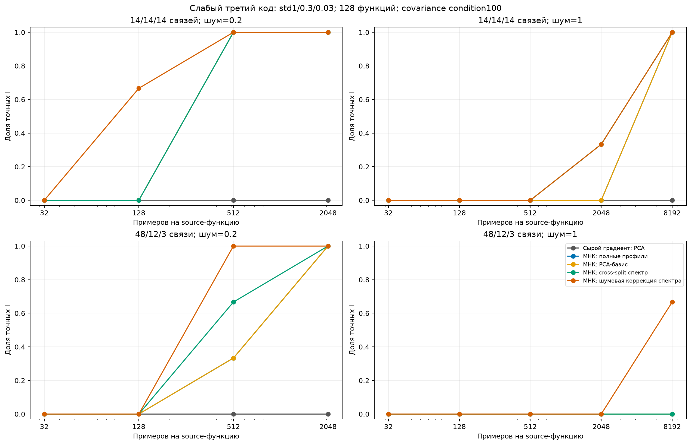

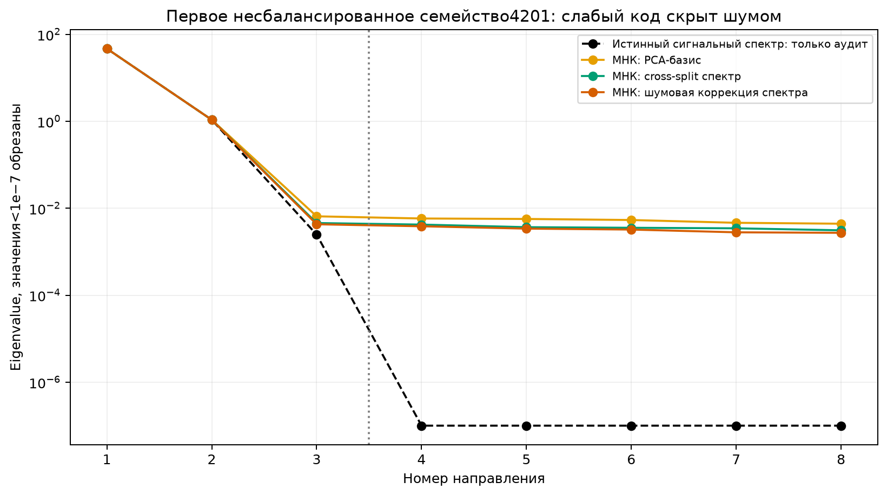

## 6. G2: текущая проверяемая гипотеза

Проверка полного жёсткого trace-критерия завершена. В случае4201 его локальный поиск повысил score, но ухудшил I с21 до68 ошибок после выбора лучшего из двух стартов. Итоговый score превышает истинный на0.0002984: максимум шумной статистики переобучается. Исходный положительный разрыв между teacher и несколькими кандидатами не был гарантией корректности максимума.

Точная source-MSE с полной кривизной и аналитическим переобучением C оставила15 ошибок из OLS-старта, но0 из whitening-PCA. Стандартный noise-whitened PCA дал6/6 точных I; это известный контроль. Полный F-граф на тех же8192 наблюдениях не выдаёт I:5 компонент вместо необходимых7. [Подробный G2/G3-отчёт](results/20261105/contrast_pilot_g3/report/REPORT.md).

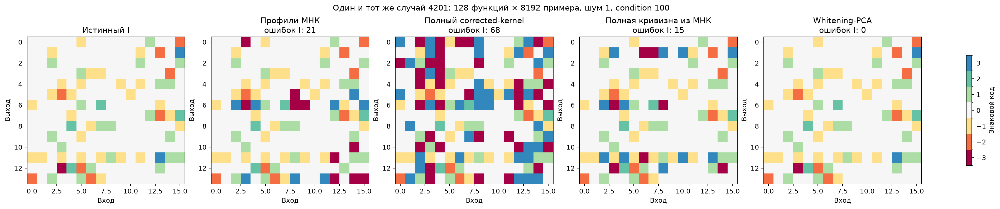

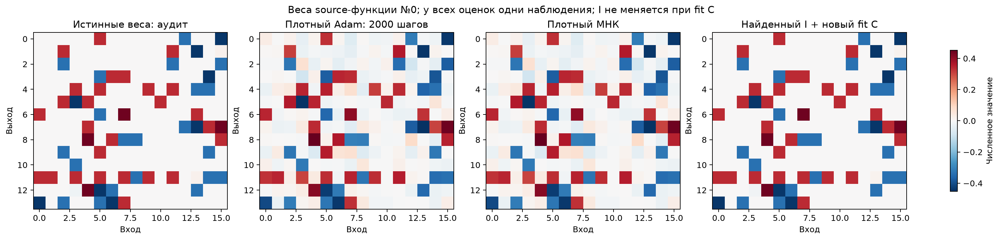

Adam на рисунке действительно обучен2000 шагов по наблюдениям, а не заменён истинными весами. Это линейная задача: хороший numerical-fit не отменяет шума оценки слабых весов.

## 7. G3: проверяемые равенства вместо обязательной проекции

Сначала в THEORY.md записаны точный Gaussian F-контраст для нуля/обоих знаков пары, единое семейство E² гипотез и правило остановки. Граф имеет2E+1 вершин: положительные/отрицательные позиции и нулевой якорь. При сохранении истинных равенств его компоненты могут только объединять истинные классы. Поэтому при **точно известном** числе K непустых различимых групп число компонент2K+1 достаточно для правильного I. Шаги сбора данных делят общий alpha, что учитывает выбор момента остановки. При K как верхней границе эта гарантия неприменима.

Pilot:24 условия, четыре новые геометрии,128 source-функций; вложенные бюджеты512–131072 наблюдения. Использована точная Gaussian симуляция достаточных статистик, без хранения полного X. Полный граф выдал20/20 точных I в различимых случаях, в4 коллизиях не выдал I. В самом шумном режиме обычные спектральные методы справлялись раньше; консервативная надёжность имеет цену.

Из диагноза128 шумовых степеней свободы при K=3 выведена следующая добавка: предварительный I и адаптированные кодбуки на одной половине данных дают межзадачные направления; независимая половина проверяет проецированные контрасты. Вторая ориентация cross-fit и полный fallback получают отдельные части alpha. Контроль ложных отклонений не требует правильности предварительного I, но его ошибки снижают мощность. [Псевдоалгоритм и ограничения](METHOD.md).

| Сложная геометрия | Полный F-граф: первый достаточный n | Cross-fit кодбуков | Cross-fit PCA-направлений |
|---|---:|---:|---:|
|6101|131072|32768|32768|
|6102|32768|32768|32768|
|6201|32768|32768|32768|
|6202|131072|32768|32768|

Проекция помогла, но специфический выигрыш направления из кодбуков против PCA пока **не показан**. Случайные направления с fallback повторили более дорогой полный граф. Все эти результаты exploratory, не независимый competitive confirmation.

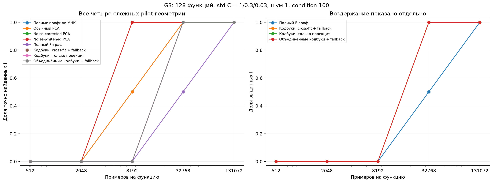

## 8. G4: замороженные конкуренты и независимое подтверждение

Завершены32 HPO-запуска на четырёх pilot-геометриях и двух бюджетах данных. Yeh:36 настроек; непрерывный exact-adapt MSR:4; LC:9; LUT-Q:8. Настройки/состояния выбираются по32 отдельным source-validation функциям, не по true I. Непрерывные представления и их дополнительный дискретный readout сохраняются отдельно. Это явно описанные multi-task адаптации, а не неизменённые авторские скрипты. [Протокол](results/20261105/competitor_pilot_g4/protocol.json), [замороженный выбор](results/20261105/competitor_pilot_g4/hpo_frozen.json).

Завершены36 подтверждающих случаев:12 новых геометрий × три уровня шума, три numerical seeds для обучаемых методов. Все модели заморожены до structural audit и100 новых C-функций на перенос. Уровни шума0.2/1/2, covariance condition100, слабая вариация третьего кода. В источник входят также отдельные validation-функции для выбора checkpoint: это не утверждение об информационном пределе по всей доступной совокупности данных. [Регистрация](results/20261105/competitor_pilot_g4/confirmation_registration.json), [полные таблицы, кривые и I](results/20261105/competitor_pilot_g4/report/REPORT.md).

Основное прикладное сравнение должно выбирать численный старт по source-validation. Дополнительный post-hoc анализ использует только сохранённые source-оценки; правило и входные хеши вынесены в [отдельный файл](results/20261105/competitor_pilot_g4/report/validation_restart_choices.json). Приводить только средний неудачный seed конкурента было бы необъективно. MSR с readout — явно отдельный дополнительный декодер, не исходный дискретный выход метода.

|Метод|Exact I, n8192|Exact I, n131072|MSE переноса support4, n131072|
|---|---:|---:|---:|
|Yeh: native MAP, лучший из3 по validation|11/12|12/12|0.00056985|
|LC: native I, лучший из3 по validation|12/12|12/12|0.00056985|
|LUT-Q: native I, лучший из3 по validation|1/12|12/12|0.00056985|
|MSR exact-adapt + отдельный readout, лучший из3|12/12|12/12|0.00056985|
|Noise-whitened PCA, известный контроль|12/12|12/12|0.00056985|
|Cross-fit кодбуков + F-граф|0/12, воздержание|12/12|0.00056985|
|Cross-fit PCA-направлений + F-граф|0/12, воздержание|12/12|0.00056985|
|Истинный I, только аудит|—|—|0.00056985|

Таким образом, **превосходства нового метода над лучшими конкурентами в G4 нет**. Между отдельными seed есть заметная разница: native Yeh28/36, LC27/36, LUT-Q24/36 при n131072, но выбор по validation устраняет её на уровне геометрий. Преимущество графа — условный контроль ошибочной выдачи и отсутствие зависимости от удачного numerical-start; за него здесь приходится платить большим n. В самом шумном режиме noise2 проекционные графы выдают12/12 точных I, полный граф7/12 и воздерживается в5; LC/Yeh/MSR+readout с validation-selection также12/12. Утверждать отдельную пользу codebook-направлений по сравнению с PCA-направлениями нельзя.

WSR/OSCAR-контроли оптимизируют native fusion-представления независимо по задачам и пересекают точные равенства. На этом протоколе они не восстановили общий I. Это ограничение конкретной адаптации; её нельзя выдавать за отрицательный результат сильной совместной векторной fusion-оптимизации. Такой контроль остаётся необходимым.

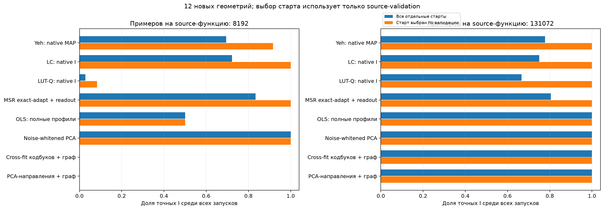

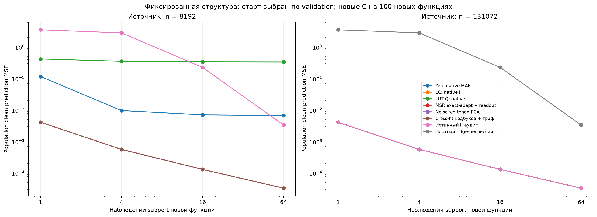

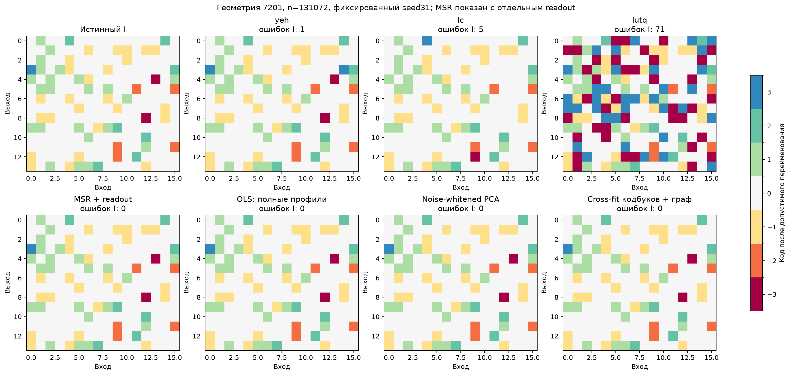

## 9. G5: различимость групп при rank(C)<K

Из диагноза потери слабого спектра получен новый контроль: три кодбука c_t=s_t(1,2,3) коллинеарны, но задают три различных профиля. THEORY.md§12 до запуска уточняет достаточное условие: положительный минимальный разрыв нуля/знаковых профилей важнее полного ранга C. На четырёх уже известных pilot-геометриях полные профили, PCA с амплитудами и F-графы точны4/4 при512 наблюдениях. Принудительные три нормированных PCA-направления неточны0/4 даже при131072. Это не независимая confirmation-геометрия и не провал PCA вообще: при сохранении амплитуд PCA успешен.

Мягкая модель может выразить s,2s,3s одним кодом3s с вероятностями1/3,2/3,1. Поэтому source-fit сам по себе не заставляет argmax восстановить три группы. Эта неоднозначность объясняет, почему точная численная функция и общая hard-структура должны оцениваться раздельно. [Все числа и ограничения G5](results/20261105/collinear_diagnostic_g5/report/REPORT.md).

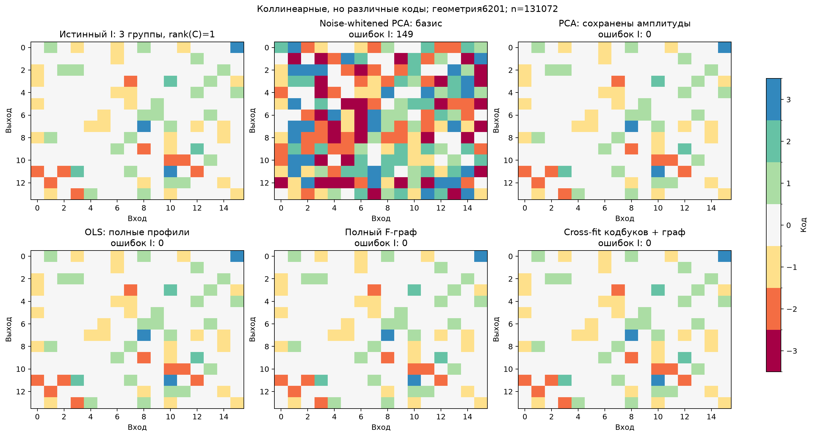

## 10. G6: исходный нелинейный DeepSets

Проверена прежняя архитектура16 входов/16 скрытых ReLU с общими bias/amplitude. Четыре новых перестановки8401–8404, исходные и Gaussian-коэффициенты, шум0/0.2; восемь функций,16 численных случаев. Gaussian Hermite/whitening reconstruction — явно известный контроль, не собственный новый алгоритм и не неизменённая реализация NN-LIFT. Значения учителя открыты после заморозки learner outputs каждого случая; autograd учителя не используется.

Population-моменты восстанавливают8/8 индексаторов, но sample-моменты не восстанавливают ни одного из16 случаев даже при8млн примеров. Третий момент после affine-control-variate имеет относительную ошибку около0.24 на исходных C и0.51 на новых даже без label-noise. Это существенно больше ошибки второго момента. Oracle-гибрид observed M2 + true M3 снижает медианную квадратичную ошибку W примерно до0.00008/0.00157, а true M2 + observed M3 оставляет5.06/302.48. Учитель здесь только диагностирует источник ошибки.

Реальный плотный Adam,9 numerical стартов/скоростей и3000 шагов на1млн данных, после выбора по noisy validation и **дополнительной** точной scalar-DP проекции даёт7/8 точных I на исходных C и1/8 на новых. Это не native-I Adam, и бюджеты отличаются от максимального moment-контроля. В свежих C есть близкие по модулю значения с разрывом около0.025 и хуже conditioned W; качество предсказаний не гарантирует их разделения. [Полный отчёт G6](results/20261105/nonlinear_moments_g6/report/REPORT.md).

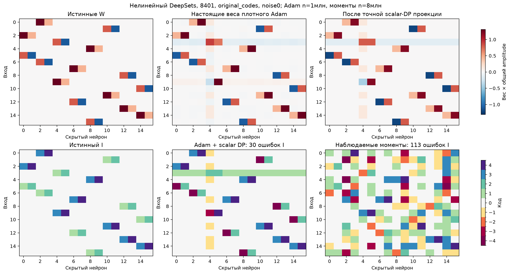

Из диагноза следуют две отдельно проверяемые поправки: antithetic-пары x/−x удаляют чётную часть labels из нечётного третьего момента; joint diagonalization всех срезов снижает зависимость от случайного eigenvalue gap одного sketch. THEORY.md§14 записан до опыта, обе техники известны и не объявляются самостоятельной новизной. G7 зарегистрирован как факториальная абляция, с одинаковым числом labels для IID и parity-view, полным учётом pilot и без teacher-driven остановки. [Протокол G7](results/20261105/parity_moments_g7/protocol.json).

## 11. G7: variance снижается, но универсальный hard I ещё не получен

Факториальная абляция завершена: IID/пары x−x × matrix-sketch/joint-diagonalization. При16.78млн labels исходные C с noise0.2 дают4/4 у обеих joint-строк против0/4 matrix-sketch. Это означает, что выигрыш всей комбинации здесь нельзя приписать parity-компоненту. На fresh C без шума parity+joint достигает4/4 при134.22млн labels, IID+joint1/4. При noise0.2 и максимуме1.074млрд labels результат3/4 против2/4. Стоимость pilot+16384 одинакова для всех; один antithetic-пример считается за два labels. [Все четыре таблицы и кривые](results/20261105/parity_moments_g7/report/REPORT.md).

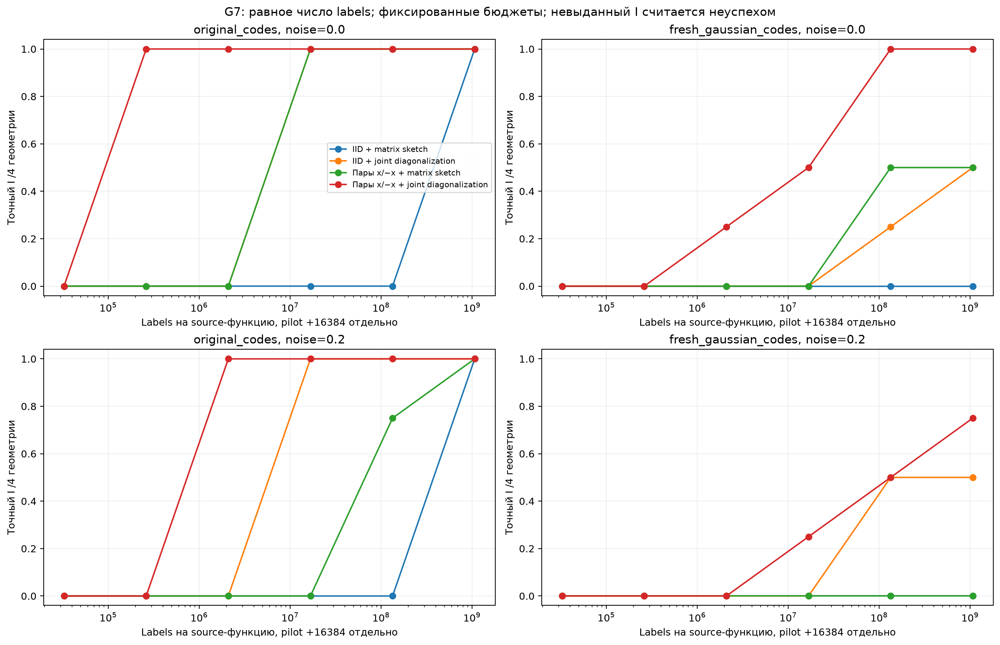

Оставшийся8401 имеет23 ошибки при малой общей weight-MSE. Oracle-warm-start совместной диагонализации приводит к тому же observed objective и тем же ошибкам: это не подтверждает гипотезу о сбое только численного старта solver. Нельзя считать миллиарды labels практичным или равным по данным сравнением с прежним denseAdam1млн; такой победы не заявляется.

Из этого зарегистрирован и завершён G8: одинаковое observation-only refinement всех свободных весов из случайного и моментных стартов, фиксированный gauge bias1, аналитический readout и cooled Adam. THEORY.md§15 записан до запуска. [Протокол](results/20261105/moment_refinement_g8/protocol.json), [полный отчёт](results/20261105/moment_refinement_g8/report/REPORT.md).

## 12. G8: numerical refinement и причина ошибки scalar-DP

Четыре fresh-C геометрии, два шума0/0.2;9 стартов/скоростей,6000 шагов на262144 независимых refinement-примерах, отдельные8192readout-support и8192validation. Случайный cooled-Adam дал0/8 точных I. Моментный старт с дополнительным1.074млрд labels после той же оптимизации дал8/8. Более дешёвые warm-старты16.78млн/134.22млн дали6/8 и7/8. Это working numerical-контроль, **не равное по total-data сравнение и не независимая confirmation**. Выбор numerical checkpoint и старта выполнен по noisy validation, затем scalar-DP — дополнительный readout.

В8404noise0.2 при среднем бюджете общая weight relative squared error≈0.000352, но131 ошибка I. Центр0.0353 тратится на шум вокруг нуля, близкие ненулевые коды сливаются. Ошибка hard-validation растёт, хотя dense-validation почти совпадает с вариантом правильного I. Низкий source-fit и малая норма ошибки весов не решают задачу выбора групп.

## 13. G9: что действительно исправляет полная кривизна

До запуска THEORY.md§16 обосновывает поглощение amplitude в U/beta, полную кривизну внутри области ReLU-gates, локальную идентифицируемость и **асимптотическую** nonlinear-Wald covariance. Наблюдения G8 восстановлены побитово и проверены по hash; новые labels не добавлялись. Никакая маска не фиксировалась. [Регистрация](results/20261105/curvature_sharing_g9/protocol.json), [весь G9-отчёт](results/20261105/curvature_sharing_g9/report/REPORT.md).

**Сильный численный контроль изменил вывод:** noiseless Gauss–Newton из cold-start даёт4/4 точных I. Поэтому0/4 у прежнего cooled-Adam не являлись пределом плотной MLP или градиентной оптимизации. На noisy данных scalar-DP из warm-стартов остаётся2/4; улучшение точности numerical-fit может усиливать подгонку шума нулей.

Основной Wald-граф воздержался во всех16 noisy fit-view: заданный numerical-stationarity критерий не выполнен. Его нельзя ослабить после просмотра результатов и считать это подтверждением. Отдельная post-hoc абляция без этого критерия даёт2/4 точных I из каждого moment-start, в остальных5/7 компонент вместо9; full и diagonal covariance совпали. Простое statistically-zero threshold +scalar-DP дало4/4 из каждого moment-start и2/4 из cold. Это явный известный mask-then-quantization контроль, не доказательство нового прямого шэринга.

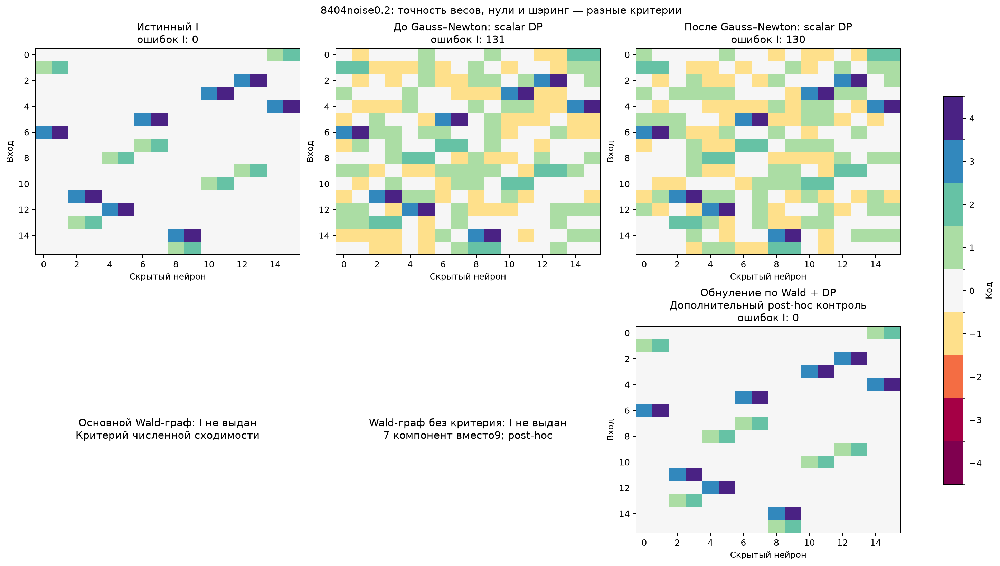

Нелинейная finite-sample F-гарантия не заявляется. Для применения Wald важны consistency/локальная нормальность и Taylor-bias; в noiseless данных дополнительно действует numerical rounding-floor. Простое исчезновение soft/argmax mismatch не устраняет эти статистические и численные вопросы. G8/G9 завершены; работающие здесь комбинации пока состоят преимущественно из известных компонентов.

## 14. G10: глобальная совместимость индексатора

THEORY.md§17 до опыта выводит сертификат единственности I по simultaneous-интервалам и ровно K ненулевым кодам. Классический interval-piercing определяет опорные интервалы; каждое альтернативное назначение проверяется на совместимость **со всей системой**. Finite-sample Student-гарантия ограничена линейной Gaussian моделью.

Шесть новых геометрий8601–8606, три C, три covariance-режима и два шума =108 зависимых случаев; восемь бюджетов. Матрица16×16, fixed0±4кода; позиции/знаки/размеры групп скрыты. Фактические sample-Gram Gaussian sufficient statistics. Source-серия целиком заморожена до true-I аудита и100 новых C-функций на перенос. [Полный G10 с таблицами, кривыми и I](results/20261105/interval_certificate_g10/report/REPORT.md).

Приn131072: global CI70/108 exact, полный F-граф68/108, граф с теми же интервалами64/108, scalar-DP84/108, zero-cleanup+information-DP92/108. Ошибочных confidence-выдач ни на одном бюджете не обнаружено. Воздержание считается неуспехом; alpha=.05 на один запуск по всем looks, не на всю таблицу. Покрытие относительно графов выше, но преимущества над сильными point-оценками нет.

На переносе фиксируется только I, все C обучаются заново; confidence-MSE условна на выданном подмножестве. Уже открытые nonlinear G9 оценки дают16/16 noiseless и лишь1/4 noisy warm-семейств на бюджет: exploratory, без доказанной nonlinear coverage. Hidden-permutation в аудите учтена; исходный ошибочный metric-файл сохранён рядом с correction record.

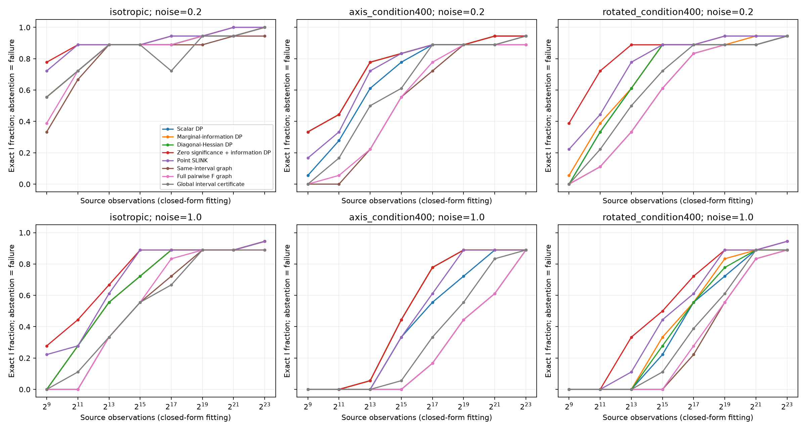

## 15. G11: независимый кодбук из достоверных групп

В33/108 случаев G10 приn32768 K групп уже различимы, но отдельные назначения неоднозначны. THEORY.md§18 до опыта выводит следующий шаг: взять назначения, истинные для всех совместимых структур, обучить C на независимой половине, проверить остальные координаты Student-контрастами с полной covariance. Достоверные нули и равенства позволяют GLS-коррекцию свободных весов. Alpha распределён по обоим этапам/бюджетам.

Шесть новых геометрий8701–8706,108 случаев; все контроли используют тот же **общий** n. Source-модели заморожены до аудита и100 новых C-функций. [Полный G11 с абляциями, переносом и диагностикой](results/20261105/core_codebook_g11/report/REPORT.md).

|Метод|Exact I, n8192|n32768|n131072|n8388608|
|---|---:|---:|---:|---:|
|Scalar-DP, все данные|47/108|65/108|80/108|106/108|
|Обнуление +information-DP|59/108|81/108|89/108|107/108|
|Полный F-граф|36/108|50/108|66/108|99/108|
|Глобальный CI, все данные|41/108|56/108|72/108|106/108|
|Одна опорная позиция на код|36/108|52/108|72/108|105/108|
|Среднее по достоверной группе|37/108|55/108|73/108|104/108|
|GLS по ненулевым ядрам|38/108|55/108|73/108|105/108|
|Полный GLS с достоверными нулями|38/108|57/108|75/108|105/108|

Ошибочных confidence-выдач не наблюдалось. Приn131072 полная коррекция уменьшает медианную variance C до0.15 от среднего по группе, но добавляет только2/108 точных I относительно этого среднего. В22/108 случаев первая половина ещё не разделяет K кодов. Повышение численной точности C не устраняет неопределённость всех назначений. Bootstrap разницы считается по6 геометриям, а не108 зависимым повторам. G11 остаётся линейной диагностикой, не native nonlinear подтверждением.

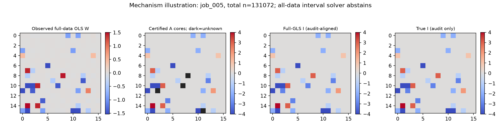

## 16. G12: полноценный совместный fusion-контроль

Прежний independent OSCAR/WSR не был достаточно сильной multi-task реализацией. THEORY.md§19 до G12 описывает joint group-L2 штрафы на нули, суммы и разности **целых профилей** всех128 задач; полная task-кривизна сохранена. Это явная многозадачная адаптация известных PACS/convex-clustering, не наш новый метод. Native I читается по точным zero-prox ограничениям, без k-means; проверяются primal/dual residual и feasible duality gap.

На4 прежних pilot-геометриях×2n source-validation выбрала gamma8/r0=.1 из10 вариантов, lambda выбирается отдельно для каждого источника. После заморозки48 source-моделей добавлен парный контроль на **уже открытом G4 cohort**, поэтому это не новая независимая confirmation. [Полный G12 с native I, loss/recall/gap, переносом и сравнениями](results/20261105/joint_fusion_g12/report/REPORT.md).

|Режим|Exact I joint-fusion|MSE переноса support4|
|---|---:|---:|
|Noise1, n8192|0/12|0.647633|
|Noise1, n131072|12/12|0.000570|
|Noise0.2, n131072|12/12|0.000570|
|Noise2, n131072|1/12|0.628785|

Выбранные решения имеют relative duality gap<1e−6. При слабом SNR pilot удаляет целиком третий код:14 позиций каждой conv и3 каждой signed-геометрии. Между истинно равными профилями squared-RMS почти целиком состоит из ожидаемого шума (.001338 против .001318 на6101,n8192). Это измеренный сбой adaptive weights, а не только неудачный numerical-start. Изменения совместной нормы, весов и solver по сравнению со старым OSCAR одновременны, поэтому улучшение при большом n не приписывается одной joint-норме.

## 17. G13: проверка очистки fusion-весов

THEORY.md§20 **до запуска** выводит unbiased squared-profile-distance после вычитания observed noise covariance, его T-зависимую погрешность и достаточный KKT-аргумент для native group recovery при separation/bounded-curvature условиях. Сравниваются raw shrinking-floor, noise-corrected weights и известные Gaussian-kernel weights; исходный raw PACS сохраняется как G12-контроль. Это кандидат специализации известных принципов, не установленная новизна.

Все24 pilot-состояния и source-only choices заморожены до аудита. Приn8192 raw/shrinking-floor/heat дают0/4 точных I, noise-correction2/4; приn131072 все4/4. Отдельная matched проверка на43 значениях lambda вместо7 при фиксированных ранее выбранных весовых настройках сохранила raw0/4 и corrected2/4. Среднее число ошибок corrected немного уменьшилось7→6.75, но conv-геометрии остались неточными. Это не полный повторный gamma×lambda HPO.

Сохранённый LC на этих же pilot-данных, с прежней frozen HPO-строкой и прежним numerical seed, даёт3/4 приn8192 и4/4 приn131072. Учитель не использовался для нового выбора. Поэтому новый компонент даёт измеренный эффект относительно raw fusion, но ещё не превосходит сильного конкурента. Перенос именно corrected-варианта пока не измерялся; G12 raw transfer — отдельная серия. Зарегистрированное расширение G13 на G4 пока не запущено: сначала требуется устранить оставшиеся диагностические ошибки. [Полный G13 с таблицами, I и кривыми](results/20261105/calibrated_fusion_g13/report/REPORT.md).

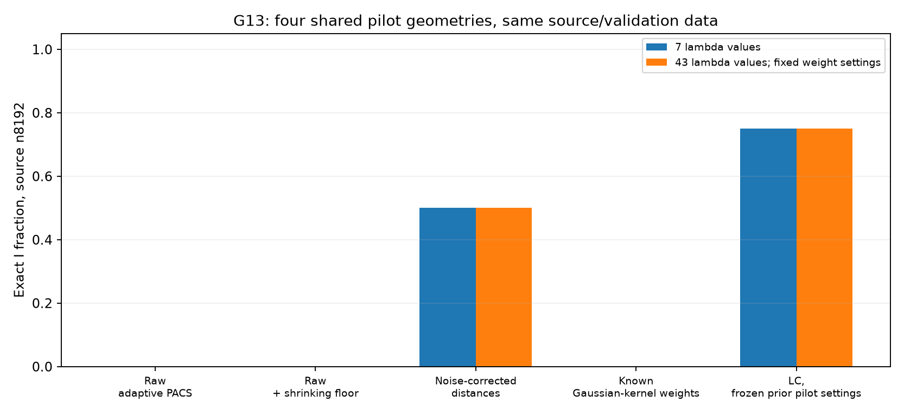

## 18. G14: условный score и остаточная слабая группа

THEORY.md§21 до запуска выводит restricted GLS/Schur efficient score с полной covariance nuisance-кодбуков. Coarse-I берётся из frozen native fusion G12; все пока нулевые позиции разрешены как свободные веса, ни маска слабой группы, ни её размер не даны. Это **post-selection диагностика на48 открытых G4 условиях/12 геометриях**, не новая независимая confirmation и не finite-confidence сертификат. Все48 новых состояний заморожены до структурного аудита. [Полный G14, loss/variance, selected I, numerical W](results/20261105/residual_spectrum_g14/report/REPORT.md).

|Метод|Noise1 n8192|Noise1 n131072|Noise.2 n131072|Noise2 n131072|
|---|---:|---:|---:|---:|
|Native joint-fusion|0/12|12/12|12/12|1/12|
|OLS profiles + readout|10/12|12/12|12/12|12/12|
|Ordinary PCA + readout|7/12|12/12|12/12|12/12|
|Noise-corrected PCA + readout|8/12|12/12|12/12|12/12|
|Known whitening-PCA + readout|12/12|12/12|12/12|12/12|
|Coarse-zero subset: corrected PCA|10/12|12/12|12/12|12/12|
|Conditional score: corrected/whitening PCA|12/12|12/12|12/12|12/12|

Conditional marginal variance уменьшается до0.685..0.896 от unrestricted, однако точность не превышает сильный известный whitening-контроль. Если coarse уже имеетK групп, residual-кандидат просто возвращает его I. В остальных случаях spectral readout указан явно; это не native исправление DARTS. Прямое извлечение из профилей/спектра показывает, что слабая группа уже различима в этих наблюдениях. Новый transfer G14 не запускался. GLS, residualization и PCA не выдаются за новый алгоритм.

## 19. G15: почему строгий gate G9 не достигается

На исходной nonlinear DeepSets THEORY.md§22 до запуска задаёт точное разложение actual loss change на fixed-gate quadratic и вычислимый ReLU remainder.16 noisy frozen G9 состояний×4 направления(fullGN/ridge)×17 fractions=1088 observed single-step responses. Все прежние source/validation восстановлены с точным observation hash; новые labels или teacher-градиенты не используются. [Полный G15, таблица откликов и графики](results/20261105/relu_response_g15/report/REPORT.md).

Во всех12 warm-состояниях полный GN прогнозирует улучшение, но фактический loss растёт. Точный measured remainder объясняет разницу с ошибкой≤1.45e−17. Лучшие GN fractions1/1024..1/64, а уменьшение MSE даже при выборе среди ridge-откликов 3.82e−12..6.99e−11 при noise-MSE≈.04. Median sqrt(scaled decrement)=.173 SE — верхняя граница сдвига до **локального линейного** optimum для любого контраста, не до истины. Малую долю gate-crossings нельзя просто игнорировать относительно столь малого ожидаемого улучшения. Cold8402 ещё имеетD≈5.20 и может сделать существенно лучший source-шаг; все cold не объединяются с warm под одним объяснением.

G9 primary-gate1e−4 и его abstentions не менялись. G15 не обучает новый I, не доказывает nonlinear coverage и не проводит новый transfer. Следующий метод должен отделять numerical score от неизвестного nonlinear bias; просто ослабить старый порог после просмотра данных недостаточно.

## 20. G16: независимые градиенты и нелинейный bias

THEORY.md§23 до запуска отделяет точное Student-распределение independent one-step **псевдоцели** от неизвестного ReLU-bias к истинным параметрам. На новых Gaussian x берутся две независимые noisy метки; их разность оценивает measurement variance независимо от среднего. Никакая стационарность theta0 для такого conditional target не нужна, но для true-I его bias необходимо контролировать. One-step/Fisher scoring и replicated-label variance известны; [MLP one-step Meskini et al.2024](https://link.springer.com/article/10.1007/s11063-024-11637-6) использует sigmoid для основного regularity аргумента, который не переносится автоматически на нашу ReLU.

16 frozen G9 reference (4 открытые геометрии×cold/три moment-warm),3 nested независимых B-бюджета; все48 новых состояний заморожены до teacher-аудита. **Каждый B-вход стоит2 labels**, плюс сохранённое дорогое reference-предобучение и новая validation. Ни teacher, ни validation не выбирали reference/n/метод. Это inference diagnosis, не matched competitive confirmation. [Полный G16 с actual W, I, bias/noise/validation](results/20261105/independent_score_g16/report/REPORT.md).

|Reference/readout|B inputs262144|B inputs1048576|B inputs4194304|
|---|---:|---:|---:|
|Warm scalar-DP|12/12|12/12|12/12|
|Warm zero-Student+DP|12/12|12/12|12/12|
|Warm full Student graph|6/12|12/12|12/12|
|Warm global interval solver|9/12|12/12|12/12|
|Cold scalar-DP/zero+DP|2/4|2/4|2/4|
|Cold graph/interval|0/4|2/4|2/4|

Здесь exact/total; отсутствующая выдача считается неуспехом.12 warm — три старта на каждой из4 геометрий, не12 независимых структур. Старые reference без новых B давали0/4 cold и6/12 warm при scalar-DP. Улучшение после шага включает2n новых labels и не приписывается только optimizer-механизму. Native DARTS и новый перенос не проверялись.

Все весовые интервалы покрыли pseudo-target в48/48 случаях, true-W в42/48. Наблюдённое покрытие не доказывает true-I coverage. Warm median max-bias/SE растёт.247→.479→.938; cold8401/8402 достигают484/385SE при максимальномB, сохраняя RMS-bias≈.128/.0383. Их ошибка — неправильная исходная локальная конфигурация, которую нельзя исправить только более точной оценкой того же frozen-Jacobian score. Два других cold исправлены one-step. Ошибочных graph/interval выдач не наблюдалось; исходный G9-gate не менялся. Общая цель всё ещё требует собственного эффекта, native nonlinear конкурентов, новых геометрий/общего I across source-functions и переноса толькоI.

## 21. G17: сильный LC и повторная линеаризация

THEORY.md§24 до primary48fit задаёт полноценный native LC: augmented Lagrangian, GN L-step с реальным ReLU backtracking, exact signed scalar-DP C-step; bias/offset не квантованы. Это objective-level адаптация известного LC, не новый метод и не авторский неизменённый скрипт. Penalty-only убираетdual; denseGN использует явно дополнительный DP-readout. Для всехI одинаковый численный fit4C+b+d, который не меняетI и не возвращается в latent trajectory. [Полный G17 с выбранными I, numerical W и actual-step кривыми](results/20261105/nonlinear_lc_g17/report/REPORT.md).

Данные точно те же, что middle-budgetG16:1048576B-входов×2метки, noise.2 иvalidation16384;4 открытые геометрии×cold/first-warm. Дваsetting/метод, max144 learning GN-solves, одинаковыйpolishing; фактическийcompute различается и сохранён. Source-validation выбираетcheckpoint иglobal setting доwholefreeze/teacher-аудита. После primary48 LC дал3/4cold, аdenseGN4/4. Поэтому THEORY§24.5 **до дополнительного контроля** выделяет24из тех же144learning-solves наmu=0 обучение поB, затем20positive-mu stages.32 дополнительныхLC/penaltyfit frozen/audited, dense16не повторяются; первичный результат сохранён.

|Метод|Cold exact I|First-warm exact I|
|---|---:|---:|
|G16 independent one-step+DP (тот жеB)|2/4|4/4|
|LC: штраф с первого шага|3/4|4/4|
|Penalty-only: штраф с первого шага|3/4|4/4|
|DenseGN с обновлениемJacobian + явныйDP-readout|4/4|4/4|
|NativeLC после обучения на той жеB|4/4|4/4|
|Penalty-only после обучения на той жеB|4/4|4/4|

Сильный плотный контроль исправляет всеcold: утверждать неизбежный optimizer failure на этих данных нельзя. G16 frozen-Jacobian шаг был недостаточен; повторная линеаризация и численное обучение исправили его bias. LC после корректной подготовки получает тот жеI; отдельный выигрышdual не показан. Дополнительный контроль меняет распределениеlearning-solves иположительнуюmu-сетку, поэтому это не изоляция одного скаляра и не доказательство единственной причины первичного сбоя. Maxcap/данные согласованы, actualpass/time/FLOPs не объявлены одинаковыми.

Этоpilot на4 ранее открытых геометриях, поодной underlyingsource-функции; новыеC/transfer или независимая common-I across-source confirmation не выполнялись. Этап усиливает сравнение и исправляет трактовку слабого numerical baseline. Преимущество собственного нового метода не установлено; global likelihood/CI гарантии на ReLU из этих point-success не следуют.

## 22. G18: разные индексаторы с одинаковыми низкими моментами

После сильных LC/dense-контролей THEORY.md §25 до запуска проверяет, определяют ли выбранные статистики структуру. Построены две signed-4-code ReLU-сети shape16×16: 8 повторённых двухмерных модулей и их ортогональное смешивание четвёрок. Маски имеют32 и128 активных весов; функции различны на одних и тех же x. При этом Gaussian input-моменты степени≤2, включая covariance линейного sample-gradient при нулевой инициализации, совпадают **точно**. Симметрия даёт равенство для любой функции совместных source-outputs, поэтому добавление разныхC не устраняет эту неоднозначность. Это не невозможность извлеченияI из полных данных, higher-order или нелинейных gradient-признаков.

На6 заранее новых coordinate-перестановках×8freshGaussianC population-аудит после whole-freeze подтвердил m0/m1/M2 до4.45e−16 и label-square/gradient-anisotropic формулы до3.78e−10 (детерминированная quadrature). Третий Hermite-момент отличается относительной Frobenius-нормой1.2247, same-x function MSE .0228–.0505; после известного ортогонального преобразования x разница≤3.56e−15. Эти teacher-формулы не служили learner-признаками. [G18: полный протокол, таблицы, истинные I/W и выбранные input-графы](results/20261105/functional_observability_g18/report/REPORT.md).

Дополнительный наблюдаемый сигнал — **известный** mixed functional-ANOVA/Sobol contrast. Получаем только граф взаимодействий входов; равенства отдельных весов из него ещё не извлечены. Active/pick-freeze panels требуют137query/base дляD16, T8 и2noisy labels/query. Unknown-sigma Gaussian F-test сalpha.05/(120пар×5looks) контролирует ложные рёбра отдельно внутри family/network/noise run; не пропуски, разбиение или полныйI. Все12 моделей×3noise×5looks frozen доаудита, HPO нет.

|Noise SD|Максимальное N|Метки/режим|Local exact graph|Mixed exact graph|Mixed exact partition|
|---|---:|---:|---:|---:|---:|
|0.2|131072|287309824|6/6|6/6|6/6|
|1|131072|287309824|4/6|0/6|5/6|
|2|131072|287309824|1/6|0/6|0/6|

Приnoise.2 local уже6/6 наN2048 (4.49m labels), mixed6/6 наN8192 (17.96m). Ложных рёбер не было во всех180 сохранённых зависимых состояниях; высокаяnoise резко снижает мощность. ПолныйI, numericalC-fit иtransfer вG18 не выполнялись. Known bilinear Sobol требуетD+1 query/base и остаётся обязательным matched-label контролем; нативныхLC/Yeh/LUT-Q на этихpanels пока нет. Поэтому ни новый собственный алгоритм, ни конкурентная победа не заявляются. Следующая схема должна устранить измеренную неоднозначность, не подставляя истинные модули или группы.

## 23. G19: прямой индексатор через подсчёт шаблонов

После G18 THEORY.md §26 до запуска задаёт candidate: кодбук из even-axis queries, затем global linear LS для целых количеств нейронов с каждым расширением prefix. Непрерывная W не восстанавливается/кластеризуется. На каждом шаге неизвестных≤H×2K, независимо от экспоненциального числа всех возможных prefix. True previous prefix + known C + full-rank design дают noiseless recovery; estimated-C/noisy гарантия не доказана. **Common bias и positive readout известны, offset0**, это ограничение pilot, которое надо снять. Одна функция на I; multi-source поиск/transfer не выполнены.

18 jobs:6 открытых G18 local +6 mixed с новымиGaussian C,6 новых arbitrary random signed I. Все126 noise/repeat состояния whole-frozen до teacher/factorial audit. Learner не знает active count, группы или модули. GPU0/1/2/3/6/7, чужие4/5 не затрагивались. [Полный отчёт G19, таблицы, measured loss/recall, I и codebook diagnosis](results/20261105/prefix_census_g19/report/REPORT.md).

|Режим/контроль|Local exact I|Mixed exact I|Random exact I|
|---|---:|---:|---:|
|Primary, noise0|6/6|6/6|3/6|
|Primary, noise.2/r4096|0/6|0/6|0/6|
|True C + observed slices, noise.2/r4096 — oracle diagnosis|6/6|6/6|4/6|
|Estimated C + clean slices — oracle diagnosis, тот жеC изnoise.2/r4096|0/6|0/6|0/6|
|True C + clean slices — oracle diagnosis|6/6|6/6|6/6|

Всего primary15/18 без шума и0/108 noisy состояний, всегда abstention при noisy failure. Это не конкурентная победа. Приnoise2 даже known-C + observed slices0/18 наr4096: LS-rounding тоже усиливает шум. Главный measured сбой приnoise.2/r4096 — C-stage: ошибка C достаточна для срыва даже на чистых slices. Known-C clean18/18 учитывается по уникальным18структурам, не повторным сохранённым ветвям.

Noiseless random8903 имеетcodeerror.0565 приeven-axis fitMSE≈3.01e−24. Между близкими истинными изломами только одна coarse-grid точка: continuous-amplitude модель допускает другой split, практически одинаковый на observed grid. В8901/8905 также есть numerical fit остаток. Следующий этап должен отдельно устранить grid/SNR/solver недостатки кодбука, а не усиливать устаревшее утверждение о плохом dense optimizer. Нужен честный контроль целых multiplicities/плотных либо активных запросов; teacher-C ветвь не подменяет обучаемый метод.

Полный source-panel40992 query×r, приr4096 —167903232 noisy labels плюс8192validation. Gaussian averages генерируются точно из достаточной статистики; их стоимость не считается одним label. Raw job-field primary_label_budget учитывает лишь обработанные префиксы доstop, но NPZ содержит все заранее созданные slices; поэтому comparison/кривая используют **весь доступный panel**, отдельно от prefix-trace visited cost. Один source, knownb/нормировка и active queries явно ограничивают scope. Novelty prefix-count специализации не установлена; известные NN extraction/LS/variable-projection принципы не объявлены новыми.

## 24. G20: codebook stage, разрешение сетки и целые количества

До запуска THEORY.md §27 вывел наблюдаемое ограничение: интерсепт каждого линейного участка even-axis отклика кратен b/sqrt(H), а множитель — cumulative integer count связей. Реализована DP с finite count-grid, свободными slopes и отдельной проверкой непрерывной физической модели. Её результат — lower-bound/initializer для релаксации, а не автоматическая глобальная гарантия continuous fit. Известные CPOP/Troeng–Fält spline-методы и границы новизны разобраны в LITERATURE.md.

На тех же18 открытых G19 сетях выполнены два осевых grid, два согласованных axis budget, noise0/.2/2 и три метода: continuous, continuous с одним заменённым DP-стартом, fixed-integer-M. У всех по7 numerical starts, выбор по независимой interleaved axis-validation. Она включена в бюджет; G19 выбирал по training, поэтому это раскрытая обновлённая адаптация, а не буквальное повторение прежнего baseline. Slices, порядок входов, rank/rounding search строго прежние с hash/array проверкой. Все540 method-states whole-frozen до teacher-аудита. [G20: полный отчёт, исходные численные W, I, measured loss/recall и затраты](results/20261105/codebook_refinement_g20/report/REPORT.md).

|Режим, по18 структурам|Continuous|Continuous + DP start|Fixed integer M|
|---|---:|---:|---:|
|Noiseless, grid257|15/18|17/18|17/18|
|Noiseless, grid1025|18/18|18/18|18/18|
|Noise.2, высокий budget, grid257|13/18|14/18|14/18|
|Noise.2, высокий budget, grid1025|14/18|14/18|15/18|
|Noise.2, низкий budget, обаgrid|0/18|0/18|0/18|
|Noise2, обаbudget/grid|0/18|0/18|0/18|

Более плотная бесшумная сетка исправила G19 и у известного continuous контроля. При умеренном шуме высокий budget и integer M улучшают local4/6→6/6, но ухудшают random4/6→3/6; mixed6/6 не меняется. Нельзя объявлять отдельный integer-компонент устойчиво лучшим. В random8905 неправильно оценённые M приводят к отказу. Ошибочных полных выдач среди540 состояний не было; отсутствие выдачи считается неуспехом и не является confidence-теоремой.

Высокий режим стоит около **275.55 миллиарда Gaussian labels на условие**, включая axis train/validation и прежние slices. Усреднённые noisy observations генерируются точно без материализации r шумов, но статистическая стоимость раскрывается. Это не эффективность и не победа над native конкурентами. G20 оставил known bias/readout, одну функцию/I, прежние открытые геометрии и не выполнял новый C-transfer. Noise2 при прежних slices уже имел0/18 с trueC в G19; следующий шаг должен отдельно исправлять amplification/feasibility count solver и использовать имеющиеся prefix данные для C-refit.

## 25. G21: полная метрика функции для дискретных количеств

THEORY.md §28 до запуска вывел точную task-цель: при фиксированных C/префиксах y0=Fn+epsilon, G=FᵀF/N и L(n+d)−L(n)=gᵀd+.5dᵀGd. Целые counts должны сохранять кратность каждого parent-prefix. На тех же18G20сетях и тех жеC/slices сравнены feasible Euclidean projection, constrained QP, QP+integer unit moves и C-refit по уже наблюдённым срезам с независимым validation-checkpoint. Старый freeLS baseline прочитан, не повторялся. [Полный G21: таблицы, I/W, loss/recall, solver/provenance и диагноз](results/20261105/count_metric_g21/report/REPORT.md).

|Режим: точный I по18структурам|FreeLS frozen G20|Euclidean|Function QP|QP+integer|+C-refit|
|---|---:|---:|---:|---:|---:|
|Noiseless|18/18|18/18|18/18|18/18|18/18|
|Noise.2, low axis precision|0/18|0/18|2/18|3/18|8/18|
|Noise.2, high axis precision|14/18|15/18|16/18|18/18|18/18|
|Noise2, low axis precision|0/18|0/18|0/18|0/18|0/18|
|Noise2, high axis precision|0/18|0/18|3/18|12/18|12/18|

Это измеренный парный алгоритмический эффект относительно Euclidean/freeLS при одинаковых начальныхC. Ограничение counts само по себе не решает mismatch метрики. Однако feasible decoder может закончить неверныйI: среди360primary-состояний179точных,145неверныхполных,36rank-отказов. Они явно показаны в отчёте. Numeric QP certificate не является сертификатом истинной структуры или global integer optimum.

До teacher-аудита устранены численные остановки: первичный SLSQP205полных/121QP-gap failure/34rank. Зарегистрированный feasible active-set продолжил только121failure; осталось52QPfailure. Следующая поправка stationarity по reduced gradient вместо малости шага на ill-conditioned грани завершила все52. Прежние FWgap≤1e−8/primal≤1e−7 не ослаблялись, принятые prefix/C не повторялись. Все root/child/grandchild cohorts заморожены до аудита, snapshots/compute сохранены. Итог324полных/36rank,QPfailure0. Все6свободныхGPU0/1/2/3/6/7 использованы, чужие4/5не затрагивались; всеworkers terminal.

Fixed true-C diagnosis после freeze дал приnoise.2 freeLS16/18,Euclidean16/18,QP18/18,integer18/18; приnoise2 —0,0,4,16. В двух оставшихся mixed8803/8806 первый неверный prefix имеет более высокий observed иvalidation loss, но все одиночные ходы ухудшают loss. Это конкретный локальный integer барьер. Прямой observed-loss difference совпал с полной квадратичной формулой до7.97e−15. Не исправляли этиI teacher-информацией. Следующий отдельный механизм — согласованные integer exchanges/сильный discrete solve; новизна такого общего принципа не заявляется.

Стоимость highрежима остаётся275.58bnlabels/условие; новыхaxislabelsнет, добавлено33.55m independent prefix-validation labels. Knownb/readout,однафункция/I,открытыегеометрии сохраняются. Это не strong native benchmark, не multi-source commonI, не новый transfer и не установленная собственная новизна. Большая цель активна.

## 26. G22: согласованные integer exchanges и оставшийся C-mismatch

После измеренных G21 local traps THEORY.md §29 до запуска вывел совместный pair-delta с cross-term и exact conditional parent simplex solve. Перебраны четыре варианта: все one/two-unit transfers, точный conditional parent, их объединение и дополнительный C-refit. Conditional compositions≤735471 приH16/K4, finite-neighbourhood descent, не global integer MLE. Block/pair optimization известна, в частности CDQuant; собственной новизной не объявляется. Те же18underlyingI/C, все5panels,360новыхprimary states, прежниеC/slices/prefix-validation. Новыхlabels0. ВсеbaselineG20/G21 прочитаны, не повторялись. [G22: полный отчёт, затраты, I/W и реальные discrete trajectories](results/20261105/count_exchanges_g22/report/REPORT.md).

|Режим: точныйI из18|G21unit|Pair|Exact parent|Parent+pair|G21unit+C|Parent+pair+C|
|---|---:|---:|---:|---:|---:|---:|
|Noiseless|18|18|18|18|18|18|
|SD.2/lowaxis|3|1|1|1|8|4|
|SD.2/highaxis|18|18|18|18|18|18|
|SD2/lowaxis|0|0|0|0|0|0|
|SD2/highaxis|12|12|12|12|12|12|
|True-C diagnosis, SD2|16|17|17|18|—|—|

В true-C diagnosis pair исправляет mixed8806/prefix15, exact-parent исправляет mixed8803/prefix2, объединение18/18. ИстинныйC вprimaryнеподставлялся. При оценённомC основная точность не выросла; stronger search+Crefit приSD.2/low потерял4ранее точныхI, не исправив других. ПриSD2/high+C aggregate12/18 скрывает2исправления и2регрессии. Этот отрицательный контроль не позволяет объявить усиленныйsolver общим решением C/structure mismatch.

Новыеprimary states199точных/129неверныхполных/32rank отказа; QPfailures0. Все5314integer-prefix solves завершились безcap, max20updates/prefix;384,154,425candidate evaluations, максимум1,475,230/prefix. Дополнительныйcompute раскрыт, highlabelcost275.58bn/условие наследуется полностью. Все18jobs whole-frozen доteacher-I audit, затем108known-Cdiagnostics; всеworkersterminal,5фигурпросмотрены. Использованы6свободныхV1000/1/2/3/6/7, чужие4/5не затрагивались, software testsнеписали/незапускали.

Следующий содержательный шаг — независимые структуры и несколько source-C с общимI, новая meta-selection часть после numericalC-fits и сильные native конкуренты на тех жеobservations; затем перенос толькоI. Не продолжать бесконечно усиливатьknown-C integer solver после18/18, выдавая это за полную цель. Hypothesis selection/численные fitter сами по себе также известны; собственный эффект/приоритет должны быть показаны отдельно.

## 27. Что ещё требуется до итогового вывода

- Установить содержательность отличий нового компонента; пока проекционный выигрыш воспроизводится PCA-направлениями.
- G4 и перенос завершены; лучший validation-selected конкурент достигает той же точности. Дальнейшее изменение должно решать измеренный сбой, а не скрывать эту ничью.
- G12 добавил полноценную совместную/adaptive fusion-оптимизацию с solver gap. G13 проверил noise correction, Gaussian kernels и lambda-resolution; остаются полноценное embedding-fusion сравнение и independent benchmark конкурентоспособного кандидата.
- G14 закрыл conditional-Fisher диагноз на открытой линейной серии: точность12/12 совпала с известным whitening-PCA. G15 обнаружил измеренный ReLU remainder вблизи noisy numerical optimum. Ни один не закрывает независимый native nonlinear benchmark или собственную новизну.
- G16 независимым score исправил все warm и2/4 cold, отдельно показав pseudo-target noise и сохраняющийся bias. G17 проверил сильный native LC и исправление cold; native Yeh/LUT-Q в новом nonlinear multi-C benchmark ещё не проверены. Student-pseudo гарантию нельзя выдавать за nonlinear true-I сертификат.
- G17 LC/denseGN контроль выполнен: оба4/4cold+4/4warm после корректной подготовки. Нельзя дальше строить преимущество на G16 one-step ограничении или первичном LC3/4. Следующая схема должна использовать самостоятельную наблюдаемую информацию оI и отличаться от известного численного/refit механизма; нужны новый общийI несколькихsource-C, приоритет, устойчивость и независимое подтверждение/перенос.
- G18 установил точную неоднозначность низких input-моментов и проверил дополнительный known functional-interaction observable. Это не восстановленный полныйI: нужны переход от функции к шэрингу безteacher-шаблона, дешёвый bilinear контроль, одинаковыеpanels дляnative конкурентов и проверка misspecified-noise. Нельзя выдавать совпадение input-компонент за правильные назначения весов.
- G19 реализовал direct prefix-count candidate безteacher-блоков и безW-кластеризации. Он15/18noiseless и0/108noisy; факторный аудит выделилC-stage и отдельно amplification LS-rounding. Следующий собственный шаг — исправить ровно этот измеренный сбой с theory/prospective ablation, затем новые common-I/C и конкуренты. Known bias/readout и одинsource пока дополнительные ограничения, не переопределение всей цели.
- G20 исправил noiseless18/18 через informative grid; integer M дал15/18 против14/18 при умеренном шуме, но проиграл наrandom и требует275.55bn labels. G21 отдельно проверил count feasibility/function-loss/C-refit:18/18 приумеренномшуме,12/18присильном. G22 уже устранил оба известных true-C local barriers; дальше нужен независимый multi-source/strong-native benchmark. Не выдавать огромныйaxisbudget, oracle18/18 или известные QP/exchange принципы за конкурентное превосходство/новизну.
- G22 проверил stronger discrete solve: known-C18/18, primary12/18безвыигрыша и lowaxis+C8→4регрессия. Следом independent common-I multi-source/native benchmark и отдельный C-transfer; known-C solver как самостоятельное объяснение остатка исчерпан. Не выдавать oracle18/18 за метод с оценённымC.
- Проверить нарушение общего Gaussian noise и неоднородную точность наблюдений; нынешняя F-гарантия не действует автоматически при другой модели ошибок.
- Нелинейные G6–G9 завершены: variance, numerical solver и шум нулей разделены. Следующая схема должна объяснять выигрыш сверх простого zero-cleanup, а не повторять его под новым названием.
- G10/G11 проверили глобальную совместимость и независимые pooled group-контрасты. Выигрыш confidence coverage невелик и не даёт преимущества над zero-cleanup+DP; следующая схема должна учитывать этот отрицательный контроль.
- Проверить независимую nonlinear linearization/one-step оценку и её Taylor-bias; линейная G11-теория не закрывает ReLU-остаток.
- Провести новое matched-data nonlinear сравнение с сильными native конкурентами, включая Gauss–Newton numerical-контроль, и отдельный перенос только I со свежими C. Текущая диагностика ещё не является таким подтверждением.
- Оформить окончательные таблицы, затраты, ограничения новизны и аудит всех требований цели.

Ни новое конкурентное преимущество, ни завершение всей цели пока не заявляются.

## 28. G23 выполняется: общий индексатор и соответствие конкурентам

После THEORY§30 зарегистрированы шесть новых независимых I и четыре source-C на I, шумSD.2/2. Functional-prefix, LC, LUT-Q, denseGN+DP и joint categorical sharing получают одинаковые замороженные наблюдения. Общая внешняя процедура выбора I одинакова: source fit-validation банк, свежее обучение всех C, новая meta-selection после freeze предсказателей, затем whole selectionfreeze и только после этого teacher-аудит. [Протокол](results/20261105/shared_structure_g23/protocol.json). Расчёты продолжаются, exact-I результаты этой серии ещё не получены.

По уточнению пользователя основной критерий — структура: независимо точная binary mask, unsigned sharing и полный signed I. Хорошая MSE и численный fit C не заменяют exact I. Первая таблица структур/хитмапы будут опубликованы до отдельного target-переноса. После запрета GPU6/7 прежний runner70932 и наши два source workers на этих картах подтверждены terminal. Продолжение82154 сохраняет все completed jobs и те же scientific settings/seeds, переносит только unsaved jobs на0–3 и выполняет следующие фазы после всех source outputs. Действует [GPU_POLICY](GPU_POLICY.json), новые процессы на6/7 не запускаются.

До нового teacher-аудита выявлено ограничение fidelity: raw tag `yeh` в G23 — совместный Adam по P/C с entropy/nuclear penalties, а не T/V bi-level цикл Algorithm1 исходной статьи. Строка должна читаться как **Yeh-inspired joint ablation**. По ней нельзя утверждать превосходство над полным методом Yeh; нужен отдельный baseline с внутренним fit на T и гиперградиентом назначений на V. Источник, версия авторского кода и различия с прежними G4/profile и hidden/bilevel реализациями изложены в [LITERATURE](LITERATURE.md). Прежние численные результаты не подменяются, исходные зарегистрированные code snapshots сохраняются. Новый bi-level контроль зарегистрирован и поставлен в очередь, подробности ниже.

По прямому запросу пользователя удалены356старых untracked промежуточных файлов,391.91MiB; вся текущая серия G23, все выбранные индексаторы/состояния, метрики/графики и код сохранены. [Manifest очистки](../../2026-11-05/artifact_cleanup.json) перечисляет удалённые SHA/размеры и сохранённые selected checkpoints. Очистка не останавливает сравнение и не означает завершение большой цели.

## 29. Дополнительный bi-level контроль G23: зарегистрирован, результатов структуры ещё нет

THEORY§31 до регистрации вывел обычную implicit-function формулу в открытой ReLU-клетке, точные локальные4×4Hessian blocks и mixed derivative. У shared P четыре независимых C_t; inner Adam250/minibatch1024 на T, outer Adam500updates на другом architecture V, checkpoint/HPO на третьем H, независимый meta только после freeze свежих numerical fits. Температура1, entropy.025/nuclear.05, LR.003/.01/.03, random и data-only source0GN initializations,3starts. Direct local H inverse — сильный численный контроль; отдельный literalNeumann20 сохраняет конвенцию опубликованного helper без внешнего eta. Обычный implicit gradient и direct linear solve не объявляются новизной. Конечный innerAdam не гарантирует глобальный или стационарный C; stationarity/inverse residual публикуются.

[Протокол дополнения](results/20261105/shared_bilevel_g23/protocol.json) зарегистрирован до G23teacher-аудита, на тех же6геометриях и observed panels:24family/noise/inverse jobs,432LR/init/restart trajectories. Один P обучается сразу на4задачах; это явное усиление search stage по отношению к исходным single-source кандидатам, а не matched-FLOPs сравнение. До16uniqueMAPI/mode выбираются по H, затем прежний fresh32signedC/common4/meta/freeze/audit. Source1 в дополнении не запускался и не считается отказом. Новых labels0, statistical cost наследуется полностью. Это не independentconfirmation.

На128реальных наблюдаемых querypoints и4source-задачах численная [диагностика локальных производных](results/20261105/shared_bilevel_g23/local_derivative_diagnostic.json) дала relative Hessian error2.65e−16, mixedgradient4.02e−16, directPgradient4.22e−16 относительно autodiff. TeacherI/C/metaY не читались. Это свидетельство корректности локальной формулы/реализации, **не результат извлечения структуры и не доказательство сходимости**.

Runner session84271, PID547723, подтверждён live. Он ждёт конкретный parent supervisor520631/session82154 и первую frozen structural таблицу, затем выполняет supplemental extraction/freeze/freshC/meta/selectionfreeze/lateaudit/report только на свободныхGPU0–3. Его `queued_pipeline.json` фиксирует hashes/идентичности; scientific Python после регистрации не менять. Подготовлены таблица exactmask/unsignedI/signedI/bankrecall и actualMAP heatmaps, H soft/rawMAP/polishedMAP curves, stationarity/inverse-gradient diagnostics. Пока эти структурные метрики **не вычислялись**. На14:12UTC родительская серия имела163/240completedjobs; это меняющийся снимок, не завершение benchmark или общей цели.

## 30. Выполнение после диагностики загрузки GPU

5 ноября в 15:10 UTC зарегистрирован и запущен
[performance continuation](results/20261105/shared_structure_g23/performance_continuation.json):
exec session91300, supervisor623686. Он заменил только два проверенных
ожидавших CPU-диспетчера520631/547723 (sessions82154/84271 завершены130).
Исходные source workers318933/318946 продолжают работу без перезапуска;
остальные исходные и добавочные source workers уже завершились. На15:13UTC
готово231/240jobs. Старые snapshot, данные и завершённые source результаты
сохранены. Действуют только свободные GPU0–3, карты6/7 зарезервированы.

Высокий процент GPU activity сам по себе не показывал полезную загрузку:
мелкие задачи запускали много коротких kernels и синхронизаций. Короткая
CPU-диагностика того же типа полного Yeh-joint прогона заняла25,42с против
22,54с у сохранённого GPU-прогона. CPU RNG отличался, поэтому это только
ориентир производительности; кандидат в банк не добавлялся. Перенос поиска
на CPU на этом основании не принят.

Следующий fixed-I численный этап теперь использует независимые оси
4индексатора ×4задачи ×32signedстарта, уплотнение активных моделей и
отложенное копирование истории на CPU. Сохраняются данные, uniform query
loss, старты, cap16, GN/ridge, независимый backtracking и выбор по H.
[Парное измерение](results/20261105/shared_structure_g23/batched_numeric_performance.json)
дало15,78с последовательно и6,39с пакетом, **2,47 раза быстрее**. Выбранные
старты совпали; max absolute разность выбранных C5,33e−15, относительная
разность training trajectories2,24e−14. Для некоторых почти стационарных
невыбранных стартов checkpoint различался до2шагов. Это локальное численное
свидетельство, не обещание побитового совпадения всех будущих случаев.
Пиковая выделенная память пакета около1,175GB. Две более медленные попытки
пакетирования сохранены отдельно и не приняты в исполнение.

В уже зарегистрированном bi-level дополнении18LR/init/restart scenarios
объединяются в одном процессе. Отдельное измерение существующего inner
Adam kernel на реальных наблюдениях,4задачах и250шагах:
[5,20 →0,291с, ускорение17,90 раза](results/20261105/shared_bilevel_g23/inner_batch_performance.json),
максимальная разность конечных C0. Это ускорение **только inner kernel**;
outer hypergradient, создание features, warmup и checkpoints сюда не входят.
Измерение использовало свободную GPU1, teacher/metaY не открывало и новых
кандидатов не добавляло. Научный алгоритм bi-level дополнения не менялся.

Новый диспетчер после всех240source outputs и завершения source writers
автоматически выполняет прежний freeze, пакетные fresh-C fits, meta selection,
selection freeze, late teacher audit и первую структурную таблицу. Затем
выполняет ранее зарегистрированное T/V/H дополнение, также с пакетными
fresh-C fits. Хеши и снимки новых файлов сохранены до начала этих этапов;
эти Python-файлы теперь не менять. Полная цель исследования остаётся активна:
ускорение численных вычислений не означает успешное извлечение структуры
или превосходство над конкурентами.

## 31. Факторная абляция банка и общего критерия: зарегистрирована до G23teacher-аудита

Чтение `shared_structure_common.select_job` выявило смешение двух эффектов
в source1→common4: расширяется множество кандидатов и меняется task-wise
meta-критерий. THEORY§32 записан перед новой диагностикой. Добавлены два
перекрёстных сочетания к прежним двум: source0-bank/mean4-score и
all4-bank/task0-score. Все используют прежние frozen I, независимо обученные
C и сохранённые meta scores; новых labels/GPU fits нет. Дополнение не
является новым extractor или независимой подтверждающей выборкой.

`shared_structure_factor_ablation.py` прошёл Ruff и зарегистрирован
5ноября15:22:53UTC, до первого G23teacher-аудита:
[factor protocol](results/20261105/shared_structure_g23/factor_ablation/protocol.json),
exec session92729, supervisor650970. Он ожидает готовую первичную таблицу,
фиксирует все факторные choices до своего teacher-аудита, затем сохраняет
exact mask/unsigned/signed I, bank recall и selection errors. Старые два
выбора переиспользуются точно; возможное отличие recomputed argmin и
floating ties записывается отдельно. Код/snapshot теперь не менять.

THEORY§33 формализует условную различимость finite ReLU-atoms при
фиксированном b>0 и запас discrete LS против codebook drift и label noise.
Это известная линейная независимость гиперплоскостей и perturbation LS,
не новая общая теория и не готовый сертификат learner. Измерений нового
разложения ошибки пока нет. LITERATURE дополнена finite witness/multiset
injectivity2023, finite probes2026 и query reconstruction2021: finite-code
ReLU count recovery и function reconstruction не являются новой идеей
сами по себе. Полный приоритет prefix compilation и преимущество над
сильными конкурентами по-прежнему не доказаны.

## 32. Первая G23 таблица готова: структура и источник улучшения

К15:39:49UTC завершены240sourcejobs/3072траектории,695unique-I fresh-Cfits
по4source-задачам, wholefitfreeze,12meta selections, wholeselectionfreeze
и late teacher audit. [Таблица и четыре основные фигуры](results/20261105/shared_structure_g23/structure_report/REPORT.md)
готовы и просмотрены; [компактный трудный случай](results/20261105/shared_structure_g23/structure_report/shared_hard_case_compact.png)
отдельно показывает4оставшиеся sharing-ошибки и точную маску.

| Метод, один I из общего банка | Exact signed I, SD.2 /6 | Exact signed I, SD2 /6 |
|---|---:|---:|
| Functional prefix | 6 | 5 |
| Dense GN + явный DP-readout | 4 | 4 |
| Native LC adaptation | 3 | 3 |
| Native LUT-Q adaptation | 2 | 3 |
| Joint categorical Yeh-inspired ablation | 2 | 3 |

У prefix binarymask6/6 на обоих noise уровнях. ПриSD2 random9921 имеет
4неверные позиции sharing, unsignedI неверен; остальных пятиI найдены
полностью. Всего6независимыхгеометрий, а noiseусловия парные. Native
конкуренты используют раскрытые signed/model/objective adaptations;
Yehjointне является полным T/V алгоритмом статьи. Поэтому это конкретный
положительный результат первой серии, а не завершение всей программы.

У всех методов число exactI совпало с наличием истинногоI в доступном банке:
selection failures при наличии истины0. Значит, текущий дефицит прежде
всего в candidate generation. [Факторная абляция](results/20261105/shared_structure_g23/factor_ablation/REPORT.md)
завершена: на фиксированном банке замена task0 score на mean4 score не
изменила exact-I число ни у одного метода. Расширение source0→all4 повысило
prefix5→6 приSD.2 и4→5 приSD2; то же улучшение остаётся при task0 score.
Это bank-coverage эффект нескольких source-C, не доказательство пользы
совместного уточненияI или отдельного вклада среднего критерия. При
переиспользовании старых клеток argmin recomputation differences0.

Отдельная observation-only диагностика fixed-I numerical restarts сравнила
601кандидат/задачу с origin warm-C fit при той же uniform training objective:
в5случаях fresh выбранный H-loss больше warm более чем в2раза с gap>1e−4.
Никакого переобучения/смены выбора не делалось, teacher/metaY в диагностике
не читались. Это сравнение двух H-selected trajectories, не независимый
test или доказательство глобальной оптимальности C. Несмотря на эти
численные gaps, truth-in-bank selection failures здесь0.

Те же данные предоставлены всем методам, но active-query цена очень велика:
275,196,674,048physical labels/sourcecondition, Gaussianmeans симулируются
точно. Knowncommonb/readout и6I остаются ограничениями. Нелинейный transfer
на новых C, полный T/V/H baseline, matched-query functional extraction
controls и дальнейшее independent robustness/priority ещё не завершены.
Общая цель остаётся active.

С15:39:49UTC прежний зарегистрированный bi-level supplement реально
выполняется наGPU0–3, workers669936/669937/669938/669939 подsupervisor623686.
Первые4из24jobs завершены примерно за274с/job с18сценариями в пакете;
teacher-аудит этого дополнения ещё не открыт. GPU6/7 не используются.

## 33. G23 завершён: bi-level, новый перенос и связный итоговый отчёт

К16:11:20UTC завершены все24bi-leveljobs/432траектории, fresh-C fits
для373canonical-I,12meta selections, whole selectionfreeze и lateaudit.
Directlocal4×4inverse и literalNeumann20 получили по1/6exactI приSD.2
иSD2; это результаты данной signed/model/objective adaptation и настроек.
ВнутреннийAdamконечен, глобальность/stationarity не гарантированы.
Невязки и реальныеsoft/rawMAP/polishedMAP кривые сохранены в
[отчёте дополнения](results/20261105/shared_bilevel_g23/report/REPORT.md).
У всехметодов truth-in-bank selectionfailures0: дефицит в кандидатах.

Затем проспективно зарегистрирован `shared_structure_target_pipeline.py`,
execsession22916. Только после terminalparent91300 и обоих sourcereports
подготовлены8новыхtargetC/I наCPU. Те же targetobservations предоставлены
всем7методам; I фиксирован, каждыйC из32новыхsignedstarts/GN24. Парное
измерение4I×8tasks×32starts:7,73993→1,23157с,6,28459×; selectedCdiff
1,33e−15, maximumperstartvalidationrel8,87e−16. Послеparity принятbatch,
безизменениянаучныхнастроек. СовпадающиеcanonicalI/same-task/data/initials
fits переиспользованы только сfrozenhashes. GPU0–3, never6/7.

Оба полныхtargetfit-набора frozen16:13:40UTC до первогоtargettestaudit.
К16:14:22UTC готов [общий targetотчёт](results/20261105/shared_structure_g23/transfer/combined_report/REPORT.md).
По48target-задач/метод/noise,6независимыхI. CleanMSE приSD.2/2:
prefix8,618e−7/0,00985693; denseGN+DP0,261856/0,317890;
LC0,615423/0,696467; LUTQ0,635201/0,638313;
joint0,605223/0,724825; directT/V0,719403/0,714853;
literalT/V0,686384/0,712823. True-I numericalcontrol8,618e−7/0,000119519,
истинныхчиселоннеполучает. ПриSD2 prefixexcess сосредоточен в random9921:
4sharingerrors, targetMSE0,0584899 противtrue-I0,0000654442.

Пост-аудитнаяfailurediagnosisV2 отделила чистую gaugeсмену от первой
структурнойошибки. Длявыбраннойsource1/unit_refit origin перваяошибка
prefix2: truecompletion лучше observedlossна0,00178094 прифактическом
pre-refitC, значитлокальнаяintegerловушкасуществует. Вдругихветках
codebook-driftterm перевешиваетструктурныйзапас иwrongcountsвыигрывают
observedobjective; усилениеdecoderсамопосебенедостаточно. Прификсированных
четырёхterminalC среднийwrong-minus-true trainMSEgap0,301059, ноистина
недоступнакандидатномубанку. Этоopenedteacherdiagnosisбезupdates/HPO,
неисполненныйjointprefixметод. V1 сохранён из-за terminalgaugeартефакта.

По прямому запросу пользователя подготовлен [FINAL_REPORT.md](FINAL_REPORT.md).
Вначале связноеописаниеметода: I/C/A, модельиobservations, осеваяidentity,
parentcounts, полнаяfunctionalGram/QP, freshC/meta/transfer, псевдоалгоритм
иусловныеproofs. Далее7методов, перенос, факторнаяабляция, V2диагноз,
границыновизны, всяисториядоG23, стоимостьlabels ивоспроизводимость.
Новыеcombinedcomparisonиall-methodhardcaseфигуры построеныизfrozenaudits
и визуальнопросмотрены; реальныетargetGNcurvesтакжепросмотрены.
Supervisors91300и22916terminal0; нетновыхожидающихGPUlaunches.

Это завершение серии и требуемого отчёта. Полная исследовательская цель
остаётся active: приоритетprefixкомпиляции, matched-query reconstruction
контроль, независимаяconfirmation, свободныеbias/readout иинойnoise ещё
неустановлены. Факторная абляция показала bank-coverage эффект, а не
доказанный выигрыш совместного уточнения I.

## 34. G24 завершён: калибровка C исправила шэринг, отдельный joint-эффект не выявлен

До обучения записана THEORY§34: общие prefix-counts и отдельные согласованные
c_t, точная усреднённая функциональная Gram-метрика, пересечение kernels,
условие разделения и контрпример недостаточности разных code-профилей.
Предварительный I выбран из старого prefix-банка по старому numeric-H;
истинные I/C и прежний meta-выбор не использовались. Предварительные I/C
зафиксированы до новых независимых шумных ответов. Каждый новый поиск
начинается с пустого шаблона; предварительная маска не ограничивает
подключения или назначения.

Завершены 288 новых prefix-поисков и 12 frozen-контролей на прежних шести
G23-геометриях, четырёх source-функциях и paired SD0.2/2. Seed новых
query-noise26110524017. Полных выходов 276, частичных отказов 24; 32 пары
«условие, canonical-I» (26 различных I) ×4 окончательных C-fit из 32 свежих signed starts. Старый train
остаётся численной целью; prefix/H/meta наблюдения новые. Все предсказатели
заморожены в 17:24:16 UTC, все выбранные I — в 17:24:35 UTC; затем lateaudit.
Отчёт готов 5 ноября в 17:24:53 UTC.

| Общий I четырёх source | Exact signed I, SD0.2 | Exact signed I, SD2 |
|---|---:|---:|
| Frozen H-selected bootstrap | 6/6 | 5/6 |
| Старый осевой C, single + refit | 6/6 | 5/6 |
| Калиброванный C, single + fixed | 6/6 | 6/6 |
| Калиброванный C, single + refit | 6/6 | 6/6 |
| Калиброванный C, joint4 + fixed | 6/6 | 6/6 |
| Калиброванный C, joint4 + refit | 6/6 | 6/6 |

Все common-маски точны 6/6 при обоих шумах. Калибровка перед повторением
поиска исправила четыре оставшиеся sharing-ошибки random9921/SD2; простой
fixed-контроль уже достигает полного результата. Отдельного выигрыша joint
или дополнительного prefix-refit не обнаружено. Single-строки означают банк
четырёх независимых поисков. Только source0 даёт fixed5/6 при обоих шумах;
random9921 остаётся без полного кандидата. Source0-refit при SD2 даёт 4/6,
дополнительно отказывая на local9901. При наличии истины в общем банке
окончательный выбор снова не ошибался.

Новые наблюдения стоят 184549376 физических labels на source-функцию и
noise-condition сверх старого bootstrap-бюджета. Это открытая диагностика
прежних I, не независимая confirmation и не новое сравнение конкурентов.
Новый target-transfer G24 не проводился; измеренный target G23 сохраняется
с исходными результатами.

Поиск и численный fit выполнены восемью CPU-работниками. Чужие MPS-контексты
на GPU0–3 не менялись, GPU6/7 не использовались. Ожидавший GPU supervisor
session84944 завершён terminal130. CPU session72251 сохранил все 300 выходов
и завершился terminal1 до numeric fit: старый loader требовал неиспользуемые
axis_t/axis_vt. Отдельно зарегистрированный input adapter, session61398
terminal0, прочёл только четыре фактических fit-массива и вызвал прежние
неизменённые GN API. Помощники session73015 terminal0 обработали только
не начатые кандидаты, не повторяя готовые и сохранив текущее состояние
прежнего работника. CPU serial202.906 → batch87.360 с, ускорение2.3226×;
selected-C difference6.66e−16. Научные настройки, seeds и splits сохранены.

[Итоговый отчёт](FINAL_REPORT.md) обновлён до G24. В начале — определения,
полная математика и псевдоалгоритмы исходного и калиброванного варианта.
[Отдельный G24-отчёт](results/20261105/joint_prefix_g24/report/REPORT.md)
включает common/source0 таблицы, компактную хитмапу исправленных назначений
и абляционный график. Обе новые фигуры просмотрены. Предыдущая редакция
G23 сохранена с исходным SHA256, зарегистрированные научные snapshots
не менялись. Software tests не запускались; новый отчётный Python прошёл Ruff.

THEORY§35 до следующего обучающего кода описывает возможную калибровку по
целым осевым histogram-профилям без предварительного I. Oracle-only диагноз
профилей G24 показал два класса по две группы в local/mixed и четыре разных
группы в random. Истина не передана learner; новый алгоритм ещё не выполнен.
Цель остаётся active: нужны независимые новые I, сильные matched-query
контроли, робастность вне known-bias/readout и проверка приоритета.

## 35. G25 завершён: независимые 12 I, новый перенос и окончание серии

После предложения остановиться пользователь очистил старый широкий goal,
затем разрешил один заключительный контроль G24 и оформление отчёта.
Новая axis-profile схема не разрабатывалась. THEORY§36, протокол и снимки
кода зафиксированы до новых данных. Аудит47научных настроек и7основных
модулей подтвердил неизменность параметров G24.

Новые семейства: local11001–11004, quartet_mix11011–11014,
random11021–11024, по4sourceC и8новыхtargetC. Seed26110525017,
query-seed26110525019; paired SD0.2/2. Ни прежние I, ни прежние C не
используются как initialization. Bootstrap также собирается с нуля.
Все12I различны с учётом gauge, совпадений со старыми6I нет.

| Метод, общий I четырёх функций | Exact signed I, SD0.2 | Exact signed I, SD2 |
|---|---:|---:|
| Frozen H-selected prefix-bootstrap | 12/12 | 12/12 |
| Calibrated single/fixed, заранее выбранный primary | 12/12 | 12/12 |
| Calibrated joint/fixed, secondary | 12/12 | 12/12 |

Все маски и unsigned-I также точны; окончательных отказов и ошибок выбора
при наличии истины в банке нет. Строгий заранее определённый критерий
основного метода выполнен. При этом предварительный банк уже12/12:
новый контроль подтверждает извлечение, но не дополнительный эффект
калибровки или joint. Основной метод после результатов не менялся.
Исправление четырёх sharing-ошибок G24 остаётся отдельным открытым опытом.

После общей фиксации I завершены96новыхtarget-задач на уровень шума:
cleanMSE9.078793129e−7 и1.087187839e−4, excessкtrue-I numericalcontrol0.
Все кодбуки обучены из32новыхsignedstarts, без sourceC/optimizer state.
Совпадающие canonical-I на одинаковых данных/стартах используют один
численный fit с provenance; поэтому равенство риска контролю ожидаемо.
Teacher-C не использованы, testlabels открыты после whole target-fit freeze.

384первоначальныхprefix-траектории:365полных/19частичных; хотя бы один
полный I в93/96отдельныхsource-задач. Начальныйbank76пар«условие,I»,
63глобальноразличныхI. После калибровки240новыхпоисков:228полных,
12частичных, плюс24frozenконтроля. Finalbank34пары/22разныхI,
каждый проходит4freshCfit.12/12 означает окончательный общий выбор,
не успех каждой траектории или каждой одиночной source-функции.

Source/profile serial6.041→batch3.012с,2.01×,selectedCdiff7.12e−13;
target2.286→0.627с,3.64×,Cdiff1.48e−14. Все96исходныхCPUjobs,
264повторныхвыхода, source/meta/target фазы завершились штатно.
Session45892/supervisor753528 terminal0. Whole source fit freeze
18:52:22UTC, selectionfreeze18:52:32UTC, затем lateaudit.
Whole targetfit freeze18:53:05UTC, затем testaudit;
контрольный отчёт готов18:53:25UTC5ноября2026.
GPU0–3 освобождены,6/7 не использовались, чужой MPS не менялся.
Общий объём G25около353MiB; тяжёлыхcheckpoints нет.

[Итоговый отчёт G23–G25](FINAL_REPORT.md) сохранён с методом, всеми
определениями, математикой и псевдоалгоритмами в начале. Далее7конкурентов
G23, открытая G24, независимая G25, перенос, отрицательные результаты,
история и ограничения. [Отдельный G25-отчёт](results/20261105/joint_prefix_confirmation_g25/report/REPORT.md)
содержит CSV, семейственные метрики, настоящие loss-кривые и все I;
четыре новые основные фигуры просмотрены. Предыдущие редакции G23/G24
сохранены с исходными SHA256 и работающими относительными ссылками.

Согласованный контроль и оформление завершены, новых запусков нет.
Превосходство над сильными query-based методами и приоритет не заявляются;
свободныеbias/readout, другойnoise/класссетей остаются научными ограничениями,
а не активным поручением продолжать серию.
