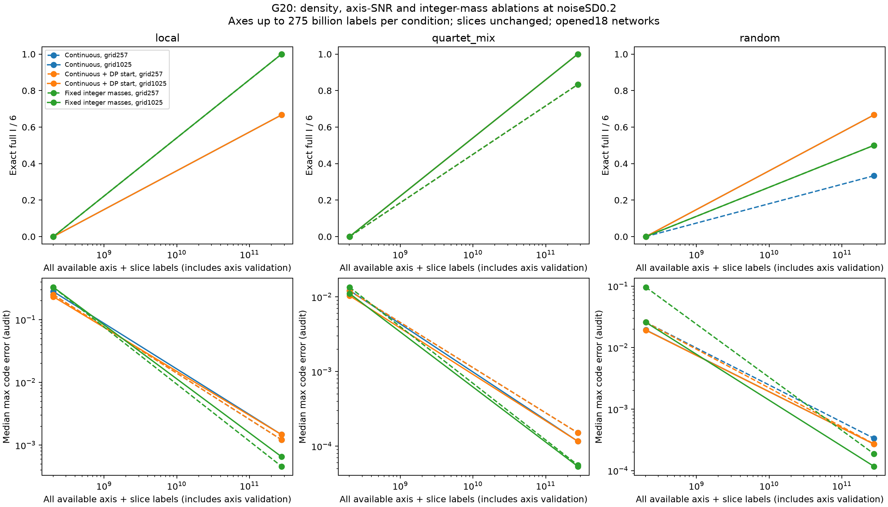
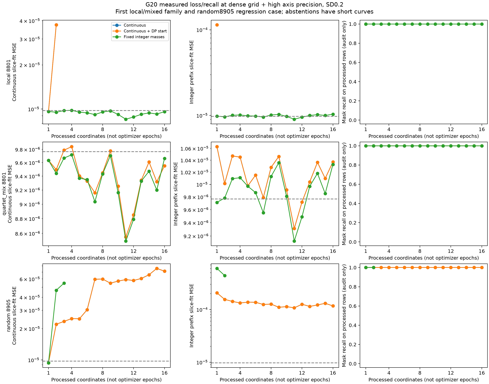
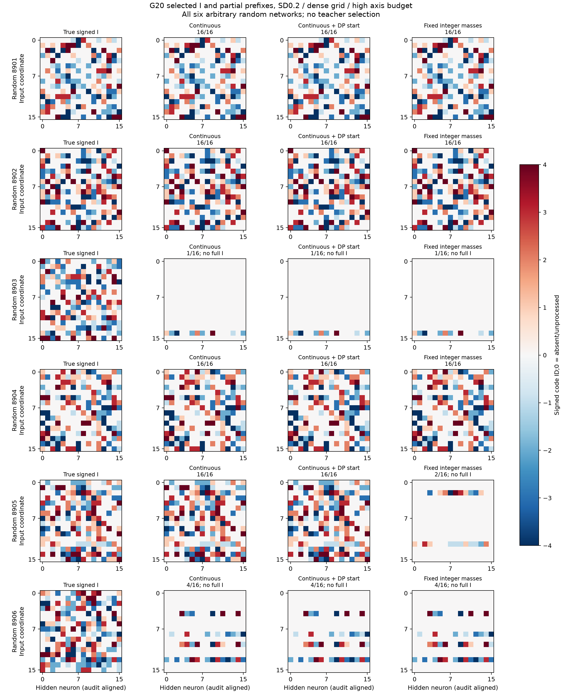
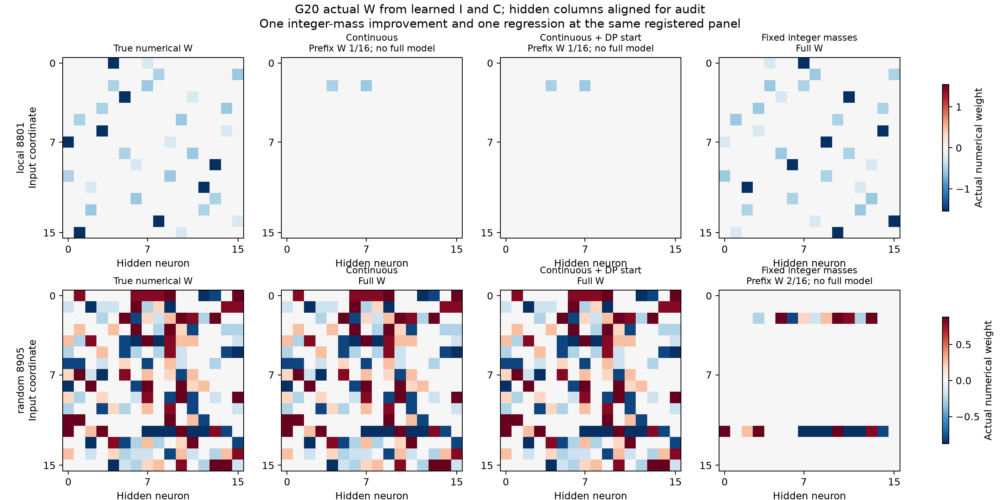

# G20: исправление кодбука через сетку, SNR и целые количества

5 ноября 2026. **На плотной сетке без шума все три варианта восстановили точный I в 18/18 случаях. При шуме 0.2 и большом осевом бюджете целые количества дали 15/18 против 14/18 у непрерывного контроля. На случайных структурах результат ухудшился с 4/6 до 3/6. Общего превосходства нет.** Все 18 запусков, 540 состояний методов, заморожены до аудита. Использованы пять свободных V100: 1, 2, 3, 6, 7. GPU 0 занял другой процесс до старта; занятые 0, 4, 5 не затрагивались.

## Почему проверено именно это

G19 дал 15/18 точных I без шума и 0/108 в шумных состояниях. Факторный контроль при шуме 0.2 и 4096 повторах дал 16/18 с истинным C и шумными срезами, но 0/18 с оценённым C и чистыми срезами. У random8903 почти нулевая ошибка на редкой сетке не означала правильного C. THEORY.md §27 до G20 вывел ограничение интерсептов: на каждом линейном участке осевого отклика свободный член кратен b/sqrt(H), а множитель — целое число уже активированных весов. Приращения M положительны, их сумма не превосходит DH. Истинное число активных связей не раскрывается.

Реализована DP по целым интерсептам со свободными наклонами. Она оптимизирует собственную релаксацию с возможными разрывами; это не автоматическое решение непрерывной физической модели. Допустимость исходного пути, выбранные количества, прямой SSE и численная разница сохранены. Инициализация через DP сравнивается отдельно от подгонки C с фиксированными целыми M. [CPOP](https://arxiv.org/abs/1701.01672) и [Troeng–Fält 2018](https://arxiv.org/abs/1806.11041) уже решают задачи непрерывных сплайнов иначе. Их алгоритмы здесь не воспроизводятся буквально. Приоритет нашей специализации не установлен.

## Протокол

Те же 18 открытых сетей G19: шесть local, шесть quartet_mix с парными перестановками входов, шесть произвольных случайных индексаторов. C и I прежние: это парная диагностика, не новое независимое подтверждение. Одна функция на I; общий bias 0.15 и положительная нормировка выхода известны, offset равен нулю. Новые осевые запросы используют 257 или 1025 точек на прежнем геометрическом диапазоне .001–1024. Срезы и порядок входов точно совпадают с G19: без шума одна метка, при шуме 0.2 и 2 — по 4096 меток. Совпадение сохранённых массивов проверено до обучения. K=4 и размеры известны; маска, истинные C, M и роли координат обучению недоступны.

Два общих осевых бюджета соответствуют 4096 и 16777216 повторам на редкой сетке. На плотной сетке повторов на точку примерно в четыре раза меньше. Обучающие осевые запросы и независимые запросы в промежуточных точках для валидации входят в бюджет: repeat=floor((2*257−1)*coarseR/(2*grid−1)). Одинаковые бесшумные бюджеты не повторялись. Все методы видят одинаковые наблюдения на каждом panel. Gaussian среднее r меток точно симулировано через sigma/sqrt(r)Z; шум парный между режимами. Повторы меток не являются независимыми геометриями.

У трёх методов по семь численных стартов и одинаковый предел итераций. **Continuous** использует исходную цель со свободными амплитудами. В G20 все методы выбирают старт по независимой осевой валидации; в G19 выбор был по обучающей ошибке. **Continuous+DPstart** заменяет только первый старт кодбуком из DP, остальные шесть совпадают. **Integer_mass** использует те же семь стартов, но фиксирует амплитуды M/sqrt(H) из DP. Дополнительного поиска M или подстановки истинных количеств нет. Выбранный C передаётся в неизменный поиск префиксов G19. Сохраняются все I и отказы; сетка и бюджет по истине не выбираются.

## Все итоги по18 структурам

|Noise SD|Axis grid|Coarse-equivalentR|Метод|Exact full I|Median max-C error|
|---|---:|---:|---|---:|---:|
|0.0|257|4096|continuous|15/18|4.42e-14|
|0.0|257|4096|continuous_dp_start|17/18|1.16e-14|
|0.0|257|4096|integer_mass|17/18|1.83e-15|
|0.0|1025|4096|continuous|18/18|3.03e-14|
|0.0|1025|4096|continuous_dp_start|18/18|2.40e-14|
|0.0|1025|4096|integer_mass|18/18|4.44e-16|
|0.2|257|4096|continuous|0/18|2.14e-02|
|0.2|257|4096|continuous_dp_start|0/18|2.16e-02|
|0.2|257|4096|integer_mass|0/18|4.04e-02|
|0.2|257|16777216|continuous|13/18|3.35e-04|
|0.2|257|16777216|continuous_dp_start|14/18|2.73e-04|
|0.2|257|16777216|integer_mass|14/18|1.70e-04|
|0.2|1025|4096|continuous|0/18|1.94e-02|
|0.2|1025|4096|continuous_dp_start|0/18|1.92e-02|
|0.2|1025|4096|integer_mass|0/18|2.73e-02|
|0.2|1025|16777216|continuous|14/18|2.64e-04|
|0.2|1025|16777216|continuous_dp_start|14/18|2.64e-04|
|0.2|1025|16777216|integer_mass|15/18|1.55e-04|
|2.0|257|4096|continuous|0/18|3.20e-01|
|2.0|257|4096|continuous_dp_start|0/18|2.72e-01|
|2.0|257|4096|integer_mass|0/18|4.63e-01|
|2.0|257|16777216|continuous|0/18|2.71e-03|
|2.0|257|16777216|continuous_dp_start|0/18|2.71e-03|
|2.0|257|16777216|integer_mass|0/18|2.25e-03|
|2.0|1025|4096|continuous|0/18|4.39e-01|
|2.0|1025|4096|continuous_dp_start|0/18|4.49e-01|
|2.0|1025|4096|integer_mass|0/18|4.82e-01|
|2.0|1025|16777216|continuous|0/18|2.64e-03|
|2.0|1025|16777216|continuous_dp_start|0/18|2.64e-03|
|2.0|1025|16777216|integer_mass|0/18|1.97e-03|

Без шума на редкой сетке одна инициализация через DP улучшает 15/18 до 17/18; фиксация целых количеств дополнительных успехов не даёт. Плотная сетка даёт 18/18 уже непрерывному контролю. Нельзя приписывать весь выигрыш целочисленному компоненту. При умеренном шуме и большом бюджете плотная сетка даёт 14/18 у continuous и 15/18 у integer: local 4→6, mixed 6→6, random 4→3. Random8905 решён непрерывным вариантом, но неправильные фиксированные M приводят integer к отказу. На редкой сетке при большом бюджете seeded/integer дают 14/18 против 13/18 у continuous. При малом осевом бюджете все дают 0/18. При шуме 2 все также дают 0/18; неизменный поиск префиксов уже давал там 0/18 даже с истинным C.

Всего ошибочных полных выдач: 0. Неуспех здесь означает отказ от полного I. Это не доверительная теорема: допустимость округлённых количеств не является сертификатом точности под шумом. Все состояния зависимы; local/mixed используют парные геометрии.

## Измеренные loss, recall, выбранные I и numerical W

Здесь X — число обработанных входных координат. Показаны измеренные остатки LS и подгонки дискретного префикса. Нелинейный этап C сохраняет результаты семи стартов, но не траекторию SGD; отсутствующие кривые не выдумываются. Recall неполного префикса считается только на обработанных строках и не означает успех полного I.

Численные W построены из реальных исходных I и C. Для сравнения меняется только перестановка скрытых нейронов. Смена имён и знаков кодовых групп применяется лишь к категориальным картинкам I. При отказе префикс W явно помечен; неполная матрица не выдаётся за полную модель. Native LC, Yeh, LUT-Q и плотный Adam на этих данных не обучались; прежние числа G17 нельзя переносить в эту таблицу.

## Стоимость и контроль релаксации

|Noise|Grid|CoarseR|Фактическийr/query|Axis train+validationlabels|Все source labels|RawDPphysical|Max прямой-SSE минусDP-SSE, abs|
|---|---:|---:|---:|---:|---:|---:|---:|
|0.0|257|4096|1|16,416|49,184|17/18|2.84e-12|
|0.0|1025|4096|1|65,568|98,336|18/18|4.28e-12|
|0.2|257|4096|4,096|67,239,936|201,457,664|0/18|2.45e-12|
|0.2|257|16777216|16,777,216|275,414,777,856|275,548,995,584|16/18|2.71e-12|
|0.2|1025|4096|1,025|67,207,200|201,424,928|0/18|1.29e-11|
|0.2|1025|16777216|4,200,445|275,414,777,760|275,548,995,488|16/18|1.12e-11|
|2.0|257|4096|4,096|67,239,936|201,457,664|0/18|3.16e-12|
|2.0|257|16777216|16,777,216|275,414,777,856|275,548,995,584|10/18|2.84e-12|
|2.0|1025|4096|1,025|67,207,200|201,424,928|0/18|2.05e-11|
|2.0|1025|16777216|4,200,445|275,414,777,760|275,548,995,488|2/18|7.30e-12|

Высокий режим стоит около **275.55 миллиарда меток на условие**, плюс 8192 старых IID-меток валидации для отчёта. Это очень дорого. Сырые r шумных меток не материализованы, но их статистическая стоимость учтена. Новые осевые метки прибавлены ко всем доступным срезам G19, даже если процедура остановилась раньше. Из-за целого floor разница осевых бюджетов между сетками мала; точные числа приведены в таблице. Равенство FLOPs или времени не заявляется: integer DP добавляет вычисления, фактические времена сохранены.

Исходный DP-путь не всегда задаёт допустимую непрерывную кривую. Численная подгонка C с фиксированными M после DP не получает автоматической глобальной гарантии. Совпадение прямого SSE и DP проверяет вычисление релаксации, но не истинность M. При шуме 0.2 и большом бюджете истинные M получены в 17/18 случаях на редкой сетке и 16/18 на плотной; при шуме 2 — в 12/18 и 9/18. Фиксация неверного M может ухудшить результат. Точность I и ошибки C измерены только после заморозки.

## Артефакты и следующий содержательный шаг

Root `results/20261105/codebook_refinement_g20`; код codebook_counts.py, codebook_refinement.py, codebook_refinement_report.py, неизменный prefix_census.py. Сохранены protocol, theory_at_registration, executed_code_snapshot, models_frozen.json. Исходные job JSON/NPZ отделены от audit.json и audit_only.npz. В отчёте comparison.csv, summary.json и четыре просмотренные фигуры. Все обучения, аудит и отчёт завершены. Программные тесты не писали и не запускали; выполнены минимальный Ruff, необходимый аудит математики и происхождения данных, просмотр фигур.

G20 исправил бесшумный сбой с помощью более информативной сетки, но улучшение SNR получено огромным числом меток. Целые M помогли локально, ухудшили один случайный индексатор и не дали устойчивого общего выигрыша. Следующий шаг должен отвечать измеренной проблеме: допустимое назначение целых количеств по ошибке функции вместо свободного LS с округлением; совместное уточнение C по уже наблюдаемым префиксным данным. До изменения нужны теория и отдельные абляции. Пока эти улучшения не выполнены.

Большая цель сохраняется: полный общий I разных source-C, свободные bias и readout, независимые геометрии и шумовые условия, сильные конкуренты при согласованных данных и вычислениях, отдельный перенос I со свежими C и приоритет собственного компонента. Общая конкурентная победа, новизна и завершение цели пока не установлены.
