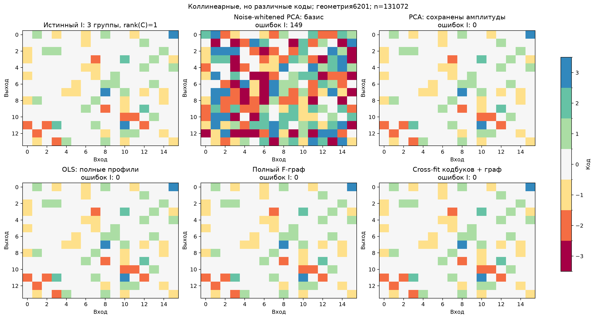

# G5: различимость групп не равна рангу межзадачных весов

Это заранее описанная в THEORY.md§12 диагностика на четырёх уже открытых pilot-геометриях, а не независимое подтверждение. Изменено только возбуждение кодов: c_t=s_t(1,2,3). Три группы имеют разные ненулевые профили и различные относительные знаки; матрица коэффициентов при этом ранга1. T=128, condition100, Gaussian noise1, пять вложенных бюджетов. Размеры групп и роли координат декодерам неизвестны, K=3 известно точно.

Полные профили, PCA с сохранёнными амплитудами и контрастные графы восстанавливают4/4 структуры уже при512 наблюдениях. Принудительное выделение трёх нормированных направлений добавляет два шумовых направления и не восстанавливает ни одной структуры даже при131072. Это не провал PCA вообще: его вариант с амплитудами здесь успешен. Граф проверяет различимость профилей; он не требует rank(C)=K.

При фиксированном кодбуке3s и нуле мягкие коэффициенты1/3,2/3,1 точно воспроизводят все три положительных числа s,2s,3s. Поэтому идеальный source-loss допускает неправильное число жёстких групп после argmax. Диагностика демонстрирует эту теоретическую возможность и различие спектральных декодеров; она не является новым запуском DARTS/Yeh или доказательством их обязательного провала. Модель с произвольным непрерывным базисом также не обязана сохранить все ненаблюдённые направления будущих независимых C.

## Точные индексаторы / четыре геометрии

|Метод|512|2048|8192|32768|131072|
|---|---:|---:|---:|---:|---:|
|OLS: полные профили|4/4|4/4|4/4|4/4|4/4|
|PCA: нормированный базис K=3|0/4|0/4|0/4|0/4|0/4|
|PCA: сохранены амплитуды|4/4|4/4|4/4|4/4|4/4|
|Noise-corrected PCA: базис|0/4|0/4|0/4|0/4|0/4|
|Cross-split PCA: базис|0/4|0/4|0/4|0/4|0/4|
|Noise-whitened PCA: базис|0/4|0/4|0/4|0/4|0/4|
|Diagonal whitening PCA: базис|0/4|0/4|0/4|0/4|0/4|
|Полный corrected-kernel|4/4|4/4|4/4|4/4|4/4|
|Полный F-граф|4/4|4/4|4/4|4/4|4/4|
|Cross-fit кодбуков + граф|4/4|4/4|4/4|4/4|4/4|
|Cross-fit без полного fallback|4/4|4/4|4/4|4/4|4/4|
|Cross-fit объединения направлений|4/4|4/4|4/4|4/4|4/4|

## Хитмапы

Никаких teacher-значений декодеры не получали; выравнивание названий кодов применяется только для аудита рисунка. Это линейный пример. Содержательная новизна и преимущество собственного codebook-компонента перед сильными профильно-статистическими контролями по нему не установлены.
