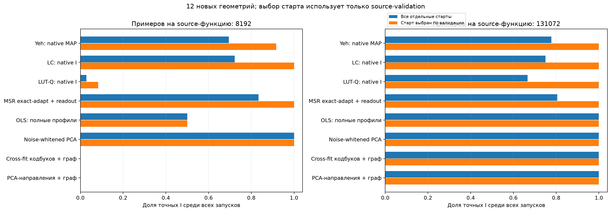
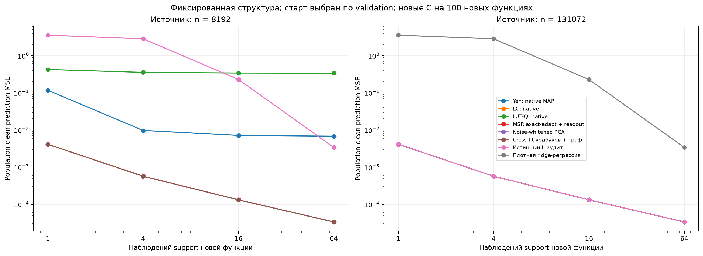
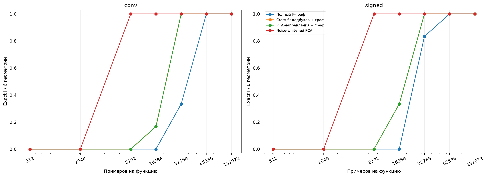
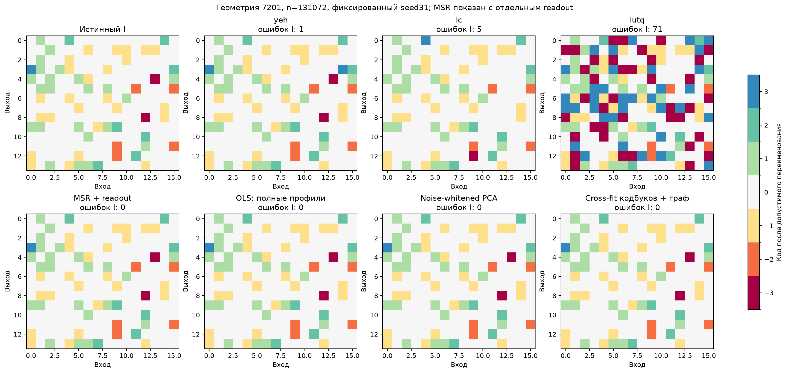
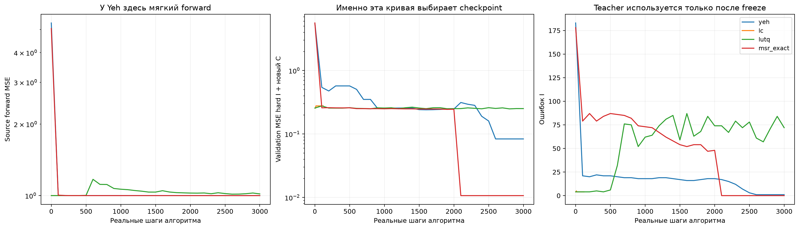

# Независимое сравнение общей структуры: G4

Все модели заморожены до структурного аудита и генерации новых C. Это12 новых геометрий ×3 уровня Gaussian шума. На каждую source-функцию128 задач и указанный бюджет наблюдений; covariance condition100; std кодов1/0.3/0.03. Размеры групп и позиции скрыты. Обучаемые методы имеют3 независимых numerical seed; статистические декодеры детерминированы заданным seed.

## Как читать таблицы

Exact I учитывает глобальную перестановку названий групп и общий знак группы. «Все seed» требует3/3 для одной геометрии. Непрерывный U не выдаёт дискретный I: его subspace и перенос сохранены отдельно. MSR с дополнительным readout — отдельная строка. У Yeh MAP, LC, LUT-Q отображаются их native назначения, без последующей исправляющей кластеризации.

Основное прикладное сравнение выбирает лучший из трёх стартов по замороженному source-validation MSE; для него в колонке «Все seed» один выбранный старт. Это дополнительный post-hoc контроль честности сравнения: правило использует только сохранённые source-оценки, но оно не было отдельно зарегистрировано до открытия аудита. Таблицы отдельных seed сохраняют информацию об устойчивости. Файл validation_restart_choices.json содержит правило, выбранные seed и хеши исходных source-моделей. Целевые ошибки и true I при выборе не используются.

**Вывод с учётом выбора старта:** в основном режиме n=131072 Yeh, LC, LUT-Q и MSR с readout, как и предложенные графы и статистические контроли, точны на12/12 геометрий. LC и MSR с readout достигают12/12 уже при n=8192, когда граф ещё воздерживается. Noise-whitened PCA также точен12/12 при8192. Поэтому преимущества нашего метода по точности/переносу над лучшими контролями здесь нет. Преимущество перед неудачными отдельными стартами нельзя выдавать за превосходство над настроенным конкурентом. Граф добавляет контроль ошибочной выдачи при явно ограниченной Gaussian модели.

Модели конкурентов — явно описанные multi-task адаптации, не неизменённые author scripts. Exact-adapt MSR использует более сильное аналитическое внутреннее обучение. Отдельные32 source-validation функции выбирают HPO/checkpoint; это дополнительная информация о структуре, одинаково доступная методам. Статистические методы не используют эти labels для подбора. Эти таблицы нельзя называть информационным пределом по всем данным.

Числа C полностью сброшены. Сто новых функций имеют независимые C стандартного масштаба, в том числе сильный третий код. После support-fit показана точная clean prediction MSE при isotropic Gaussian query: сумма квадратов ошибки весов делится на число выходов, **не** на число весов. Query labels/teacher C не участвуют в выборе. Плотная регрессия имеет observation-only empirical-Bayes ridge, замороженную до target. Истинный I служит только аудитом.

Граф может воздержаться. Невыданный I не засчитывается точным. F1 и MSE графа с частичной выдачей относятся лишь к выданным I; покрытие видно по Exact/всем запусков. Alpha0.05 относится к одному заранее заданному запуску, учитывая все7 looks и семейства контрастов, а не ко всему benchmark из36 случаев и нескольких разных алгоритмов.

## primary, n=8192

### Старт выбран по source-validation

| Метод | Exact I / запусков | Все seed точны / геометрий | F1 маски | MSE, support4 | MSE, support16 |
|---|---:|---:|---:|---:|---:|
|Yeh: native MAP|11/12|11/12|0.9993|0.00971074|0.00712782|
|Yeh: soft basis|не выдаёт I|—|—|0.0222497|0.0205822|
|MSR exact-adapt + readout|12/12|12/12|1.0000|0.000569849|0.000132295|
|MSR exact-adapt: raw U|не выдаёт I|—|—|0.100418|0.0941599|
|LC: native I|12/12|12/12|1.0000|0.000569849|0.000132295|
|LUT-Q: native I|1/12|1/12|0.7573|0.354635|0.341022|
|OLS: полные профили|6/12|6/12|0.9581|0.189378|0.176028|
|OLS + PCA-базис|7/12|7/12|0.8603|0.11656|0.111259|
|OLS + PCA с амплитудами|7/12|7/12|0.8563|0.0916385|0.0871969|
|Noise-corrected PCA|9/12|9/12|0.9540|0.0540025|0.0510523|
|Noise-whitened PCA|12/12|12/12|1.0000|0.000569849|0.000132295|
|Полный F-граф|0/12, I не выдан|0/12|—|—|—|
|Cross-fit кодбуков + граф|0/12, I не выдан|0/12|—|—|—|
|PCA-направления + граф|0/12, I не выдан|0/12|—|—|—|
|Плотная ridge-регрессия|не выдаёт I|—|—|2.83449|0.227801|
|Истинный I: аудит|не выдаёт I|—|—|0.000569849|0.000132295|

### Все отдельные старты: устойчивость оптимизации

| Метод | Exact I / запусков | Все seed точны / геометрий | F1 маски | MSE, support4 | MSE, support16 |
|---|---:|---:|---:|---:|---:|
|Yeh: native MAP|25/36|5/12|0.9948|0.0693936|0.0644975|
|Yeh: soft basis|не выдаёт I|—|—|0.0282213|0.0263033|
|MSR exact-adapt + readout|30/36|7/12|0.9866|0.0188523|0.0170895|
|MSR exact-adapt: raw U|не выдаёт I|—|—|0.118918|0.111979|
|LC: native I|26/36|4/12|0.9688|0.183222|0.174823|
|LUT-Q: native I|1/36|0/12|0.7064|0.49224|0.47175|
|OLS: полные профили|6/12|6/12|0.9581|0.189378|0.176028|
|OLS + PCA-базис|7/12|7/12|0.8603|0.11656|0.111259|
|OLS + PCA с амплитудами|7/12|7/12|0.8563|0.0916385|0.0871969|
|Noise-corrected PCA|9/12|9/12|0.9540|0.0540025|0.0510523|
|Noise-whitened PCA|12/12|12/12|1.0000|0.000569849|0.000132295|
|Полный F-граф|0/12, I не выдан|0/12|—|—|—|
|Cross-fit кодбуков + граф|0/12, I не выдан|0/12|—|—|—|
|PCA-направления + граф|0/12, I не выдан|0/12|—|—|—|
|Плотная ridge-регрессия|не выдаёт I|—|—|2.83449|0.227801|
|Истинный I: аудит|не выдаёт I|—|—|0.000569849|0.000132295|

## primary, n=131072

### Старт выбран по source-validation

| Метод | Exact I / запусков | Все seed точны / геометрий | F1 маски | MSE, support4 | MSE, support16 |
|---|---:|---:|---:|---:|---:|
|Yeh: native MAP|12/12|12/12|1.0000|0.000569849|0.000132295|
|Yeh: soft basis|не выдаёт I|—|—|0.00640433|0.00556762|
|MSR exact-adapt + readout|12/12|12/12|1.0000|0.000569849|0.000132295|
|MSR exact-adapt: raw U|не выдаёт I|—|—|0.0462283|0.0426302|
|LC: native I|12/12|12/12|1.0000|0.000569849|0.000132295|
|LUT-Q: native I|12/12|12/12|1.0000|0.000569849|0.000132295|
|WSR: независимые fit + пересечение равенств|0/6|0/6|0.3158|2.96283|2.95094|
|OSCAR: независимые fit + пересечение равенств|0/12|0/12|0.0000|3.78168|3.78168|
|OLS: полные профили|12/12|12/12|1.0000|0.000569849|0.000132295|
|OLS + PCA-базис|12/12|12/12|1.0000|0.000569849|0.000132295|
|OLS + PCA с амплитудами|12/12|12/12|1.0000|0.000569849|0.000132295|
|Noise-corrected PCA|12/12|12/12|1.0000|0.000569849|0.000132295|
|Noise-whitened PCA|12/12|12/12|1.0000|0.000569849|0.000132295|
|Полный F-граф|12/12|12/12|1.0000|0.000569849|0.000132295|
|Cross-fit кодбуков + граф|12/12|12/12|1.0000|0.000569849|0.000132295|
|PCA-направления + граф|12/12|12/12|1.0000|0.000569849|0.000132295|
|Плотная ridge-регрессия|не выдаёт I|—|—|2.83449|0.227801|
|Истинный I: аудит|не выдаёт I|—|—|0.000569849|0.000132295|

### Все отдельные старты: устойчивость оптимизации

| Метод | Exact I / запусков | Все seed точны / геометрий | F1 маски | MSE, support4 | MSE, support16 |
|---|---:|---:|---:|---:|---:|
|Yeh: native MAP|28/36|7/12|0.9966|0.0402469|0.0364533|
|Yeh: soft basis|не выдаёт I|—|—|0.00947501|0.00841981|
|MSR exact-adapt + readout|29/36|5/12|0.9576|0.0309377|0.0290725|
|MSR exact-adapt: raw U|не выдаёт I|—|—|0.0801975|0.0748198|
|LC: native I|27/36|4/12|0.9744|0.150821|0.143769|
|LUT-Q: native I|24/36|2/12|0.9417|0.152292|0.144874|
|WSR: независимые fit + пересечение равенств|0/6|0/6|0.3158|2.96283|2.95094|
|OSCAR: независимые fit + пересечение равенств|0/12|0/12|0.0000|3.78168|3.78168|
|OLS: полные профили|12/12|12/12|1.0000|0.000569849|0.000132295|
|OLS + PCA-базис|12/12|12/12|1.0000|0.000569849|0.000132295|
|OLS + PCA с амплитудами|12/12|12/12|1.0000|0.000569849|0.000132295|
|Noise-corrected PCA|12/12|12/12|1.0000|0.000569849|0.000132295|
|Noise-whitened PCA|12/12|12/12|1.0000|0.000569849|0.000132295|
|Полный F-граф|12/12|12/12|1.0000|0.000569849|0.000132295|
|Cross-fit кодбуков + граф|12/12|12/12|1.0000|0.000569849|0.000132295|
|PCA-направления + граф|12/12|12/12|1.0000|0.000569849|0.000132295|
|Плотная ridge-регрессия|не выдаёт I|—|—|2.83449|0.227801|
|Истинный I: аудит|не выдаёт I|—|—|0.000569849|0.000132295|

## low_noise, n=131072

### Старт выбран по source-validation

| Метод | Exact I / запусков | Все seed точны / геометрий | F1 маски | MSE, support4 | MSE, support16 |
|---|---:|---:|---:|---:|---:|
|Yeh: native MAP|12/12|12/12|1.0000|0.000569849|0.000132295|
|Yeh: soft basis|не выдаёт I|—|—|0.00515213|0.0043485|
|MSR exact-adapt + readout|12/12|12/12|1.0000|0.000569849|0.000132295|
|MSR exact-adapt: raw U|не выдаёт I|—|—|0.0423409|0.0389426|
|LC: native I|12/12|12/12|1.0000|0.000569849|0.000132295|
|LUT-Q: native I|12/12|12/12|1.0000|0.000569849|0.000132295|
|WSR: независимые fit + пересечение равенств|0/6|0/6|0.3158|2.96283|2.95094|
|OSCAR: независимые fit + пересечение равенств|0/12|0/12|0.0000|3.78168|3.78168|
|OLS: полные профили|12/12|12/12|1.0000|0.000569849|0.000132295|
|OLS + PCA-базис|12/12|12/12|1.0000|0.000569849|0.000132295|
|OLS + PCA с амплитудами|12/12|12/12|1.0000|0.000569849|0.000132295|
|Noise-corrected PCA|12/12|12/12|1.0000|0.000569849|0.000132295|
|Noise-whitened PCA|12/12|12/12|1.0000|0.000569849|0.000132295|
|Полный F-граф|12/12|12/12|1.0000|0.000569849|0.000132295|
|Cross-fit кодбуков + граф|12/12|12/12|1.0000|0.000569849|0.000132295|
|PCA-направления + граф|12/12|12/12|1.0000|0.000569849|0.000132295|
|Плотная ridge-регрессия|не выдаёт I|—|—|2.83449|0.227801|
|Истинный I: аудит|не выдаёт I|—|—|0.000569849|0.000132295|

### Все отдельные старты: устойчивость оптимизации

| Метод | Exact I / запусков | Все seed точны / геометрий | F1 маски | MSE, support4 | MSE, support16 |
|---|---:|---:|---:|---:|---:|
|Yeh: native MAP|27/36|6/12|0.9961|0.0383743|0.0349266|
|Yeh: soft basis|не выдаёт I|—|—|0.00835584|0.0073361|
|MSR exact-adapt + readout|31/36|7/12|0.9800|0.0201594|0.0187126|
|MSR exact-adapt: raw U|не выдаёт I|—|—|0.0769639|0.0716832|
|LC: native I|36/36|12/12|1.0000|0.000569849|0.000132295|
|LUT-Q: native I|36/36|12/12|1.0000|0.000569849|0.000132295|
|WSR: независимые fit + пересечение равенств|0/6|0/6|0.3158|2.96283|2.95094|
|OSCAR: независимые fit + пересечение равенств|0/12|0/12|0.0000|3.78168|3.78168|
|OLS: полные профили|12/12|12/12|1.0000|0.000569849|0.000132295|
|OLS + PCA-базис|12/12|12/12|1.0000|0.000569849|0.000132295|
|OLS + PCA с амплитудами|12/12|12/12|1.0000|0.000569849|0.000132295|
|Noise-corrected PCA|12/12|12/12|1.0000|0.000569849|0.000132295|
|Noise-whitened PCA|12/12|12/12|1.0000|0.000569849|0.000132295|
|Полный F-граф|12/12|12/12|1.0000|0.000569849|0.000132295|
|Cross-fit кодбуков + граф|12/12|12/12|1.0000|0.000569849|0.000132295|
|PCA-направления + граф|12/12|12/12|1.0000|0.000569849|0.000132295|
|Плотная ridge-регрессия|не выдаёт I|—|—|2.83449|0.227801|
|Истинный I: аудит|не выдаёт I|—|—|0.000569849|0.000132295|

## high_noise, n=131072

### Старт выбран по source-validation

| Метод | Exact I / запусков | Все seed точны / геометрий | F1 маски | MSE, support4 | MSE, support16 |
|---|---:|---:|---:|---:|---:|
|Yeh: native MAP|12/12|12/12|1.0000|0.000569849|0.000132295|
|Yeh: soft basis|не выдаёт I|—|—|0.00956016|0.00852883|
|MSR exact-adapt + readout|12/12|12/12|1.0000|0.000569849|0.000132295|
|MSR exact-adapt: raw U|не выдаёт I|—|—|0.0569387|0.052854|
|LC: native I|12/12|12/12|1.0000|0.000569849|0.000132295|
|LUT-Q: native I|7/12|7/12|0.9490|0.0772917|0.0723355|
|WSR: независимые fit + пересечение равенств|0/6|0/6|0.3158|2.96283|2.95094|
|OSCAR: независимые fit + пересечение равенств|0/12|0/12|0.0000|3.78168|3.78168|
|OLS: полные профили|12/12|12/12|1.0000|0.000569849|0.000132295|
|OLS + PCA-базис|12/12|12/12|1.0000|0.000569849|0.000132295|
|OLS + PCA с амплитудами|12/12|12/12|1.0000|0.000569849|0.000132295|
|Noise-corrected PCA|12/12|12/12|1.0000|0.000569849|0.000132295|
|Noise-whitened PCA|12/12|12/12|1.0000|0.000569849|0.000132295|
|Полный F-граф|7/12|7/12|1.0000|0.000591678|0.000131516|
|Cross-fit кодбуков + граф|12/12|12/12|1.0000|0.000569849|0.000132295|
|PCA-направления + граф|12/12|12/12|1.0000|0.000569849|0.000132295|
|Плотная ridge-регрессия|не выдаёт I|—|—|2.83449|0.227801|
|Истинный I: аудит|не выдаёт I|—|—|0.000569849|0.000132295|

### Все отдельные старты: устойчивость оптимизации

| Метод | Exact I / запусков | Все seed точны / геометрий | F1 маски | MSE, support4 | MSE, support16 |
|---|---:|---:|---:|---:|---:|
|Yeh: native MAP|26/36|5/12|0.9955|0.0690634|0.0651322|
|Yeh: soft basis|не выдаёт I|—|—|0.0125375|0.0113374|
|MSR exact-adapt + readout|27/36|5/12|0.9577|0.0344256|0.0320712|
|MSR exact-adapt: raw U|не выдаёт I|—|—|0.0885725|0.0828518|
|LC: native I|26/36|4/12|0.9688|0.183065|0.174939|
|LUT-Q: native I|10/36|0/12|0.8561|0.276035|0.263781|
|WSR: независимые fit + пересечение равенств|0/6|0/6|0.3158|2.96283|2.95094|
|OSCAR: независимые fit + пересечение равенств|0/12|0/12|0.0000|3.78168|3.78168|
|OLS: полные профили|12/12|12/12|1.0000|0.000569849|0.000132295|
|OLS + PCA-базис|12/12|12/12|1.0000|0.000569849|0.000132295|
|OLS + PCA с амплитудами|12/12|12/12|1.0000|0.000569849|0.000132295|
|Noise-corrected PCA|12/12|12/12|1.0000|0.000569849|0.000132295|
|Noise-whitened PCA|12/12|12/12|1.0000|0.000569849|0.000132295|
|Полный F-граф|7/12|7/12|1.0000|0.000591678|0.000131516|
|Cross-fit кодбуков + граф|12/12|12/12|1.0000|0.000569849|0.000132295|
|PCA-направления + граф|12/12|12/12|1.0000|0.000569849|0.000132295|
|Плотная ridge-регрессия|не выдаёт I|—|—|2.83449|0.227801|
|Истинный I: аудит|не выдаёт I|—|—|0.000569849|0.000132295|

## Парная неопределённость переноса

Положительная разница означает большую ошибку базы. Resampling выполняется по геометриям, отдельно внутри двух классов; numerical seed выбран по source-validation. Это описательные интервалы без одновременной поправки на все сравнения. При неполной выдаче берутся только общие геометрии; их число указано. В JSON отдельно сохранён контроль с усреднением всех стартов.

|База|Геометрий|MSE4 базы − MSE4 cross-fit кодбуков|95% bootstrap interval|
|---|---:|---:|---:|
|Yeh: native MAP|12|0|[0, 0]|
|Yeh: soft basis|12|0.00583448|[0.00364274, 0.0085441]|
|MSR exact-adapt + readout|12|0|[0, 0]|
|MSR exact-adapt: raw U|12|0.0456584|[0.0301046, 0.061403]|
|LC: native I|12|0|[0, 0]|
|LUT-Q: native I|12|0|[0, 0]|
|WSR: независимые fit + пересечение равенств|6|2.96229|[2.69938, 3.16622]|
|OSCAR: независимые fit + пересечение равенств|12|3.78111|[3.62161, 3.93544]|
|OLS: полные профили|12|0|[0, 0]|
|OLS + PCA-базис|12|0|[0, 0]|
|OLS + PCA с амплитудами|12|0|[0, 0]|
|Noise-corrected PCA|12|0|[0, 0]|
|Noise-whitened PCA|12|0|[0, 0]|
|Полный F-граф|12|0|[0, 0]|
|PCA-направления + граф|12|0|[0, 0]|
|Плотная ridge-регрессия|12|2.83392|[2.71356, 2.95229]|
|Истинный I: аудит|12|0|[0, 0]|

## Независимые графики и индексаторы

## Первый достаточный бюджет

|Геометрия|Полный F-граф|Cross-fit кодбуков|Whitening-PCA направления|
|---|---:|---:|---:|
|7101|65536|32768|32768|
|7102|65536|32768|32768|
|7103|32768|32768|32768|
|7104|65536|32768|32768|
|7105|32768|16384|16384|
|7106|65536|32768|32768|
|7201|32768|32768|32768|
|7202|32768|32768|32768|
|7203|32768|16384|16384|
|7204|32768|32768|32768|
|7205|65536|32768|32768|
|7206|32768|16384|16384|

## Ограничения интерпретации

WSR/OSCAR в этом опыте обучались независимо по source-функциям; общий I получался пересечением точных native равенств профилей. Это явно ограниченная адаптация: пересечение фрагментирует группы, а сильная регуляризация может их слить. Их неуспех не доказывает неуспех опубликованного метода или полноценной совместной векторной fusion-оптимизации. Для такого вывода нужен отдельный сильный joint/adaptive fusion контроль.

Это линейная identifiable задача; результат не переносится автоматически на hidden-neuron MLP, original nonlinear DeepSets, Pattern или сумму синусоид. Достаточные статистики Gaussian данных симулировались точно; сырые миллионы x не сохранялись. Алгоритмы получают sample Grams и наблюдаемые cross-products, не teacher W/градиенты учителя.

Whitening-PCA является сильным известным контролем. Cross-fit/проекционные тесты/fixed-confidence clustering известны. Специфическая польза кодбуков требует преимущества перед PCA-направлениями, а не только перед произвольной проекцией. Успех общего компонента и приоритет его комбинации нужно оценивать отдельно; этот отчёт сам по себе не доказывает новую универсально лучшую схему. Полный контекст, отрицательные результаты и литература находятся в ../../../../REPORT.md и LITERATURE.md.
