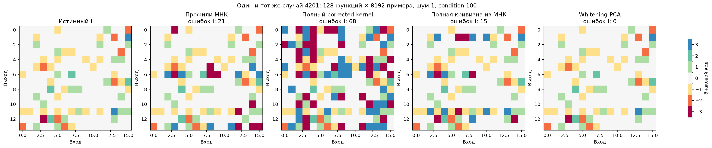
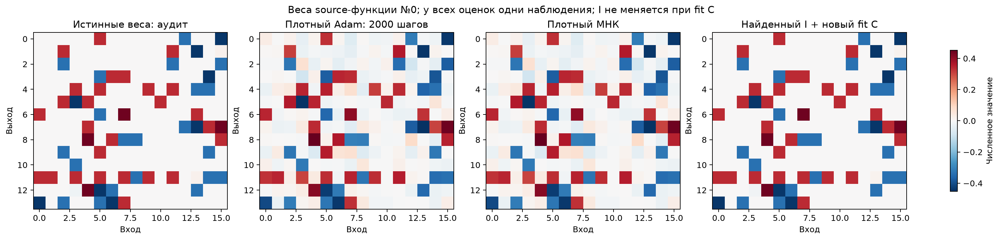
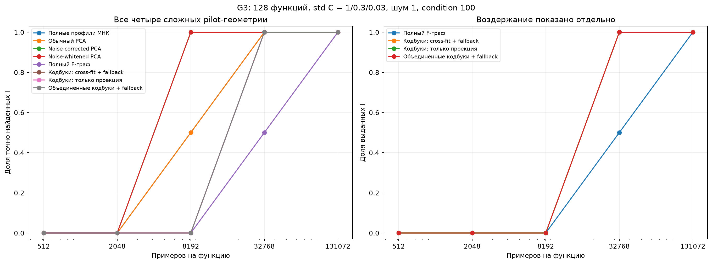

# Полная кривизна, шум и контрастный граф: G2/G3

Это диагностика и pilot, **не итоговое независимое сравнение нового метода с конкурентами**.

## G2: что именно мешает

Все шесть случаев уже открыты в G1. На самом сложном4201 полный corrected-kernel улучшает свой score, но делает68 ошибок I после выбора лучшего из двух стартов. Его score превосходит score истинного I на0.0002984: здесь уже есть адаптивное переобучение шумной статистике. Точная source-MSE с полным H и новым fit C из OLS-старта оставляет15 ошибок; из предварительного whitening-PCA —0. Начало оптимизации остаётся существенно.

Стандартный noise-whitened PCA восстанавливает6/6. Вычитание noise covariance и whitening различаются: последнее учитывает её полную геометрию. Это известный контроль, а не заявляемая новизна. Полный F-граф на8192 примерах во всех шести случаях имеет5 компонент вместо7 и воздерживается.

Плотный Adam действительно обучен2000 шагов на source-функции №0. Относительное отличие от её МНК: 0.000118. На этой линейной задаче остаётся шум оценок, а не предполагаемая нелинейная ловушка Adam. Сохранены его фактические веса и кривая целевой функции в dense_adam_actual.npz; константа Y² в кривой опущена.

## G3: протокол и полный учёт выдач

Четыре новые pilot-геометрии, два вида входной covariance, два уровня шума, слабые коды, full и collision-контроли:24 условия. На каждую функцию512/2048/8192/32768/131072 вложенных наблюдений. Использована точная симуляция достаточных статистик Gaussian регрессии, не замена эмпирических Grams на population. Bartlett sample Grams, projected Gaussian noise и residual chi-square позволяют не хранить сотни миллионов исходных x. Восемь базовых алгоритмов; размер и роли групп скрыты от поисковика.

Полный F-граф: выдал 20 индексаторов при первом допустимом останове, все 20 точные. В4 collision-случаях I не выдан даже на максимальном бюджете. Это наблюдение pilot, не эмпирическое доказательство номинальной гарантии0.05; сама узкая гарантия выведена в THEORY.md для точного K/общего Gaussian noise.

### Четыре самых сложных случая

Числитель — число exact I. Воздержание не записывается точным восстановлением. У всех одинаковые данные соответствующего n.

| Метод |512|2048|8192|32768|131072|
|---|---:|---:|---:|---:|---:|
| Полные профили МНК | 0/4 | 0/4 | 2/4 | 4/4 | 4/4 |
| Обычный PCA | 0/4 | 0/4 | 2/4 | 4/4 | 4/4 |
| Noise-corrected PCA | 0/4 | 0/4 | 4/4 | 4/4 | 4/4 |
| Noise-whitened PCA | 0/4 | 0/4 | 4/4 | 4/4 | 4/4 |
| Полный F-граф | 0/4 | 0/4 | 0/4 | 2/4 | 4/4 |
| Кодбуки: cross-fit + fallback | 0/4 | 0/4 | 0/4 | 4/4 | 4/4 |
| Кодбуки: только проекция | 0/4 | 0/4 | 0/4 | 4/4 | 4/4 |
| Объединённые кодбуки + fallback | 0/4 | 0/4 | 0/4 | 4/4 | 4/4 |

### Первый достаточный бюджет графовых вариантов

Все назначения проверяются после их выдачи, true I не участвует в выборе момента остановки.

| Геометрия | full_graph | codebook_crossfit | codebook_crossfit_only | codebook_union_crossfit |
|---|---:|---:|---:|---:|
| 6101 | 131072 | 32768 | 32768 | 32768 |
| 6102 | 32768 | 32768 | 32768 | 32768 |
| 6201 | 32768 | 32768 | 32768 | 32768 |
| 6202 | 131072 | 32768 | 32768 | 32768 |

## Граница вклада и дальнейшая проверка

Whitening, проекционные тесты, sample splitting и fixed-confidence clustering известны. Кандидат собственного компонента: независимые направления из адаптированных кодбуков, полный covariance контрастов, знаковой граф с нулевым якорем, остановка по числу2K+1 классов, затем фиксированный I и свежий C. Это ещё не установленный приоритет или конкурентное превосходство. Спектральные контроли должны остаться в финальном сравнении.

G4 настраивает явные multi-task адаптации Yeh/LC/LUT-Q/непрерывного MSR по отдельным наблюдаемым source-validation функциям. Их результаты пока не относятся к новым confirmation-геометриям. Новая нелинейная проверка, устойчивость за пределами общего Gaussian noise, независимый перенос и расширенные конкуренты ещё требуются.
