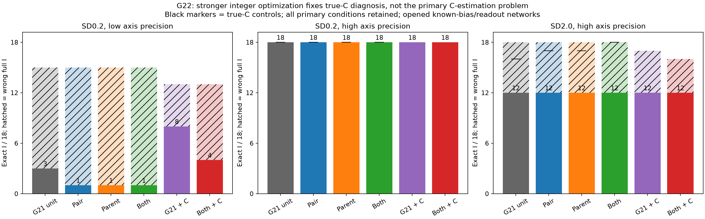
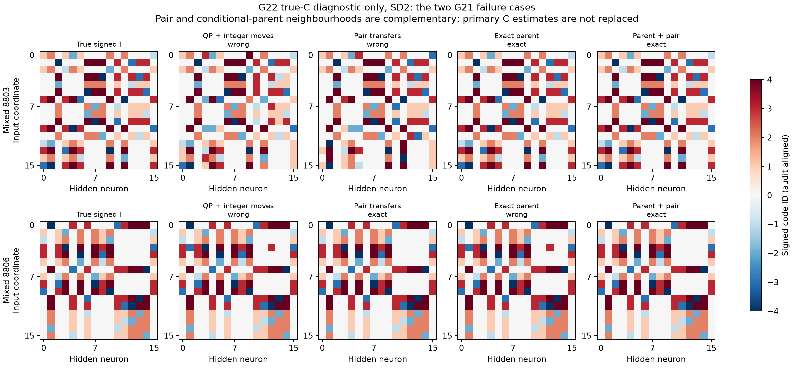
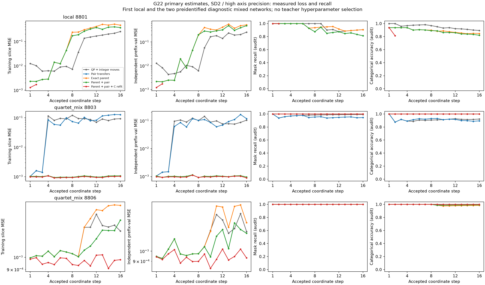
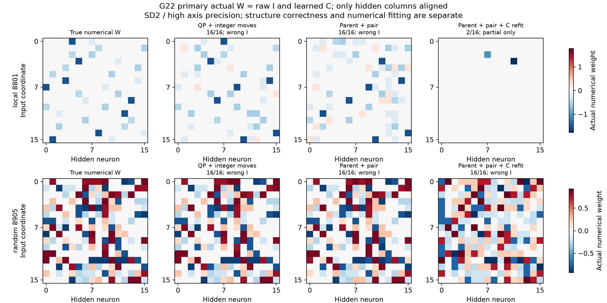
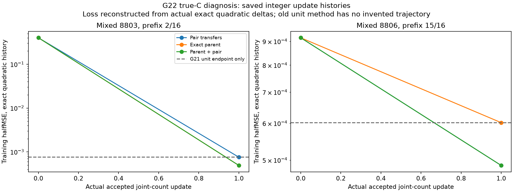

# G22: согласованные дискретные изменения индексатора

5 ноября 2026. **Остаточные known-C ловушки G21 устранены сочетанием exact-parent и pair ходов:18/18 при SD2 против16/18 у одиночных ходов. Каждый отдельный механизм даёт17/18. Основной метод с оценённым C остаётся12/18; при SD0.2/low stronger search + C-refit ухудшает8/18 до4/18. Поэтому это подтверждённое исправление solver failure, но не общее улучшение извлечения структуры.**

## Диагностика и теория до запуска

G21 показал два конкретных local integer barriers: teacher counts имеют меньшие observed/validation loss, но одиночные изменения ухудшают objective. THEORY §29 до запуска вывел pair-delta = delta1+delta2+d1ᵀGd2 и conditional-parent delta по полному g/G. Перебираются все допустимые пары unit moves или все compositions counts одного parent; teacher assignment/counts не сообщаются.

Exact parent solve условный, при fixed других блоках. Максимум735471распределение приH16/K4, GPUchunk16384, таблицы зависят только отH/K. Greedy лучший ход из всех parents/pairs, строгий decrease1e−12, cap512updates. Это не global integer MLE: при cross-block G могут остаться более дальние локальные ловушки. Ни block descent, ни pair updates не объявлены новыми: [CDQuant §3.1/Algorithms1–2](https://arxiv.org/html/2406.17542v3) уже рассматривает greedy и совместные дискретные обновления по полной квадратичной форме. Отличие исследуемой постановки — counts наблюдаемых ReLU atoms без заданной плотнойW; приоритет именно её пока не установлен.

## Полная primary таблица

18открытых G21 underlyingI/C, все5panels и4новыхварианта,360states whole-frozen до нового teacher-I audit. Все старые G20/G21controls прочитаны, не повторялись. Cinit/slices/means/order и prefix-validation совпали поhash/массивам. Новыхsource labels0; precision/метод не выбирались поteacher. Время — median seconds только prefix phase; axis-init уже выполнен ранее, старыйfreeLS не имел отдельного такого таймера. Это не matched-compute native comparison.

|SD|Axis precision budget|Метод|ТочныйI|НеверныйполныйI|НетполногоI|Median prefix seconds|
|---:|---:|---|---:|---:|---:|---:|
|0.0|4096|free_ls|18/18|0|0|—|
|0.0|4096|euclidean|18/18|0|0|0.09|
|0.0|4096|qp|18/18|0|0|0.18|
|0.0|4096|qp_integer|18/18|0|0|0.18|
|0.0|4096|qp_integer_refit|18/18|0|0|0.38|
|0.0|4096|pair|18/18|0|0|0.12|
|0.0|4096|parent|18/18|0|0|0.25|
|0.0|4096|parent_pair|18/18|0|0|0.26|
|0.0|4096|parent_pair_refit|18/18|0|0|0.46|
|0.2|4096|free_ls|0/18|0|18|—|
|0.2|4096|euclidean|0/18|15|3|0.09|
|0.2|4096|qp|2/18|13|3|1.13|
|0.2|4096|qp_integer|3/18|12|3|2.18|
|0.2|4096|qp_integer_refit|8/18|5|5|1.07|
|0.2|4096|pair|1/18|14|3|0.62|
|0.2|4096|parent|1/18|14|3|0.98|
|0.2|4096|parent_pair|1/18|14|3|1.07|
|0.2|4096|parent_pair_refit|4/18|9|5|1.23|
|0.2|16777216|free_ls|14/18|0|4|—|
|0.2|16777216|euclidean|15/18|3|0|0.09|
|0.2|16777216|qp|16/18|2|0|0.76|
|0.2|16777216|qp_integer|18/18|0|0|0.73|
|0.2|16777216|qp_integer_refit|18/18|0|0|0.96|
|0.2|16777216|pair|18/18|0|0|0.47|
|0.2|16777216|parent|18/18|0|0|0.59|
|0.2|16777216|parent_pair|18/18|0|0|0.61|
|0.2|16777216|parent_pair_refit|18/18|0|0|0.91|
|2.0|4096|free_ls|0/18|0|18|—|
|2.0|4096|euclidean|0/18|15|3|0.08|
|2.0|4096|qp|0/18|12|6|10.25|
|2.0|4096|qp_integer|0/18|15|3|29.41|
|2.0|4096|qp_integer_refit|0/18|9|9|1.05|
|2.0|4096|pair|0/18|15|3|0.65|
|2.0|4096|parent|0/18|15|3|1.37|
|2.0|4096|parent_pair|0/18|15|3|1.31|
|2.0|4096|parent_pair_refit|0/18|11|7|1.22|
|2.0|16777216|free_ls|0/18|0|18|—|
|2.0|16777216|euclidean|0/18|18|0|0.08|
|2.0|16777216|qp|3/18|15|0|12.22|
|2.0|16777216|qp_integer|12/18|6|0|10.55|
|2.0|16777216|qp_integer_refit|12/18|5|1|1.87|
|2.0|16777216|pair|12/18|6|0|0.54|
|2.0|16777216|parent|12/18|6|0|0.75|
|2.0|16777216|parent_pair|12/18|6|0|0.74|
|2.0|16777216|parent_pair_refit|12/18|4|2|0.93|

Итог новых primary states: 199точных, 129неверныхполных, 32отказов. Полная допустимая структура не является сертификатом истины. QP numerical gap/primal прежние, допускинеослаблялись. Rank/остальныепричины: {'integer_prefix': 328, 'rank_deficient_dictionary': 32}. Integer neighbourhood caps:0; проверено5314prefix solves, max20acceptedupdates/prefix. Всего384,154,425candidate evaluations; max1,475,230/prefix. Это дополнительныйcompute, не новые наблюдения.

Парное сравнение parent_pair_refit против G21unit_refit:

|SD|Axis budget|Исправлено ранее неверныхI|Потеряно ранее точныхI|
|---:|---:|---:|---:|
|0.0|4096|0|0|
|0.2|4096|0|4|
|0.2|16777216|0|0|
|2.0|4096|0|0|
|2.0|16777216|2|2|

## True-C diagnosis отдельно от основного метода

После wholefreeze/source-audit запущены108known-C diagnostic states на тех же noisy slices. Никаких повтора поprecision, C-refit, teacher правок primary или отбора только двух известных failurecases.

|SD|Decoder с истиннымC|ТочныйI|НеверныйполныйI|
|---:|---|---:|---:|
|0.2|euclidean|16/18|2|
|0.2|qp|18/18|0|
|0.2|qp_integer|18/18|0|
|0.2|pair|18/18|0|
|0.2|parent|18/18|0|
|0.2|parent_pair|18/18|0|
|2.0|euclidean|0/18|18|
|2.0|qp|4/18|14|
|2.0|qp_integer|16/18|2|
|2.0|pair|17/18|1|
|2.0|parent|17/18|1|
|2.0|parent_pair|18/18|0|

Два механизма дополняют друг друга: pair решает межродительский совместный ход, exact-parent — многокоординатное перераспределение внутри parent. Успех18/18 относится к true-C diagnosis и не заменяет primary12/18. Численный convex QP решён; остаток с оценённымC нельзя объяснять только незавершённым QP или ровно двумя known-C integer ловушками. Сильнее минимизировать критерий с ошибочной dictionary недостаточно: нужны работа с nuisance C, несколько source-задач/независимый выбор общей структуры и полноценные сильные контроли.

## Фигуры

Никаких выдуманных SGD/Adam траекторий. Count-loss восстанавливается из фактически сохранённых точных quadratic deltas; старый unit control имеет только endpoint. Prefix losses/recall измерены на реальных coordinate steps. NumericalW изrawI/C с одним hidden-column alignment; categorical group renaming используется лишь дляI audit. ДиагностическиеI не смешаны сprimaryW.

## Границы и продолжение

Known commonb=.15/readout1/sqrt(H)/offset0, D=H16/K4, однафункция/I, открытые геометрии. Highcost275,582,549,920labels/условие, low234,979,360; эти затраты наследуются полностью, хотя новыхlabelsнет. Gaussian means точно симулированы без materialization всехlabels. Все6свободныхV1000/1/2/3/6/7 использованы, чужие4/5не затрагивались. Software tests не писали/не запускали; минимальныйRuff/provenance/math/visual.

Следующий шаг должен выйти из opened known-bias solver ablations: независимые I и разные source-C с одним общимI, сильные nativeLC/Yeh/LUT-Q/denseGN на тех же observations, перенос толькоI со свежимиC. При выборе whole-I кандидата по нескольким задачам нужен отдельный meta-selection split после всех numerical C-fits; validation, уже использованный дляfitC, не может служить независимым доказательством. Цель остаётся активна; собственной конкурентной победы/новизны этот этап не доказывает.

Код count_exchanges.py/count_exchange_search.py/count_exchange_report.py; protocol/theory/snapshots/freeze/audit раздельны. comparison.csv/oracle_comparison.csv/summary.json содержат все conditions, pairing, реальныйcompute иoracle hashes.
