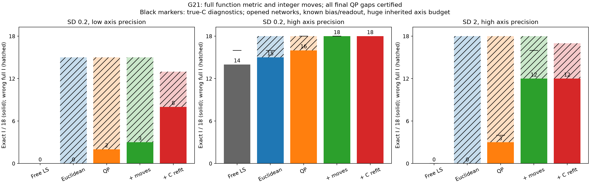
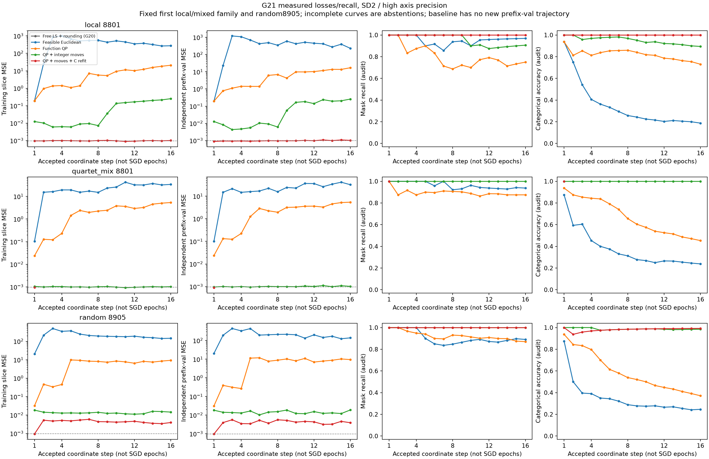
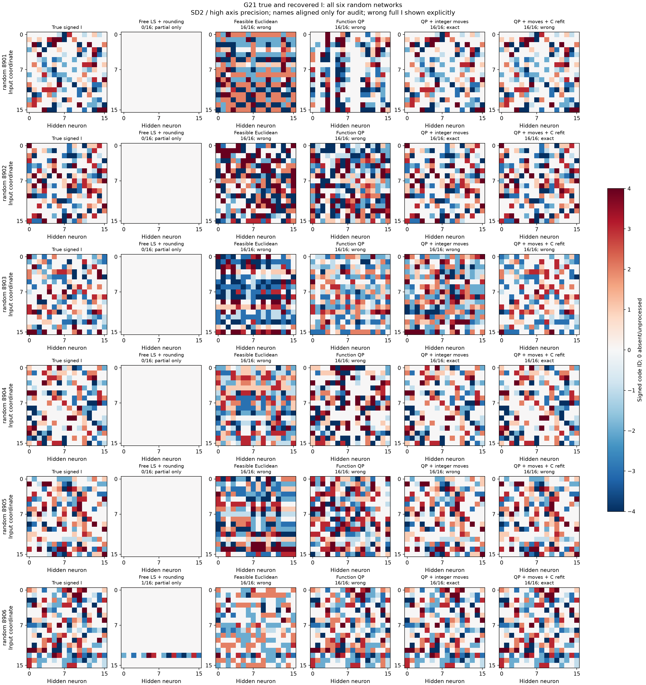
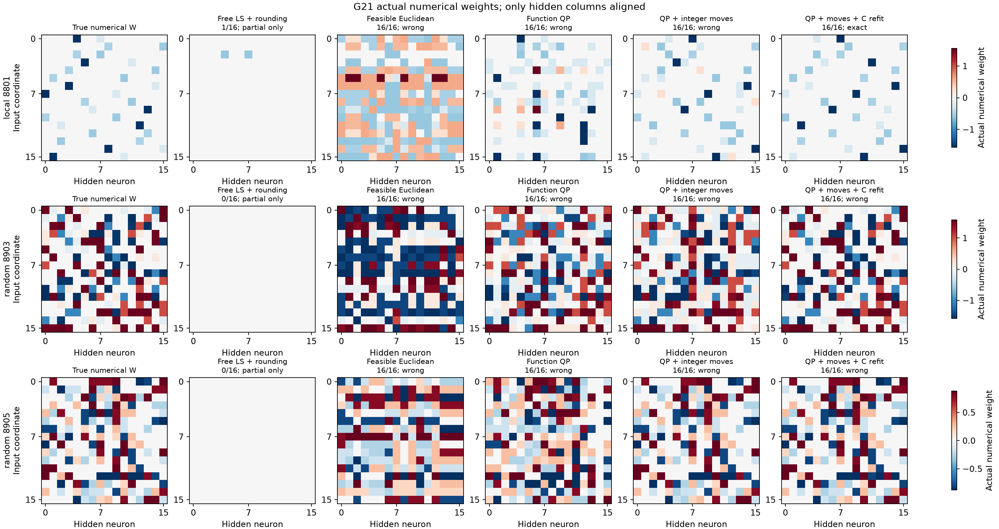
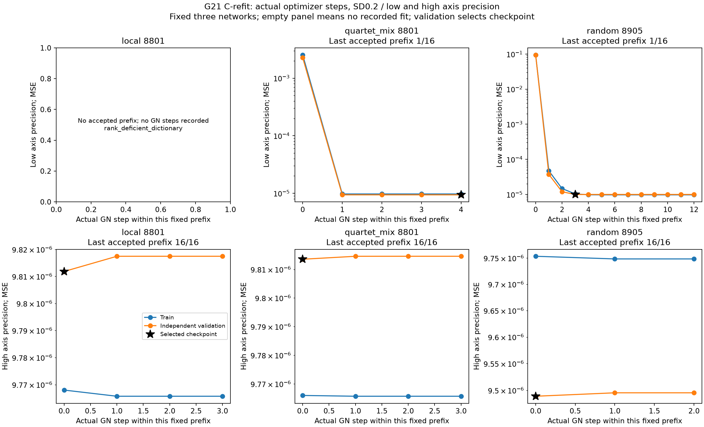

# G21: допустимые counts по полной ошибке функции

5 ноября 2026. **Полная метрика функции и целочисленные ходы исправляют значительную часть LS-rounding failure. При SD0.2/highaxis точный I:14/18 у frozen G20 freeLS,15/18 у Euclidean,16/18 у QP,18/18 у QP+integer. При SD2/highaxis:0,0,3,12 из18. Это отдельный парный алгоритмический эффект при одинаковых C и slices; конкурентное превосходство нового метода не установлено.**

## Почему проверен этот критерий

G19/G20 отделили неверный C от неустойчивого unrestricted LS количеств. THEORY.md §28 записан до fit: при фиксированных C/префиксах count→function линейно, L(n)=||Fn−y0||²/(2N). Полная G=FᵀF/N связывает разные продолжения, а gᵀd+.5dᵀGd даёт точное изменение loss. Это известная task-metric integer LS, а не новая общая формула или доказанная новизна. Возможное отличие — функциональная prefix-факторизация без исходной плотной W; её приоритет ещё требует проверки.

Euclidean вариант точно проектирует LS-counts в целый simplex каждого родителя. QP сначала минимизирует continuous task-loss с nonnegativity/capacity, затем использует ту же integer проекцию. Integer moves переносят одну единицу внутри родителя по точному task-loss с полным cross-gradient. Это лишь локальный integer optimum. C-refit фиксирует уже hard-prefix и уточняет4числа по предыдущим training slices; independent prefix-validation выбирает numerical checkpoint. C не сортируется относительно принятых labels.

## Полная таблица: точный I и ошибочные выдачи

|SD|Coarse-equivalent axis budget|Метод|Точный I|Неверный полный I|Нет полного I|Median max C error|
|---:|---:|---|---:|---:|---:|---:|
|0.0|4096|free_ls|18/18|0|0|2.40e-14|
|0.0|4096|euclidean|18/18|0|0|2.40e-14|
|0.0|4096|qp|18/18|0|0|2.40e-14|
|0.0|4096|qp_integer|18/18|0|0|2.40e-14|
|0.0|4096|qp_integer_refit|18/18|0|0|0.00e+00|
|0.2|4096|free_ls|0/18|0|18|1.92e-02|
|0.2|4096|euclidean|0/18|15|3|1.92e-02|
|0.2|4096|qp|2/18|13|3|1.92e-02|
|0.2|4096|qp_integer|3/18|12|3|1.92e-02|
|0.2|4096|qp_integer_refit|8/18|5|5|9.02e-03|
|0.2|16777216|free_ls|14/18|0|4|2.64e-04|
|0.2|16777216|euclidean|15/18|3|0|2.64e-04|
|0.2|16777216|qp|16/18|2|0|2.64e-04|
|0.2|16777216|qp_integer|18/18|0|0|2.64e-04|
|0.2|16777216|qp_integer_refit|18/18|0|0|8.22e-06|
|2.0|4096|free_ls|0/18|0|18|4.49e-01|
|2.0|4096|euclidean|0/18|15|3|4.49e-01|
|2.0|4096|qp|0/18|12|6|4.49e-01|
|2.0|4096|qp_integer|0/18|15|3|4.49e-01|
|2.0|4096|qp_integer_refit|0/18|9|9|4.06e-01|
|2.0|16777216|free_ls|0/18|0|18|2.64e-03|
|2.0|16777216|euclidean|0/18|18|0|2.64e-03|
|2.0|16777216|qp|3/18|15|0|2.64e-03|
|2.0|16777216|qp_integer|12/18|6|0|2.64e-03|
|2.0|16777216|qp_integer_refit|12/18|5|1|1.09e-04|

Все regimes сохранены; HPO/выбор метода/бюджета по teacher не делали. Полный выход не является сертификатом правильности: при SD2/low все выданные полные I неверны. В отличие от прежнего отказа freeLS, feasible projection может уверенно закончить ошибочную структуру. Это не скрыто и не считается успехом.

## Численный контроль до teacher

Все18исходныхjobs/360состояний заморожены. Первичный SLSQP часто сообщал success при FWgap выше неизменного1e−8:121остановка. До teacher-аудита THEORY §28.6 зарегистрировал продолжение только этих состояний с feasible active-set QP. Оно дало67полных выходов,2rank failure и52QP failure. THEORY §28.7 до второго продолжения исправил проверку стационарности на грани: reduced gradient вместо чрезвычайно малого шага при condition1e8–1e9. Все52достигли прежнего полного FWgap/feasibility и завершили prefix loop. Это стандартная численная поправка, не новый структурный механизм. Принятые предыдущие I/C/history не пересчитывались; raw root/child/grandchild snapshots и freezes сохранены. Полные структуры открыты только после всех source-freezes.

|Состояние cohort|Полных I|Точных I|Неверных полных|QP failures|Rank failures|
|---|---:|---:|---:|---:|---:|
|initial|205|97|108|121|34|
|numeric_continuation|272|141|131|52|36|
|numeric_continuation/face_stationarity|324|179|145|0|36|

Первичные незавершённые QP нельзя выдавать за качество optimum. У итоговых принятых QP проверены прежние absolute FWgap≤1e−8 и primal≤1e−7. Эти numerical certificates относятся к continuous QP, а не к истинному I или global integer optimum. Время каждой numerical continuation и прежнего fit сохранено; больше вычислений раскрыто.

## Факторный oracle: истинный C, те же noisy slices

Только после wholefreeze, один раз наjob/noise, без повторов по axis precision и без C-refit. Frozen G19 known-C freeLS прочитан, не перезапущен.

|SD|Count decoder, true-C diagnosis|Точный I|Неверный полный I|
|---:|---|---:|---:|
|0.2|free_ls|16/18|0|
|0.2|euclidean|16/18|2|
|0.2|qp|18/18|0|
|0.2|qp_integer|18/18|0|
|2.0|free_ls|0/18|0|
|2.0|euclidean|0/18|18|
|2.0|qp|4/18|14|
|2.0|qp_integer|16/18|2|

При SD2 trueC/Euclidean даёт0/18, QP4/18, integer16/18 против0/18 у старого freeLS. Следовательно mismatch метрики — реальная причина, которую не исправляет одно знание C. Остаток16/18 против18/18 требует диагностики локальной дискретной оптимизации/различимости. Разница primary12/18 и oracle16/18 показывает сохраняющийся вклад ошибки C, но это не разложение независимых причин: prefix пути различаются. C-refit особенно полезен при SD0.2/low (3/18→8/18), а при SD2/high не увеличивает12/18. Не объявлять любое уточнение C универсально полезным.

## Измеренный остаточный сбой integer decoder

THEORY §28.8 до диагностического расчёта зафиксировал сравнение уже сохранённых ошибочных known-C структур, без нового fit и без правокI. В обоих случаях выбранные counts проигрывают teacher по observed и independent-validation loss, хотя ни один допустимый одиночный перенос не улучшает их. Это локальный integer барьер, не недостаточность teacher-C или доказанное noise misranking.

|Сеть|Первый неверный numeric prefix|Observed halfMSE found−true|Validation MSE found−true|Лучший одиночный ход: изменение halfMSE|
|---|---:|---:|---:|---:|
|8803 mixed|2|2.67e-04|5.23e-04|4.61e-03|
|8806 mixed|15|1.15e-04|2.56e-04|1.05e-05|

У mixed8803 переход прямо к teacher требует4одноединичных переносов, у mixed8806 —2; это не доказательство минимального радиуса выхода из локальной ловушки. Максимальная ошибка тождества direct difference = gᵀd+.5dᵀGd равна7.97e-15. Полная квадратичная метрика рассчитана правильно; следующий проверяемый механизм — согласованные дискретные ходы/более сильный integer solve, с новой проспективной абляцией, а не подстановка teacher. Диагноз не меняет первичные16/18/12/18. Артефакт failure_diagnosis.json, код count_failure_diagnosis.py.

## Данные, затраты и ограничения

18ранее открытых G19/G20 underlying I/C:6local,6quartet_mix,6random. D=H16,K4, known commonb=.15, readout1/sqrt(H),offset0, одна функция наI. Initial C всегда G20 continuous_dp_start/grid1025 с обоими сохранёнными precision. Все G19 slice means/order совпали по hash/массивам; noisy r4096. Новых axis наблюдений нет. На каждый16prefix добавлены512independent validation points, noisy r4096:33,554,432labels. Baseline frozen и не использует их для ретроспективногоHPO; его старые slices/C и результаты прочитаны. Таблица ниже считает весь доступный inherited axis+slice+новый prefix-validation panel; отдельный8192IIDvalidation показан лишь как report, не selection.

|SD|Axis budget|Все доступные source labels, включая prefix-validation|
|---:|---:|---:|
|0.0|4096|106,528|
|0.2|4096|234,979,360|
|0.2|16777216|275,582,549,920|
|2.0|4096|234,979,360|
|2.0|16777216|275,582,549,920|

Высокий режим по-прежнему около275.58миллиардаlabels/условие, низкий около234.98миллиона. Gaussian r-label means симулируются точно без материализацииrnoise, но статистическая стоимость считается полностью. Это не доказательство эффективности или победы над native LC/Yeh/LUT-Q. Все6свободныхV1000/1/2/3/6/7 использованы, чужие4/5не затрагивались; все fit/audit/oracle workers terminal. Software tests не писали/не запускали; только необходимая provenance/math проверка, Ruff и просмотр фигур.

## Фигуры и воспроизводимость

Loss/recall по реальным обработанным координатам, а не выдуманным SGD эпохам. GN-рисунок использует сохранённые фактические train/validation точки на одном фиксированном prefix. I можно переназвать для аудита; numerical W рассчитана из исходных I/C, выровнены только hidden columns. Неполная W не объявлена полной моделью.

Код count_projection.py/count_metric.py/count_qp_active.py/count_numeric_continuation.py, отдельный count_metric_report.py. Исторические executed_code_snapshot, protocol.json, theory_at_registration.md и models_frozen.json у каждого numerical stage сохраняют фактически выполненные версии. comparison.csv/oracle_comparison.csv/summary.json и oracle_artifact_hashes.json содержат машинные результаты и provenance.

Большая цель остаётся активна: нужны commonI разных source-C, новые независимые геометрии, свободныеbias/readout, misspecifiednoise, strong matched-query native конкуренты, перенос толькоI со свежимиC и аудит приоритета. Из QP/локального integer search не следует автоматически новая general structure-learning работа.
