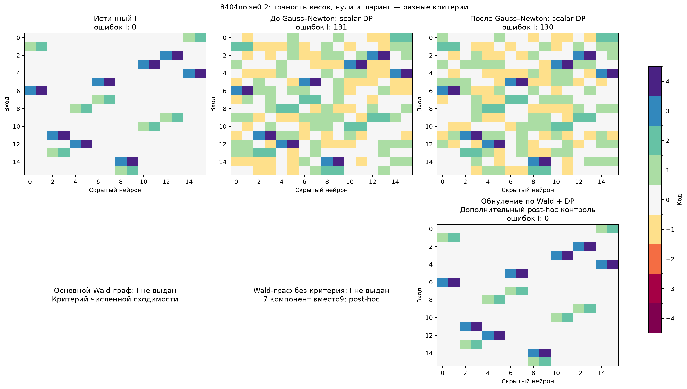

# G9: полная кривизна и статистические отношения весов

Это exploratory-диагностика на тех же четырёх свежих coefficient-функциях G8. Все G8 source/readout/validation наблюдения восстановлены побитово и проверены по сохранённому hash; новых labels нет. Положительный amplitude поглощён в U и общий beta. Для фиксированных ReLU-gates модель линейна по258 параметрам, поэтому внутри области Hessian точно2JᵀJ/n. Gauss–Newton с line-search уменьшает настоящую source-loss, не surrogate-норму весов. До запуска THEORY.md§16 описывает параметры, локальную идентифицируемость, ограничения NLS-Wald и контроли.

**Численный результат:** noiseless cold-start после полной кривизны даёт4/4 точных I, как и все moment-starts. Это устраняет предыдущее0/4 cold-Adam и показывает, что сильный numerical-контроль обязателен. В noisy случаях scalar-DP после Gauss–Newton всё ещё ошибается: каждый warm-вариант2/4, cold0/4. Более точное численное решение не гарантирует правильной квантованной структуры; оно может лучше подогнать шум нулей.

Основной nonlinear Wald-граф включает полный nuisance-profile covariance и заранее заданный критерий numerical-stationarity. На noisy данных этот критерий не выполнен ни в одном из16 fit-view: squared standardized decrement примерно0.017–5.20, вместо требуемого<=0.0001. Следовательно **основной метод воздержался во всех16 случаях**. Нельзя после просмотра результатов молча ослабить критерий и объявить подтверждённый успех.

Nonlinear Wald интерпретируется только локально/асимптотически, при consistency и nonsingular Fisher; прежняя exact finite-sample linear F-гарантия здесь не действует. В noiseless-данных float32 rounding учтён observation-scaled variance-floor; это numerical safeguard, а не Gaussian-coverage theorem. Alpha0.05 делится между8 views одной семьи и E² заранее заданными отношениями; не по всему benchmark из нескольких семейств/вариантов.

## Зарегистрированные результаты

|noise|Начальный numerical fit|Декодер|Exact I /4|Выдано /4|
|---:|---|---|---:|---:|
|0.0|Случайный старт|Scalar DP|4/4|4/4|
|0.0|Случайный старт|Wald: диагональная covariance|4/4|4/4|
|0.0|Случайный старт|Wald: полная covariance|4/4|4/4|
|0.0|Случайный старт|Обнуление по Wald + DP|4/4|4/4|
|0.0|Моменты:1.074млрд labels|Scalar DP|4/4|4/4|
|0.0|Моменты:1.074млрд labels|Wald: диагональная covariance|4/4|4/4|
|0.0|Моменты:1.074млрд labels|Wald: полная covariance|4/4|4/4|
|0.0|Моменты:1.074млрд labels|Обнуление по Wald + DP|4/4|4/4|
|0.0|Моменты:134.22млн labels|Scalar DP|4/4|4/4|
|0.0|Моменты:134.22млн labels|Wald: диагональная covariance|4/4|4/4|
|0.0|Моменты:134.22млн labels|Wald: полная covariance|4/4|4/4|
|0.0|Моменты:134.22млн labels|Обнуление по Wald + DP|4/4|4/4|
|0.0|Моменты:16.78млн labels|Scalar DP|4/4|4/4|
|0.0|Моменты:16.78млн labels|Wald: диагональная covariance|4/4|4/4|
|0.0|Моменты:16.78млн labels|Wald: полная covariance|4/4|4/4|
|0.0|Моменты:16.78млн labels|Обнуление по Wald + DP|4/4|4/4|
|0.2|Случайный старт|Scalar DP|0/4|4/4|
|0.2|Случайный старт|Wald: диагональная covariance|0/4|0/4|
|0.2|Случайный старт|Wald: полная covariance|0/4|0/4|
|0.2|Случайный старт|Обнуление по Wald + DP|0/4|0/4|
|0.2|Моменты:1.074млрд labels|Scalar DP|2/4|4/4|
|0.2|Моменты:1.074млрд labels|Wald: диагональная covariance|0/4|0/4|
|0.2|Моменты:1.074млрд labels|Wald: полная covariance|0/4|0/4|
|0.2|Моменты:1.074млрд labels|Обнуление по Wald + DP|0/4|0/4|
|0.2|Моменты:134.22млн labels|Scalar DP|2/4|4/4|
|0.2|Моменты:134.22млн labels|Wald: диагональная covariance|0/4|0/4|
|0.2|Моменты:134.22млн labels|Wald: полная covariance|0/4|0/4|
|0.2|Моменты:134.22млн labels|Обнуление по Wald + DP|0/4|0/4|
|0.2|Моменты:16.78млн labels|Scalar DP|2/4|4/4|
|0.2|Моменты:16.78млн labels|Wald: диагональная covariance|0/4|0/4|
|0.2|Моменты:16.78млн labels|Wald: полная covariance|0/4|0/4|
|0.2|Моменты:16.78млн labels|Обнуление по Wald + DP|0/4|0/4|

## Диагностика сходимости и роли нулей

Отдельный **post-hoc** контроль применяет те же декодеры к тем же frozen оценкам, отключив numerical-stationarity критерий. Новое обучение и подбор alpha не выполнялись. Это диагноз причины воздержания, **не результат зарегистрированной процедуры и не доказанная confidence-выдача**.

|Инициализация|Декодер, без критерия сходимости|Exact I /4|Выдано /4|
|---|---|---:|---:|
|Случайный старт|Wald: диагональная covariance|0/4|0/4|
|Случайный старт|Wald: полная covariance|0/4|0/4|
|Случайный старт|Обнуление по Wald + DP|2/4|4/4|
|Моменты:1.074млрд labels|Wald: диагональная covariance|2/4|2/4|
|Моменты:1.074млрд labels|Wald: полная covariance|2/4|2/4|
|Моменты:1.074млрд labels|Обнуление по Wald + DP|4/4|4/4|
|Моменты:134.22млн labels|Wald: диагональная covariance|2/4|2/4|
|Моменты:134.22млн labels|Wald: полная covariance|2/4|2/4|
|Моменты:134.22млн labels|Обнуление по Wald + DP|4/4|4/4|
|Моменты:16.78млн labels|Wald: диагональная covariance|2/4|2/4|
|Моменты:16.78млн labels|Wald: полная covariance|2/4|2/4|
|Моменты:16.78млн labels|Обнуление по Wald + DP|4/4|4/4|

Даже после отключения этого условия full-Wald и diagonal-Wald совпадают: из moment-start2/4 точных I, в двух других случаях5/7 компонент вместо9. Следовательно один строгий numerical-критерий не объясняет весь неуспех. В то же время простое обнуление statistically-nonsignificant весов и повторный scalar-DP даёт4/4 из каждого moment-start, cold2/4. Успех этого известного двухэтапного контроля показывает, что для данных ошибок достаточно убрать шум нулей; отдельная польза полной covariance для группирования здесь не продемонстрирована.

В8404 noisy средний moment-start до GN имел131 ошибку, после GN обычный DP130, а zero-cleanup+DP0. Это не скрытая новая teacher-маска: нули определяются по наблюдаемой variance, но процедура является явным mask-then-quantization контролем. Предпочитаемая пользователем прямая схема пока не подтвердила здесь преимущество.

## Следующий обоснованный вопрос

В noisy ReLU-loss Newton-обновления меняют gates возле отдельных наблюдений; source-loss почти не меняется, а точный smooth-score критерий продолжает колебаться. Следующий кандидат — независимая linearization/one-step оценка с отдельным анализом её Taylor-bias и covariance, либо pooled-сравнение групп вместо требования разделить все отдельные пары. Эти варианты ещё не реализованы/проверены в G9. Критично не переносить exact linear-Gaussian guarantee на данные с ненулевым nonlinear remainder.

Никакой новой победы над Yeh/LC/LUT-Q или опубликованной новизны этот отчёт не заявляет. Нужны новое matched-data confirmation, сильные native numerical controls, перенос только I со свежими C и дополнительный литературный аудит. Полная история исследования сохранена в основном REPORT.md.
