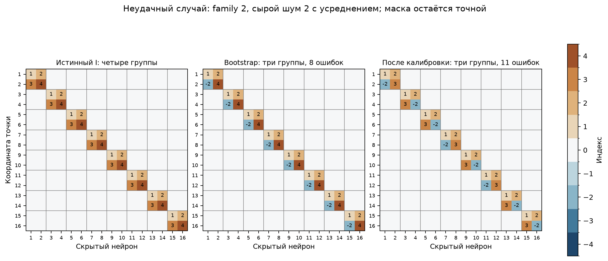
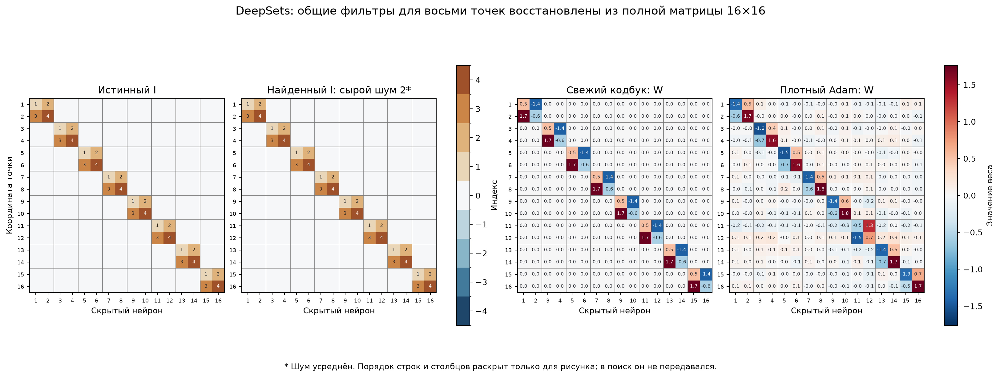
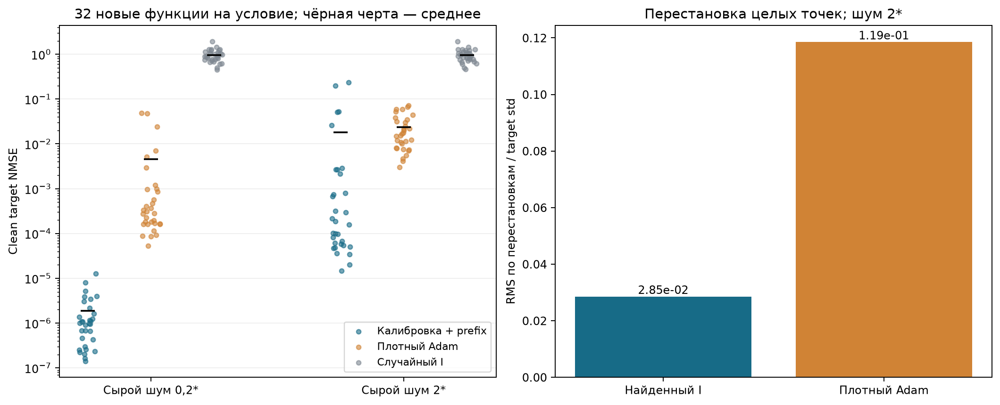
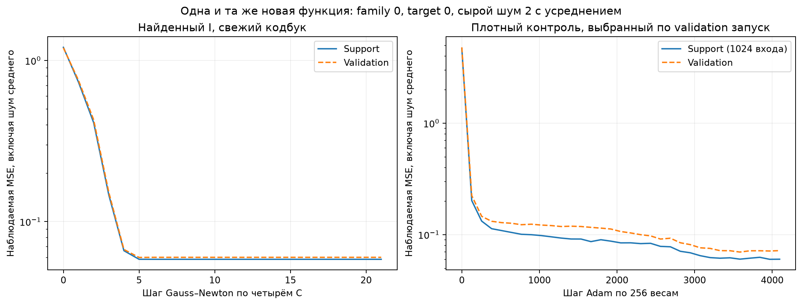

# DeepSets: прямое восстановление индексатора и новые кодбуки

Эксперимент G27. Проверяется прежний синтетический DeepSets: восемь двумерных точек, общий блок 2→2 с ReLU, суммирование по точкам и двум фильтрам. Learner видит плоские 16 координат с неизвестной перестановкой; поиск идёт по полной матрице 16×16. Пары координат, общие фильтры и число активных связей не подаются в алгоритм.

## Модель и определения

В каждом из четырёх случаев скрыты новая перестановка входных координат и порядок скрытых нейронов. Внутри точки четыре произвольных коэффициента задают два ReLU-фильтра. Один общий индексатор используется с разными кодбуками.

$$
\begin{aligned}
\varphi_c(u,v)&=[b+c_1u+c_3v]_+ + [b+c_2u+c_4v]_+,\\
f_c(X)&=\frac1{\sqrt{16}}\sum_{i=1}^{8}\varphi_c(u_i,v_i)+d_c,\\
W_{dh}&=\operatorname{sgn}(I_{dh})c_{|I_{dh}|},\qquad I_{dh}\in\{0,\pm1,\ldots,\pm4\}.
\end{aligned}
$$

b=0.15 и readout известны, как в выбранном prefix-методе. Четыре C свободны по знаку; удвоенный словарь содержит девять значений с нулём. Выход центрируется в соответствии с прежней задачей, но неизвестный d не раскрывается из teacher: он оценивается по независимому наблюдению f(0)−sqrt(H)b. Этот наблюдаемый сдвиг одинаково используется всеми методами.

## Поиск и разделение информации

На геометрию есть четыре source-функции: прежний кодбук [0.8,−1.1,1.3,0.45] и три новых Gaussian-кодбука. Все численные значения, истинный I и роли координат скрыты от поиска. Доступны только вещественные выходы в выбранных точках; teacher-градиенты и активации не используются.

Алгоритм прежний: осевой fit численного словаря → достраивание мультимножества префиксов с целыми количествами продолжений по полной функциональной MSE → банк кандидатов → свежий fit четырёх C для каждого I → предварительный общий I → калибровка C → повторные prefix-поиски с пустых префиксов при фиксированных C → независимый meta-выбор. Обучающие labels и meta-labels разделены; все предсказатели фиксируются до meta, все I — до структурного аудита. Решатели QP/counts и гиперпараметры взяты из G25. Добавлена наблюдаемая калибровка output-offset.

Здесь сохранена исходная combined axis+prefix training loss при калибровке C. В отличие от G26 не используется сокращённая Gaussian-only калибровка. Основной метод — single/fixed; первичный bootstrap — отдельный контроль. Истинные I и схема point-pooling не используются для отбора. Данные для разных уровней шума спарены.

| Метод | Точный I, без шума | Точный I, сырой σ=0.2* | Точный I, сырой σ=2* |
|---|---:|---:|---:|
| Первичный prefix | 4/4 | 4/4 | 3/4 |
| Калибровка + prefix | 4/4 | 4/4 | 3/4 |

Исходных prefix-траекторий завершено 184/192, повторных 46/48. Все следы и отказы сохранены. Точный I означает совпадение нулей, групп и согласованных знаков с учётом только глобального переименования/переворота групп и перестановки скрытых нейронов; перестановка входов в структурном аудите запрещена.

## Новые функции и плотный контроль

После фиксации всех source-I созданы восемь новых Gaussian-кодбуков для каждой из четырёх геометрий: всего 32 новые функции, одинаковые в трёх условиях шума. Переносится только I. Все C и состояния оптимизатора инициализируются заново; 32 знаковых старта и до 24 шагов Gauss–Newton, выбор старта/checkpoint по validation. Support4096/validation1024, test8192. Совпадающие канонические I переиспользуют один одинаковый численный fit, включая oracle-контроль; численные значения между разными функциями не переносятся.

Плотный контроль обучает 256 независимых весов при тех же известных b/readout и том же наблюдаемом output-offset. Используется настоящий torch.optim.Adam: два заранее заданных LR0.003/0.01 ×16 инициализаций,4096шагов,batch256; validation выбирает запуск/checkpoint. Все 24 target-предсказателя одной геометрии обучаются пакетом. Все четыре геометрии фиксируют модели до открытия любого clean-test. Кластеризации плотных W нет; у этого контроля нет категориального I для оценки exact-sharing.

| Сырой σ* | Метод | Оценено функций | Mean clean MSE | Mean clean NMSE | Worst NMSE | Mean permutation RMS / std |
|---|---|---:|---:|---:|---:|---:|
| 0 | Первичный prefix | 32/32 | 1.62782e-31 | 1.71461e-31 | 2.99178e-31 | 6.59e-16 |
| 0 | Калибровка + prefix | 32/32 | 1.62782e-31 | 1.71461e-31 | 2.99178e-31 | 6.59e-16 |
| 0 | Истинный I | 32/32 | 1.62782e-31 | 1.71461e-31 | 2.99178e-31 | 6.59e-16 |
| 0 | Плотный Adam | 32/32 | 0.00523724 | 0.00300114 | 0.0442273 | 0.0197 |
| 0 | Случайный I | 32/32 | 1.02826 | 0.957844 | 1.94023 | 0.666 |
| 0.2 | Первичный prefix | 32/32 | 1.09442e-06 | 1.86103e-06 | 1.26274e-05 | 6.74e-16 |
| 0.2 | Калибровка + prefix | 32/32 | 1.09442e-06 | 1.86103e-06 | 1.26274e-05 | 6.74e-16 |
| 0.2 | Истинный I | 32/32 | 1.09442e-06 | 1.86103e-06 | 1.26274e-05 | 6.74e-16 |
| 0.2 | Плотный Adam | 32/32 | 0.00663932 | 0.00452329 | 0.0484817 | 0.0331 |
| 0.2 | Случайный I | 32/32 | 1.02845 | 0.958077 | 1.94099 | 0.666 |
| 2 | Первичный prefix | 32/32 | 0.0241849 | 0.0274588 | 0.345713 | 6.67e-16 |
| 2 | Калибровка + prefix | 32/32 | 0.0146136 | 0.0180906 | 0.235161 | 0.0285 |
| 2 | Истинный I | 32/32 | 0.00013691 | 0.000249263 | 0.00266425 | 6.74e-16 |
| 2 | Плотный Adam | 32/32 | 0.0187847 | 0.0235541 | 0.0715726 | 0.119 |
| 2 | Случайный I | 32/32 | 1.02943 | 0.959674 | 1.93621 | 0.667 |

NMSE делит MSE каждой функции на дисперсию её clean-test ответов, затем усредняется. В таблице 32 функции на условие; это не 96 независимых новых кодбуков. Стоимость поиска I дополнительная, поэтому таблица не является сравнением равных общих бюджетов. Четыре оптимизируемых C сравниваются с 256 весами после одинаковой калибровки d. Свободный поиск неизвестных b/readout здесь не проверяется.

GN использует float64, плотный Adam — float32. Без шума значения около машинной точности не следует интерпретировать как практический выигрыш на десятки порядков. При сильном шуме средняя NMSE основного метода меньше dense-контроля, но worst-case NMSE хуже: ошибки одной структуры затрагивают восемь новых функций. Равномерного превосходства по всем новым задачам нет.

## Диагностика неудачного случая

При сыром шуме2 в family2 бинарная маска по-прежнему точна,32связи. Bootstrap объединил роли в три группы вместо четырёх:8/256ошибок; после калибровки выбраны три группы и11/256ошибок. Правильного I нет ни в исходном, ни в итоговом банке, поэтому это не ошибка выбора среди банка с правильным решением.

На первой source-функции истинные модули кодов0.45/0.8/1.1/1.3 оценены как0.44846/0.82172/1.20721/16. Последний слот у границы не восстанавливает отдельный настоящий код. Остальные три source-оценки также неточны. Ошибка нулевого якоря source0 составляет−0.00020456 и создаёт общий сдвиг осевой суммы; его возможный вклад не отделён дополнительной факторной абляцией.

После фиксации основного эксперимента зарегистрирован один диагностический oracle-контроль: тот же noisy source0, тот же наблюдаемый output-offset, те же prefix-панели и unit/QP-решатель, но истинные численные C. Он дал точный I,0/256ошибок. Этот контроль не включён в primary, не заменяет ошибочный выбранный I и не использует target-test для изменения метода. Он локализует данный сбой в оценке/калибровке словаря: count-поиск с правильными числами на тех же данных справляется. Артефакты: failure_diagnostic_registration.json/failure_diagnosis.json/failure_oracle_C_control.npz.

Ошибочный bootstrap остаётся инвариантным к перестановке точек, поскольку повторяет один и тот же неправильный локальный блок. Поэтому одна инвариантность не подтверждает правильность всех групп шэринга. После повторного поиска часть назначений различается между точками; инвариантность тоже нарушается.

## Инвариантность и рисунки

Для каждой новой функции используются 64 новых набора точек и 16 перестановок целых точек на набор. Измеряется RMS отклонения предсказаний от их среднего по перестановкам, нормированный на target std. Это новые входы после фиксации моделей. Переставляются истинные целые точки, а не отдельные признаки. Истинное разбиение используется только для этой итоговой диагностики.

Для читаемости рисунка скрытая перестановка входов и столбцов раскрыта только после выбора. В вычислении exact-I входы не переставляются. Численные веса относятся к одной и той же новой target-функции при шуме2; плотные веса показаны непосредственно. Все значения и порядки отображения сохранены в figures/heatmap_values.npz.

## Шум, стоимость и ограничения

*Шум сырого ответа Gaussianσ0.2/2 усредняется. Axis R=4,194,304, prefix R=4,096, fit/meta и target R=64. Нулевой source-якорь использует2D×Raxis, чтобы его вклад в дисперсию осевой суммы был сопоставим с шумом самих осевых запросов. На target R0=Nsupport×Rtarget. Все средние симулируются аналитически; физически миллиарды повторов не выполняются.

Номинальная цена одного шумного source-условия — 275,482,279,936 независимых ответов на функцию; target-адаптация — 589,824. Это сильное ограничение практической применимости текущего результата. Он не означает устойчивость к неусреднённомуσ2 и не устанавливает извлечение из произвольного пассивного датасета.

Результат относится к известному однослойному ReLU-классу с суммированием, фиксированным числом точек и известными общим bias/readout. MNIST/FashionMNIST, обучаемый нелинейный rho после pooling и неизвестные индивидуальные bias здесь не запускались. Предыдущие G23–G26 не изменялись.

## Воспроизводимость

Протокол/хеши исходников: protocol.json/code_snapshot. source_frozen.json фиксирует все I до аудита; target/cohort_frozen.json фиксирует всю target-когорту до test/permutation. structure_audit.json, target/evaluation.json и target_metrics.csv содержат отдельные измерения, comparison.csv/summary.json — сводку. Численные fits, исходные наблюдения, точки перестановок и реальные W сохранены. Программные тесты не создавались и не запускались. Карты6/7 не использовались.
