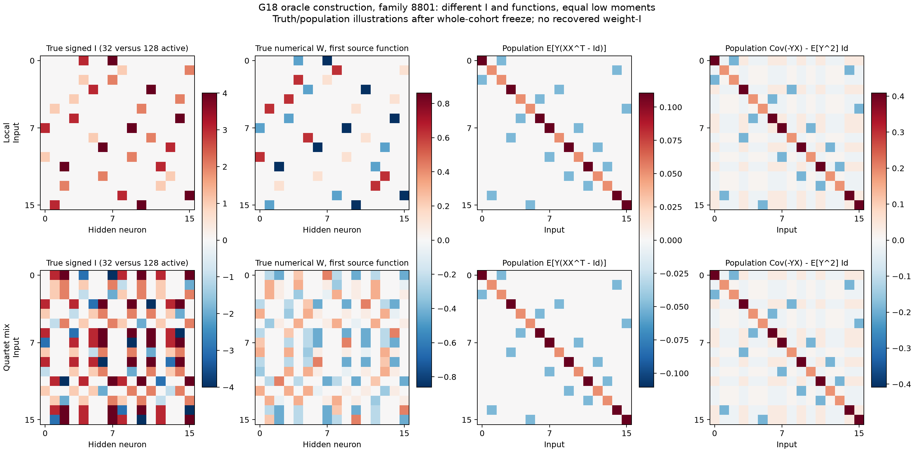
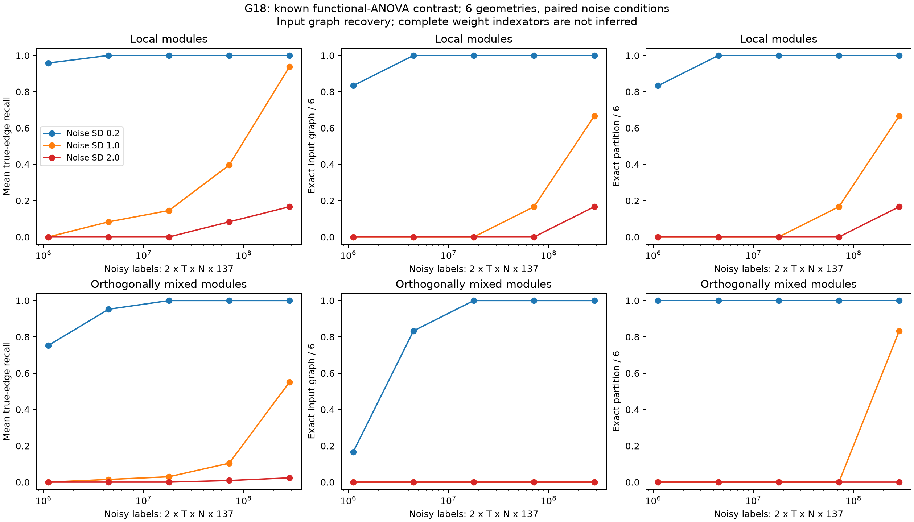
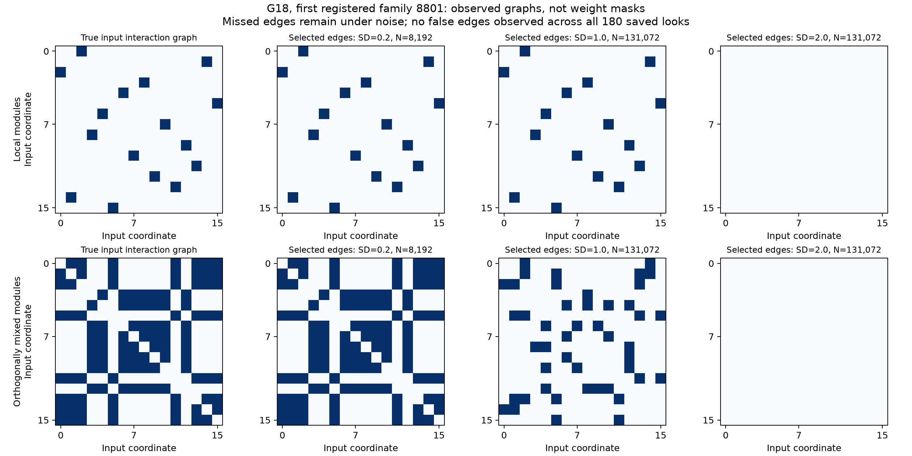

# G18: какие наблюдения различают структуру

5 ноября 2026. **Диагностика завершена; новый полный алгоритм извлечения I не получен.**
После сильного LC/dense-контроля G17 проверяем достаточность статистик до разработки новой схемы. THEORY.md §25 записан до протокола и запусков. Все 12 моделей и их 180 budget/noise-состояний заморожены до oracle-аудита. Код: functional_observability.py, functional_moments.py; протокол, snapshot, freeze и отдельный audit находятся на уровень выше.

## Что установлено

Для двух разных signed-индексаторов с четырьмя обучаемыми кодами существуют **точно одинаковые Gaussian input-моменты степени не выше двух**, включая covariance линейного sample-gradient при нулевой инициализации. Это не недостаток числа примеров: бесконечный объём таких статистик не определяет I в данном классе. Нельзя переносить вывод на произвольные градиенты нелинейной сети, полные данные или higher-order признаки.

Конструкция: 8 повторённых двухмерных модулей, 16 ReLU, common bias 0.15, положительный sum-readout /sqrt(16). Исходный W=Id8 tensor B(C) имеет 32 активных веса. Q4=J4/2-Id4 ортогональна и сохраняет ones; смешивание двух четвёрок даёт W'=VW=WV, 128 активных весов и значения из 0/±C/2. Shape и число кодов совпадают, маски и функции различны. На шести новых перестановках координат и восьми fresh Gaussian source-C общий I внутри каждой сети неизменен.

Обоснование: для любой функции psi совместных source-outputs перестановочная симметрия задаёт E[psi(Y)X]=ones8 tensor v и E[psi(Y)XX^T]=Id8 tensor A+J8 tensor D. V сохраняет оба выражения. В частности, совпадают E[Y], E[YX], E[Y(XX^T-Id)] и E[Y²XX^T]. Больше разных C само по себе эту неоднозначность не устраняет. Это классический symmetry/commutant аргумент; приоритет именно finite-code специализации не установлен.

|Population-величина|Максимальная численная разница двух сетей, 48 source-функций|
|---|---:|
|m0|4.44e-16|
|m1|1.11e-16|
|m2|5.55e-17|
|squared_label_h2|3.77e-10|
|gradient_covariance_minus_output_square_I|3.77e-10|

Label-square формула вычислена детерминированной Gaussian quadrature; остаток до 3.78e-10 — её численная точность, а не измеренная статистическая разница. Теоретическое равенство следует из симметрии. Третий Hermite-момент различается: относительная Frobenius-разница 1.2247 во всех 48 функциях. MSE двух функций на одних и тех же новых Gaussian x составляет 0.0228–0.0505 по геометриям. После известного ортогонального преобразования x максимальная разница 3.55e-15. Эти числа получены oracle-аудитом после freeze, не служили learner-признаками или выбором параметров.

## Дополнительный наблюдаемый сигнал

Использован **известный** mixed functional-ANOVA/Sobol контраст: delta_ij f=f(Xij)-f(Xi)-f(Xj)+f(X), где заменённые координаты берутся из независимого Z. E[delta²]=4 sum_(u contains i,j) V_u. Он равен нулю между аддитивными компонентами, а положительная энергия выявляет взаимодействие. Источники: [Owen 2013](https://arxiv.org/abs/1205.1774), [Borgonovo, Plischke, Rabitti 2022](https://onlinelibrary.wiley.com/doi/10.1111/sjos.12560); [Hooker 2004](https://doi.org/10.1145/1014052.1014122) ранее обнаруживал additive black-box structure. Наша реализация не объявлена неизменённым авторским кодом или новым принципом.

Доступ к active/pick-freeze query — отдельное условие; такие panels нельзя получить из произвольного готового IID банка. Для D16 нужны Q=137 query/base (base+singles+pairs), T8 source-функций и две независимые шумные метки/query. Noise SD 0.2/1/2; все пять зарегистрированных N сохраняются. Входы и unit noise парные между сетями/noise-режимами; это зависимые условия, шесть единиц геометрии, не 36 независимых подтверждений. Learner не знает истинные компоненты, активные позиции, численные C или population-моменты.

Разность двух меток независимо оценивает sigma², средняя используется в контрасте. При delta f=0 статистика F=[sum(delta ybar)²/(2TN)]/sigmahat² имеет точное F(TN,TNQ) распределение при iid homoscedastic Gaussian measurement noise. Alpha 0.05 делится на 120 пар × 5 looks **внутри family/network/noise run**. Гарантия относится только к ложным рёбрам. Она не сертифицирует отсутствие пропусков, компоненты или полный weight-I; общего benchmark-level покрытия не заявляем. Для heteroscedastic/heavy-tail noise эта гарантия не доказана.

## Результат графа входных взаимодействий

|Сеть|Noise SD|N base|Шумных меток|Точный граф|Точное разбиение входов|Mean edge recall|Ложных рёбер, сумма|
|---|---:|---:|---:|---:|---:|---:|---:|
|local|0.2|512|1,122,304|5/6|5/6|95.83%|0|
|local|0.2|2,048|4,489,216|6/6|6/6|100.00%|0|
|local|0.2|8,192|17,956,864|6/6|6/6|100.00%|0|
|local|0.2|32,768|71,827,456|6/6|6/6|100.00%|0|
|local|0.2|131,072|287,309,824|6/6|6/6|100.00%|0|
|local|1.0|512|1,122,304|0/6|0/6|0.00%|0|
|local|1.0|2,048|4,489,216|0/6|0/6|8.33%|0|
|local|1.0|8,192|17,956,864|0/6|0/6|14.58%|0|
|local|1.0|32,768|71,827,456|1/6|1/6|39.58%|0|
|local|1.0|131,072|287,309,824|4/6|4/6|93.75%|0|
|local|2.0|512|1,122,304|0/6|0/6|0.00%|0|
|local|2.0|2,048|4,489,216|0/6|0/6|0.00%|0|
|local|2.0|8,192|17,956,864|0/6|0/6|0.00%|0|
|local|2.0|32,768|71,827,456|0/6|0/6|8.33%|0|
|local|2.0|131,072|287,309,824|1/6|1/6|16.67%|0|
|quartet_mix|0.2|512|1,122,304|1/6|6/6|75.30%|0|
|quartet_mix|0.2|2,048|4,489,216|5/6|6/6|95.24%|0|
|quartet_mix|0.2|8,192|17,956,864|6/6|6/6|100.00%|0|
|quartet_mix|0.2|32,768|71,827,456|6/6|6/6|100.00%|0|
|quartet_mix|0.2|131,072|287,309,824|6/6|6/6|100.00%|0|
|quartet_mix|1.0|512|1,122,304|0/6|0/6|0.00%|0|
|quartet_mix|1.0|2,048|4,489,216|0/6|0/6|1.49%|0|
|quartet_mix|1.0|8,192|17,956,864|0/6|0/6|2.98%|0|
|quartet_mix|1.0|32,768|71,827,456|0/6|0/6|10.42%|0|
|quartet_mix|1.0|131,072|287,309,824|0/6|5/6|55.06%|0|
|quartet_mix|2.0|512|1,122,304|0/6|0/6|0.00%|0|
|quartet_mix|2.0|2,048|4,489,216|0/6|0/6|0.00%|0|
|quartet_mix|2.0|8,192|17,956,864|0/6|0/6|0.00%|0|
|quartet_mix|2.0|32,768|71,827,456|0/6|0/6|0.89%|0|
|quartet_mix|2.0|131,072|287,309,824|0/6|0/6|2.38%|0|

При SD0.2 исходный граф точен 6/6 уже при N2048 (4 489 216 меток), mixed-граф 6/6 при N8192 (17 956 864 метки). При SD1 на максимальном бюджете исходный граф 4/6, mixed 0/6, но его разбиение входов уже 5/6: для связности не нужны все рёбра. При SD2 соответственно 1/6 и 0/6; мощности явно недостаточно. Во всех 180 сохранённых состояниях ложных рёбер не наблюдалось, но это зависимые состояния и не доказательство покрытия вне заявленной модели.

## Стоимость и границы вывода

Каждая строка максимального N131072 стоит 287 309 824 виртуальные noisy labels; raw queries/labels генерировались поточно и не сохранялись. Три noise-режима повторно используют clean responses и unit noise, но стоимость одного режима явно включает обе метки на каждом query. Время и настройки каждого из 12 GPU-job находятся в models/job_*.json; использованы свободные GPU 0,1,2,3,6,7. Чужие 4/5 не затрагивались. Новые software tests не создавались и не запускались; выполнены необходимый математический/provenance аудит, минимальный Ruff и просмотр фигур.

У этого диагноза нет оптимизатора, train/validation loss или обученных численных W. Поэтому показаны настоящие measured graph-recall curves по label budget, а не выдуманная SGD-кривая. На heatmap отдельно подписаны истинные W/I и выбранный **input interaction graph**. Это не найденная маска весов и не полный шэринг. Ни дообучение кодбука, ни перенос на новый C в G18 не выполнялись.

Простой rectangle-F дорог и слаб при большом шуме. Известные bilinear Sobol estimators требуют D+1 query/base; их variance/cost нужно проверить на том же label budget до конкурентной заявки. Также нужны native LC/Yeh/LUT-Q на тех же panels, переход от функциональных взаимодействий к полному I без истинного шаблона, независимые геометрии, misspecified noise и transfer только I. Граф не разрешает автоматически равенства отдельных весов или ориентации нейронов. Возможный functional-I compiler пока гипотеза, не выполненный метод. Общая цель остаётся active; превосходство и новизна не установлены.
