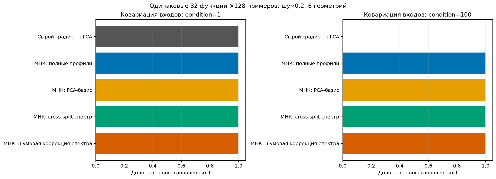
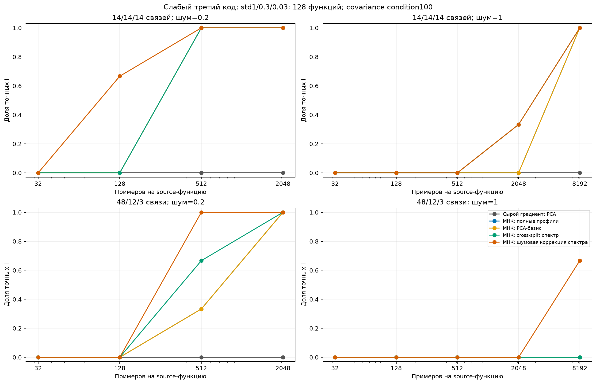
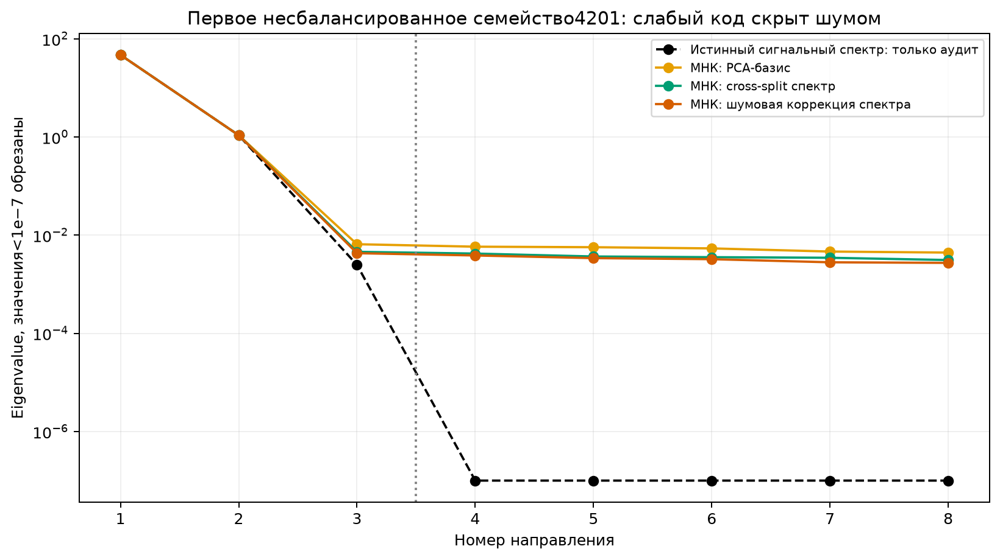
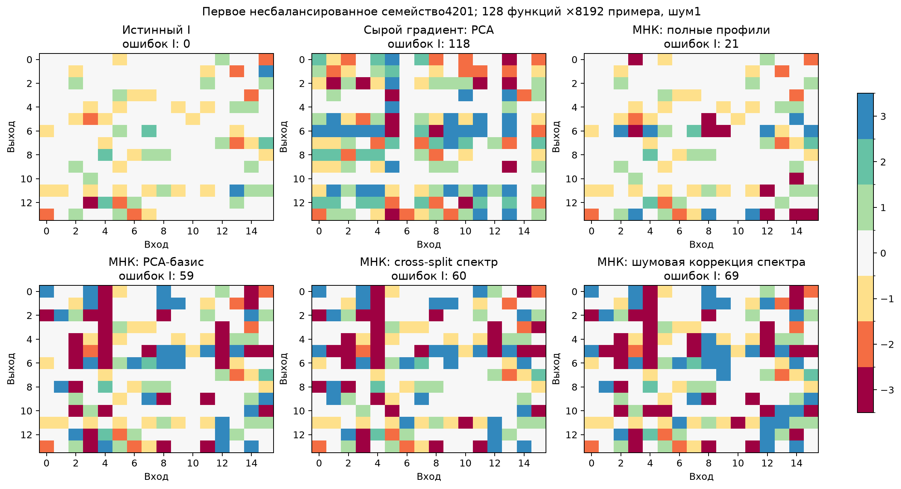
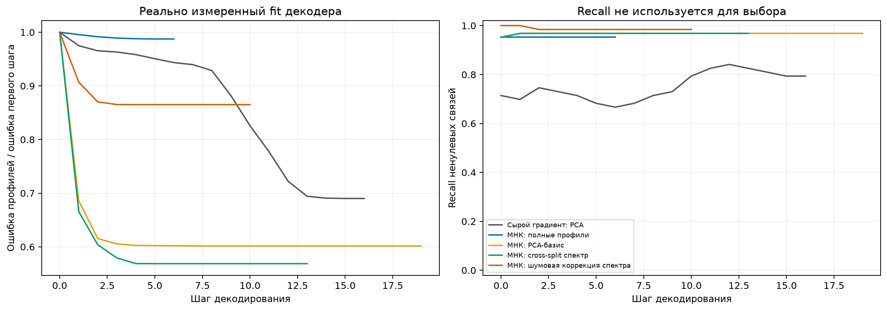

# G1: информация о структуре в градиентах и спектре

Диагностический этап активной исследовательской цели. 876 условий,9 базовых способов извлечения,7884 результата;5 свободных V1000/1/2/3/6. Это не подтверждение нового метода и не сравнение с обученными Yeh/MSR/WSR. Теория записана до запуска в THEORY.md.

Шесть независимых геометрий:3 скрытые переставленные свёртки и3 произвольных знаковых структуры. Последние имеют группы48/12/3; их число связей не передаётся алгоритмам. Известны shape14×16 иK3. Raw-gradient, обычный МНК, PCA, cross-split и шумовая коррекция — контроли, не заявления о новизне. Популяционное предобусловливание получает известную covariance и является отдельной oracle-design диагностикой.

## Основные срезы

| Режим | Метод | Точный I | F1 маски | Ошибка подпространства |
|---|---|---:|---:|---:|
| ordinary | Сырой градиент: профили | 6/6 | 1.000 | 0.179 |
| ordinary | Сырой градиент: PCA | 6/6 | 1.000 | 0.179 |
| ordinary | Известная covariance: профили | 6/6 | 1.000 | 0.179 |
| ordinary | МНК: полные профили | 6/6 | 1.000 | 0.017 |
| ordinary | МНК: PCA-базис | 6/6 | 1.000 | 0.017 |
| ordinary | МНК: PCA с амплитудами | 6/6 | 1.000 | 0.017 |
| ordinary | Градиент: cross-split спектр | 6/6 | 1.000 | 0.179 |
| ordinary | МНК: cross-split спектр | 6/6 | 1.000 | 0.019 |
| ordinary | МНК: шумовая коррекция спектра | 6/6 | 1.000 | 0.017 |
| correlated | Сырой градиент: профили | 0/6 | 0.495 | 0.767 |
| correlated | Сырой градиент: PCA | 0/6 | 0.507 | 0.767 |
| correlated | Известная covariance: профили | 3/6 | 0.896 | 0.448 |
| correlated | МНК: полные профили | 6/6 | 1.000 | 0.040 |
| correlated | МНК: PCA-базис | 6/6 | 1.000 | 0.040 |
| correlated | МНК: PCA с амплитудами | 6/6 | 1.000 | 0.040 |
| correlated | Градиент: cross-split спектр | 0/6 | 0.505 | 0.766 |
| correlated | МНК: cross-split спектр | 6/6 | 1.000 | 0.044 |
| correlated | МНК: шумовая коррекция спектра | 6/6 | 1.000 | 0.040 |
| weak_2048 | Сырой градиент: профили | 0/6 | 0.431 | 0.812 |
| weak_2048 | Сырой градиент: PCA | 0/6 | 0.488 | 0.812 |
| weak_2048 | Известная covariance: профили | 0/6 | 0.631 | 0.581 |
| weak_2048 | МНК: полные профили | 0/6 | 0.838 | 0.508 |
| weak_2048 | МНК: PCA-базис | 0/6 | 0.666 | 0.508 |
| weak_2048 | МНК: PCA с амплитудами | 0/6 | 0.658 | 0.508 |
| weak_2048 | Градиент: cross-split спектр | 0/6 | 0.469 | 0.810 |
| weak_2048 | МНК: cross-split спектр | 1/6 | 0.722 | 0.474 |
| weak_2048 | МНК: шумовая коррекция спектра | 1/6 | 0.790 | 0.447 |
| weak_8192 | Сырой градиент: профили | 0/6 | 0.433 | 0.804 |
| weak_8192 | Сырой градиент: PCA | 0/6 | 0.491 | 0.804 |
| weak_8192 | Известная covariance: профили | 1/6 | 0.769 | 0.551 |
| weak_8192 | МНК: полные профили | 3/6 | 0.962 | 0.340 |
| weak_8192 | МНК: PCA-базис | 3/6 | 0.860 | 0.340 |
| weak_8192 | МНК: PCA с амплитудами | 3/6 | 0.856 | 0.340 |
| weak_8192 | Градиент: cross-split спектр | 0/6 | 0.489 | 0.800 |
| weak_8192 | МНК: cross-split спектр | 3/6 | 0.854 | 0.338 |
| weak_8192 | МНК: шумовая коррекция спектра | 5/6 | 0.942 | 0.302 |
| unidentifiable | Сырой градиент: профили | 0/6 | 0.701 | 0.577 |
| unidentifiable | Сырой градиент: PCA | 0/6 | 0.570 | 0.577 |
| unidentifiable | Известная covariance: профили | 0/6 | 0.701 | 0.577 |
| unidentifiable | МНК: полные профили | 0/6 | 0.998 | 0.574 |
| unidentifiable | МНК: PCA-базис | 0/6 | 0.976 | 0.574 |
| unidentifiable | МНК: PCA с амплитудами | 0/6 | 0.989 | 0.574 |
| unidentifiable | Градиент: cross-split спектр | 0/6 | 0.563 | 0.577 |
| unidentifiable | МНК: cross-split спектр | 0/6 | 0.964 | 0.574 |
| unidentifiable | МНК: шумовая коррекция спектра | 0/6 | 0.977 | 0.577 |

ordinary: condition1, noise0.2,32 функции×128 примеров. correlated отличается только condition100. weak2048/8192: std кодов1/0.3/0.03, noise1,128функций, condition100. unidentifiable: первые два кода равны во всех source-функциях,2048примеров×128функций, без шума.

## Диагноз

1. Сырой градиент содержит ковариацию входов. При condition100 его профили/PCA не восстанавливают ни одной геометрии ordinary-среза, тогда как МНК-варианты дают6/6. Усечение спектра само эту неоднозначность не исправляет.
2. Полные обычные профили являются сильным контролем. При достаточной вариации кодов простая оценка весов уже извлекает I; выдавать это за новый градиентный метод нельзя.
3. Редкая и слабо возбуждённая группа может выпасть изtop-K. В сложном8192-срезе полные МНК-профили/PCA/cross-split дают3/6, шумовая коррекция5/6. Оставшееся семейство4201 имеет cosine слабого направления около0.14 даже после коррекции; это прежде всего ошибка оценивания подпространства, а не только ближайшего центроида.
4. Слепое whitening по найденным eigenvalues усиливает шумовой третий вектор: у4201 профильный декодер делает21ошибку, PCA59, коррекция69. В двух других несбалансированных геометриях коррекция действительно извлекла весь I. Один общий агрегат скрывал бы эту разницу.
5. В collision-контроле ни один способ не восстановил истинный I. Это ожидаемая неидентифицируемость групп, а не доказательство слабости конкретного оптимизатора. Больше наблюдений тех же функций не создадут различия совпадающих кодов.
6. Предобусловленный эмпирический градиент совпал с МНК, а средний градиент в МНК-оптимуме исчез. Численные максимумы сохранены в summary.json. Новое направление должно учитывать эти отрицательные результаты.

## Ограничения и следующий шаг

Данные этого этапа открыты для диагностики и выбора гипотез, поэтому не будут использоваться как независимое подтверждение будущего метода. Новых целевых функций с resetC здесь не оценивали: эта проверка обязательна в следующих этапах. Нет гарантии, что локальныйLloyd найдёт оптимальную дискретную проекцию. Cross-split и noise-debiasing имеют известные статистические аналоги; их самостоятельная новизна не утверждается.

Следующий механизм должен устранять измеренную потерю слабой/редкой группы, а не просто переименовывать PCA или менять градиентный шаг. Перед реализацией нужны теория группового остатка и аудит близких gradient-untying/heteroscedastic-PCA методов.

