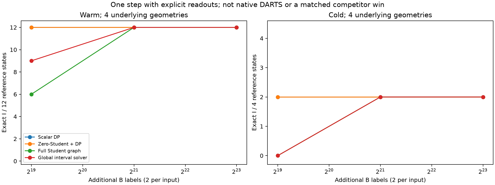
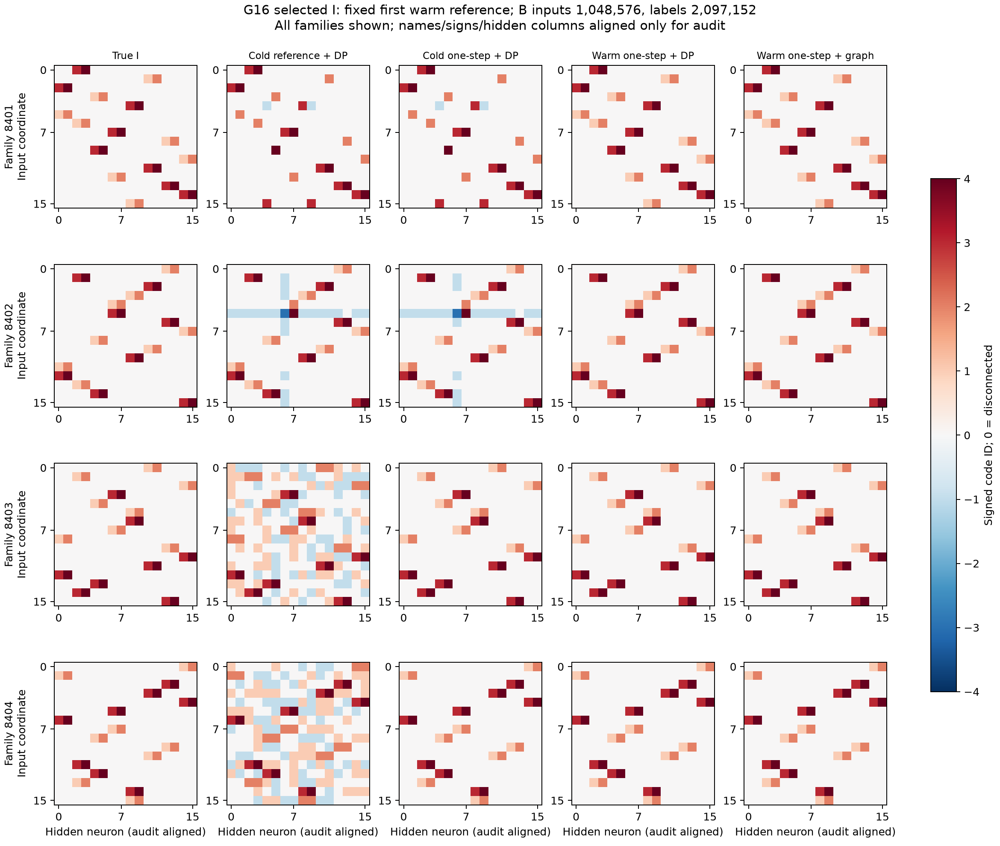
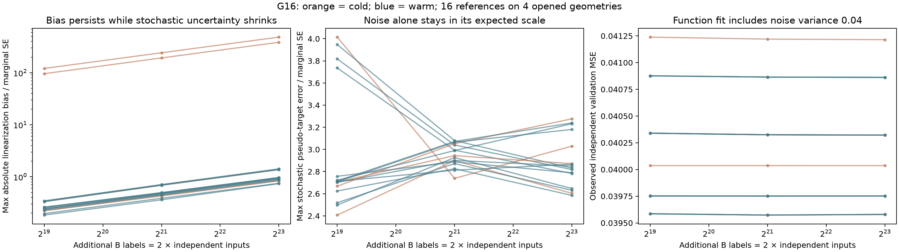
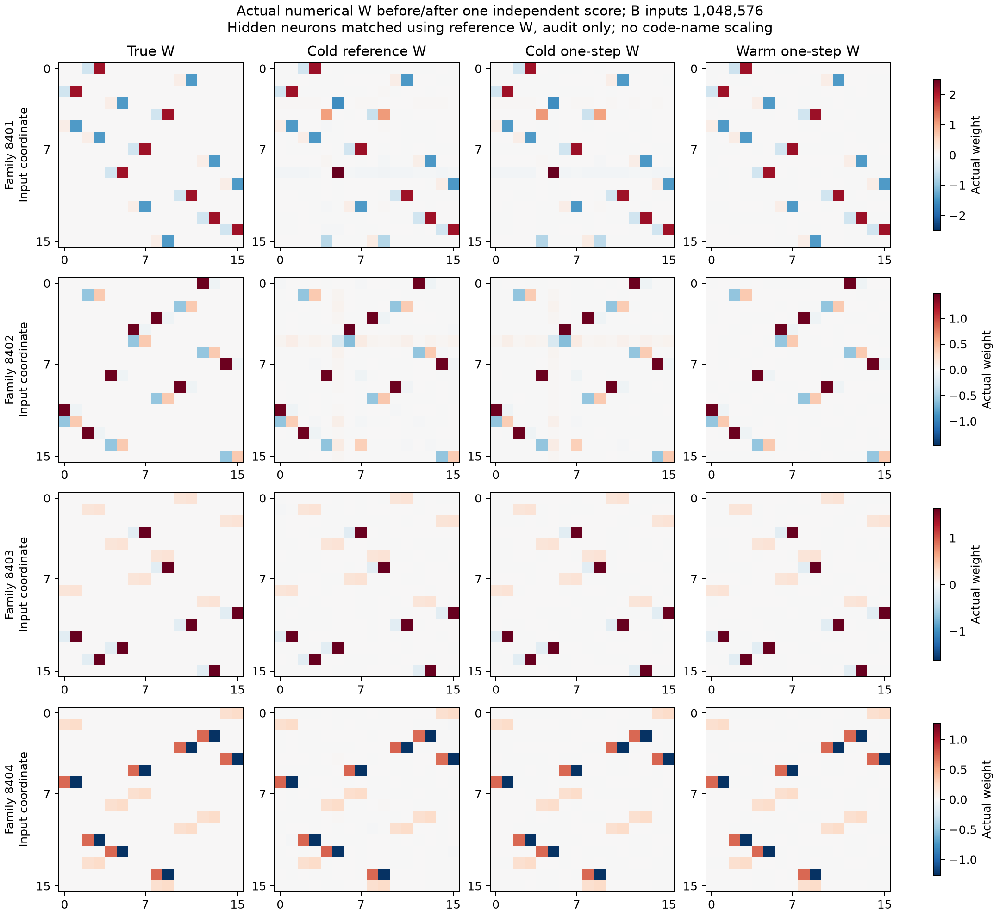

# G16: независимый one-step и его нелинейное смещение

После независимого шага все12 warm reference-состояний дают точный I через простой scalar-DP уже на первом B-бюджете; полный Student-граф даёт6/12, затем12/12. Два из четырёх cold reference остаются ошибочными при любом бюджете. Это известный one-step контроль, не новая конкурентная победа.

## Данные и границы сравнения

THEORY.md§23 до запуска.4 ранее открытые нелинейные DeepSets геометрии8401..8404,16inputs/16ReLU, общий positive bias+offset,258 чисел,4 signed-кода+фиксированный0. На геометрию frozen G9 cold и3 moment-warm reference. Эти12 warm не являются12 независимыми структурами: всего4. Reference не меняется между n. Все16 новых моделей/48 budget-состояний заморожены до teacher-аудита.

Новые независимые B:262144/1048576/4194304 Gaussian входов, по2 noisy labels sigma.2 на каждый. **B-label budget=2n**, плюс прежний reference-fit262144 и стоимость выбранного moment-предобучения (warm8.39m/67.1m/536.9m пар). Это не равный по общему бюджету benchmark против прежнего G9 или конкурентов. Все reference одной геометрии видят одинаковые nested B. Дополнительная observed validation16384 независима. Нет выбора по teacher, новых target-C или переноса.

Дисперсия оценена разностью репликат, независимо от их среднего. Условно на reference/x Student-интервалы точны для дизайн-зависимой **псевдоцели**. Для истинных параметров остаётся nonlinear bias. Номинальныйalpha.05 делится по4 reference×3look иE/E² контрастам отдельно для каждого метода/геометрии; совместная гарантия на весь benchmark не заявляется. Старый G9-gate/abstentions не изменены, новая one-step процедура не требует его stationarity, поскольку оценивает другой conditional target.

## Точная структура

В таблице exact/returned/total; отсутствие выдачи считается неуспехом. Все192 readout-оценки учтены. Native DARTS здесь не обучается; DP/zero+DP/graph/interval объявлены явно.

|Reference|Метод|B262144 (524288 labels)|B1048576 (2097152 labels)|B4194304 (8388608 labels)|
|---|---|---:|---:|---:|
|cold|Scalar DP|2/4/4|2/4/4|2/4/4|
|cold|Zero-Student + DP|2/4/4|2/4/4|2/4/4|
|cold|Full Student graph|0/0/4|2/2/4|2/2/4|
|cold|Global interval solver|0/0/4|2/2/4|2/2/4|
|warm|Scalar DP|12/12/12|12/12/12|12/12/12|
|warm|Zero-Student + DP|12/12/12|12/12/12|12/12/12|
|warm|Full Student graph|6/6/12|12/12/12|12/12/12|
|warm|Global interval solver|9/9/12|12/12/12|12/12/12|

Для прежних reference W без нового B scalar-DP был точен0/4 cold и6/12 warm. Эти числа описывают starting point; разница после шага включает дополнительную информацию2n новых labels и не приписывается только optimizer-трюку.

## Шум против смещения

После freeze auditor фиксирует hidden-permutation по reference-to-teacher W и точно разлагает ошибку на projected Gaussian noise и nonlinear bias. Все весовые CI покрывают псевдоцель в48/48 budget-состояний, истинные W — в42/48. Наблюдённое покрытие не доказывает неизвестную true-parameter гарантию. Structural scores отдельно учитывают допустимые hidden/code/sign переименования.

У warm median max-bias/SE по256 весам растёт .247→.479→.938 при увеличении B. При4.19m максимум по warm около1.42SE: bias не исчезает, хотя консервативные интервалы во всех этих наблюдённых случаях ещё покрывают true-W. У cold8401/8402 max-bias достигает484/385SE, RMS-bias≈.128/.0383; простое добавление B не исправляет начальную локальную конфигурацию. Остальные два cold точны. Чистая случайная ошибка псевдоцели остаётся нормального масштаба — это отличает bias от плохой оценки noise/covariance.

Ошибочных graph/interval выдач в этой серии не наблюдалось, но finite true-I гарантия отсюда не следует: Student-теорема относится к pseudo-target, который вообще не обязан иметь истинный шэринг. Успех требует достаточно хорошего reference либо нового контроля/устранения remainder. Сам one-step известен, в том числе для MLP: [Meskini et al.2024](https://link.springer.com/article/10.1007/s11063-024-11637-6). Их гладкийsigmoid аргумент не переносится автоматически на ReLU.

## Следующий вопрос

Для плохих cold reference требуется механизм смены ошибочной конфигурации, а не ещё большая оценочная B-выборка при фиксированном Jacobian. Сначала диагностировать, какие нейроны/равенства ошибочны и сохраняется ли residual-функциональная информация; затем теоретически обосновать структурное исправление и сравнить его с сильным native LC/Yeh/LUT-Q/numerical baseline. Для хороших reference дальнейший вопрос — уменьшение/контроль bias при обновлении reference на независимых данных. Ни один из этих следующих методов вG16 не заявлен реализованным.

